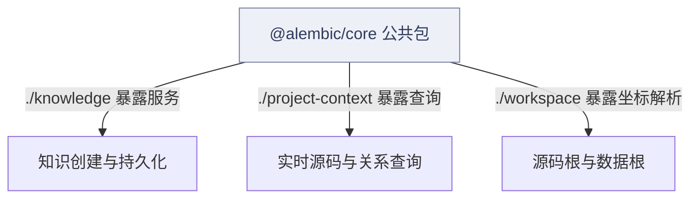
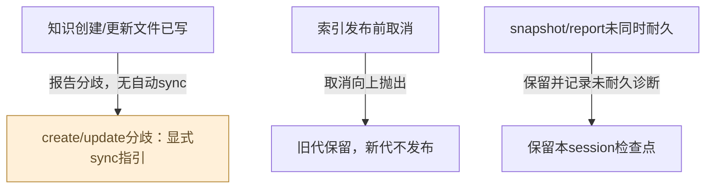
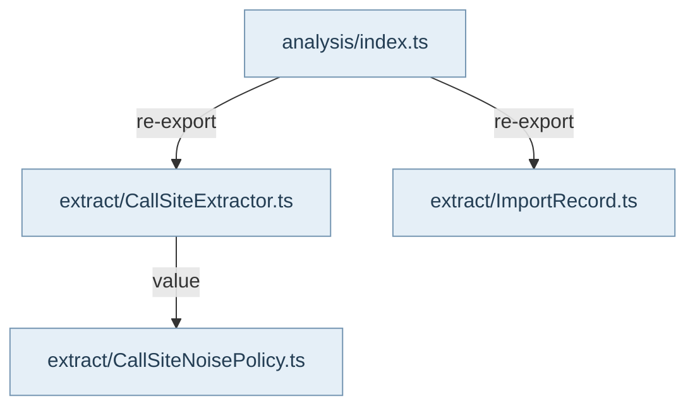

AlembicCore 是可运行的 Headless 内核库。它拥有配置与路径解析、数据库和仓储、源码分析、知识写入与检索、Guard、工作流及严格生产的确定性规则；宿主负责选择项目、装配依赖、执行模型和工具、CLI/MCP/UI 交互及发布运输。理解入口时先查 package.json 的 exports，再查对应门面的实际导出，不能把磁盘上存在的类视为可供外层直接引用的公共 API。

根入口保留常用共享能力和明确收敛的兼容符号，完整业务能力通过子路径进入。公开 ProjectContext 在 ./project-context，认证持久工件在 ./project-context-foundation；后者实际映射到 projectContextFoundation 门面。./core/analysis 是冻结兼容入口，当前把调用点和导入记录类型转发到语法叶子。没有 ./source-graph 或 ./recipe-context 公共键，关系查询由 ProjectContext 门面提供，RecipeContext 的能力门面是 ./recipe-context-capabilities。

图中的边界关系表示公开门面暴露了某个能力，不表示导入包就执行相应流程。运行调用必须回到专题纵切里的确切方法；例如 Main 的 KnowledgeModule 用公开 ./knowledge 的 KnowledgeService，并注入 repository、fileWriter、eventBus 等真实依赖。Core 支持可选端口和历史兼容路径，宿主装配不同会改变副作用，不能把一个构造器或类型声明当作全部能力已启用。

依赖方向由 config/layer-contract.json 约束，公共面的稳定性和收缩预算由 config/public-api-boundary.json 约束。core 目录是分析叶子，不是凌驾所有层的控制器。type-only 桥与运行依赖必须区分；AstAnalyzer、repository 和 workflow 的存在是完整复用能力的一部分，不能为了看起来分层整齐而删成接口。

边界测试对公开存在与退役符号作断言，但这只证明相应 API 可见性，不证明业务执行成功。维护者新增公共能力时还需要真实消费者、输入输出、持久化与兼容说明。下钻时按用户问题选择知识持久化、项目事实、严格生产等专题，再从生成的文件与 API 索引确认定位。

## 视图与术语

本页手工图描述已核对的关系与关键分叉；F1 也承担所列调用范围的业务纵切（V0）阅读，不能推出未画出的宿主自动调度。F0 文件依赖精选由同页选择集和 TypeScript 导入图生成，不是运行时轨迹。S0/R0 只描述正文指定的 owner、状态和恢复前提。公开 API、全部文件及变更影响见阅读器的对应入口。

`source` 为代码来源，`direct` 为直接绑定调用及断言，`indirect` 为经 helper/fixture 或间接行为的断言，`none` 为明确未覆盖。正文中的“宿主”指真实外层装配，不属于 Core 内部运行时。

## 模块协作与恢复边界深化

阅读Core调用链时先标记四种责任：门面决定可见性，宿主决定依赖装配，领域服务执行用例，持久化owner决定何时可以确认耐久。根入口不是一个自动执行的应用启动器；createAlembicRepositories也只绑定已连接句柄，不替宿主连接、迁移或选择数据根。

失败恢复同样分属各owner。知识创建/更新可能留下文件真相，索引取消应保留旧代，工作流结果部分保存应保留检查点，严格输入闭包失败则不能发布局部结果。下面将这些独立路径并排展示，供宿主选择正确入口；图中没有一个隐藏的Core总恢复调度器。输出预算又是另一层：overflow只描述交付合同，既不保存原内容，也不能证明宿主已经履行归档。

## 删除不能套用创建恢复

file-first协调器也服务remove，但恢复入口因操作而不同。创建/更新分歧见F01-file-db-divergence；删除的文件/DB/后置事件分流见[知识删除](../10-knowledge-authoring-persistence/README.md#m-M10-06)。

<!-- atlas:generated:start -->

## 功能单元与调用接缝

各单元按真实入口拆分职责；门面暴露、内部调用和宿主装配是不同关系。关联图提供相邻阅读上下文，故障产生位置以条目源码为准。

<a id="m-M01-01" class="stable-anchor"></a>
<a id="公共门面解析能力入口" class="stable-anchor"></a>

### 公共门面：解析能力入口

入口：`src/index.ts#<module>`

| 检查项 | 功能与边界 |
| --- | --- |
| 输入 | 外层选定的根/子路径import |
| 输出 | 可见的值与类型绑定 |
| 后续调用 / 绑定 | package exports → 对应src门面 → 实际实现 |
| 状态与副作用 | 暴露关系本身不等于执行某条业务；被加载模块是否有初始化效果应逐项查看 |
| 能力边界 | 子路径存在不代表宿主已接线；不把CLI/MCP/provider放入Core。 |

关联：未声明跨项关联 · 包入口 [@alembic/core](../../data/public-api.json)

<a id="m-M01-02" class="stable-anchor"></a>
<a id="createalembicrepositories让core持有表装配" class="stable-anchor"></a>

### createAlembicRepositories：让Core持有表装配

入口：`src/repositories.ts#createAlembicRepositories`

| 检查项 | 功能与边界 |
| --- | --- |
| 输入 | 暴露getDb/getDrizzle的connected handle |
| 输出 | 知识/图/生成/记忆/会话等repository bundle |
| 后续调用 / 绑定 | resolveRepositoryDatabase验证 → 各repository构造器 |
| 状态与副作用 | 仅绑定仓储对象；实际SQL随方法调用发生 |
| 能力边界 | 不连接数据库、不自动迁移、也不替代业务service的file-first写链。 |

关联：未声明跨项关联 · 包入口 [@alembic/core/repositories](../../data/public-api.json)

<a id="m-M01-03" class="stable-anchor"></a>
<a id="实时projectcontextreader与取消的闭包总门" class="stable-anchor"></a>

### 实时ProjectContext：reader与取消的闭包总门

入口：`src/service/project-context/ProjectContextService.ts#ProjectContextService`

| 检查项 | 功能与边界 |
| --- | --- |
| 输入 | 规范请求、默认或注入handlers、reader与可选共享analysis |
| 输出 | 事实envelope；reader锁存缺口/取消继续失败 |
| 后续调用 / 绑定 | createProjectContext；projectContext.execute；sourceReader.assertComplete；analysis.dispose |
| 状态与副作用 | 普通execute创建并释放analysis；共享session由外层finally管理 |
| 能力边界 | 任意注入executor不会自动获得sourceReader能力标记；不能把leaf catch后的部分返回当完整输入 |

关联：[F01-input-closure · record/replay reader发现未捕获的目录/配置/源码观察；leaf可能把读错误捕获](README.md#f-F01-input-closure)

<a id="m-M01-04" class="stable-anchor"></a>
<a id="索引生命周期显式追赶不由query偷写" class="stable-anchor"></a>

### 索引生命周期：显式追赶，不由query偷写

入口：`src/service/source-graph/SourceGraphLifecycle.ts#SourceGraphLifecycleService`

| 检查项 | 功能与边界 |
| --- | --- |
| 输入 | cold-start/startup/file-change的索引输入 |
| 输出 | built-full/built-incremental/fresh-noop及durableTables计数 |
| 后续调用 / 绑定 | SourceGraphService.inspectFreshness；buildFullIndex；buildIncrementalIndex |
| 状态与副作用 | 只有选中build时写代际；不实现文件监听器 |
| 能力边界 | 结果action依据实际snapshot.mode，不按调用名虚报incremental |

关联：未声明跨项关联 · 包入口 [@alembic/core](../../data/public-api.json)

<a id="m-M01-05" class="stable-anchor"></a>
<a id="文件优先知识提交" class="stable-anchor"></a>

### 文件优先知识提交

入口：`src/service/knowledge/commitKnowledgeWrite.ts#commitKnowledgeWrite`

| 检查项 | 功能与边界 |
| --- | --- |
| 输入 | 实体、文件端口、提交回调与操作类型 |
| 输出 | 成功实体/删除ID凭据，或FileWriteError/DivergenceError |
| 后续调用 / 绑定 | 文件端口 → commit回调 → 返回ID核对 |
| 状态与副作用 | 文件操作先完成；文件与SQLite不组成同一事务 |
| 能力边界 | 无fileStore走显式日志的DB-only兼容；remove=false仅表示无匹配文件，不能推断普通读取失败。 |

关联：[知识创建的文件优先提交](../10-knowledge-authoring-persistence/README.md#graph-knowledge-create) · [F01-port-missing · 宿主没有注入fileStore](README.md#f-F01-port-missing) · [F01-file-db-divergence · 创建/更新的文件操作已完成，但DB提交或ID读回失败](README.md#f-F01-file-db-divergence)

返回业务旅程：[一次知识从提交到可查询 · 先持久化文件，再提交 DB 并核对实体 ID](../../journeys/j01.md#J01-03) · [知识删除与部分完成后的恢复 · 文件先移除，再更新referrer与删除目标事务](../../journeys/j05.md#J05-02)

<a id="m-M01-06" class="stable-anchor"></a>
<a id="工作流结果快照报告与检查点清理" class="stable-anchor"></a>

### 工作流结果：快照、报告与检查点清理

入口：`src/workflows/surfaces/persistence/WorkflowResultPersistence.ts#persistWorkflowResult`

| 检查项 | 功能与边界 |
| --- | --- |
| 输入 | workflow结果、文件集、sessionStore、统计和sessionId |
| 输出 | 独立snapshot状态、report、snapshotId与汇总 |
| 后续调用 / 绑定 | saveWorkflowSnapshot；writeWorkflowReport；clearDimensionCheckpoints |
| 状态与副作用 | 先SQLite/fileDiff snapshot，再JSON report/history；两者成功才清理本session恢复点 |
| 能力边界 | 跨存储非事务；失败/跳过结果仍返回给宿主决策重试，不能视日志摘要为耐久成功 |

关联：[F01-result-not-durable · snapshot skipped/failed或writeWorkflowReport返回null](README.md#f-F01-result-not-durable) · 包入口 [@alembic/core/host-agent-workflows](../../data/public-api.json)、[@alembic/core/workflows](../../data/public-api.json)、[@alembic/core/workflows/surfaces](../../data/public-api.json)、[@alembic/core/workflows/surfaces/persistence](../../data/public-api.json)

<a id="m-M01-07" class="stable-anchor"></a>
<a id="输出边界字节预算与恢复引用" class="stable-anchor"></a>

### 输出边界：字节预算与恢复引用

入口：`src/shared/OutputBudget.ts#applyOutputBudget`

| 检查项 | 功能与边界 |
| --- | --- |
| 输入 | 已序列化payload、预算名、可选route/artifactRef |
| 输出 | 内容、truncated、原字节数和overflow |
| 后续调用 / 绑定 | UTF-8计数 → 安全字节截断 → 附加overflow描述 |
| 状态与副作用 | 纯内容投影，不创建artifact、不执行分页 |
| 能力边界 | 未知名称不设预算；宿主应提供真实可访问的恢复引用，不能只返回空artifact-ref承诺完整内容。 |

关联：[F01-output-overflow · payload超过已声明UTF-8字节预算](README.md#f-F01-output-overflow) · 包入口 [@alembic/core](../../data/public-api.json)


## 生成的图与逐边依据

此区域由同页结构化图模型生成；请修改 frontmatter，再显式运行 `npm run inventory:write`，不要单独修改表格或 Mermaid。

<a id="graph-core-package-facades"></a>

### 按职责进入公共门面

图 ID：`core-package-facades` · A0 · 边表示公开暴露关系，不表示执行调用。ProjectContext 的内部 SourceGraph 服务没有被根门面聚合暴露。



| 边 ID | 关系 | 源码定位 | 断言关系 | case / 缺口 | 相关旅程步骤 |
| --- | --- | --- | --- | --- | --- |
| <a id="e-core-package-facades--package-knowledge"></a>package-knowledge | ./knowledge 暴露服务 | `src/knowledge.ts#KnowledgeService` | none | 本边为门面暴露关系；本页不把知识服务行为测试当作门面执行证据，完整写链见专题10。 |  |
| <a id="e-core-package-facades--package-project"></a>package-project | ./project-context 暴露查询 | `src/project-context.ts#ProjectContext` | indirect | routes public project information through ProjectContext instead of root source graph aggregation |  |
| <a id="e-core-package-facades--package-workspace"></a>package-workspace | ./workspace 暴露坐标解析 | `src/workspace.ts#WorkspaceResolver` | none | 此边只表达导出绑定；工作区模式与坐标行为由专题02的实例测试证明。 |  |

<a id="graph-r3-core-recovery-owners"></a>

### 不同持久化owner的失败去向

图 ID：`r3-core-recovery-owners` · R0 · 三个独立组件并排展示；箭头表达各自实现的失败状态，不表示存在一个自动跨模块恢复器。



| 边 ID | 关系 | 源码定位 | 断言关系 | case / 缺口 | 相关旅程步骤 |
| --- | --- | --- | --- | --- | --- |
| <a id="e-r3-core-recovery-owners--r3-owner-knowledge"></a>r3-owner-knowledge | 报告分歧，无自动sync | `src/service/knowledge/commitKnowledgeWrite.ts#commitKnowledgeWrite` | indirect | reports %s as divergence and sync can restore the durable file |  |
| <a id="e-r3-core-recovery-owners--r3-owner-index"></a>r3-owner-index | 取消向上抛出 | `src/service/source-graph/SourceGraphIndexer.ts#SourceGraphIndexer` | direct | does not publish a generation when the build is cancelled before publication |  |
| <a id="e-r3-core-recovery-owners--r3-owner-workflow"></a>r3-owner-workflow | 保留并记录未耐久诊断 | `src/workflows/surfaces/persistence/WorkflowResultPersistence.ts#persistWorkflowResult` | direct | cleans recovery checkpoints only after durable results: %s |  |

<a id="graph-dependencies-01"></a>

### 文件依赖精选 · 静态关系

图 ID：`dependencies-01` · F0 · 显式选择集内的实际导入；类型边不代表运行调用，动态未知保留在全量索引。



| 边 ID | 关系 | 源码定位 | 断言关系 | case / 缺口 | 相关旅程步骤 |
| --- | --- | --- | --- | --- | --- |
| <a id="e-dependencies-01--dep-01-0"></a>dep-01-0 | re-export | `src/core/analysis/index.ts#<module>` | none | TypeScript AST 静态导入事实，不主张运行调用或断言覆盖。 |  |
| <a id="e-dependencies-01--dep-01-1"></a>dep-01-1 | re-export | `src/core/analysis/index.ts#<module>` | none | TypeScript AST 静态导入事实，不主张运行调用或断言覆盖。 |  |
| <a id="e-dependencies-01--dep-01-2"></a>dep-01-2 | value | `src/core/ast/extract/CallSiteExtractor.ts#<module>` | none | TypeScript AST 静态导入事实，不主张运行调用或断言覆盖。 |  |

## 失败后的状态与恢复责任

先检查已落盘状态，再决定恢复。自动动作只描述代码已执行的分支；显式恢复不能据提示文字推断为自动调用。

<a id="f-F01-port-missing" class="stable-anchor"></a>
<a id="f01-port-missing--宿主没有注入filestore" class="stable-anchor"></a>

### F01-port-missing · 宿主没有注入fileStore

| 检查项 | 当前代码语义 |
| --- | --- |
| 已留下什么 | 仅调用DB回调；没有由该协调器保证的Markdown写入 |
| Core自动做什么 | warn并return commit，不追加文件路径和ID读回要求 |
| 谁显式恢复 | 需要文件真相的宿主应装配真实writer后重新确认数据，而不是认定已有文件 |
| 必须停止的条件 | 不能把DB-only创建描述为文件优先完整链 |
| 源码定位 | `src/service/knowledge/commitKnowledgeWrite.ts#commitKnowledgeWrite` |

```ts
if (!fileStore) {
```

关联：[文件优先知识提交](README.md#m-M01-05) · [知识创建的文件优先提交](../10-knowledge-authoring-persistence/README.md#graph-knowledge-create)

返回业务旅程：[一次知识从提交到可查询 · 先持久化文件，再提交 DB 并核对实体 ID](../../journeys/j01.md#J01-03)

断言关系：**none**。这里锚定兼容分支；未把文件writer正例作为缺端口行为覆盖。

<a id="f-F01-file-db-divergence" class="stable-anchor"></a>
<a id="f01-file-db-divergence--创建更新的文件操作已完成但db提交或id读回失败" class="stable-anchor"></a>

### F01-file-db-divergence · 创建/更新的文件操作已完成，但DB提交或ID读回失败

| 检查项 | 当前代码语义 |
| --- | --- |
| 已留下什么 | 文件真相保留；数据库可能未写入或与文件不符；删除操作需另查实际文件效果 |
| Core自动做什么 | 记录明细并抛DivergenceError；无自动sync |
| 谁显式恢复 | 宿主先排除DB故障，再显式KnowledgeSyncService.sync并重读确认 |
| 必须停止的条件 | 异常不证明所有副作用已撤销；不能盲目重复create |
| 源码定位 | `src/service/knowledge/commitKnowledgeWrite.ts#commitKnowledgeWrite` |

#### 恢复检查顺序

前提：确认发生于 create/update 的 file-first persist 路径，保留原 entryId、operation、DivergenceError.details；使用原项目知识根和同一 DB。remove 分支不适用“文件仍保留”的假设。

1. 核对 details.fileOpsCompleted、sqliteBusy、operation 与 entryIds — 区分文件成功后的 DB 分歧，不能将 FileWriteError 或 remove 的 false 分支混入。
2. 检查原 Markdown 是否存在、id/正文/hash，并按同 id 读 DB — 确认文件真相与 DB 缺失/旧版本/读回异常；不只看调用返回错误。
3. 检查是否已经进入 relations/audit 等衍生动作 — 本指南只恢复文件→DB 投影，不会补保证所有后置效果。

显式动作：仅对create/update等persist路径且原文件真相仍在：排除DB故障后显式KnowledgeSyncService.sync/syncAll。若operation为knowledge.delete，按reconcileVia分流到删除清单，不能以sync代替同IDdelete。先dryRun，正式写后仍须读回。

重试身份：复用原 entryId 与原文件，不重新 create 生成新 id，也不因重试更新已保存文件的来源身份。

完成断言：按同 entryId 重读 DB 与 Markdown，核对正文和文件 hash；确认没有同一条目重复行，并记录 sync 的 updated/created/skipped/orphaned/violations。向量和关系另验。

停止条件：文件不在预期根、id 冲突、仍有审计 PersistenceError 或来源无法确认时停止；不能以删除文件/清空 DB 代替恢复。

```ts
throw new DivergenceError(dbFailureMessage, details, { cause: error });
```

关联：[文件优先知识提交](README.md#m-M01-05) · [知识创建的文件优先提交](../10-knowledge-authoring-persistence/README.md#graph-knowledge-create) · [文件与数据库分歧的显式恢复](../10-knowledge-authoring-persistence/README.md#graph-knowledge-recovery) · [校验、创建与同步的不同完成边界](../10-knowledge-authoring-persistence/README.md#graph-r3-authoring-and-sync-effects)

返回业务旅程：[一次知识从提交到可查询 · 先持久化文件，再提交 DB 并核对实体 ID](../../journeys/j01.md#J01-03) · [一次知识从提交到可查询 · 需要修复或手改同步时，显式扫描 Markdown](../../journeys/j01.md#J01-05)

断言关系：**indirect**。`test/KnowledgeServicePersistence.test.ts` · `reports %s as divergence and sync can restore the durable file`

通过case内run(command)调用公开KnowledgeService：DB故障导致分歧；移除故障trigger后显式sync可恢复文件对应的DB状态。（recovery）。这里只定位断言；实际运行范围见独立运行证据。

```ts
details: { entryIds: [id], fileOpsCompleted: 1, reconcileVia: 'KnowledgeSyncService.sync' },
```

<a id="f-F01-index-cancel" class="stable-anchor"></a>
<a id="f01-index-cancel--输入abortsignal在分析外部引擎执行后replacegeneration前取消" class="stable-anchor"></a>

### F01-index-cancel · 输入AbortSignal在分析/外部引擎执行后、replaceGeneration前取消

| 检查项 | 当前代码语义 |
| --- | --- |
| 已留下什么 | 已算出的内存事实丢弃；旧持久代仍在；新generation不存在 |
| Core自动做什么 | throwIfSourceReadAborted直接抛出，不按外部不可用降级 |
| 谁显式恢复 | 宿主在未取消的新执行中显式重试构建；禁止发布已取消批次 |
| 必须停止的条件 | 取消检查后不得继续replaceGeneration |
| 源码定位 | `src/service/source-graph/SourceGraphIndexer.ts#SourceGraphIndexer` |

```ts
throwIfSourceReadAborted(input.options);
    const snapshot = await this.repository.replaceGeneration({
```

关联：未声明跨项关联

断言关系：**direct**。`test/SourceGraphIndexer.test.ts` · `does not publish a generation when the build is cancelled before publication`

发布前取消不产生新代，原代保留。（cancellation）。这里只定位断言；实际运行范围见独立运行证据。

```ts
expect(await repository.getSnapshot('cancelled')).toBeNull()
```

<a id="f-F01-result-not-durable" class="stable-anchor"></a>
<a id="f01-result-not-durable--snapshot-skippedfailed或writeworkflowreport返回null" class="stable-anchor"></a>

### F01-result-not-durable · snapshot skipped/failed或writeWorkflowReport返回null

| 检查项 | 当前代码语义 |
| --- | --- |
| 已留下什么 | 此前成功的一项可能已落盘，checkpoint保留；跨存储不回滚成全无 |
| Core自动做什么 | persistWorkflowResult记录retained checkpoints诊断，返回各项结果 |
| 谁显式恢复 | 宿主补齐database/file list或修复写入错误，再重试结果保存；只有两项成功才清理同session恢复点 |
| 必须停止的条件 | snapshot未saved或report为null时不得清理唯一恢复点 |
| 源码定位 | `src/workflows/surfaces/persistence/WorkflowResultPersistence.ts#persistWorkflowResult` |

```ts
if (snapshot.status === 'saved' && report !== null) {
```

关联：[工作流结果：快照、报告与检查点清理](README.md#m-M01-06) · 包入口 [@alembic/core/host-agent-workflows](../../data/public-api.json)、[@alembic/core/workflows](../../data/public-api.json)、[@alembic/core/workflows/surfaces](../../data/public-api.json)、[@alembic/core/workflows/surfaces/persistence](../../data/public-api.json)

断言关系：**direct**。`test/PublicHostAgentWorkflowEntrypoints.test.ts` · `cleans recovery checkpoints only after durable results: %s`

snapshot failed/skipped或report失败保留本session checkpoint；saved才清理，其他session不动。（recovery）。这里只定位断言；实际运行范围见独立运行证据。

```ts
expect((await loadDimensionCheckpoints(dataRoot)).has('architecture')).toBe(
        outcome !== 'saved'
      )
```

<a id="f-F01-input-closure" class="stable-anchor"></a>
<a id="f01-input-closure--recordreplay-reader发现未捕获的目录配置源码观察leaf可能把读错误捕获" class="stable-anchor"></a>

### F01-input-closure · record/replay reader发现未捕获的目录/配置/源码观察；leaf可能把读错误捕获

| 检查项 | 当前代码语义 |
| --- | --- |
| 已留下什么 | reader锁存未完成状态；可能已计算局部envelope但不准作为完整结果发布 |
| Core自动做什么 | ProjectContextService成功路径assertComplete；批处理正常退出再检查所有已使用reader |
| 谁显式恢复 | 由认证捕获owner重新收集完整输入并重放；不能仅catch后重试同一不完整快照 |
| 必须停止的条件 | 闭包锁存未清除/未重新捕获前拒绝完整性声明 |
| 源码定位 | `src/service/project-context/ProjectContextService.ts#ProjectContextService` |

```ts
sourceReader.assertComplete();
```

关联：[实时ProjectContext：reader与取消的闭包总门](README.md#m-M01-03)

断言关系：**indirect**。`test/ProjectContextFoundation.test.ts` · `replays every certified request from serialized inputs after removing the source tree`

从已序列化输入离线重放；删除directory观察后未捕获输入锁存，不能被repo降级吞掉。（failure）。这里只定位断言；实际运行范围见独立运行证据。

```ts
expect(() => incomplete.assertComplete()).toThrow()
```

<a id="f-F01-output-overflow" class="stable-anchor"></a>
<a id="f01-output-overflow--payload超过已声明utf-8字节预算" class="stable-anchor"></a>

### F01-output-overflow · payload超过已声明UTF-8字节预算

| 检查项 | 当前代码语义 |
| --- | --- |
| 已留下什么 | 本函数仅返回前缀；全量payload仍只存在于调用者所持输入或其另行存储 |
| Core自动做什么 | 返回truncated=true、omittedBytes和route；不写文件 |
| 谁显式恢复 | 调用者先保存完整材料并给出真实artifactRef，或提供可执行分页入口 |
| 必须停止的条件 | 不能把route字符串当作可恢复全量内容的证明 |
| 源码定位 | `src/shared/OutputBudget.ts#applyOutputBudget` |

```ts
route: options.route ?? 'artifact-ref',
```

关联：[输出边界：字节预算与恢复引用](README.md#m-M01-07) · 包入口 [@alembic/core](../../data/public-api.json)

断言关系：**direct**。`test/OutputBudget.test.ts` · `over-budget payloads are truncated with truncated:true and an overflow route`

超预算返回截断标记、实际省略字节和调用者提供的artifactRef；本例不证明引用文件被创建。（positive）。这里只定位断言；实际运行范围见独立运行证据。

```ts
expect(result.truncated).toBe(true);
```


<!-- atlas:generated:end -->
