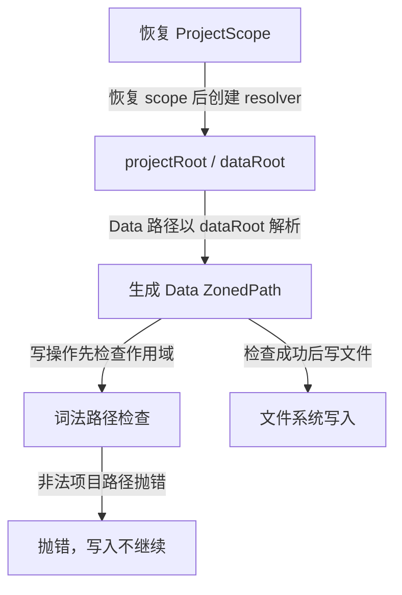
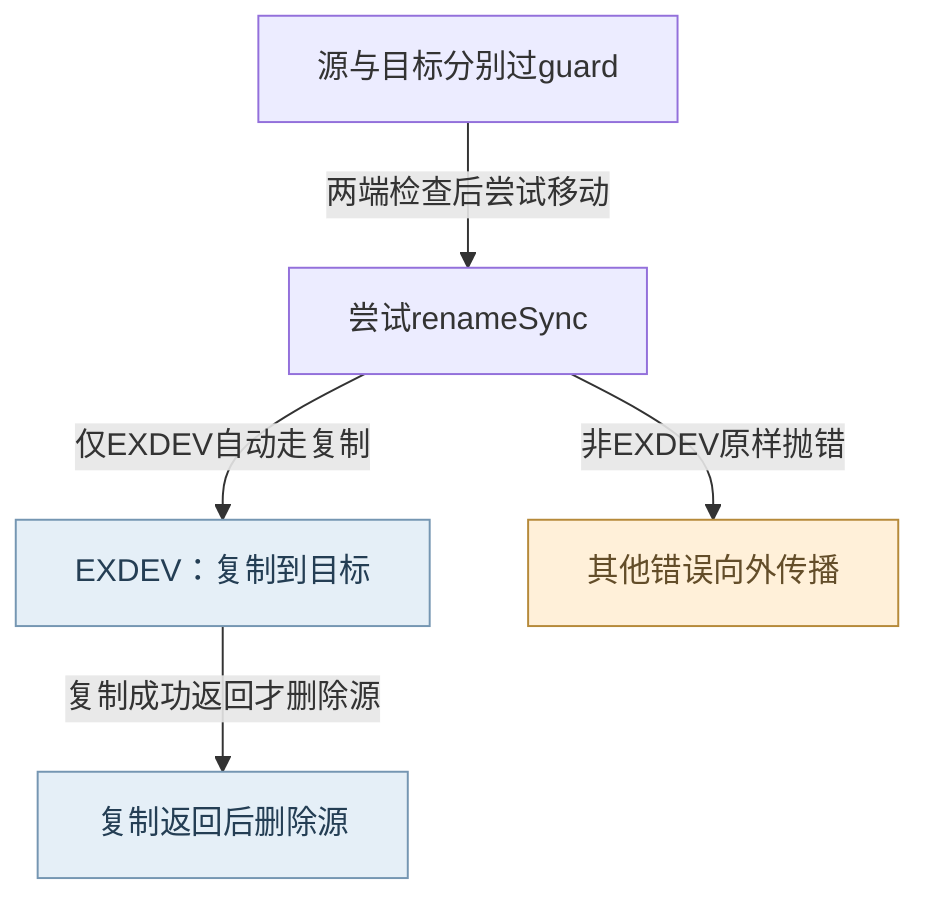
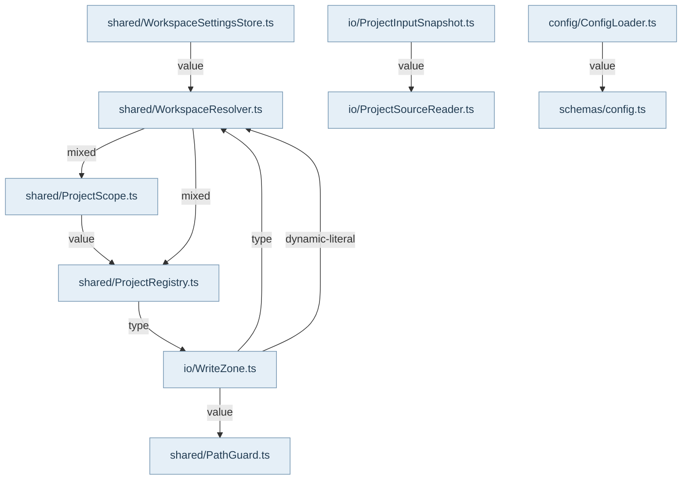

工作区解析先确定源码身份，再决定数据写入位置。projectRoot 始终指向当前源码 folder；普通模式把 dataRoot 设为同一根，Ghost 把运行数据放到登记的外置目录。多根 ProjectScope 额外保留 controlRoot、projectId、projectScopeId 和 folder 身份，当前版本采用 Ghost 存储。控制根不是隐含源码成员，遇到重叠 folder 时按最长前缀选当前成员。

WorkspaceResolver.fromProjectScopeRegistry 是从目录恢复多根语义的入口：读取 registry，获得 ProjectDescriptor，再经 fromProject 创建 resolver；明确 singleRoot 才跳过 scope。ProjectRegistry 负责 realpath 归一化和项目登记，普通 register 不切换既有模式，显式切换与日常恢复是不同动作。runtimeDir、databasePath、knowledgeDir 都从 resolver 的 dataRoot 和 folder names 推导，宿主不能拿源码根替代数据根。

WriteZone 按 Project、Data、Global 产生 ZonedPath，并在真正写入时做运行检查。branded type 防止误用区域，但本身不证明文件系统真实目标安全。Project/Data 交给 PathGuard，Global 使用独立前缀检查；写入前准备父目录，rename 在 EXDEV 时执行复制再删除。拒绝时异常回到调用者，Ghost 白名单未装配会给出明确提示；这里没有全局事务或自动回滚保证。

配置也有不同权威：ConfigLoader 合并包配置并给出非阻塞 schema 诊断，WorkspaceSettingsStore 管理工作区设置和掩码显示，在损坏 JSON 上拒绝覆盖。源码读取则通过 ProjectSourceReader、ProjectInputView/Snapshot 记录或回放输入，严格会话要求完整观察，不能把缺失输入当作空文件。

已确认 R02 必须保留：PathGuard 使用 path.resolve 与词法前缀，未逐段核验 symlink 真实目标。项目内 .asd 指向根外时，写操作可能逃出声明根；ZonedPath 和现有路径正例不能反证这个问题。宿主的 WriteZone 真实注入与普通/Ghost/多根坐标测试已定位，但没有据此新增修复或声称所有写入抗软链接逃逸。

## 视图与术语

本页手工图描述已核对的关系与关键分叉；F1 也承担所列调用范围的业务纵切（V0）阅读，不能推出未画出的宿主自动调度。F0 文件依赖精选由同页选择集和 TypeScript 导入图生成，不是运行时轨迹。S0/R0 只描述正文指定的 owner、状态和恢复前提。公开 API、全部文件及变更影响见阅读器的对应入口。

`source` 为代码来源，`direct` 为直接绑定调用及断言，`indirect` 为经 helper/fixture 或间接行为的断言，`none` 为明确未覆盖。正文中的“宿主”指真实外层装配，不属于 Core 内部运行时。

## 模块协作与恢复边界深化

坐标恢复、配置读取和写入授权是三层独立判断。WorkspaceResolver得到一个dataRoot并不表示PathGuard已经接受该根，ProjectScope读成null也不表示宿主同意改单根。排查Ghost错误时应依次核对登记身份、成员scope、resolver数据根和guard白名单，不能从最后一条文件异常直接更换projectRoot。

配置存在两种相反的容错目标：ConfigLoader的schema问题允许继续使用合并值，而WorkspaceSettingsStore在覆盖前必须读懂原settings/secrets。readJsonFile(read)返回空只用于读取可用性；write模式不会把它解释成“原配置为空”。禁止把这些兼容分叉合并画成统一自动修复。

WriteZone.rename把EXDEV转换为复制后删除，这确实是自动动作，但并不具备跨文件系统事务。它没有旧字节快照，失败后由调用者检查实际状态；R02又使词法通过与真实文件目标包含关系分离。图谱应让读者看见“有自动fallback”和“已证明安全恢复”是不同结论。

<!-- atlas:generated:start -->

## 功能单元与调用接缝

各单元按真实入口拆分职责；门面暴露、内部调用和宿主装配是不同关系。关联图提供相邻阅读上下文，故障产生位置以条目源码为准。

<a id="m-M02-01" class="stable-anchor"></a>
<a id="workspaceresolver读取坐标与存储坐标分离" class="stable-anchor"></a>

### WorkspaceResolver：读取坐标与存储坐标分离

入口：`src/shared/WorkspaceResolver.ts#WorkspaceResolver`

| 检查项 | 功能与边界 |
| --- | --- |
| 输入 | projectRoot、可选ProjectDescriptor、folderNames和Ghost登记 |
| 输出 | immutable坐标属性以及runtime/knowledge/private revision路径 |
| 后续调用 / 绑定 | ProjectRegistry.inspect → resolveProjectScopeForFolder；fromProjectScopeRegistry → loadProjectScopeForFolder → fromProject |
| 状态与副作用 | 构造器读取项目marker/registry以确定身份；本身不建库、不创建知识文件 |
| 能力边界 | ProjectScope分支优先且固定Ghost；singleRoot是显式退出多根语义；Ghost无projectId直接拒绝。 |

关联：[F02-ghost-identity · 要求Ghost但显式参数/登记都没有projectId](README.md#f-F02-ghost-identity) · 包入口 [@alembic/core](../../data/public-api.json)、[@alembic/core/workspace](../../data/public-api.json)、[@alembic/core/shared](../../data/public-api.json)

<a id="m-M02-02" class="stable-anchor"></a>
<a id="projectregistry身份登记与显式模式切换" class="stable-anchor"></a>

### ProjectRegistry：身份登记与显式模式切换

入口：`src/shared/ProjectRegistry.ts#ProjectRegistry`

| 检查项 | 功能与边界 |
| --- | --- |
| 输入 | 项目路径与register/setWorkspaceMode选项 |
| 输出 | 按规范化路径登记的ProjectEntry，稳定短ID与模式 |
| 后续调用 / 绑定 | normalizeProjectPath(realpath，失败时resolve) → loadRegistry → saveRegistry |
| 状态与副作用 | register/setWorkspaceMode写全局登记文件；普通register保留已登记模式 |
| 能力边界 | 重新register不是切换模式；目录不可realpath时的词法回退不能证明真实目标。 |

关联：未声明跨项关联 · 包入口 [@alembic/core](../../data/public-api.json)、[@alembic/core/workspace](../../data/public-api.json)、[@alembic/core/shared](../../data/public-api.json)

<a id="m-M02-03" class="stable-anchor"></a>
<a id="projectscope-registry最长前缀与空登记回退" class="stable-anchor"></a>

### ProjectScope registry：最长前缀与空登记回退

入口：`src/shared/ProjectScope.ts#loadProjectScopeForFolder`

| 检查项 | 功能与边界 |
| --- | --- |
| 输入 | folderPath、可选registryPath |
| 输出 | 当前成员的ProjectDescriptor或null |
| 后续调用 / 绑定 | readProjectScopeRegistryDocument → resolveProjectScopeRegistryFolder → resolveProjectScopeForFolder |
| 状态与副作用 | 只读registry；未通过外形/版本检查或解析异常返回空/null |
| 能力边界 | 空登记是兼容降级，不等于证明项目本来无多根scope；此层没有自动修复文件或补注册。 |

关联：未声明跨项关联 · 包入口 [@alembic/core](../../data/public-api.json)、[@alembic/core/shared](../../data/public-api.json)

<a id="m-M02-04" class="stable-anchor"></a>
<a id="writezone区域路径写前检查和跨盘移动" class="stable-anchor"></a>

### WriteZone：区域路径、写前检查和跨盘移动

入口：`src/infrastructure/io/WriteZone.ts#WriteZone`

| 检查项 | 功能与边界 |
| --- | --- |
| 输入 | Project/Data/Global ZonedPath及写入内容或源/目的路径 |
| 输出 | 写入完成，或原生/PathGuard异常；rename无返回payload |
| 后续调用 / 绑定 | project/data/global解析 → #guardWrite → fs操作；rename EXDEV → ensureParent → cpSync → rmSync |
| 状态与副作用 | 创建父目录、写/追加/复制/删除；EXDEV移动是两个可分离的文件系统效果 |
| 能力边界 | 复制失败不执行后续删除；删除失败可保留源和目的双份；没有跨盘原子回滚。R02词法guard仍未覆盖symlink真实目标。 |

关联：[F02-zone-rejected · Project/Data写路径不在已配置允许范围，或Ghost dataRoot未进白名单](README.md#f-F02-zone-rejected) · [F02-exdev-partial · renameSync返回EXDEV，后续copy或remove任一步失败](README.md#f-F02-exdev-partial) · 包入口 [@alembic/core](../../data/public-api.json)、[@alembic/core/io](../../data/public-api.json)

<a id="m-M02-05" class="stable-anchor"></a>
<a id="configloader默认环境local合并与访问防线" class="stable-anchor"></a>

### ConfigLoader：默认/环境/local合并与访问防线

入口：`src/infrastructure/config/ConfigLoader.ts#ConfigLoader`

| 检查项 | 功能与边界 |
| --- | --- |
| 输入 | env与包内default/env/local JSON |
| 输出 | 进程缓存的合并配置；get/has/set按对象自身字段访问 |
| 后续调用 / 绑定 | _findPackageRoot → JSON.parse → _deepMerge → AppConfigSchema.safeParse |
| 状态与副作用 | 只读取配置；set修改进程内对象；schema失败写警告后仍缓存配置 |
| 能力边界 | JSON语法损坏会抛错；schema失败则非阻塞，二者不要合并。危险原型键在merge/set被拒绝；不会自动迁移旧配置。 |

关联：未声明跨项关联 · 包入口 [@alembic/core](../../data/public-api.json)、[@alembic/core/config](../../data/public-api.json)

<a id="m-M02-06" class="stable-anchor"></a>
<a id="workspacesettingsstore读取容错与覆盖前确认旧字节" class="stable-anchor"></a>

### WorkspaceSettingsStore：读取容错与覆盖前确认旧字节

入口：`src/shared/WorkspaceSettingsStore.ts#WorkspaceSettingsStore`

| 检查项 | 功能与边界 |
| --- | --- |
| 输入 | resolver和白名单AI/env更新（本图不读取真实凭据） |
| 输出 | env投影、settings/secrets路径及存在性 |
| 后续调用 / 绑定 | readAiConfig分别读两个JSON；writeAiConfig先严格读两文件再分流白名单字段和持久化 |
| 状态与副作用 | settings与secrets分开写，更新各自updatedAt；展示使用mask helpers |
| 能力边界 | read模式损坏返回空并记录诊断；write模式拒绝覆盖。两份文件不是一个跨文件事务，先通过读取防线不代表随后写入全原子。 |

关联：未声明跨项关联 · 包入口 [@alembic/core](../../data/public-api.json)、[@alembic/core/shared](../../data/public-api.json)

<a id="m-M02-07" class="stable-anchor"></a>
<a id="projectsourcereader取消与未捕获输入不能变成不存在" class="stable-anchor"></a>

### ProjectSourceReader：取消与未捕获输入不能变成不存在

入口：`src/infrastructure/io/ProjectSourceReader.ts#sourceExists`

| 检查项 | 功能与边界 |
| --- | --- |
| 输入 | 显式reader与absolutePath |
| 输出 | exists布尔或控制错误 |
| 后续调用 / 绑定 | reader.stat → 分类AbortError / PROJECT_SOURCE_INPUT_UNCAPTURED → 重抛；其余探测错误返回false |
| 状态与副作用 | 普通reader执行异步fs；绑定reader保留原identity，记录/回放实例由会话拥有 |
| 能力边界 | sourceExists的false不说明所有权限/I/O细节；严格input missing和取消不能被此helper吞成普通不存在。 |

关联：未声明跨项关联


## 生成的图与逐边依据

此区域由同页结构化图模型生成；请修改 frontmatter，再显式运行 `npm run inventory:write`，不要单独修改表格或 Mermaid。

<a id="graph-workspace-write-coordinate"></a>

### 从工作区坐标到一次受限写入

图 ID：`workspace-write-coordinate` · V0 · 坐标解析与写入检查分离；图只展示 Data 路径，Project/Global 为各自分支。



| 边 ID | 关系 | 源码定位 | 断言关系 | case / 缺口 | 相关旅程步骤 |
| --- | --- | --- | --- | --- | --- |
| <a id="e-workspace-write-coordinate--scope-coordinates"></a>scope-coordinates | 恢复 scope 后创建 resolver | `src/shared/WorkspaceResolver.ts#WorkspaceResolver` | direct | uses the longest prefix when nested project folders overlap |  |
| <a id="e-workspace-write-coordinate--coordinates-zone"></a>coordinates-zone | Data 路径以 dataRoot 解析 | `src/infrastructure/io/WriteZone.ts#WriteZone` | none | 未定位到直接调用 WriteZone.data 并检查路径的用例；WorkspaceResolver 测试只支持坐标规则。 |  |
| <a id="e-workspace-write-coordinate--zone-guard"></a>zone-guard | 写操作先检查作用域 | `src/infrastructure/io/WriteZone.ts#WriteZone` | none | PathGuard 有独立路径断言，但没有据此宣称 WriteZone 集成或 symlink 目标已覆盖。 |  |
| <a id="e-workspace-write-coordinate--zone-disk"></a>zone-disk | 检查成功后写文件 | `src/infrastructure/io/WriteZone.ts#WriteZone` | none | 当前专题未定位 WriteZone.writeFile 的文件回读断言；本边为代码证据。 |  |
| <a id="e-workspace-write-coordinate--guard-rejected"></a>guard-rejected | 非法项目路径抛错 | `src/shared/PathGuard.ts#PathGuard` | none | PathGuard 多项路径拒绝用例存在；本边只声明异常路径，不将其升级为真实文件系统目标安全保证。 |  |

<a id="graph-writezone-cross-device-move"></a>

### 跨设备移动：自动复制与无法证明的回滚

图 ID：`writezone-cross-device-move` · R0 · 两端先过guard；只有EXDEV自动转复制+删除。此链没有跨资源原子性或自动恢复旧目标。



| 边 ID | 关系 | 源码定位 | 断言关系 | case / 缺口 | 相关旅程步骤 |
| --- | --- | --- | --- | --- | --- |
| <a id="e-writezone-cross-device-move--WZ-R1"></a>WZ-R1 | 两端检查后尝试移动 | `src/infrastructure/io/WriteZone.ts#WriteZone` | none | 未定位rename直接case。 |  |
| <a id="e-writezone-cross-device-move--WZ-R2"></a>WZ-R2 | 仅EXDEV自动走复制 | `src/infrastructure/io/WriteZone.ts#WriteZone` | none | 没有跨盘失败注入断言；本边是代码fallback。 |  |
| <a id="e-writezone-cross-device-move--WZ-R3"></a>WZ-R3 | 复制成功返回才删除源 | `src/infrastructure/io/WriteZone.ts#WriteZone` | none | 未声明复制/删除原子性，失败残留需调用者核对。 |  |
| <a id="e-writezone-cross-device-move--WZ-R4"></a>WZ-R4 | 非EXDEV原样抛错 | `src/infrastructure/io/WriteZone.ts#WriteZone` | none | 原生异常传播分支尚无本页直接断言。 |  |

<a id="graph-dependencies-02"></a>

### 文件依赖精选 · 静态关系

图 ID：`dependencies-02` · F0 · 显式选择集内的实际导入；类型边不代表运行调用，动态未知保留在全量索引。



| 边 ID | 关系 | 源码定位 | 断言关系 | case / 缺口 | 相关旅程步骤 |
| --- | --- | --- | --- | --- | --- |
| <a id="e-dependencies-02--dep-02-0"></a>dep-02-0 | value | `src/infrastructure/config/ConfigLoader.ts#<module>` | none | TypeScript AST 静态导入事实，不主张运行调用或断言覆盖。 |  |
| <a id="e-dependencies-02--dep-02-1"></a>dep-02-1 | value | `src/infrastructure/io/ProjectInputSnapshot.ts#<module>` | none | TypeScript AST 静态导入事实，不主张运行调用或断言覆盖。 |  |
| <a id="e-dependencies-02--dep-02-2"></a>dep-02-2 | value | `src/infrastructure/io/WriteZone.ts#<module>` | none | TypeScript AST 静态导入事实，不主张运行调用或断言覆盖。 |  |
| <a id="e-dependencies-02--dep-02-3"></a>dep-02-3 | type | `src/infrastructure/io/WriteZone.ts#<module>` | none | TypeScript AST 静态导入事实，不主张运行调用或断言覆盖。 |  |
| <a id="e-dependencies-02--dep-02-4"></a>dep-02-4 | dynamic-literal | `src/infrastructure/io/WriteZone.ts#<module>` | none | TypeScript AST 静态导入事实，不主张运行调用或断言覆盖。 |  |
| <a id="e-dependencies-02--dep-02-5"></a>dep-02-5 | type | `src/shared/ProjectRegistry.ts#<module>` | none | TypeScript AST 静态导入事实，不主张运行调用或断言覆盖。 |  |
| <a id="e-dependencies-02--dep-02-6"></a>dep-02-6 | value | `src/shared/ProjectScope.ts#<module>` | none | TypeScript AST 静态导入事实，不主张运行调用或断言覆盖。 |  |
| <a id="e-dependencies-02--dep-02-7"></a>dep-02-7 | mixed | `src/shared/WorkspaceResolver.ts#<module>` | none | TypeScript AST 静态导入事实，不主张运行调用或断言覆盖。 |  |
| <a id="e-dependencies-02--dep-02-8"></a>dep-02-8 | mixed | `src/shared/WorkspaceResolver.ts#<module>` | none | TypeScript AST 静态导入事实，不主张运行调用或断言覆盖。 |  |
| <a id="e-dependencies-02--dep-02-9"></a>dep-02-9 | value | `src/shared/WorkspaceSettingsStore.ts#<module>` | none | TypeScript AST 静态导入事实，不主张运行调用或断言覆盖。 |  |

## 失败后的状态与恢复责任

先检查已落盘状态，再决定恢复。自动动作只描述代码已执行的分支；显式恢复不能据提示文字推断为自动调用。

<a id="f-F02-ghost-identity" class="stable-anchor"></a>
<a id="f02-ghost-identity--要求ghost但显式参数登记都没有projectid" class="stable-anchor"></a>

### F02-ghost-identity · 要求Ghost但显式参数/登记都没有projectId

| 检查项 | 当前代码语义 |
| --- | --- |
| 已留下什么 | resolver构造未完成，未据此建立dataRoot |
| Core自动做什么 | 抛Error；无自动注册、无退回标准模式 |
| 谁显式恢复 | 由宿主完成登记或给出合法显式ID，再重新构造 |
| 必须停止的条件 | 缺少身份时不能继续用猜测目录写数据 |
| 源码定位 | `src/shared/WorkspaceResolver.ts#WorkspaceResolver` |

```ts
`[WorkspaceResolver] Ghost 模式需要项目已注册。请先由宿主初始化 Alembic 工作区`
```

关联：[WorkspaceResolver：读取坐标与存储坐标分离](README.md#m-M02-01) · 包入口 [@alembic/core](../../data/public-api.json)、[@alembic/core/workspace](../../data/public-api.json)、[@alembic/core/shared](../../data/public-api.json)

断言关系：**none**。现有WorkspaceResolver正例覆盖Ghost坐标，本批未定位直接断言无ID构造失败的case。

<a id="f-F02-registry-damaged" class="stable-anchor"></a>
<a id="f02-registry-damaged--project-scopesjson缺失json损坏或版本结构不符" class="stable-anchor"></a>

### F02-registry-damaged · project-scopes.json缺失、JSON损坏或版本/结构不符

| 检查项 | 当前代码语义 |
| --- | --- |
| 已留下什么 | 原文件不被修改；调用方得到空登记/无scope |
| Core自动做什么 | readProjectScopeRegistryDocument返回空文档；load入口返回null |
| 谁显式恢复 | 调用方若要求多根，应核验登记并显式修复后重读；Core此函数不会补写 |
| 必须停止的条件 | 不能把降级的null当作已经确认的单根业务决策 |
| 源码定位 | `src/shared/ProjectScope.ts#readProjectScopeRegistryDocument` |

```ts
} catch {
    return createProjectScopeRegistryDocument();
```

关联：未声明跨项关联 · 包入口 [@alembic/core](../../data/public-api.json)、[@alembic/core/shared](../../data/public-api.json)

断言关系：**direct**。`test/ProjectScopeRegistryLoader.test.ts` · `returns an empty registry document for empty, missing, or damaged registry files`

缺失或损坏的登记文件读成空registry，不改原文件（negative）。这里只定位断言；实际运行范围见独立运行证据。

```ts
expect(readProjectScopeRegistryDocument(registryPath)).toEqual(
      createProjectScopeRegistryDocument()
    );
```

<a id="f-F02-zone-rejected" class="stable-anchor"></a>
<a id="f02-zone-rejected--projectdata写路径不在已配置允许范围或ghost-dataroot未进白名单" class="stable-anchor"></a>

### F02-zone-rejected · Project/Data写路径不在已配置允许范围，或Ghost dataRoot未进白名单

| 检查项 | 当前代码语义 |
| --- | --- |
| 已留下什么 | guard之前的文件状态保留；本次fs写入尚未执行 |
| Core自动做什么 | PathGuard抛错；WriteZone对Data分支补充bootstrap提示后继续抛错 |
| 谁显式恢复 | 宿主确认真正数据根并正确初始化guard，然后显式重试；不得直接扩大白名单绕过 |
| 必须停止的条件 | 路径边界未确认前停止写入 |
| 源码定位 | `src/infrastructure/io/WriteZone.ts#WriteZone` |

```ts
`[WriteZone] Zone.Data 写入被 PathGuard 拒绝: ${target.absolute}\n`
```

关联：[WriteZone：区域路径、写前检查和跨盘移动](README.md#m-M02-04) · 包入口 [@alembic/core](../../data/public-api.json)、[@alembic/core/io](../../data/public-api.json)

断言关系：**none**。未定位WriteZone集成拒绝路径的直接case；独立PathGuard测试不能证明Ghost装配已正确。

<a id="f-F02-exdev-partial" class="stable-anchor"></a>
<a id="f02-exdev-partial--renamesync返回exdev后续copy或remove任一步失败" class="stable-anchor"></a>

### F02-exdev-partial · renameSync返回EXDEV，后续copy或remove任一步失败

| 检查项 | 当前代码语义 |
| --- | --- |
| 已留下什么 | copy失败时源保留且目的可能已有部分内容；remove失败时可能出现双份 |
| Core自动做什么 | 只对EXDEV自动复制再删除；其他rename错误原样抛出，复制/删除异常向外传播 |
| 谁显式恢复 | 调用方检查源/目标实际字节后决定清理或重试；不存在Core自动批次回滚 |
| 必须停止的条件 | 无法证明目标完整或源已删除时不得报告原子移动成功 |
| 源码定位 | `src/infrastructure/io/WriteZone.ts#WriteZone` |

```ts
if ((err as NodeJS.ErrnoException).code === 'EXDEV') {
```

关联：[WriteZone：区域路径、写前检查和跨盘移动](README.md#m-M02-04) · 包入口 [@alembic/core](../../data/public-api.json)、[@alembic/core/io](../../data/public-api.json)

断言关系：**none**。本批未找到WriteZone跨设备复制/删除失败注入用例；根据顺序调用说明可保留状态，不声明已验证恢复。

<a id="f-F02-settings-corrupt" class="stable-anchor"></a>
<a id="f02-settings-corrupt--writeaiconfig遇到任一既有settingssecrets损坏或不是json-object" class="stable-anchor"></a>

### F02-settings-corrupt · writeAiConfig遇到任一既有settings/secrets损坏或不是JSON object

| 检查项 | 当前代码语义 |
| --- | --- |
| 已留下什么 | 旧文件保留；未开始两文件写入 |
| Core自动做什么 | readJsonFile(write)诊断并抛错；read模式另有空对象降级 |
| 谁显式恢复 | 调用方恢复/修正原JSON后显式再次调用；不能用空对象覆盖来消除错误 |
| 必须停止的条件 | 既有配置不可读时停止更新 |
| 源码定位 | `src/shared/WorkspaceSettingsStore.ts#readJsonFile` |

```ts
`Cannot update workspace configuration: existing JSON is unreadable at ${filePath}`
```

关联：未声明跨项关联

断言关系：**none**。此批未定位损坏配置写拒绝的直接测试；read/write分支从函数体复核。


<!-- atlas:generated:end -->
