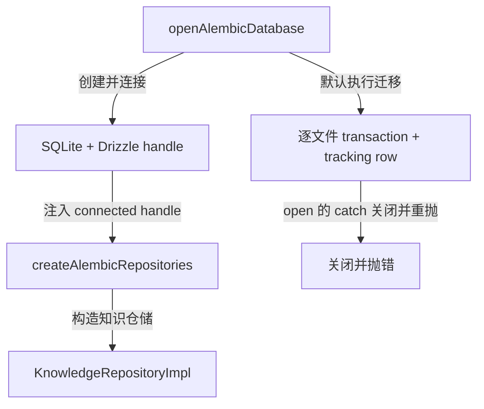
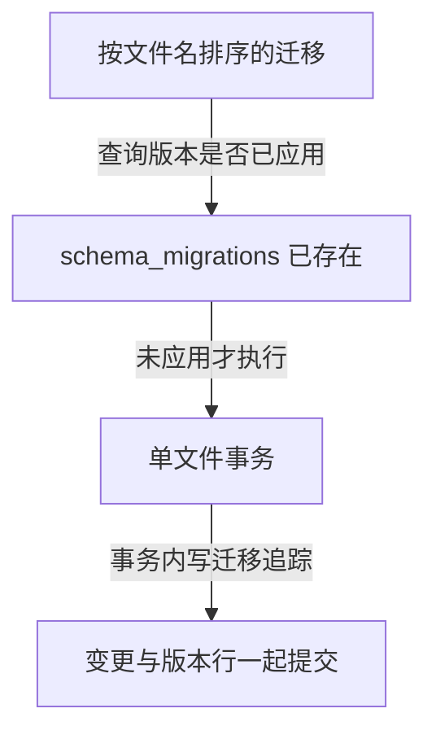
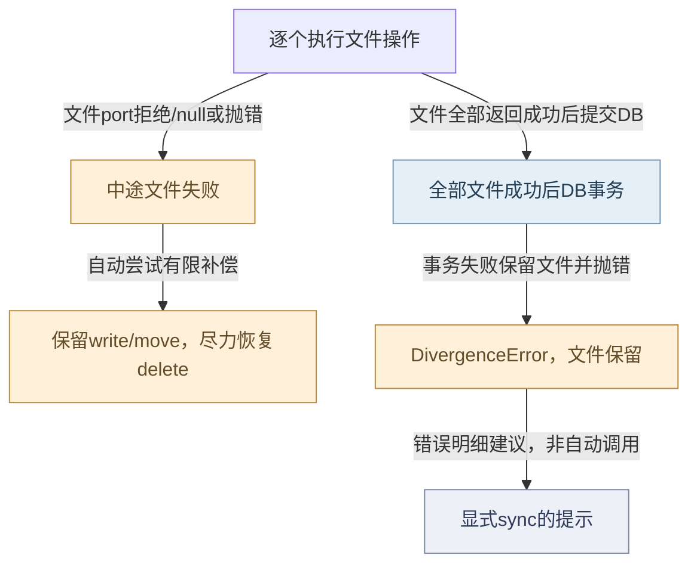
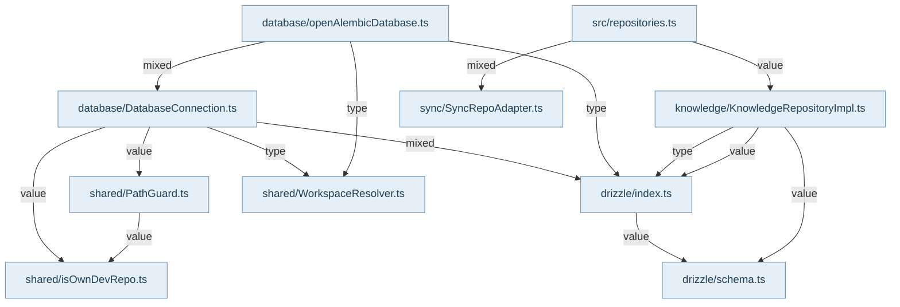

数据库公共入口把原生 SQLite、Drizzle 和生命周期收拢到一个 handle。openAlembicDatabase 创建 DatabaseConnection、await connect，默认跑迁移后返回 connection/sqlite/drizzle/migrated/close；runMigrations=false 是明确绕过迁移的调用选择。连接路径优先采用注入 WorkspaceResolver 的 dataRoot，宿主缺失多根数据根而落到排除项目时拒绝；普通排除项目有带诊断的临时库重定向，不能把所有路径都描述成默认项目数据库。

连接初始化设 WAL、foreign_keys 和 3 秒 busy_timeout。其并发合同是一写多读和有限锁等待，没有应用层重试退避。Drizzle 与 root 登记全部成功才发布对象状态，初始化失败关闭尚未发布的 native handle；已连接实例重复 connect 被拒绝。close 释放缓存、数据库和 root 登记，外层仍负责选择关闭时机。

迁移按现存文件名排序，允许编号空洞，并在 schema_migrations 中按名称登记。每一文件的 SQL/JS 变更与 tracking row 在同一 SQLite transaction，已记录文件跳过；这不是所有迁移的一次整体事务。中途失败会保留之前成功的 migration，修复后重跑依赖各迁移的幂等语义。open 包装层在迁移异常时主动 close 并继续抛错；不自动删库或回退旧 schema。

createAlembicRepositories 消费同一 handle，验证 getDb/getDrizzle 后装配仓储束。知识、关系、代码实体、生成快照、Guard、记忆、会话、SourceGraph、proposal、warning、生命周期、checkpoint、coverage 和 sourceRef 各有自己的 owner。Main 的 InfraModule 缓存这个 bundle 并向业务 service 注入具体仓储，避免外层拿 schema 表重装配 Core。

知识内容在配置 fileStore 的路径以 Markdown 为持久真相，SQLite 条目可以通过 sync 重建；但 proposal、coverage、会话与代际等持久数据有独立责任，因此整库不能称为可随时抛弃的缓存。仓储直接 CRUD 也不等价于 KnowledgeService 的 file-first 提交。检查一致性时应进入对应专题，核对输入、状态变化和恢复入口，而不是仅看 SQL 调用成功。

## 视图与术语

本页手工图描述已核对的关系与关键分叉；F1 也承担所列调用范围的业务纵切（V0）阅读，不能推出未画出的宿主自动调度。F0 文件依赖精选由同页选择集和 TypeScript 导入图生成，不是运行时轨迹。S0/R0 只描述正文指定的 owner、状态和恢复前提。公开 API、全部文件及变更影响见阅读器的对应入口。

`source` 为代码来源，`direct` 为直接绑定调用及断言，`indirect` 为经 helper/fixture 或间接行为的断言，`none` 为明确未覆盖。正文中的“宿主”指真实外层装配，不属于 Core 内部运行时。

## 模块协作与恢复边界深化

理解持久化应区分三种提交边界：DatabaseConnection只发布一个初始化完整的handle；migration以每个文件为事务；KnowledgeUnitOfWork以DB批次为事务，却不能让之前文件效果成为同一事务。把它们画成单一“原子保存”会掩盖可恢复状态。

UoW的失败补偿尤其有限：write可能覆盖旧内容且没有字节快照，所以保留；move不反向移动而是告警；delete才尝试通过fileStore.persist恢复。补偿失败被记录但不替代最初FileWriteError。DB阶段抛DivergenceError时，已经完成的文件同样保留，reconcileVia只是供调用者决定显式sync的指引。

数据库重连也不能用new实例或重复connect去隐藏活动句柄。当前实例在close后可重新连接；私有revision还另外拥有root撤销机制。PreparedStatementCache只是按连接对象复用prepare成本，不持有持久真相，不会让已关闭或被撤销的native对象恢复可用。

<!-- atlas:generated:start -->

## 功能单元与调用接缝

各单元按真实入口拆分职责；门面暴露、内部调用和宿主装配是不同关系。关联图提供相邻阅读上下文，故障产生位置以条目源码为准。

<a id="m-M03-01" class="stable-anchor"></a>
<a id="openalembicdatabase成功对象与失败清理的边界" class="stable-anchor"></a>

### openAlembicDatabase：成功对象与失败清理的边界

入口：`src/infrastructure/database/openAlembicDatabase.ts#openAlembicDatabase`

| 检查项 | 功能与边界 |
| --- | --- |
| 输入 | 数据库path、可选resolver、runMigrations |
| 输出 | 含connection/sqlite/drizzle/migrated/close的runtime |
| 后续调用 / 绑定 | createDatabaseConnection → connect → 默认runMigrations → getDrizzle |
| 状态与副作用 | 打开文件和native handle；迁移失败catch关闭连接 |
| 能力边界 | connect发生在包装层try之前，其局部初始化清理由DatabaseConnection负责；runMigrations=false不证明schema就绪。 |

关联：[F03-migration-open-failure · open包装层默认迁移调用拒绝](README.md#f-F03-migration-open-failure) · 包入口 [@alembic/core/database](../../data/public-api.json)

<a id="m-M03-02" class="stable-anchor"></a>
<a id="databaseconnection路径wal活动句柄登记" class="stable-anchor"></a>

### DatabaseConnection：路径、WAL、活动句柄登记

入口：`src/infrastructure/database/DatabaseConnection.ts#DatabaseConnection`

| 检查项 | 功能与边界 |
| --- | --- |
| 输入 | config.path、可选WorkspaceResolver |
| 输出 | 连接后的SQLite/Drizzle与active-root登记 |
| 后续调用 / 绑定 | guard检查/排除项目分支 → new Database → PRAGMA → initDrizzle → canonicalDatabaseRoot → ACTIVE_DATABASE_CONNECTIONS_BY_ROOT |
| 状态与副作用 | 创建DB目录/文件，登记dataRoot白名单与连接；close移除登记并关闭native handle |
| 能力边界 | 本层配置WAL和3s锁等待；无应用级backoff。重复connect拒绝；显式close后可重连。 |

关联：未声明跨项关联 · 包入口 [@alembic/core](../../data/public-api.json)、[@alembic/core/database](../../data/public-api.json)、[@alembic/core/infrastructure/database](../../data/public-api.json)

<a id="m-M03-03" class="stable-anchor"></a>
<a id="migration-runner逐文件事务和版本行" class="stable-anchor"></a>

### Migration runner：逐文件事务和版本行

入口：`src/infrastructure/database/DatabaseConnection.ts#DatabaseConnection`

| 检查项 | 功能与边界 |
| --- | --- |
| 输入 | 已连接DB、按文件名排序的迁移目录 |
| 输出 | 完成各文件schema变更与schema_migrations记录 |
| 后续调用 / 绑定 | listMigrationFiles → SELECT version → import/读取SQL → db.transaction → INSERT tracking → runMigration |
| 状态与副作用 | 仅未记录版本执行；每一文件独立提交 |
| 能力边界 | 允许历史编号缺口；不是全迁移整体原子提交，失败之前完成的版本不会自动回滚。 |

关联：未声明跨项关联 · 包入口 [@alembic/core](../../data/public-api.json)、[@alembic/core/database](../../data/public-api.json)、[@alembic/core/infrastructure/database](../../data/public-api.json)

<a id="m-M03-04" class="stable-anchor"></a>
<a id="preparedstatementcache每连接lru" class="stable-anchor"></a>

### PreparedStatementCache：每连接LRU

入口：`src/infrastructure/database/PreparedStatementCache.ts#prepareCached`

| 检查项 | 功能与边界 |
| --- | --- |
| 输入 | 连接对象与完整SQL字符串 |
| 输出 | 复用的statement或新prepare的statement |
| 后续调用 / 绑定 | WeakMap连接隔离 → cache命中触新 → db.prepare → 最旧项逐出 |
| 状态与副作用 | 进程内128项/连接缓存，无持久化 |
| 能力边界 | bindings不进入cache key；不同连接不共享statement；prepare失败不会缓存错误结果。 |

关联：未声明跨项关联

<a id="m-M03-05" class="stable-anchor"></a>
<a id="createalembicrepositories让core持有表装配" class="stable-anchor"></a>

### createAlembicRepositories：让Core持有表装配

入口：`src/repositories.ts#createAlembicRepositories`

| 检查项 | 功能与边界 |
| --- | --- |
| 输入 | 暴露getDb/getDrizzle的connected handle |
| 输出 | 知识/图/生成/记忆/会话等repository bundle |
| 后续调用 / 绑定 | resolveRepositoryDatabase验证 → 各repository构造器 |
| 状态与副作用 | 仅绑定仓储对象；实际SQL随方法调用发生 |
| 能力边界 | 不连接数据库、不自动迁移、也不替代业务service的file-first写链。 |

关联：未声明跨项关联 · 包入口 [@alembic/core/repositories](../../data/public-api.json)

<a id="m-M03-06" class="stable-anchor"></a>
<a id="knowledgeunitofwork文件批次和sqlite事务协调" class="stable-anchor"></a>

### KnowledgeUnitOfWork：文件批次和SQLite事务协调

入口：`src/repository/knowledge/KnowledgeUnitOfWork.ts#KnowledgeUnitOfWork`

| 检查项 | 功能与边界 |
| --- | --- |
| 输入 | 显式注册的文件操作与DB变更回调 |
| 输出 | 成功时dbCommitted=true和完成数；失败为FileWriteError/DivergenceError |
| 后续调用 / 绑定 | 逐个#executeFileOp → 失败有限补偿；全部文件成功 → drizzle.transaction逐个change |
| 状态与副作用 | 已完成write/move保留；已删文件尽力persist恢复；commit/rollback清空待办 |
| 能力边界 | rollback只清pending，不撤销已经提交效果；补偿不恢复覆盖写旧字节，sync字符串仅为显式修复指引。 |

关联：[F03-uow-divergence · 文件全部完成后SQLite事务抛错，包括SQLITE_BUSY](README.md#f-F03-uow-divergence) · 包入口 [@alembic/core/repository](../../data/public-api.json)

<a id="m-M03-07" class="stable-anchor"></a>
<a id="rawdbsyncadapter同步写表与审计严格失败" class="stable-anchor"></a>

### RawDbSyncAdapter：同步写表与审计严格失败

入口：`src/repository/sync/SyncRepoAdapter.ts#RawDbSyncAdapter`

| 检查项 | 功能与边界 |
| --- | --- |
| 输入 | raw DB与列名/条目ID |
| 输出 | UPSERT/audit statement、存在性、sourceFile行、deprecate效果 |
| 后续调用 / 绑定 | prepare SQL → 同步run/get/all |
| 状态与副作用 | UPSERT保留初始id/createdBy/createdAt；审计prepare失败抛PersistenceError |
| 能力边界 | 它只负责SQL持久化，不解析Markdown，也不自行启动sync扫描或错误重试。 |

关联：[文件与数据库分歧的显式恢复](../10-knowledge-authoring-persistence/README.md#graph-knowledge-recovery) · [校验、创建与同步的不同完成边界](../10-knowledge-authoring-persistence/README.md#graph-r3-authoring-and-sync-effects) · [F03-audit-prepare · audit_logs缺失等导致审计INSERT prepare失败](README.md#f-F03-audit-prepare) · 包入口 [@alembic/core/repositories](../../data/public-api.json)、[@alembic/core/repository](../../data/public-api.json)、[@alembic/core/repository/sync](../../data/public-api.json)、[@alembic/core/repository/sync/*](../../data/public-api.json)

返回业务旅程：[一次知识从提交到可查询 · 需要修复或手改同步时，显式扫描 Markdown](../../journeys/j01.md#J01-05)


## 生成的图与逐边依据

此区域由同页结构化图模型生成；请修改 frontmatter，再显式运行 `npm run inventory:write`，不要单独修改表格或 Mermaid。

<a id="graph-database-open-and-bind"></a>

### 打开数据库并装配仓储

图 ID：`database-open-and-bind` · F1 · 工厂创建仓储由外层传入同一 handle；迁移失败关闭连接，既有成功迁移保留。



| 边 ID | 关系 | 源码定位 | 断言关系 | case / 缺口 | 相关旅程步骤 |
| --- | --- | --- | --- | --- | --- |
| <a id="e-database-open-and-bind--open-connect"></a>open-connect | 创建并连接 | `src/infrastructure/database/openAlembicDatabase.ts#openAlembicDatabase` | indirect | opens a migrated SQLite and Drizzle runtime from the stable database facade |  |
| <a id="e-database-open-and-bind--open-migrate"></a>open-migrate | 默认执行迁移 | `src/infrastructure/database/openAlembicDatabase.ts#openAlembicDatabase` | indirect | opens a migrated SQLite and Drizzle runtime from the stable database facade |  |
| <a id="e-database-open-and-bind--connection-bundle"></a>connection-bundle | 注入 connected handle | `src/repositories.ts#createAlembicRepositories` | direct | creates core repositories without exposing schema tables or implementation paths |  |
| <a id="e-database-open-and-bind--bundle-knowledge"></a>bundle-knowledge | 构造知识仓储 | `src/repositories.ts#createAlembicRepositories` | direct | creates core repositories without exposing schema tables or implementation paths |  |
| <a id="e-database-open-and-bind--migration-close"></a>migration-close | open 的 catch 关闭并重抛 | `src/infrastructure/database/openAlembicDatabase.ts#openAlembicDatabase` | none | 未在此批定位 open 包装层迁移抛错后的 close spy 断言；迁移重跑测试不能替代这个关闭分支的直接覆盖。 |  |

<a id="graph-migration-replay-state"></a>

### 迁移记录与显式重跑

图 ID：`migration-replay-state` · R0 · 每文件独立提交；已应用跳过，缺 tracking 的文件重新执行。



| 边 ID | 关系 | 源码定位 | 断言关系 | case / 缺口 | 相关旅程步骤 |
| --- | --- | --- | --- | --- | --- |
| <a id="e-migration-replay-state--migration-read-tracking"></a>migration-read-tracking | 查询版本是否已应用 | `src/infrastructure/database/DatabaseConnection.ts#DatabaseConnection` | direct | full re-run is idempotent: no re-application, no errors, data preserved |  |
| <a id="e-migration-replay-state--migration-missing-apply"></a>migration-missing-apply | 未应用才执行 | `src/infrastructure/database/DatabaseConnection.ts#DatabaseConnection` | direct | partial-failure recovery: lost tracking row + missing table heal on re-run |  |
| <a id="e-migration-replay-state--migration-transaction-record"></a>migration-transaction-record | 事务内写迁移追踪 | `src/infrastructure/database/DatabaseConnection.ts#DatabaseConnection` | direct | fresh run applies every migration file and creates the core tables |  |

<a id="graph-knowledge-uow-partial-compensation"></a>

### 批次文件失败的有限补偿与DB分歧

图 ID：`knowledge-uow-partial-compensation` · R0 · 文件批次不是原子回滚；sync仅为错误携带的恢复建议，需调用者显式执行。



| 边 ID | 关系 | 源码定位 | 断言关系 | case / 缺口 | 相关旅程步骤 |
| --- | --- | --- | --- | --- | --- |
| <a id="e-knowledge-uow-partial-compensation--UOW-R1"></a>UOW-R1 | 文件port拒绝/null或抛错 | `src/repository/knowledge/KnowledgeUnitOfWork.ts#KnowledgeUnitOfWork` | none | 特定文件port失败有参数化用例；本边未选完整literal对应的直接case。 |  |
| <a id="e-knowledge-uow-partial-compensation--UOW-R2"></a>UOW-R2 | 自动尝试有限补偿 | `src/repository/knowledge/KnowledgeUnitOfWork.ts#KnowledgeUnitOfWork` | none | 已读补偿实现，但本图不把缺旧快照解释为可验证原子恢复。 |  |
| <a id="e-knowledge-uow-partial-compensation--UOW-R3"></a>UOW-R3 | 文件全部返回成功后提交DB | `src/repository/knowledge/KnowledgeUnitOfWork.ts#KnowledgeUnitOfWork` | direct | DB transaction failure after file success throws DivergenceError, keeps files |  |
| <a id="e-knowledge-uow-partial-compensation--UOW-R4"></a>UOW-R4 | 事务失败保留文件并抛错 | `src/repository/knowledge/KnowledgeUnitOfWork.ts#KnowledgeUnitOfWork` | direct | DB transaction failure after file success throws DivergenceError, keeps files |  |
| <a id="e-knowledge-uow-partial-compensation--UOW-R5"></a>UOW-R5 | 错误明细建议，非自动调用 | `src/repository/knowledge/KnowledgeUnitOfWork.ts#KnowledgeUnitOfWork` | direct | DB transaction failure after file success throws DivergenceError, keeps files |  |

<a id="graph-dependencies-03"></a>

### 文件依赖精选 · 静态关系

图 ID：`dependencies-03` · F0 · 显式选择集内的实际导入；类型边不代表运行调用，动态未知保留在全量索引。



| 边 ID | 关系 | 源码定位 | 断言关系 | case / 缺口 | 相关旅程步骤 |
| --- | --- | --- | --- | --- | --- |
| <a id="e-dependencies-03--dep-03-0"></a>dep-03-0 | value | `src/infrastructure/database/DatabaseConnection.ts#<module>` | none | TypeScript AST 静态导入事实，不主张运行调用或断言覆盖。 |  |
| <a id="e-dependencies-03--dep-03-1"></a>dep-03-1 | value | `src/infrastructure/database/DatabaseConnection.ts#<module>` | none | TypeScript AST 静态导入事实，不主张运行调用或断言覆盖。 |  |
| <a id="e-dependencies-03--dep-03-2"></a>dep-03-2 | type | `src/infrastructure/database/DatabaseConnection.ts#<module>` | none | TypeScript AST 静态导入事实，不主张运行调用或断言覆盖。 |  |
| <a id="e-dependencies-03--dep-03-3"></a>dep-03-3 | mixed | `src/infrastructure/database/DatabaseConnection.ts#<module>` | none | TypeScript AST 静态导入事实，不主张运行调用或断言覆盖。 |  |
| <a id="e-dependencies-03--dep-03-4"></a>dep-03-4 | value | `src/infrastructure/database/drizzle/index.ts#<module>` | none | TypeScript AST 静态导入事实，不主张运行调用或断言覆盖。 |  |
| <a id="e-dependencies-03--dep-03-5"></a>dep-03-5 | type | `src/infrastructure/database/openAlembicDatabase.ts#<module>` | none | TypeScript AST 静态导入事实，不主张运行调用或断言覆盖。 |  |
| <a id="e-dependencies-03--dep-03-6"></a>dep-03-6 | mixed | `src/infrastructure/database/openAlembicDatabase.ts#<module>` | none | TypeScript AST 静态导入事实，不主张运行调用或断言覆盖。 |  |
| <a id="e-dependencies-03--dep-03-7"></a>dep-03-7 | type | `src/infrastructure/database/openAlembicDatabase.ts#<module>` | none | TypeScript AST 静态导入事实，不主张运行调用或断言覆盖。 |  |
| <a id="e-dependencies-03--dep-03-8"></a>dep-03-8 | value | `src/repositories.ts#<module>` | none | TypeScript AST 静态导入事实，不主张运行调用或断言覆盖。 |  |
| <a id="e-dependencies-03--dep-03-9"></a>dep-03-9 | mixed | `src/repositories.ts#<module>` | none | TypeScript AST 静态导入事实，不主张运行调用或断言覆盖。 |  |
| <a id="e-dependencies-03--dep-03-10"></a>dep-03-10 | type | `src/repository/knowledge/KnowledgeRepositoryImpl.ts#<module>` | none | TypeScript AST 静态导入事实，不主张运行调用或断言覆盖。 |  |
| <a id="e-dependencies-03--dep-03-11"></a>dep-03-11 | value | `src/repository/knowledge/KnowledgeRepositoryImpl.ts#<module>` | none | TypeScript AST 静态导入事实，不主张运行调用或断言覆盖。 |  |
| <a id="e-dependencies-03--dep-03-12"></a>dep-03-12 | value | `src/repository/knowledge/KnowledgeRepositoryImpl.ts#<module>` | none | TypeScript AST 静态导入事实，不主张运行调用或断言覆盖。 |  |
| <a id="e-dependencies-03--dep-03-13"></a>dep-03-13 | value | `src/shared/PathGuard.ts#<module>` | none | TypeScript AST 静态导入事实，不主张运行调用或断言覆盖。 |  |

## 失败后的状态与恢复责任

先检查已落盘状态，再决定恢复。自动动作只描述代码已执行的分支；显式恢复不能据提示文字推断为自动调用。

<a id="f-F03-double-connect" class="stable-anchor"></a>
<a id="f03-double-connect--同一databaseconnection已有db或已登记root再次connect" class="stable-anchor"></a>

### F03-double-connect · 同一DatabaseConnection已有db或已登记root再次connect

| 检查项 | 当前代码语义 |
| --- | --- |
| 已留下什么 | 第一个handle仍有效，未用第二个覆盖引用 |
| Core自动做什么 | 记录拒绝并抛ALEMBIC_DATABASE_ALREADY_CONNECTED |
| 谁显式恢复 | 显式close当前实例，再connect以取得新handle |
| 必须停止的条件 | 旧handle生命周期未结束不得开启第二个 |
| 源码定位 | `src/infrastructure/database/DatabaseConnection.ts#DatabaseConnection` |

```ts
throw new Error('ALEMBIC_DATABASE_ALREADY_CONNECTED');
```

关联：未声明跨项关联 · 包入口 [@alembic/core](../../data/public-api.json)、[@alembic/core/database](../../data/public-api.json)、[@alembic/core/infrastructure/database](../../data/public-api.json)

断言关系：**direct**。`test/ProductionPersistenceContracts.test.ts` · `rejects a second active native handle on one public DatabaseConnection`

再次connect被拒绝且旧preparedRead仍可读（negative）。这里只定位断言；实际运行范围见独立运行证据。

```ts
await expect(connection.connect()).rejects.toThrow('ALEMBIC_DATABASE_ALREADY_CONNECTED');
```

<a id="f-F03-connect-init-failure" class="stable-anchor"></a>
<a id="f03-connect-init-failure--native-database已打开但pragmadrizzleroot登记前初始化失败" class="stable-anchor"></a>

### F03-connect-init-failure · native Database已打开，但PRAGMA/Drizzle/root登记前初始化失败

| 检查项 | 当前代码语义 |
| --- | --- |
| 已留下什么 | 未发布this.db/this.drizzle；本地native handle应关闭；已创建的目录/DB文件可保留 |
| Core自动做什么 | catch检查database.open后close并重抛 |
| 谁显式恢复 | 修复实际初始化原因后由调用者重新connect；不会删库重建 |
| 必须停止的条件 | 初始化未完整发布时不得把该对象交给仓储 |
| 源码定位 | `src/infrastructure/database/DatabaseConnection.ts#DatabaseConnection` |

```ts
if (database.open) {
        database.close();
      }
```

关联：未声明跨项关联 · 包入口 [@alembic/core](../../data/public-api.json)、[@alembic/core/database](../../data/public-api.json)、[@alembic/core/infrastructure/database](../../data/public-api.json)

断言关系：**none**。此批未定位PRAGMA/initDrizzle失败注入后的native-close直接断言；明确这里只是代码清理路径。

<a id="f-F03-migration-open-failure" class="stable-anchor"></a>
<a id="f03-migration-open-failure--open包装层默认迁移调用拒绝" class="stable-anchor"></a>

### F03-migration-open-failure · open包装层默认迁移调用拒绝

| 检查项 | 当前代码语义 |
| --- | --- |
| 已留下什么 | 此前已提交migration保留；本次失败文件事务由SQLite处理；runtime未返回 |
| Core自动做什么 | open catch关闭连接并重抛原错误 |
| 谁显式恢复 | 修复迁移/schema问题后显式重新open/runMigrations；按tracking跳过已完成版本 |
| 必须停止的条件 | 不得把连上SQLite等同迁移完成 |
| 源码定位 | `src/infrastructure/database/openAlembicDatabase.ts#openAlembicDatabase` |

```ts
} catch (error) {
    connection.close();
    throw error;
```

关联：[openAlembicDatabase：成功对象与失败清理的边界](README.md#m-M03-01) · 包入口 [@alembic/core/database](../../data/public-api.json)

断言关系：**none**。重跑幂等测试覆盖tracking恢复；未定位包装层迁移拒绝时close spy用例，故不借它冒充直接覆盖。

<a id="f-F03-scope-root-lost" class="stable-anchor"></a>
<a id="f03-scope-root-lost--projectscope成员解析到被排除的源码根而非有效dataroot" class="stable-anchor"></a>

### F03-scope-root-lost · ProjectScope成员解析到被排除的源码根，而非有效dataRoot

| 检查项 | 当前代码语义 |
| --- | --- |
| 已留下什么 | 未打开或重定向到临时dev DB |
| Core自动做什么 | 抛带Space dataRoot lost upstream说明的错误 |
| 谁显式恢复 | 宿主修复resolver/scope数据根传递，再显式connect |
| 必须停止的条件 | 不能静默写临时库让多根任务继续 |
| 源码定位 | `src/infrastructure/database/DatabaseConnection.ts#DatabaseConnection` |

```ts
'Space dataRoot lost upstream.'
```

关联：未声明跨项关联 · 包入口 [@alembic/core](../../data/public-api.json)、[@alembic/core/database](../../data/public-api.json)、[@alembic/core/infrastructure/database](../../data/public-api.json)

断言关系：**direct**。`test/DatabaseConnectionScopeGuard.test.ts` · `throws instead of redirecting a project-scope member write to the dev tmp DB`

错误scope路径被拒绝且源码根下未创建数据库（negative）。这里只定位断言；实际运行范围见独立运行证据。

```ts
expect(existsSync(path.join(memberRoot, '.asd', 'alembic.db'))).toBe(false);
```

<a id="f-F03-uow-divergence" class="stable-anchor"></a>
<a id="f03-uow-divergence--文件全部完成后sqlite事务抛错包括sqlite_busy" class="stable-anchor"></a>

### F03-uow-divergence · 文件全部完成后SQLite事务抛错，包括SQLITE_BUSY

| 检查项 | 当前代码语义 |
| --- | --- |
| 已留下什么 | 文件真相保留；DB事务未提交；pending数组清空 |
| Core自动做什么 | 记录分歧/忙码，抛DivergenceError；没有自动sync或应用重试 |
| 谁显式恢复 | 调用者检查文件真相并显式运行KnowledgeSyncService.sync对齐DB |
| 必须停止的条件 | 异常不得被解释为写成功，也不得删已写真相充当回滚 |
| 源码定位 | `src/repository/knowledge/KnowledgeUnitOfWork.ts#KnowledgeUnitOfWork` |

```ts
'Knowledge files persisted but DB commit failed — run knowledge sync to rebuild DB rows from files'
```

关联：[KnowledgeUnitOfWork：文件批次和SQLite事务协调](README.md#m-M03-06) · 包入口 [@alembic/core/repository](../../data/public-api.json)

断言关系：**direct**。`test/FailureSemanticsCO3.test.ts` · `DB transaction failure after file success throws DivergenceError, keeps files`

事务失败保留文件且明确提示sync，未自动调用sync（negative）。这里只定位断言；实际运行范围见独立运行证据。

```ts
expect(divergence.details.reconcileVia).toBe('KnowledgeSyncService.sync');
```

<a id="f-F03-audit-prepare" class="stable-anchor"></a>
<a id="f03-audit-prepare--audit_logs缺失等导致审计insert-prepare失败" class="stable-anchor"></a>

### F03-audit-prepare · audit_logs缺失等导致审计INSERT prepare失败

| 检查项 | 当前代码语义 |
| --- | --- |
| 已留下什么 | 未返回可忽略的null，调用方收到持久化错误 |
| Core自动做什么 | 包装成PersistenceError，details保留operation/table |
| 谁显式恢复 | 修复数据库schema/句柄后由调用者重试相应sync；adapter不自动跑迁移 |
| 必须停止的条件 | 审计不可写时不能声称同步写入链无损完成 |
| 源码定位 | `src/repository/sync/SyncRepoAdapter.ts#RawDbSyncAdapter` |

```ts
{ operation: 'audit-insert-prepare', table: 'audit_logs' }
```

关联：[RawDbSyncAdapter：同步写表与审计严格失败](README.md#m-M03-07) · 包入口 [@alembic/core/repositories](../../data/public-api.json)、[@alembic/core/repository](../../data/public-api.json)、[@alembic/core/repository/sync](../../data/public-api.json)、[@alembic/core/repository/sync/*](../../data/public-api.json)

断言关系：**direct**。`test/FailureSemanticsCO3.test.ts` · `prepare failure throws PersistenceError instead of returning null`

审计prepare错误被类型化，不静默丢失（negative）。这里只定位断言；实际运行范围见独立运行证据。

```ts
expect((caught as PersistenceError).details.operation).toBe('audit-insert-prepare');
```


<!-- atlas:generated:end -->
