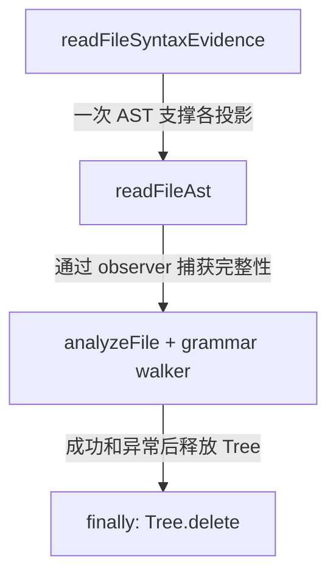
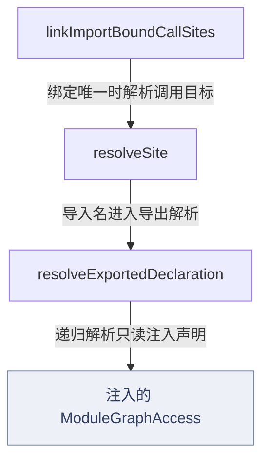
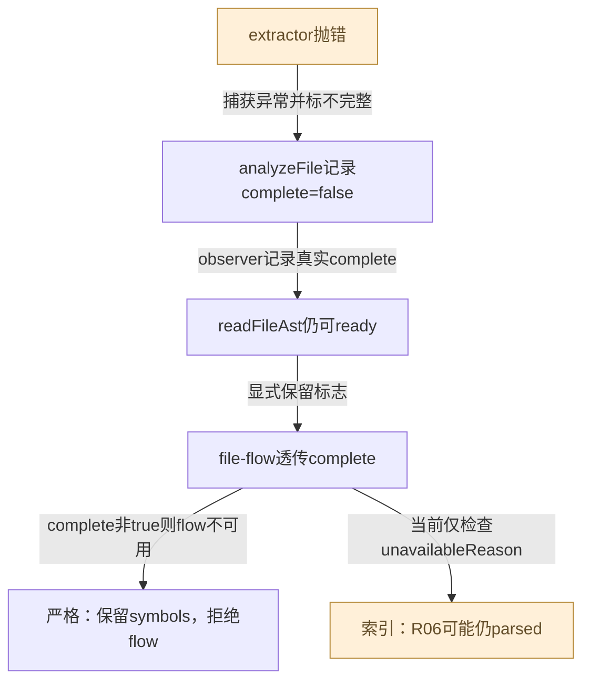
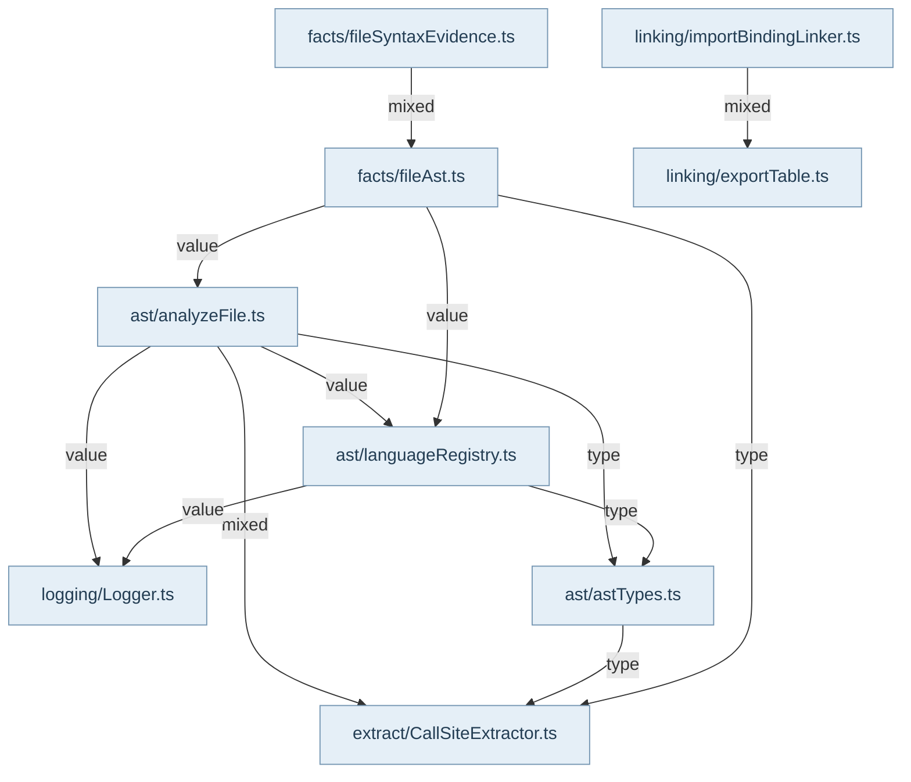

语法层负责把源码文本变成结构化观察，事实层把观察投影成消费者可用的 symbols/flow，链接层用明确规则连接声明。readFileSyntaxEvidence 共用一次 readFileAst，避免 symbols 和 calls 来自不同文本版本；includeCalls 控制调用点提取。FileAstFacts 区分 unsupported、runtime-unavailable、empty、failed 与 ready，ready 只说明返回摘要，不代表每一种语义观察都完整。

analyzeFile 取得语言插件与共享 parser，parse 得到短生命周期 Tree，运行 walker、模块语法、补充声明及可选 call-site pass，再聚合模式和指标，finally 删除 Tree。调用点提取失败允许返回已有摘要，但 complete=false 会交给观察者；没有语言 producer 也不能把空 calls 写成已确认完整。Parser 是每语言共享资源，重新注册会替换并释放旧 parser，已返回 Tree 的拥有者仍负责释放。Tree 与 parser 生命周期不能混为同一缓存。

JS/TS 链接优先词法绑定范围，type-only imports 不是运行时绑定，参数或局部声明遮蔽会使绑定不匹配。linkImportBoundCallSites 通过 ModuleGraphAccess.resolveModule 找目标，再经 resolveExportedDeclaration 跟随显式别名、default 与 star re-export。access 是注入读取端口，链接器自身不读磁盘；深度与 visited 限制终止环，不唯一就保留未解析。按 dist→src 惯例恢复的目标携带 conventional 标记，不能升级为配置已经证明的关系。

已确认 R05 是当前代码和理想规则的差距：localNameFor 找不到本地显式别名时直接返回 exportedName，uniqueTopLevelDeclaration 未要求导出可见性。barrel 内私有同名声明会抢先于合法 export * 被选中，现有正常 barrel 用例不能反证这个缺陷。Atlas 的公共 API 检查应使用 TypeScript checker，而不是把这个产品链接器输出当自证。

不同语言 walker 的支持深度不同，启发式模式不等于编译器类型推理。R06 还说明下游 SourceGraph 对 callSitesComplete=false 的传播有缺口；语法层已保留不完整信息，普通摘要宽容返回不授权索引代际声称完整。查看关系可信度时要继续读 SourceGraph 和严格 ProjectContext 会话。

## 视图与术语

本页手工图描述已核对的关系与关键分叉；F1 也承担所列调用范围的业务纵切（V0）阅读，不能推出未画出的宿主自动调度。F0 文件依赖精选由同页选择集和 TypeScript 导入图生成，不是运行时轨迹。S0/R0 只描述正文指定的 owner、状态和恢复前提。公开 API、全部文件及变更影响见阅读器的对应入口。

`source` 为代码来源，`direct` 为直接绑定调用及断言，`indirect` 为经 helper/fixture 或间接行为的断言，`none` 为明确未覆盖。正文中的“宿主”指真实外层装配，不属于 Core 内部运行时。

## 模块协作与恢复边界深化

新的读取顺序应从“为什么没有关系”反推状态：unsupported表示没有解析语言，runtime-unavailable表示尚无可用运行时，failed表示分析异常，形态预算unavailable表示主动未分析；ready加complete=false则表示声明可用、调用观察不完整。这几种状态需要不同的修复行动，不能共用“没有调用”的标签。

Grammar初始化和增强包初始化不能混淆：前者有loading Promise和reloadRevision合流，部分失败后保持可重试；增强注册器的R10属于另一实现。Parser cache也只发布成功setLanguage的对象，注册替换会释放旧parser；分析tree的finally生命周期则保证单文件资源释放。

完整性在三个消费者处不同：普通file-flow宽容返回legacy摘要，严格backend把不完整flow变成不可用并保留symbols，SourceGraph当前的R06会丢失complete=false这一防线。新图表达已有不一致，不伪画一条所有消费者都拒绝partial的理想链。

<!-- atlas:generated:start -->

## 功能单元与调用接缝

各单元按真实入口拆分职责；门面暴露、内部调用和宿主装配是不同关系。关联图提供相邻阅读上下文，故障产生位置以条目源码为准。

<a id="m-M04-01" class="stable-anchor"></a>
<a id="ast插件初始化in-flight合流与reload代际" class="stable-anchor"></a>

### AST插件初始化：in-flight合流与reload代际

入口：`src/core/ast/index.ts#loadPlugins`

| 检查项 | 功能与边界 |
| --- | --- |
| 输入 | 并发load/reload请求与grammar资源 |
| 输出 | 所有调用等待同一注册Promise；成功语言保留，完整标志可为false |
| 后续调用 / 绑定 | loadCurrentPlugins → initParser/loadLanguageWasm → 动态模块 → registerLanguage |
| 状态与副作用 | 更新语言注册与grammar/parser缓存，记录不可用和reload诊断 |
| 能力边界 | 部分失败不把_loaded设true；后续显式load可以重试；运行中的reloadRevision变化触发下一轮，不代表业务查询自动重试。 |

关联：未声明跨项关联 · 包入口 [@alembic/core](../../data/public-api.json)、[@alembic/core/core](../../data/public-api.json)、[@alembic/core/core/ast](../../data/public-api.json)、[@alembic/core/core/ast/*](../../data/public-api.json)

<a id="m-M04-02" class="stable-anchor"></a>
<a id="parser-cache语法绑定失败不发布缓存" class="stable-anchor"></a>

### Parser cache：语法绑定失败不发布缓存

入口：`src/core/ast/languageRegistry.ts#getLanguageParser`

| 检查项 | 功能与边界 |
| --- | --- |
| 输入 | lang及已注册plugin/getGrammar |
| 输出 | 复用parser、新parser或null |
| 后续调用 / 绑定 | getParserClass → plugin.getGrammar → new Parser → setLanguage → cache |
| 状态与副作用 | 按语言持有parser；失败时delete已构造parser；registerLanguage替换时释放旧parser |
| 能力边界 | 调用者返回Tree仍由调用者释放；null包括无runtime/无plugin/无grammar和绑定异常，不能一律当语法错误。 |

关联：[F04-parser-binding · parser已创建但setLanguage失败](README.md#f-F04-parser-binding) · 包入口 [@alembic/core/core/ast/*](../../data/public-api.json)

<a id="m-M04-03" class="stable-anchor"></a>
<a id="readfileast状态与观察完整性分开" class="stable-anchor"></a>

### readFileAst：状态与观察完整性分开

入口：`src/core/facts/fileAst.ts#readFileAst`

| 检查项 | 功能与边界 |
| --- | --- |
| 输入 | 文本、路径、语言、行数、extractCallSites |
| 输出 | ready/unsupported/runtime-unavailable/empty/failed，外加可选syntax/module/call证据 |
| 后续调用 / 绑定 | resolveAstParserLanguage → isAstAvailable → analyzeFile observers |
| 状态与副作用 | 返回plain观察值，不保留Tree；catch把walker等异常变成failed |
| 能力边界 | ready仅表示摘要可用；calls complete可以false。取消/输入版本由上层会话负责。 |

关联：[file-flow怎样复用安全读取与同版本语法事实](../06-project-context/README.md#graph-pc-handler-facts) · [F04-call-extractor-partial · 可选调用点extractor抛错](README.md#f-F04-call-extractor-partial)

返回业务旅程：[从源码读取到关系证据与认证工件 · live 路径：安全读取与同版本语法事实](../../journeys/j02.md#J02-02)

<a id="m-M04-04" class="stable-anchor"></a>
<a id="file-syntax共用与file-flow形态防线" class="stable-anchor"></a>

### file syntax共用与file-flow形态防线

入口：`src/core/facts/fileSyntaxEvidence.ts#readFileSyntaxEvidence`

| 检查项 | 功能与边界 |
| --- | --- |
| 输入 | 同一文件输入与includeCalls |
| 输出 | symbols、可选flow、default导出名及module exports |
| 后续调用 / 绑定 | readFileAst单次 → extractFileSymbolsFromSource + extractFileFlowFromSource |
| 状态与副作用 | 独立复制range，消费者不共享可变AST tree |
| 能力边界 | 形态预算先决定是否提取调用；超长/压缩内容降级不等于证明没有imports/calls。 |

关联：[file-flow怎样复用安全读取与同版本语法事实](../06-project-context/README.md#graph-pc-handler-facts)

返回业务旅程：[从源码读取到关系证据与认证工件 · live 路径：安全读取与同版本语法事实](../../journeys/j02.md#J02-02)

<a id="m-M04-05" class="stable-anchor"></a>
<a id="file-flow投影保留complete与legacy摘要" class="stable-anchor"></a>

### file-flow投影：保留complete与legacy摘要

入口：`src/core/facts/fileFlow.ts#extractFileFlowFromSource`

| 检查项 | 功能与边界 |
| --- | --- |
| 输入 | FileAstInput与可复用FileAstFacts |
| 输出 | callSites/imports/exports，可选完整调用证据和unavailableReason |
| 后续调用 / 绑定 | getFileFlowUnavailableReason → 必要时readFileAst → collectCallSites → JS模块语法或非JS导入投影 |
| 状态与副作用 | 纯投影；需要时触发AST读取 |
| 能力边界 | 完整evidence仅在complete=true时替代legacy calls；complete=false仍透传，不能下游丢弃。 |

关联：[F04-source-shape-budget · 单行超过20000或平均行长超过400，命中病态源码形态](README.md#f-F04-source-shape-budget) · [F04-call-extractor-partial · 可选调用点extractor抛错](README.md#f-F04-call-extractor-partial)

<a id="m-M04-06" class="stable-anchor"></a>
<a id="词法绑定与模块解析不确定结果保留原因" class="stable-anchor"></a>

### 词法绑定与模块解析：不确定结果保留原因

入口：`src/core/linking/moduleResolver.ts#resolveModuleSpecifier`

| 检查项 | 功能与边界 |
| --- | --- |
| 输入 | 注入ModuleResolutionAccess、importer、specifier、扩展名顺序/conventions |
| 输出 | found(via/conventional)或outside-scope/not-found/external |
| 后续调用 / 绑定 | 相对路径 → 最近tsconfig/jsconfig别名 → 包入口/imports；findCaller/findCallee另按声明范围消歧 |
| 状态与副作用 | 只通过access读取/记忆化/诊断；linker不直接扫描磁盘 |
| 能力边界 | 相对逃逸与外部包分开；conventional回填必须降证据级别；MAX_EXTENDS/工作区展开预算限制不能用猜测补全。 |

关联：[file-flow怎样复用安全读取与同版本语法事实](../06-project-context/README.md#graph-pc-handler-facts) · [session正常返回、失败与finally排空释放](../06-project-context/README.md#graph-pc-session) · [严格reader装配与旧实例取消排空](../05-discovery-and-intelligence/README.md#graph-discoverer-session-reader-and-cancel)

返回业务旅程：[从源码读取到关系证据与认证工件 · live session：链接事实后检查闭包并释放](../../journeys/j02.md#J02-03)

<a id="m-M04-07" class="stable-anchor"></a>
<a id="export-resolver有界转发与当前私有遮蔽缺口" class="stable-anchor"></a>

### export resolver：有界转发与当前私有遮蔽缺口

入口：`src/core/linking/exportTable.ts#resolveExportedDeclaration`

| 检查项 | 功能与边界 |
| --- | --- |
| 输入 | ModuleGraphAccess、文件、导出名 |
| 输出 | 唯一ExportedDeclaration或undefined |
| 后续调用 / 绑定 | 具名转发 → 本地声明 → star转发；深度8与visited保护 |
| 状态与副作用 | 无写入；调用access.declarations/resolveModule |
| 能力边界 | R05仍存在：localNameFor同名回退未验证export，私有声明可能早于star转发命中；AST公共API checker不可复用其错误输出自证。 |

关联：[file-flow怎样复用安全读取与同版本语法事实](../06-project-context/README.md#graph-pc-handler-facts) · [session正常返回、失败与finally排空释放](../06-project-context/README.md#graph-pc-session) · [严格reader装配与旧实例取消排空](../05-discovery-and-intelligence/README.md#graph-discoverer-session-reader-and-cancel) · [F04-ambiguous-export · 导出别名多义、star有多个不同目标、循环或超过深度](README.md#f-F04-ambiguous-export)

返回业务旅程：[从源码读取到关系证据与认证工件 · live session：链接事实后检查闭包并释放](../../journeys/j02.md#J02-03)


## 生成的图与逐边依据

此区域由同页结构化图模型生成；请修改 frontmatter，再显式运行 `npm run inventory:write`，不要单独修改表格或 Mermaid。

<a id="graph-syntax-evidence-and-tree"></a>

### 同次语法观察与 Tree 释放

图 ID：`syntax-evidence-and-tree` · F1 · readFileAst 保留 completeness；analyzeFile 无论成功或 walker 抛错都释放自己的 Tree。



| 边 ID | 关系 | 源码定位 | 断言关系 | case / 缺口 | 相关旅程步骤 |
| --- | --- | --- | --- | --- | --- |
| <a id="e-syntax-evidence-and-tree--evidence-read-ast"></a>evidence-read-ast | 一次 AST 支撑各投影 | `src/core/facts/fileSyntaxEvidence.ts#readFileSyntaxEvidence` | indirect | follows aliased and star re-exports through barrels |  |
| <a id="e-syntax-evidence-and-tree--facts-analyze"></a>facts-analyze | 通过 observer 捕获完整性 | `src/core/facts/fileAst.ts#readFileAst` | indirect | follows aliased and star re-exports through barrels |  |
| <a id="e-syntax-evidence-and-tree--analyze-release"></a>analyze-release | 成功和异常后释放 Tree | `src/core/ast/analyzeFile.ts#analyzeFile` | direct | deletes the analyzeFile Tree exactly once when a language walker throws |  |

<a id="graph-import-binding-resolution"></a>

### 词法导入绑定到导出声明

图 ID：`import-binding-resolution` · F1 · 正常 barrel 链可解析；R05 的私有同名抢占属于已确认限制。



| 边 ID | 关系 | 源码定位 | 断言关系 | case / 缺口 | 相关旅程步骤 |
| --- | --- | --- | --- | --- | --- |
| <a id="e-import-binding-resolution--link-resolve-site"></a>link-resolve-site | 绑定唯一时解析调用目标 | `src/core/linking/importBindingLinker.ts#linkImportBoundCallSites` | indirect | follows aliased and star re-exports through barrels |  |
| <a id="e-import-binding-resolution--site-export"></a>site-export | 导入名进入导出解析 | `src/core/linking/importBindingLinker.ts#resolveSite` | indirect | follows aliased and star re-exports through barrels |  |
| <a id="e-import-binding-resolution--export-access"></a>export-access | 递归解析只读注入声明 | `src/core/linking/exportTable.ts#resolve` | indirect | follows aliased and star re-exports through barrels |  |

<a id="graph-syntax-partial-propagation"></a>

### 调用提取不完整如何流向不同消费者

图 ID：`syntax-partial-propagation` · F1 · 同一complete=false在普通、严格与持久索引路径有不同结果；R06保留为现状。



| 边 ID | 关系 | 源码定位 | 断言关系 | case / 缺口 | 相关旅程步骤 |
| --- | --- | --- | --- | --- | --- |
| <a id="e-syntax-partial-propagation--PART-1"></a>PART-1 | 捕获异常并标不完整 | `src/core/ast/analyzeFile.ts#analyzeFile` | direct | reports an incomplete optional call pass while keeping the real grammar summary available |  |
| <a id="e-syntax-partial-propagation--PART-2"></a>PART-2 | observer记录真实complete | `src/core/facts/fileAst.ts#readFileAst` | direct | reports an incomplete optional call pass while keeping the real grammar summary available |  |
| <a id="e-syntax-partial-propagation--PART-3"></a>PART-3 | 显式保留标志 | `src/core/facts/fileFlow.ts#extractFileFlowFromSource` | indirect | refuses a call list when call-site extraction did not complete, keeping the symbols |  |
| <a id="e-syntax-partial-propagation--PART-4"></a>PART-4 | complete非true则flow不可用 | `src/service/project-context/analysis/strictAnalysisBackend.ts#createStrictAnalysisBackend` | indirect | refuses a call list when call-site extraction did not complete, keeping the symbols |  |
| <a id="e-syntax-partial-propagation--PART-5"></a>PART-5 | 当前仅检查unavailableReason | `src/service/source-graph/SourceGraphFileAnalyzer.ts#analyzeInventoryFile` | none | R06由既有隔离probe复现；尚无直接SourceGraph完整性回归case，不能借strict会话测试说索引已修复。 |  |

<a id="graph-dependencies-04"></a>

### 文件依赖精选 · 静态关系

图 ID：`dependencies-04` · F0 · 显式选择集内的实际导入；类型边不代表运行调用，动态未知保留在全量索引。



| 边 ID | 关系 | 源码定位 | 断言关系 | case / 缺口 | 相关旅程步骤 |
| --- | --- | --- | --- | --- | --- |
| <a id="e-dependencies-04--dep-04-0"></a>dep-04-0 | value | `src/core/ast/analyzeFile.ts#<module>` | none | TypeScript AST 静态导入事实，不主张运行调用或断言覆盖。 |  |
| <a id="e-dependencies-04--dep-04-1"></a>dep-04-1 | type | `src/core/ast/analyzeFile.ts#<module>` | none | TypeScript AST 静态导入事实，不主张运行调用或断言覆盖。 |  |
| <a id="e-dependencies-04--dep-04-2"></a>dep-04-2 | mixed | `src/core/ast/analyzeFile.ts#<module>` | none | TypeScript AST 静态导入事实，不主张运行调用或断言覆盖。 |  |
| <a id="e-dependencies-04--dep-04-3"></a>dep-04-3 | value | `src/core/ast/analyzeFile.ts#<module>` | none | TypeScript AST 静态导入事实，不主张运行调用或断言覆盖。 |  |
| <a id="e-dependencies-04--dep-04-4"></a>dep-04-4 | type | `src/core/ast/astTypes.ts#<module>` | none | TypeScript AST 静态导入事实，不主张运行调用或断言覆盖。 |  |
| <a id="e-dependencies-04--dep-04-5"></a>dep-04-5 | value | `src/core/ast/languageRegistry.ts#<module>` | none | TypeScript AST 静态导入事实，不主张运行调用或断言覆盖。 |  |
| <a id="e-dependencies-04--dep-04-6"></a>dep-04-6 | type | `src/core/ast/languageRegistry.ts#<module>` | none | TypeScript AST 静态导入事实，不主张运行调用或断言覆盖。 |  |
| <a id="e-dependencies-04--dep-04-7"></a>dep-04-7 | value | `src/core/facts/fileAst.ts#<module>` | none | TypeScript AST 静态导入事实，不主张运行调用或断言覆盖。 |  |
| <a id="e-dependencies-04--dep-04-8"></a>dep-04-8 | type | `src/core/facts/fileAst.ts#<module>` | none | TypeScript AST 静态导入事实，不主张运行调用或断言覆盖。 |  |
| <a id="e-dependencies-04--dep-04-9"></a>dep-04-9 | value | `src/core/facts/fileAst.ts#<module>` | none | TypeScript AST 静态导入事实，不主张运行调用或断言覆盖。 |  |
| <a id="e-dependencies-04--dep-04-10"></a>dep-04-10 | mixed | `src/core/facts/fileSyntaxEvidence.ts#<module>` | none | TypeScript AST 静态导入事实，不主张运行调用或断言覆盖。 |  |
| <a id="e-dependencies-04--dep-04-11"></a>dep-04-11 | mixed | `src/core/linking/importBindingLinker.ts#<module>` | none | TypeScript AST 静态导入事实，不主张运行调用或断言覆盖。 |  |

## 失败后的状态与恢复责任

先检查已落盘状态，再决定恢复。自动动作只描述代码已执行的分支；显式恢复不能据提示文字推断为自动调用。

<a id="f-F04-partial-plugin-pass" class="stable-anchor"></a>
<a id="f04-partial-plugin-pass--某个wasm或插件导出不可用其他语言加载成功" class="stable-anchor"></a>

### F04-partial-plugin-pass · 某个WASM或插件导出不可用，其他语言加载成功

| 检查项 | 当前代码语义 |
| --- | --- |
| 已留下什么 | 已有可用/旧注册保留，_loaded=false，loading在finally清空 |
| Core自动做什么 | 本轮跳过缺语言并诊断；并发调用等待同一轮 |
| 谁显式恢复 | 资源修复后显式loadPlugins/reloadProjectAstPlugins重新尝试；此时不是每次analyze自动拉资源 |
| 必须停止的条件 | 不得把部分注册作为全语言ready |
| 源码定位 | `src/core/ast/index.ts#loadCurrentPlugins` |

```ts
_loaded = complete;
```

关联：未声明跨项关联

断言关系：**indirect**。`test/AstPluginLoading.test.ts` · `waits for registration in every caller and retries an incomplete plugin pass`

并发等待注册结束；下一次load重试完整资源集合（recovery）。这里只定位断言；实际运行范围见独立运行证据。

```ts
expect(load).toHaveBeenCalledTimes(ast.CORE_GRAMMAR_RESOURCE_FILES.length * 2);
```

<a id="f-F04-parser-binding" class="stable-anchor"></a>
<a id="f04-parser-binding--parser已创建但setlanguage失败" class="stable-anchor"></a>

### F04-parser-binding · parser已创建但setLanguage失败

| 检查项 | 当前代码语义 |
| --- | --- |
| 已留下什么 | 失败parser已释放且未进缓存；返回null |
| Core自动做什么 | disposeParser并记录阶段/原因 |
| 谁显式恢复 | 重新注册合法grammar后显式再次analyze；失败结果不会锁死cache |
| 必须停止的条件 | 无有效parser不得返回假的空分析成功 |
| 源码定位 | `src/core/ast/languageRegistry.ts#getLanguageParser` |

```ts
disposeParser(parser, lang, 'grammar-binding-failed');
```

关联：[Parser cache：语法绑定失败不发布缓存](README.md#m-M04-02) · 包入口 [@alembic/core/core/ast/*](../../data/public-api.json)

断言关系：**indirect**。`test/AstAnalyzerTreeLifetime.test.ts` · `releases a constructed parser if grammar binding fails and can retry after repair`

绑定失败返回null并释放parser，修复注册后可重试（recovery）。这里只定位断言；实际运行范围见独立运行证据。

```ts
expect(analyzeFile('export class Invalid {}', 'typescript')).toBeNull();
```

<a id="f-F04-source-shape-budget" class="stable-anchor"></a>
<a id="f04-source-shape-budget--单行超过20000或平均行长超过400命中病态源码形态" class="stable-anchor"></a>

### F04-source-shape-budget · 单行超过20000或平均行长超过400，命中病态源码形态

| 检查项 | 当前代码语义 |
| --- | --- |
| 已留下什么 | symbols路径可单独存在；file-flow返回空关系与unavailableReason |
| Core自动做什么 | 调用点分析前短路；不处理被跳过的整文件关系 |
| 谁显式恢复 | 调用方选择手写源而非bundle、调整请求目标；没有自动扩大预算或重跑 |
| 必须停止的条件 | 不能把因预算跳过的空关系当作已完整扫描 |
| 源码定位 | `src/core/facts/fileFlow.ts#getFileFlowUnavailableReason` |

```ts
return `file-flow line-parse skipped for ${input.filePath}: ${shape.reason}.`;
```

关联：[file-flow投影：保留complete与legacy摘要](README.md#m-M04-05) · [file-flow怎样复用安全读取与同版本语法事实](../06-project-context/README.md#graph-pc-handler-facts)

返回业务旅程：[从源码读取到关系证据与认证工件 · live 路径：安全读取与同版本语法事实](../../journeys/j02.md#J02-02)

断言关系：**indirect**。`test/ProjectContextFileFlowGuards.test.ts` · `防线①:单行压缩 JS(jquery.min 形态)整体跳过并给出 unavailableReason,不挂死`

病态JS快速返回并显式标minified/generated（negative）。这里只定位断言；实际运行范围见独立运行证据。

```ts
expect(JSON.stringify(envelope)).toContain('minified/generated');
```

<a id="f-F04-call-extractor-partial" class="stable-anchor"></a>
<a id="f04-call-extractor-partial--可选调用点extractor抛错" class="stable-anchor"></a>

### F04-call-extractor-partial · 可选调用点extractor抛错

| 检查项 | 当前代码语义 |
| --- | --- |
| 已留下什么 | 真实grammar摘要仍可ready；callSiteEvidence可为空且complete=false |
| Core自动做什么 | analyzeFile捕获并警告，readFileAst/file-flow透传完整性；strict backend保留symbols但拒绝flow |
| 谁显式恢复 | 修复extractor/输入后由调用者重跑；没有自动补齐遗漏调用 |
| 必须停止的条件 | R06：SourceGraph当前只看unavailableReason，可能仍把该结果写成parsed；不得称代际完整 |
| 源码定位 | `src/core/ast/analyzeFile.ts#analyzeFile` |

```ts
complete = false;
```

关联：[readFileAst：状态与观察完整性分开](README.md#m-M04-03) · [file-flow投影：保留complete与legacy摘要](README.md#m-M04-05) · [file-flow怎样复用安全读取与同版本语法事实](../06-project-context/README.md#graph-pc-handler-facts) · 包入口 [@alembic/core](../../data/public-api.json)、[@alembic/core/core](../../data/public-api.json)、[@alembic/core/core/ast/*](../../data/public-api.json)、[@alembic/core/test-fixtures](../../data/public-api.json)

返回业务旅程：[从源码读取到关系证据与认证工件 · live 路径：安全读取与同版本语法事实](../../journeys/j02.md#J02-02)

断言关系：**direct**。`test/ProjectContextFileFlowGuards.test.ts` · `reports an incomplete optional call pass while keeping the real grammar summary available`

调用pass抛错仍有ready摘要，callSitesComplete=false（negative）。这里只定位断言；实际运行范围见独立运行证据。

```ts
expect(facts.callSitesComplete).toBe(false);
```

<a id="f-F04-ambiguous-export" class="stable-anchor"></a>
<a id="f04-ambiguous-export--导出别名多义star有多个不同目标循环或超过深度" class="stable-anchor"></a>

### F04-ambiguous-export · 导出别名多义、star有多个不同目标、循环或超过深度

| 检查项 | 当前代码语义 |
| --- | --- |
| 已留下什么 | 没有唯一可证明target；不产出该绑定 |
| Core自动做什么 | 返回undefined并结束有界递归 |
| 谁显式恢复 | 调用者保留unresolved，修复实际导出/配置后显式重查 |
| 必须停止的条件 | 不能按顺序猜target；R05私有同名例外仍是已知缺陷 |
| 源码定位 | `src/core/linking/exportTable.ts#resolve` |

```ts
if (depth > MAX_REEXPORT_DEPTH || visited.has(key)) {
    return undefined;
```

关联：[export resolver：有界转发与当前私有遮蔽缺口](README.md#m-M04-07) · [file-flow怎样复用安全读取与同版本语法事实](../06-project-context/README.md#graph-pc-handler-facts) · [session正常返回、失败与finally排空释放](../06-project-context/README.md#graph-pc-session) · [严格reader装配与旧实例取消排空](../05-discovery-and-intelligence/README.md#graph-discoverer-session-reader-and-cancel)

返回业务旅程：[从源码读取到关系证据与认证工件 · live session：链接事实后检查闭包并释放](../../journeys/j02.md#J02-03)

断言关系：**indirect**。`test/ImportBindingLinker.test.ts` · `refuses to guess between ambiguous declarations`

真实AST helper遇到导出歧义不返回链接（negative）。这里只定位断言；实际运行范围见独立运行证据。

```ts
expect(await fixture.link('src/app.ts')).toEqual([]);
```


<!-- atlas:generated:end -->
