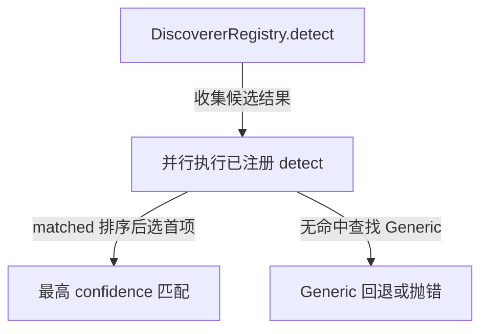
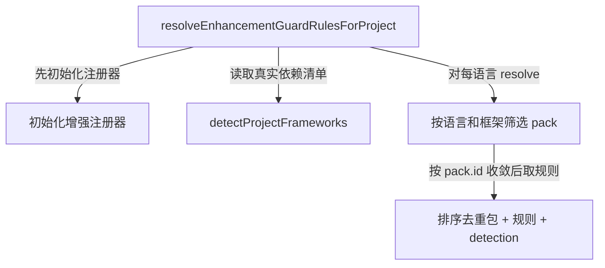
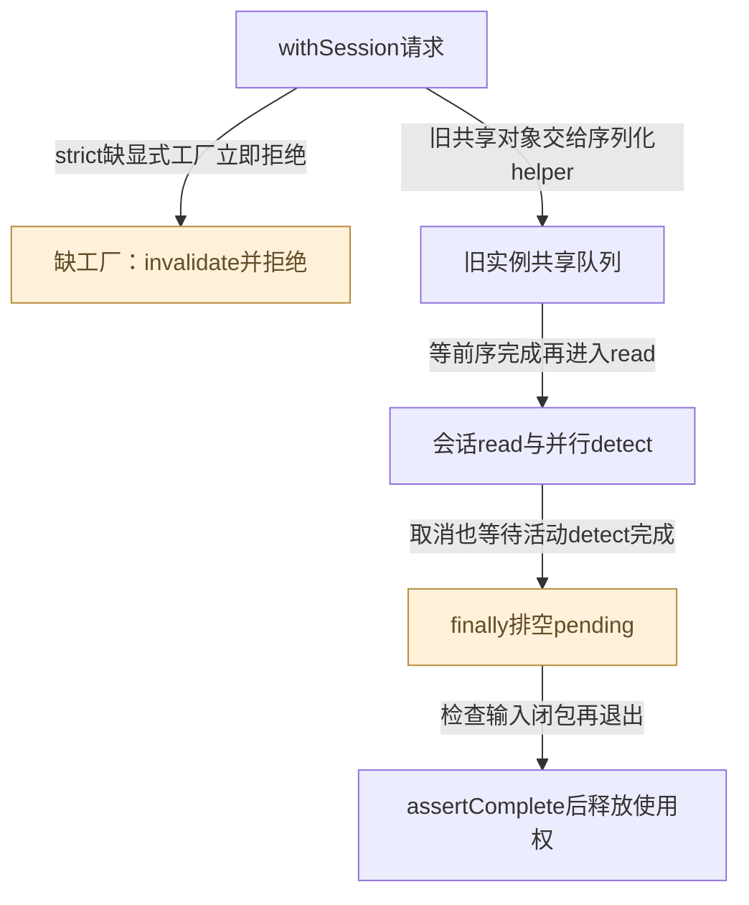
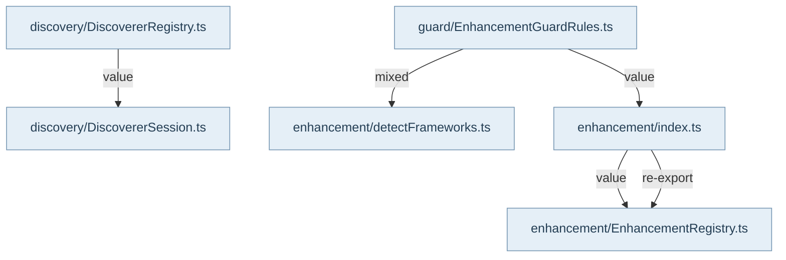

发现器回答项目采用什么构建和包结构、有哪些 target 与源码文件。DiscovererRegistry 注册各语言生态实现，detect 并行收集结果后按 confidence 选最高匹配，全部未命中才用 Generic；detectAll 还会结合显式用户偏好处理混合项目。会话通过工厂重建有 reader 的实例，旧共享实例串行使用，退出前等待未完成检测并 assertComplete，避免取消或输入缺口被后台任务掩盖。

Node、SPM、Go、JVM、Python、Rust、Dart 和自定义配置发现器静态读取清单，不执行构建系统。其输出是后续 repo/map/module 查询的输入，不是编译器或依赖求解器证明。轻量 DSL/YAML parser 与目录惯例有可见限制，例如动态构建表达式不能靠字符串形状补造目标。Generic 的语言和 target 状态会随 load 重置，跨项目复用不应泄漏上一项目判断。

增强包链是另一条能力：detectProjectFrameworks 从真实依赖清单产出排序去重的 languages/frameworks/manifests；registry.resolve 按语言和框架条件筛选 pack；Guard 的 async 项目 helper 按 pack.id 合并并输出规则及判定依据。单清单缺失、不可读、损坏或超限会保守跳过，检测不到意味着没有当前证据支持对应包，不能推断项目没有该框架。增强包提供维度素材、规则与少量预处理，不执行模型，也不自动生成知识。

R10 已确认：initEnhancementRegistry 首次并发调用没有 in-flight promise 合流，两个初始化可能向共享实例重复注册。同步 all/resolve/规则收集可重复；async resolveEnhancementGuardRulesForProject 的 Map 去重保护了该返回链，不能把影响夸大成所有 Guard 入口重复。Main 真实在 ServiceContainer 初始化增强包，但宿主的调用顺序不能消除库级并发缺口。

架构智能从 ProjectContext presenter 与可选共享图快照组合领域、补充信息、风格和复杂度。analyzeArchitectureIntelligence 依次调用 DomainSignalDetector、ProjectInformationSupplementAnalyzer、ArchitectureStyleClassifier 和 ComplexityAnalyzer，输出带 evidence 的信号而非唯一架构结论。测试要求领域有 ProjectContext/shared-graph 来源，并明确不从语言本身推断领域；这些启发式结果适合导航与规划，不能提升成认证事实或代码合规证明。

## 视图与术语

本页手工图描述已核对的关系与关键分叉；F1 也承担所列调用范围的业务纵切（V0）阅读，不能推出未画出的宿主自动调度。F0 文件依赖精选由同页选择集和 TypeScript 导入图生成，不是运行时轨迹。S0/R0 只描述正文指定的 owner、状态和恢复前提。公开 API、全部文件及变更影响见阅读器的对应入口。

`source` 为代码来源，`direct` 为直接绑定调用及断言，`indirect` 为经 helper/fixture 或间接行为的断言，`none` 为明确未覆盖。正文中的“宿主”指真实外层装配，不属于 Core 内部运行时。

## 模块协作与恢复边界深化

发现器不是一组任意可并发调用的单例。内置工厂实例能绑定本次reader并相互独立；旧第三方注册对象可能在load时写targets和language，所以withDiscovererSession按对象身份串行保护，跨registry也共享同一尾队列。取消排队者不能提前放过后继，取消运行者也必须等忽略signal的旧worker结束，这才守住投影期间的项目身份。

“失败不阻塞所有生态”与“严格会话不允许读未捕获输入”属于不同层。detectWithCancellation对普通候选错误给no-match；strict入口对无reader工厂直接invalidate。Generic的目录fallback、Node的workspace拓扑和framework detector的依赖名匹配各自回答不同问题，不能用一个空结果替代另一层的完整性。

增强包的部分加载也不形成持久恢复队列。Promise.allSettled仅注册fulfilled项，当前一旦非空registry再次init会返回现有集合；R10的并发重复又是独立限制。项目Guard helper的Map去重只影响返回规则，架构智能的领域/风格/复杂度则继续是输入快照上的启发式证据投影。

<!-- atlas:generated:start -->

## 功能单元与调用接缝

各单元按真实入口拆分职责；门面暴露、内部调用和宿主装配是不同关系。关联图提供相邻阅读上下文，故障产生位置以条目源码为准。

<a id="m-M05-01" class="stable-anchor"></a>
<a id="discovererregistrywithsessionreader绑定与结束时排空" class="stable-anchor"></a>

### DiscovererRegistry.withSession：reader绑定与结束时排空

入口：`src/core/discovery/DiscovererRegistry.ts#DiscovererRegistry`

| 检查项 | 功能与边界 |
| --- | --- |
| 输入 | 读回调与可选sourceReader/signal；已注册实例及显式工厂 |
| 输出 | 会话投影值；拒绝不能绑定本次严格reader的注册 |
| 后续调用 / 绑定 | resolveContext → strict工厂校验 → withDiscovererSession → 创建实例 → read(session) → pendingDetections排空 → reader.assertComplete |
| 状态与副作用 | 只持临时session；严格违规invalidate reader |
| 能力边界 | supportsSourceReader标志不等于对象绑定了本次reader；旧实例未提供工厂时严格模式必须拒绝。 |

关联：[file-flow怎样复用安全读取与同版本语法事实](../06-project-context/README.md#graph-pc-handler-facts) · [session正常返回、失败与finally排空释放](../06-project-context/README.md#graph-pc-session) · [严格reader装配与旧实例取消排空](README.md#graph-discoverer-session-reader-and-cancel) · [F05-strict-unbound-reader · 非live reader会话遇到旧注册实例但未提供session工厂，或工厂产物不支持reader](README.md#f-F05-strict-unbound-reader) · [F05-cancelled-legacy · 并行detect中一个响应取消，另一个旧扩展忽略signal仍执行](README.md#f-F05-cancelled-legacy) · 包入口 [@alembic/core](../../data/public-api.json)、[@alembic/core/core](../../data/public-api.json)、[@alembic/core/core/discovery](../../data/public-api.json)

返回业务旅程：[从源码读取到关系证据与认证工件 · live session：链接事实后检查闭包并释放](../../journeys/j02.md#J02-03)

<a id="m-M05-02" class="stable-anchor"></a>
<a id="discoverersession旧共享实例的跨registry使用权" class="stable-anchor"></a>

### DiscovererSession：旧共享实例的跨registry使用权

入口：`src/core/discovery/DiscovererSession.ts#withDiscovererSession`

| 检查项 | 功能与边界 |
| --- | --- |
| 输入 | 旧discoverer实例集合、read回调、取消signal |
| 输出 | 串行完成的回调结果或取消异常 |
| 后续调用 / 绑定 | 同步预约全部对象的tail → waitForSessionTurn → read → finally release |
| 状态与副作用 | WeakMap记录每实例队尾；完成后条件移除 |
| 能力边界 | 不按构造器猜测如何clone旧实例；排队取消仍保留previous依赖，后继请求不能越过仍在执行的前序。 |

关联：未声明跨项关联

<a id="m-M05-03" class="stable-anchor"></a>
<a id="genericdiscoverer目录样本与无依赖图保证" class="stable-anchor"></a>

### GenericDiscoverer：目录样本与无依赖图保证

入口：`src/core/discovery/GenericDiscoverer.ts#GenericDiscoverer`

| 检查项 | 功能与边界 |
| --- | --- |
| 输入 | 项目根及reader/取消上下文 |
| 输出 | 目录target、源码列表、language；图只含target节点 |
| 后续调用 / 绑定 | load清空旧状态 → 有限深度语言采样 →约定目录target → 无命中则整根target |
| 状态与副作用 | 读取目录/stat，无构建执行 |
| 能力边界 | generic始终match且低confidence；空edges表示没有依赖推断能力，不能称项目无依赖。 |

关联：未声明跨项关联 · 包入口 [@alembic/core](../../data/public-api.json)、[@alembic/core/core](../../data/public-api.json)、[@alembic/core/core/discovery](../../data/public-api.json)

<a id="m-M05-04" class="stable-anchor"></a>
<a id="nodediscoverer清单workspace静态拓扑" class="stable-anchor"></a>

### NodeDiscoverer：清单/workspace静态拓扑

入口：`src/core/discovery/NodeDiscoverer.ts#NodeDiscoverer`

| 检查项 | 功能与边界 |
| --- | --- |
| 输入 | package.json/tsconfig标记、npm/pnpm/lerna工作区清单 |
| 输出 | 单包或workspace targets及按包名建立的依赖 |
| 后续调用 / 绑定 | JSON读取 → resolveWorkspaces →逐成员读取package → buildWorkspaceDeps |
| 状态与副作用 | 读取清单和目录，无安装/执行package manager |
| 能力边界 | workspace模式是有限静态展开，不执行任意配置函数，也不是完整依赖求解器；坏成员清单不证明成员不存在。 |

关联：未声明跨项关联 · 包入口 [@alembic/core](../../data/public-api.json)、[@alembic/core/core](../../data/public-api.json)、[@alembic/core/core/discovery](../../data/public-api.json)

<a id="m-M05-05" class="stable-anchor"></a>
<a id="detectprojectframeworks分生态容错生产检测依据" class="stable-anchor"></a>

### detectProjectFrameworks：分生态容错生产检测依据

入口：`src/core/enhancement/detectFrameworks.ts#detectProjectFrameworks`

| 检查项 | 功能与边界 |
| --- | --- |
| 输入 | 项目根的有限大小依赖清单 |
| 输出 | 排序去重languages/frameworks/manifests |
| 后续调用 / 绑定 | Node → Python → Go → Rust → JVM → Apple；每生态按依赖名映射 |
| 状态与副作用 | 只读文件；形状错误可记录诊断，单生态失败不妨碍后续 |
| 能力边界 | 空集合是未得到匹配证据；不是已确认不存在框架。源码旧注释不覆盖当前Swift语言检测与无framework条件包。 |

关联：未声明跨项关联 · 包入口 [@alembic/core/enhancement](../../data/public-api.json)

<a id="m-M05-06" class="stable-anchor"></a>
<a id="增强包注册与项目精确规则两级去重不同" class="stable-anchor"></a>

### 增强包注册与项目精确规则：两级去重不同

入口：`src/core/enhancement/index.ts#initEnhancementRegistry`

| 检查项 | 功能与边界 |
| --- | --- |
| 输入 | 首次异步初始化，随后按language/framework resolve |
| 输出 | registry包含成功加载pack；helper输出packIds/rules/detection |
| 后续调用 / 绑定 | 动态import各pack → fulfilled才register；项目helper→Map(pack.id)→排序规则 |
| 状态与副作用 | 进程内可变registry；无持久化 |
| 能力边界 | R10：注册首次并发没有合流，可能重复pack；项目async helper自己去重只保护那条返回路径。 |

关联：[F05-enhancement-duplicate · 两个首次initEnhancementRegistry在await之前都创建共享_instance](README.md#f-F05-enhancement-duplicate) · 包入口 [@alembic/core](../../data/public-api.json)、[@alembic/core/core](../../data/public-api.json)

<a id="m-M05-07" class="stable-anchor"></a>
<a id="architecture-intelligence四种投影而非单一架构判决" class="stable-anchor"></a>

### architecture intelligence：四种投影而非单一架构判决

入口：`src/service/project-context/architectureIntelligence/architectureIntelligence.ts#analyzeArchitectureIntelligence`

| 检查项 | 功能与边界 |
| --- | --- |
| 输入 | ProjectContext presenter +可选共享图/维度覆盖快照 |
| 输出 | domains/styles/complexity/supplements带evidence |
| 后续调用 / 绑定 | DomainSignalDetector.detect → SupplementAnalyzer.analyze → StyleClassifier.classify → ComplexityAnalyzer.analyze |
| 状态与副作用 | 纯输入投影，不读项目、不写知识 |
| 能力边界 | 语言本身不构成领域证据；阈值/文本/模块边指标为启发式，不能升级成认证或Guard覆盖证明。 |

关联：未声明跨项关联 · 包入口 [@alembic/core/project-context-capabilities](../../data/public-api.json)


## 生成的图与逐边依据

此区域由同页结构化图模型生成；请修改 frontmatter，再显式运行 `npm run inventory:write`，不要单独修改表格或 Mermaid。

<a id="graph-discovery-choice"></a>

### 发现器选择及无匹配回退

图 ID：`discovery-choice` · V0 · 检测返回置信度，Generic 仅在无匹配且已注册时使用。



| 边 ID | 关系 | 源码定位 | 断言关系 | case / 缺口 | 相关旅程步骤 |
| --- | --- | --- | --- | --- | --- |
| <a id="e-discovery-choice--registry-detect-all"></a>registry-detect-all | 收集候选结果 | `src/core/discovery/DiscovererRegistry.ts#DiscovererRegistry` | indirect | reads standard SPM test sources and projects literal target dependencies |  |
| <a id="e-discovery-choice--registry-select-best"></a>registry-select-best | matched 排序后选首项 | `src/core/discovery/DiscovererRegistry.ts#DiscovererRegistry` | indirect | reads standard SPM test sources and projects literal target dependencies |  |
| <a id="e-discovery-choice--registry-generic-fallback"></a>registry-generic-fallback | 无命中查找 Generic | `src/core/discovery/DiscovererRegistry.ts#DiscovererRegistry` | none | 已定位 Generic load 状态测试，但未定位此 registry 无匹配分支的直接返回断言，不用近似测试替代。 |  |

<a id="graph-framework-to-rules"></a>

### 真实清单到增强包 Guard 规则

图 ID：`framework-to-rules` · F1 · async helper 自行初始化并按 pack.id 去重；不是 registry 并发初始化缺陷已经修复。



| 边 ID | 关系 | 源码定位 | 断言关系 | case / 缺口 | 相关旅程步骤 |
| --- | --- | --- | --- | --- | --- |
| <a id="e-framework-to-rules--guard-init-packs"></a>guard-init-packs | 先初始化注册器 | `src/service/guard/EnhancementGuardRules.ts#resolveEnhancementGuardRulesForProject` | direct | recognizes single-line Go require directives through the project Guard entrypoint |  |
| <a id="e-framework-to-rules--guard-detect-frameworks"></a>guard-detect-frameworks | 读取真实依赖清单 | `src/service/guard/EnhancementGuardRules.ts#resolveEnhancementGuardRulesForProject` | direct | recognizes single-line Go require directives through the project Guard entrypoint |  |
| <a id="e-framework-to-rules--guard-select-packs"></a>guard-select-packs | 对每语言 resolve | `src/service/guard/EnhancementGuardRules.ts#resolveEnhancementGuardRulesForProject` | direct | recognizes single-line Go require directives through the project Guard entrypoint |  |
| <a id="e-framework-to-rules--guard-deduplicate-rules"></a>guard-deduplicate-rules | 按 pack.id 收敛后取规则 | `src/service/guard/EnhancementGuardRules.ts#resolveEnhancementGuardRulesForProject` | direct | recognizes single-line Go require directives through the project Guard entrypoint |  |

<a id="graph-discoverer-session-reader-and-cancel"></a>

### 严格reader装配与旧实例取消排空

图 ID：`discoverer-session-reader-and-cancel` · R0 · strict不允许未绑定reader的旧对象；live兼容对象受共享队列保护，清理完成前不交给后继请求。



| 边 ID | 关系 | 源码定位 | 断言关系 | case / 缺口 | 相关旅程步骤 |
| --- | --- | --- | --- | --- | --- |
| <a id="e-discoverer-session-reader-and-cancel--DISC-R1"></a>DISC-R1 | strict缺显式工厂立即拒绝 | `src/core/discovery/DiscovererRegistry.ts#DiscovererRegistry` | none | 专属严格工厂负例未定位。 |  |
| <a id="e-discoverer-session-reader-and-cancel--DISC-R2"></a>DISC-R2 | 旧共享对象交给序列化helper | `src/core/discovery/DiscovererRegistry.ts#DiscovererRegistry` | direct | waits for every in-flight legacy detector before releasing a cancelled session |  |
| <a id="e-discoverer-session-reader-and-cancel--DISC-R3"></a>DISC-R3 | 等前序完成再进入read | `src/core/discovery/DiscovererSession.ts#withDiscovererSession` | indirect | keeps a shared legacy instance fenced when a queued session is cancelled |  |
| <a id="e-discoverer-session-reader-and-cancel--DISC-R4"></a>DISC-R4 | 取消也等待活动detect完成 | `src/core/discovery/DiscovererRegistry.ts#DiscovererRegistry` | direct | waits for every in-flight legacy detector before releasing a cancelled session |  |
| <a id="e-discoverer-session-reader-and-cancel--DISC-R5"></a>DISC-R5 | 检查输入闭包再退出 | `src/core/discovery/DiscovererRegistry.ts#DiscovererRegistry` | direct | waits for every in-flight legacy detector before releasing a cancelled session | [J02 · live session：链接事实后检查闭包并释放](../../journeys/j02.md#J02-03) |

<a id="graph-dependencies-05"></a>

### 文件依赖精选 · 静态关系

图 ID：`dependencies-05` · F0 · 显式选择集内的实际导入；类型边不代表运行调用，动态未知保留在全量索引。



| 边 ID | 关系 | 源码定位 | 断言关系 | case / 缺口 | 相关旅程步骤 |
| --- | --- | --- | --- | --- | --- |
| <a id="e-dependencies-05--dep-05-0"></a>dep-05-0 | value | `src/core/discovery/DiscovererRegistry.ts#<module>` | none | TypeScript AST 静态导入事实，不主张运行调用或断言覆盖。 |  |
| <a id="e-dependencies-05--dep-05-1"></a>dep-05-1 | value | `src/core/enhancement/index.ts#<module>` | none | TypeScript AST 静态导入事实，不主张运行调用或断言覆盖。 |  |
| <a id="e-dependencies-05--dep-05-2"></a>dep-05-2 | re-export | `src/core/enhancement/index.ts#<module>` | none | TypeScript AST 静态导入事实，不主张运行调用或断言覆盖。 |  |
| <a id="e-dependencies-05--dep-05-3"></a>dep-05-3 | mixed | `src/service/guard/EnhancementGuardRules.ts#<module>` | none | TypeScript AST 静态导入事实，不主张运行调用或断言覆盖。 |  |
| <a id="e-dependencies-05--dep-05-4"></a>dep-05-4 | value | `src/service/guard/EnhancementGuardRules.ts#<module>` | none | TypeScript AST 静态导入事实，不主张运行调用或断言覆盖。 |  |

## 失败后的状态与恢复责任

先检查已落盘状态，再决定恢复。自动动作只描述代码已执行的分支；显式恢复不能据提示文字推断为自动调用。

<a id="f-F05-strict-unbound-reader" class="stable-anchor"></a>
<a id="f05-strict-unbound-reader--非live-reader会话遇到旧注册实例但未提供session工厂或工厂产物不支持reader" class="stable-anchor"></a>

### F05-strict-unbound-reader · 非live reader会话遇到旧注册实例但未提供session工厂，或工厂产物不支持reader

| 检查项 | 当前代码语义 |
| --- | --- |
| 已留下什么 | reader被invalidate，会话未启动真实分析 |
| Core自动做什么 | rejectSourceReader抛PROJECT_SOURCE_INPUT_UNCAPTURED |
| 谁显式恢复 | 调用者提供能绑定本次reader/context的工厂后创建新会话；不能伪造supportsSourceReader标志 |
| 必须停止的条件 | 本次输入闭包缺证时不得fallback到live读取 |
| 源码定位 | `src/core/discovery/DiscovererRegistry.ts#DiscovererRegistry` |

```ts
rejectSourceReader(reader, 'discoverer-factory-required', discoverer.id);
```

关联：[DiscovererRegistry.withSession：reader绑定与结束时排空](README.md#m-M05-01) · [file-flow怎样复用安全读取与同版本语法事实](../06-project-context/README.md#graph-pc-handler-facts) · [session正常返回、失败与finally排空释放](../06-project-context/README.md#graph-pc-session) · [严格reader装配与旧实例取消排空](README.md#graph-discoverer-session-reader-and-cancel) · 包入口 [@alembic/core](../../data/public-api.json)、[@alembic/core/core](../../data/public-api.json)、[@alembic/core/core/discovery](../../data/public-api.json)

返回业务旅程：[从源码读取到关系证据与认证工件 · live session：链接事实后检查闭包并释放](../../journeys/j02.md#J02-03)

断言关系：**none**。本批未定位完整literal的factory-required专属case；通过代码确认其为严格入口拒绝。

<a id="f-F05-cancelled-legacy" class="stable-anchor"></a>
<a id="f05-cancelled-legacy--并行detect中一个响应取消另一个旧扩展忽略signal仍执行" class="stable-anchor"></a>

### F05-cancelled-legacy · 并行detect中一个响应取消，另一个旧扩展忽略signal仍执行

| 检查项 | 当前代码语义 |
| --- | --- |
| 已留下什么 | 旧实例保持占用，后继共享session仍等待 |
| Core自动做什么 | finally等待全部pendingDetections，再assertComplete，最终release队尾 |
| 谁显式恢复 | 调用者等待本次清理完成后可用新signal显式创建后续请求；不重发旧请求 |
| 必须停止的条件 | 活动旧worker未结束前不释放实例给下一项目 |
| 源码定位 | `src/core/discovery/DiscovererRegistry.ts#DiscovererRegistry` |

```ts
await Promise.all(session.#pendingDetections);
```

关联：[DiscovererRegistry.withSession：reader绑定与结束时排空](README.md#m-M05-01) · 包入口 [@alembic/core](../../data/public-api.json)、[@alembic/core/core](../../data/public-api.json)、[@alembic/core/core/discovery](../../data/public-api.json)

断言关系：**direct**。`test/ProjectContextRepoContext.test.ts` · `waits for every in-flight legacy detector before releasing a cancelled session`

取消后旧detect未结束前后继session不开始（cancellation）。这里只定位断言；实际运行范围见独立运行证据。

```ts
expect(nextStarted).toBe(false);
```

<a id="f-F05-detect-error" class="stable-anchor"></a>
<a id="f05-detect-error--单个discovererdetect抛普通错误且signal未abort" class="stable-anchor"></a>

### F05-detect-error · 单个discoverer.detect抛普通错误且signal未abort

| 检查项 | 当前代码语义 |
| --- | --- |
| 已留下什么 | 该候选变成match=false/confidence=0，其余候选仍有机会 |
| Core自动做什么 | detectWithCancellation降级为detect error；取消错误则按signal重抛 |
| 谁显式恢复 | 查看实际清单/扩展实现并修复后重新detect；无自动修复构建系统 |
| 必须停止的条件 | 不能把该候选未命中说成项目没有对应生态 |
| 源码定位 | `src/core/discovery/DiscovererRegistry.ts#detectWithCancellation` |

```ts
return { confidence: 0, match: false, reason: 'detect error' };
```

关联：未声明跨项关联

断言关系：**none**。未定位普通detect抛错转no-match的直接case；取消/共享实例case只覆盖另外控制分支。

<a id="f-F05-invalid-manifest" class="stable-anchor"></a>
<a id="f05-invalid-manifest--packagejson解析失败或根不是object" class="stable-anchor"></a>

### F05-invalid-manifest · package.json解析失败或根不是object

| 检查项 | 当前代码语义 |
| --- | --- |
| 已留下什么 | 该清单不提供language/framework，其他生态检测继续 |
| Core自动做什么 | 语法损坏return；结构错误诊断并return |
| 谁显式恢复 | 修复清单后由调用者重试；不猜JavaScript/React |
| 必须停止的条件 | 不能把空框架集合当不存在的证明 |
| 源码定位 | `src/core/enhancement/detectFrameworks.ts#detectNodeEcosystem` |

```ts
parsed = JSON.parse(raw);
```

关联：未声明跨项关联

断言关系：**indirect**。`test/unit/DetectFrameworks.test.ts` · `损坏的 package.json:静默跳过,不抛错不猜测`

损坏package不猜语言或框架（negative）。这里只定位断言；实际运行范围见独立运行证据。

```ts
expect(detection.languages).toEqual([]);
```

<a id="f-F05-enhancement-duplicate" class="stable-anchor"></a>
<a id="f05-enhancement-duplicate--两个首次initenhancementregistry在await之前都创建共享_instance" class="stable-anchor"></a>

### F05-enhancement-duplicate · 两个首次initEnhancementRegistry在await之前都创建共享_instance

| 检查项 | 当前代码语义 |
| --- | --- |
| 已留下什么 | 成功模块可能向当前同一registry重复register；重复状态留在进程 |
| Core自动做什么 | 当前没有去重/合流恢复；async项目规则helper用Map抑制其结果重复 |
| 谁显式恢复 | 本轮不修产品；调用者不可声称初始化已并发安全，进程重建仅重置状态而非修复竞争 |
| 必须停止的条件 | R10仍未修复；同步all/resolve结果不能假设pack.id唯一 |
| 源码定位 | `src/core/enhancement/index.ts#initEnhancementRegistry` |

```ts
_instance.register(result.value.pack);
```

关联：[增强包注册与项目精确规则：两级去重不同](README.md#m-M05-06) · 包入口 [@alembic/core](../../data/public-api.json)、[@alembic/core/core](../../data/public-api.json)

断言关系：**none**。R10已有独立probe；既有规则测试比较同一registry结果不能验证无重复。

<a id="f-F05-rule-helper-failure" class="stable-anchor"></a>
<a id="f05-rule-helper-failure--增强初始化或检测外层异常逃出内部容错" class="stable-anchor"></a>

### F05-rule-helper-failure · 增强初始化或检测外层异常逃出内部容错

| 检查项 | 当前代码语义 |
| --- | --- |
| 已留下什么 | 本次结果为空detection/packIds/rules，不能从空集判断合规 |
| Core自动做什么 | resolveEnhancementGuardRulesForProject catch直接返回空结果 |
| 谁显式恢复 | 调用者依诊断与环境修复显式重试；无自动恢复已失败模块 |
| 必须停止的条件 | 不把0条增强规则解释成所有规则已执行且无违规 |
| 源码定位 | `src/service/guard/EnhancementGuardRules.ts#resolveEnhancementGuardRulesForProject` |

```ts
return { detection: empty, packIds: [], rules: [] };
```

关联：未声明跨项关联 · 包入口 [@alembic/core](../../data/public-api.json)、[@alembic/core/guard](../../data/public-api.json)

断言关系：**none**。本批未找到该最外层catch的直接失败注入断言。


<!-- atlas:generated:end -->
