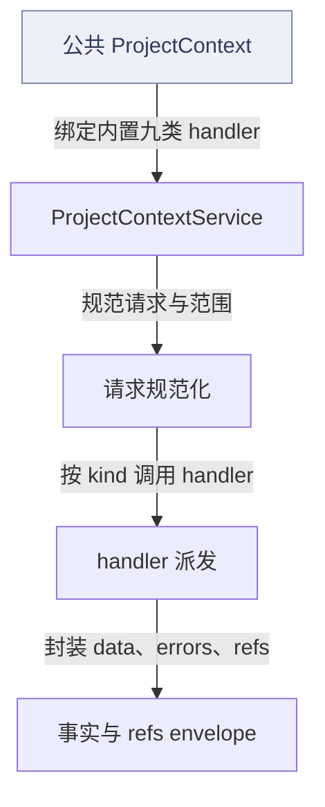
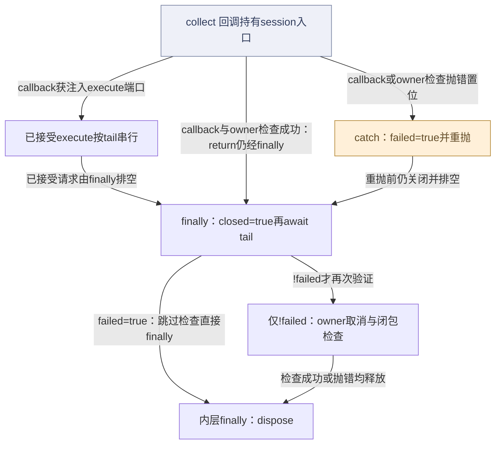
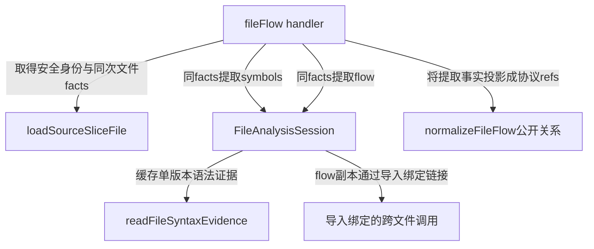
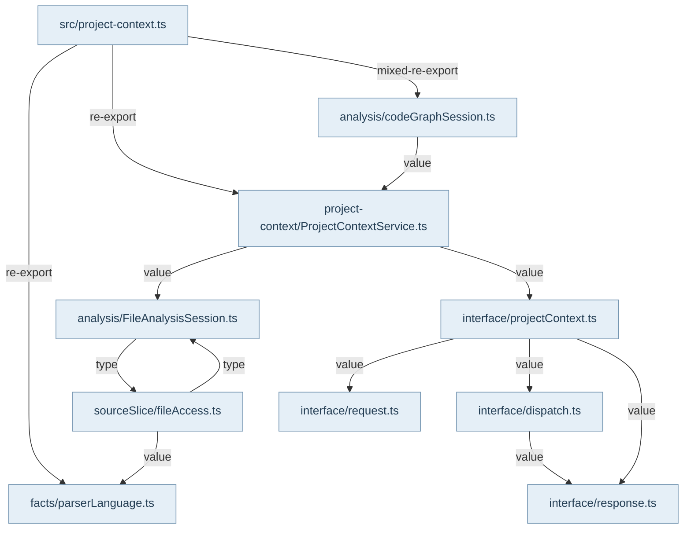

## 入口与责任

宿主通过 `@alembic/core/project-context` 消费 `ProjectContext`、`withProjectContextSession` 和关系查询 factory。`ProjectContextService` 装配 space、repo、map、module、module-layers、file-flow、file-symbols、source-slice、anchor-range 九种 handler。输入是请求 kind、scope 与 payload；执行期 AbortSignal、sourceReader、analysis 在独立 context 中传入，不进入可序列化业务请求。

接口层的 owner 是 `createProjectContext`：先规范化请求，再派发 handler，最后构造 envelope。请求错误转换为明确 errors 与 unavailable data；其他错误继续抛出。派发前后检查取消，没有 handler 时返回 query-unavailable。它不执行模型、终端、工具系统，也不自己发起大范围扫描；具体事实由各 handler 和共享读取会话生产。

## 一次读取与一批读取

普通 `ProjectContext.execute` 每次创建短生命周期 `FileAnalysisSession`，允许下一次查询看到文件修改。批量入口创建一个共享 analysis，将已接收 execute 连接到 promise tail 按顺序执行。这样一个请求的取消不会意外取消另一请求共享的在途读取；owner signal 仍可取消整批。reader identity 参与缓存隔离，不能用相同 repoId 混淆不同项目根。

每次成功查询之后执行 sourceReader.assertComplete；批处理正常返回还要等 tail 排空，再检查 owner 取消与 analysis 输入闭包。调用方 catch 叶子错误并不能据此把缺失输入宣布成功。finally 标记 closed，拒绝退出后的 execute，排空后释放 analysis；失败回调保留原错误，不用后续完整性检查覆盖它。资源释放是可运行行为，不能把 session 画成只含DTO的盒子。

## 引用与消费者

结果包含 bounded facts、refs、nextRefs 和显式错误，供宿主逐级下钻；map/module 的公开层次与文件内部匹配范围不同。source-slice 先做路径与 realpath 检查再读取 regular file，文件 hash 绑定正文版本。严格认证由 foundation 专题补充；历史名 `withCodeGraphProjectContextSession` 当前装配内置严格后端，不启动外部进程。Main 的 CertifiedProjectFactsRuntime 实际用该入口采集，调用方负责项目范围与私有目录。

关系 factory 同属公开 `/project-context`，但 `ensureIndex` 的写代际行为与 `query` 的读代际行为在专题07展开。普通实时上下文、冻结认证工件和持久源码图是不同用途，不能把同名 ref 或同一文件 hash 当成全部链路共同的授权。返回有界事实也不证明整个仓库语义完整。

## 失败与阅读边界

取消、无handler、非法范围、输入闭包缺口各有不同路径；图中成功 envelope 不覆盖这些分支。测试证据区分直接调用公开 session 的断言与经 createProjectContext 间接覆盖内部派发。这里引用既有测试源代码而非宣称本轮已运行产品测试；批处理一致性只在其会话和读取合同范围内成立。

## 视图与术语

本页手工图描述已核对的关系与关键分叉；F1 也承担所列调用范围的业务纵切（V0）阅读，不能推出未画出的宿主自动调度。F0 文件依赖精选由同页选择集和 TypeScript 导入图生成，不是运行时轨迹。S0/R0 只描述正文指定的 owner、状态和恢复前提。公开 API、全部文件及变更影响见阅读器的对应入口。

`source` 为代码来源，`direct` 为直接绑定调用及断言，`indirect` 为经 helper/fixture 或间接行为的断言，`none` 为明确未覆盖。正文中的“宿主”指真实外层装配，不属于 Core 内部运行时。

## 模块协作与恢复边界深化

这里应按“选择器→安全文件身份→同一输入视图→事实投影→闭包总门”理解功能，而非九个handler只是层级菜单。source-slice负责范围与可选正文；file-symbols只输出紧凑声明；file-flow把同一facts对象的symbols与flow再归一为关系；anchor-range是带范围和include选项的组合查询；repo借静态发现器提供canonical partition，所有这些都由execution context把取消和reader传到底层。

关键状态是读取版本，不是图中某个全局数据库。FileAnalysisSession以reader identity区分record/replay，再以完整项目和文件身份缓存读取，解析缓存键为实际facts对象。拒绝的Promise（如取消）会驱逐；正常resolve的not-found/query-unavailable结构化失败仍保留在本批输入视图。文件或权限修复后应使用新session/reader重新查询，已成功读出的facts也保持本批版本。sourceFolder只改变导航投影；AST输出返回副本，避免调用方修改range污染后续查询。路径校验先于缓存，所以非法../别名不能蹭已有合法缓存。

普通live查询允许带warning的部分输出。组合后端遗漏flow时，Core保留已验证模块语法并明确调用观察不可用；这与严格认证拒绝未完整输入不是矛盾，而是不同消费合同。真正闭包总门在service及批处理正常返回后调用reader.assertComplete，阻止repo/space某层catch把回放缺口降成空项目。回调失败则保留原错误，不用闭包检查覆盖它；无论哪条路径都先关闭新请求、排空已接受工作，再释放分析资源。

恢复责任归输入或后端owner。Core没有后台重试，也不自动修复非法scope、不重写旧ref、不替调用者重新捕获认证工件。本文测试引用是源代码断言证据，具体新运行结果仍由独立验证回执负责。

<!-- atlas:generated:start -->

## 功能单元与调用接缝

各单元按真实入口拆分职责；门面暴露、内部调用和宿主装配是不同关系。关联图提供相邻阅读上下文，故障产生位置以条目源码为准。

<a id="m-M06-01" class="stable-anchor"></a>
<a id="source-slice有界正文和版本引用" class="stable-anchor"></a>

### source-slice：有界正文和版本引用

入口：`src/service/project-context/sourceSlice/sourceSlice.ts#sourceSliceProjectContextHandler`

| 检查项 | 功能与边界 |
| --- | --- |
| 输入 | filePath或file ref、行范围、includeText及scope |
| 输出 | SourceSliceContext、file/source-slice refs；非法输入返回结构化unavailable |
| 后续调用 / 绑定 | loadSourceSliceFile；normalizeSourceSliceRange；createProjectContextFileRef；createProjectContextSourceRangeProjection |
| 状态与副作用 | 通过reader读文件；无产品写入；只有includeText=true输出正文 |
| 能力边界 | 范围在已读取lineCount内校验；ref选择器不自动证明旧hash仍有效 |

关联：[file-flow怎样复用安全读取与同版本语法事实](README.md#graph-pc-handler-facts)

返回业务旅程：[从源码读取到关系证据与认证工件 · live 路径：安全读取与同版本语法事实](../../journeys/j02.md#J02-02)

<a id="m-M06-02" class="stable-anchor"></a>
<a id="文件访问先校验路径再缓存" class="stable-anchor"></a>

### 文件访问：先校验路径再缓存

入口：`src/service/project-context/sourceSlice/fileAccess.ts#loadSourceSliceFile`

| 检查项 | 功能与边界 |
| --- | --- |
| 输入 | 项目根、相对或绝对文件路径、reader、可选analysis/signal |
| 输出 | 同次读取的bytes SHA、短text hash、lines、mtime与SourceSliceFileFacts |
| 后续调用 / 绑定 | resolveSourceSliceFileIdentity；FileAnalysisSession.readSourceFile 或 readSourceSliceFile；onSourceFileVersion |
| 状态与副作用 | realpath/stat/readFile；可调用读取观察回调 |
| 能力边界 | 父级traversal必须在缓存前拒绝；realpath不得越根；非regular file不读；取消继续抛错 |

关联：[file-flow怎样复用安全读取与同版本语法事实](README.md#graph-pc-handler-facts) · [当前正文必须与引用hash一致](../07-source-graph/README.md#graph-sg-evidence) · [pcf-path-escape · filePath含..、越出项目根，或realpath链接到根外](README.md#f-pcf-path-escape) · [pcf-read-error · 文件缺失、非regular file或reader读取失败](README.md#f-pcf-read-error)

返回业务旅程：[从源码读取到关系证据与认证工件 · live 路径：安全读取与同版本语法事实](../../journeys/j02.md#J02-02) · [从源码读取到关系证据与认证工件 · 关系查询：旧图身份与当前正文分开核对](../../journeys/j02.md#J02-05)

<a id="m-M06-03" class="stable-anchor"></a>
<a id="file-symbols紧凑声明投影" class="stable-anchor"></a>

### file-symbols：紧凑声明投影

入口：`src/service/project-context/fileSymbols/fileSymbols.ts#fileSymbolsProjectContextHandler`

| 检查项 | 功能与边界 |
| --- | --- |
| 输入 | filePath/ref/activeFile，scope和execution context |
| 输出 | symbols、naming、source-slice drilldown refs与可用性warning |
| 后续调用 / 绑定 | loadSourceSliceFile；analysis.symbols或extractFileSymbolsFromSource；normalizeFileSymbols；summarizeFileSymbolNaming |
| 状态与副作用 | 复用已读facts；不保存数据库 |
| 能力边界 | 无法提取时保留明确warning；公开refs不暴露内部声明匹配范围 |

关联：[file-flow怎样复用安全读取与同版本语法事实](README.md#graph-pc-handler-facts)

返回业务旅程：[从源码读取到关系证据与认证工件 · live 路径：安全读取与同版本语法事实](../../journeys/j02.md#J02-02)

<a id="m-M06-04" class="stable-anchor"></a>
<a id="file-flow导入导出与调用关系" class="stable-anchor"></a>

### file-flow：导入、导出与调用关系

入口：`src/service/project-context/fileFlow/fileFlow.ts#fileFlowProjectContextHandler`

| 检查项 | 功能与边界 |
| --- | --- |
| 输入 | 目标文件与分析会话；sourceReader供模块解析读取 |
| 输出 | callers/callees/imports/exports/inflow/outflow和refs |
| 后续调用 / 绑定 | loadSourceSliceFile；analysis.symbols；analysis.flow；normalizeFileFlow |
| 状态与副作用 | 同一事实版本生产符号和调用；可读关联模块配置/目标 |
| 能力边界 | 未解决的关系保持unresolved；普通live模式允许有诊断的部分事实，不等同严格认证 |

关联：[file-flow怎样复用安全读取与同版本语法事实](README.md#graph-pc-handler-facts)

返回业务旅程：[从源码读取到关系证据与认证工件 · live 路径：安全读取与同版本语法事实](../../journeys/j02.md#J02-02)

<a id="m-M06-05" class="stable-anchor"></a>
<a id="fileanalysissession输入视图与解析生命周期" class="stable-anchor"></a>

### FileAnalysisSession：输入视图与解析生命周期

入口：`src/service/project-context/analysis/FileAnalysisSession.ts#FileAnalysisSession`

| 检查项 | 功能与边界 |
| --- | --- |
| 输入 | reader identity、完整项目/文件身份、SourceSliceFileFacts对象与提取模式 |
| 输出 | 同批固定文件读、共享AST投影及独立可变返回值 |
| 后续调用 / 绑定 | readFileSyntaxEvidence；symbolExtractor.analyzeFile或extractSymbols；linkImportBoundCalls；reader.assertComplete |
| 状态与副作用 | 内存Promise/WeakMap缓存；dispose清空；拒绝的Promise驱逐对应缓存，结构化读取失败仍可缓存 |
| 能力边界 | record/replay reader分开；sourceFolder是导航投影不是新字节；缓存不跨session；仅成功返回事实不能绕过输入锁存；Promise拒绝才驱逐；结构化读取失败保留到会话结束，修复后需新session/reader。 |

关联：[file-flow怎样复用安全读取与同版本语法事实](README.md#graph-pc-handler-facts) · [session正常返回、失败与finally排空释放](README.md#graph-pc-session) · [严格reader装配与旧实例取消排空](../05-discovery-and-intelligence/README.md#graph-discoverer-session-reader-and-cancel) · [pcf-combined-backend-no-flow · 请求flow但组合后端只返回symbols](README.md#f-pcf-combined-backend-no-flow)

返回业务旅程：[从源码读取到关系证据与认证工件 · live 路径：安全读取与同版本语法事实](../../journeys/j02.md#J02-02) · [从源码读取到关系证据与认证工件 · live session：链接事实后检查闭包并释放](../../journeys/j02.md#J02-03)

<a id="m-M06-06" class="stable-anchor"></a>
<a id="anchor-range围绕证据锚点局部下钻" class="stable-anchor"></a>

### anchor-range：围绕证据锚点局部下钻

入口：`src/service/project-context/anchorRange/anchorRange.ts#anchorRangeProjectContextHandler`

| 检查项 | 功能与边界 |
| --- | --- |
| 输入 | activeFile/line/symbol/relation/source-slice/ref，radius及include选项 |
| 输出 | 归一anchor、expanded range、局部symbols/relations/sourceSlices/nextRefs |
| 后续调用 / 绑定 | resolveAnchorRange；querySourceSlice；queryFileSymbols；queryFileFlow；expandSourceRange |
| 状态与副作用 | 复用底层读取和分析；无全库写入 |
| 能力边界 | 只按选项和范围投影；相关refs不代表自动遍历所有上下游；子请求失败保持errors |

关联：未声明跨项关联

<a id="m-M06-07" class="stable-anchor"></a>
<a id="repo真实发现器与canonical-module-partition" class="stable-anchor"></a>

### repo：真实发现器与canonical module partition

入口：`src/service/project-context/repo/repo.ts#repoProjectContextHandler`

| 检查项 | 功能与边界 |
| --- | --- |
| 输入 | repo scope、source folder、payload及可绑定reader |
| 输出 | 构建系统、targets、源文件、模块、依赖、入口与drilldown refs |
| 后续调用 / 绑定 | resolveRepoIdentity；getDiscovererRegistry().withSession；collectRepoContextFacts；createRepoContextData |
| 状态与副作用 | 读目录/manifest/配置；discoverer资源保持到投影完成后释放 |
| 能力边界 | 源码清单自身预算与plan maxFiles不同；静态发现不执行构建命令；缺口应以errors表达 |

关联：未声明跨项关联

<a id="m-M06-08" class="stable-anchor"></a>
<a id="projectcontextservice闭包总门" class="stable-anchor"></a>

### ProjectContextService：闭包总门

入口：`src/service/project-context/ProjectContextService.ts#ProjectContextService`

| 检查项 | 功能与边界 |
| --- | --- |
| 输入 | 规范请求、默认或注入handlers、reader与可选共享analysis |
| 输出 | 事实envelope；reader锁存缺口/取消继续失败 |
| 后续调用 / 绑定 | createProjectContext；projectContext.execute；sourceReader.assertComplete；analysis.dispose |
| 状态与副作用 | 普通execute创建并释放analysis；共享session由外层finally管理 |
| 能力边界 | 任意注入executor不会自动获得sourceReader能力标记；不能把leaf catch后的部分返回当完整输入 |

关联：[请求规范化、派发与结果封装](README.md#graph-pc-request) · [当前正文必须与引用hash一致](../07-source-graph/README.md#graph-sg-evidence) · [接受的 scope 到认证工件](../08-certified-project-facts/README.md#graph-certified-capture-freeze) · [file-flow怎样复用安全读取与同版本语法事实](README.md#graph-pc-handler-facts) · [session正常返回、失败与finally排空释放](README.md#graph-pc-session) · [严格reader装配与旧实例取消排空](../05-discovery-and-intelligence/README.md#graph-discoverer-session-reader-and-cancel) · [pcf-owner-cancel-drain · collect已返回但owner在已接受execute排空期间abort](README.md#f-pcf-owner-cancel-drain) · [pcf-input-closure · record/replay reader发现未捕获的目录/配置/源码观察；leaf可能把读错误捕获](README.md#f-pcf-input-closure)

返回业务旅程：[从源码读取到关系证据与认证工件 · 按读取目标选择路径和身份](../../journeys/j02.md#J02-01) · [从源码读取到关系证据与认证工件 · live session：链接事实后检查闭包并释放](../../journeys/j02.md#J02-03)


## 生成的图与逐边依据

此区域由同页结构化图模型生成；请修改 frontmatter，再显式运行 `npm run inventory:write`，不要单独修改表格或 Mermaid。

<a id="graph-pc-request"></a>

### 请求规范化、派发与结果封装

图 ID：`pc-request` · F1 · 只展示接口链路；具体扫描由handler拥有。执行期取消在派发前后检查。



| 边 ID | 关系 | 源码定位 | 断言关系 | case / 缺口 | 相关旅程步骤 |
| --- | --- | --- | --- | --- | --- |
| <a id="e-pc-request--pc-r1"></a>pc-r1 | 绑定内置九类 handler | `src/service/project-context/ProjectContextService.ts#ProjectContext` | none | 该边为静态门面装配，既有测试仅通过公共入口间接使用，未单独断言九项绑定集合。 |  |
| <a id="e-pc-request--pc-r2"></a>pc-r2 | 规范请求与范围 | `src/service/project-context/interface/projectContext.ts#createProjectContext` | indirect | canonicalizes payload keys and preserves deterministic envelope equality | [J02 · 按读取目标选择路径和身份](../../journeys/j02.md#J02-01) |
| <a id="e-pc-request--pc-r3"></a>pc-r3 | 按 kind 调用 handler | `src/service/project-context/interface/projectContext.ts#createProjectContext` | indirect | canonicalizes payload keys and preserves deterministic envelope equality | [J02 · 按读取目标选择路径和身份](../../journeys/j02.md#J02-01) |
| <a id="e-pc-request--pc-r4"></a>pc-r4 | 封装 data、errors、refs | `src/service/project-context/interface/projectContext.ts#createProjectContext` | indirect | canonicalizes payload keys and preserves deterministic envelope equality |  |

<a id="graph-pc-session"></a>

### session正常返回、失败与finally排空释放

图 ID：`pc-session` · S0 · 顺序是finally先closed并await tail，再仅在!failed时检查owner取消/输入闭包，最后内层finally dispose。failed=true跳过闭包检查，保留原错误。



| 边 ID | 关系 | 源码定位 | 断言关系 | case / 缺口 | 相关旅程步骤 |
| --- | --- | --- | --- | --- | --- |
| <a id="e-pc-session--pc-s1"></a>pc-s1 | callback获注入execute端口 | `src/service/project-context/ProjectContextService.ts#withProjectContextSession` | direct | shares a complete analysis batch without leaking edited results, file identities, or a closed session |  |
| <a id="e-pc-session--pc-s2"></a>pc-s2 | 已接受请求由finally排空 | `src/service/project-context/ProjectContextService.ts#withProjectContextSession` | direct | does not poison later batch requests after cancellation and drains accepted work on callback failure | [J02 · live session：链接事实后检查闭包并释放](../../journeys/j02.md#J02-03) |
| <a id="e-pc-session--pc-s3"></a>pc-s3 | callback与owner检查成功：return仍经finally | `src/service/project-context/ProjectContextService.ts#withProjectContextSession` | direct | shares a complete analysis batch without leaking edited results, file identities, or a closed session |  |
| <a id="e-pc-session--pc-s4"></a>pc-s4 | callback或owner检查抛错置位 | `src/service/project-context/ProjectContextService.ts#withProjectContextSession` | direct | does not poison later batch requests after cancellation and drains accepted work on callback failure |  |
| <a id="e-pc-session--pc-s5"></a>pc-s5 | 重抛前仍关闭并排空 | `src/service/project-context/ProjectContextService.ts#withProjectContextSession` | direct | does not poison later batch requests after cancellation and drains accepted work on callback failure |  |
| <a id="e-pc-session--pc-s6"></a>pc-s6 | !failed才再次验证 | `src/service/project-context/ProjectContextService.ts#withProjectContextSession` | none | 成功分支输入锁存的精确断言需另核foundation场景；关闭/排空用例不替代完整性测试。 | [J02 · live session：链接事实后检查闭包并释放](../../journeys/j02.md#J02-03) |
| <a id="e-pc-session--pc-s7"></a>pc-s7 | failed=true：跳过检查直接finally | `src/service/project-context/ProjectContextService.ts#withProjectContextSession` | none | 本边依据源码内层finally；已审用例断言排空/原错误与closed入口，未直接spy analysis.dispose，不能借此声称释放行为已独立断言。 |  |
| <a id="e-pc-session--pc-s8"></a>pc-s8 | 检查成功或抛错均释放 | `src/service/project-context/ProjectContextService.ts#withProjectContextSession` | none | 本边依据源码内层finally；已审用例断言排空/原错误与closed入口，未直接spy analysis.dispose，不能借此声称释放行为已独立断言。 | [J02 · live session：链接事实后检查闭包并释放](../../journeys/j02.md#J02-03) |

<a id="graph-pc-handler-facts"></a>

### file-flow怎样复用安全读取与同版本语法事实

图 ID：`pc-handler-facts` · F1 · 补充具体handler调用链；关联模块链接与公开关系归一分开。普通部分结果仍受service闭包总门约束。



| 边 ID | 关系 | 源码定位 | 断言关系 | case / 缺口 | 相关旅程步骤 |
| --- | --- | --- | --- | --- | --- |
| <a id="e-pc-handler-facts--pch-1"></a>pch-1 | 取得安全身份与同次文件facts | `src/service/project-context/fileFlow/fileFlow.ts#fileFlowProjectContextHandler` | indirect | returns TypeScript imports, exports, calls, relation refs, and source-slice drill-down | [J02 · live 路径：安全读取与同版本语法事实](../../journeys/j02.md#J02-02) |
| <a id="e-pc-handler-facts--pch-2"></a>pch-2 | 同facts提取symbols | `src/service/project-context/fileFlow/fileFlow.ts#fileFlowProjectContextHandler` | indirect | returns TypeScript imports, exports, calls, relation refs, and source-slice drill-down | [J02 · live 路径：安全读取与同版本语法事实](../../journeys/j02.md#J02-02) |
| <a id="e-pc-handler-facts--pch-3"></a>pch-3 | 同facts提取flow | `src/service/project-context/fileFlow/fileFlow.ts#fileFlowProjectContextHandler` | indirect | returns TypeScript imports, exports, calls, relation refs, and source-slice drill-down | [J02 · live 路径：安全读取与同版本语法事实](../../journeys/j02.md#J02-02) |
| <a id="e-pc-handler-facts--pch-4"></a>pch-4 | 缓存单版本语法证据 | `src/service/project-context/analysis/FileAnalysisSession.ts#FileAnalysisSession` | indirect | returns TypeScript imports, exports, calls, relation refs, and source-slice drill-down | [J02 · live 路径：安全读取与同版本语法事实](../../journeys/j02.md#J02-02) |
| <a id="e-pc-handler-facts--pch-5"></a>pch-5 | flow副本通过导入绑定链接 | `src/service/project-context/analysis/FileAnalysisSession.ts#FileAnalysisSession` | indirect | returns TypeScript imports, exports, calls, relation refs, and source-slice drill-down | [J02 · live session：链接事实后检查闭包并释放](../../journeys/j02.md#J02-03) |
| <a id="e-pc-handler-facts--pch-6"></a>pch-6 | 将提取事实投影成协议refs | `src/service/project-context/fileFlow/fileFlow.ts#fileFlowProjectContextHandler` | indirect | returns TypeScript imports, exports, calls, relation refs, and source-slice drill-down |  |

<a id="graph-dependencies-06"></a>

### 文件依赖精选 · 静态关系

图 ID：`dependencies-06` · F0 · 显式选择集内的实际导入；类型边不代表运行调用，动态未知保留在全量索引。



| 边 ID | 关系 | 源码定位 | 断言关系 | case / 缺口 | 相关旅程步骤 |
| --- | --- | --- | --- | --- | --- |
| <a id="e-dependencies-06--dep-06-0"></a>dep-06-0 | re-export | `src/project-context.ts#<module>` | none | TypeScript AST 静态导入事实，不主张运行调用或断言覆盖。 |  |
| <a id="e-dependencies-06--dep-06-1"></a>dep-06-1 | mixed-re-export | `src/project-context.ts#<module>` | none | TypeScript AST 静态导入事实，不主张运行调用或断言覆盖。 |  |
| <a id="e-dependencies-06--dep-06-2"></a>dep-06-2 | re-export | `src/project-context.ts#<module>` | none | TypeScript AST 静态导入事实，不主张运行调用或断言覆盖。 |  |
| <a id="e-dependencies-06--dep-06-3"></a>dep-06-3 | value | `src/service/project-context/ProjectContextService.ts#<module>` | none | TypeScript AST 静态导入事实，不主张运行调用或断言覆盖。 |  |
| <a id="e-dependencies-06--dep-06-4"></a>dep-06-4 | value | `src/service/project-context/ProjectContextService.ts#<module>` | none | TypeScript AST 静态导入事实，不主张运行调用或断言覆盖。 |  |
| <a id="e-dependencies-06--dep-06-5"></a>dep-06-5 | type | `src/service/project-context/analysis/FileAnalysisSession.ts#<module>` | none | TypeScript AST 静态导入事实，不主张运行调用或断言覆盖。 |  |
| <a id="e-dependencies-06--dep-06-6"></a>dep-06-6 | value | `src/service/project-context/analysis/codeGraphSession.ts#<module>` | none | TypeScript AST 静态导入事实，不主张运行调用或断言覆盖。 |  |
| <a id="e-dependencies-06--dep-06-7"></a>dep-06-7 | value | `src/service/project-context/interface/dispatch.ts#<module>` | none | TypeScript AST 静态导入事实，不主张运行调用或断言覆盖。 |  |
| <a id="e-dependencies-06--dep-06-8"></a>dep-06-8 | value | `src/service/project-context/interface/projectContext.ts#<module>` | none | TypeScript AST 静态导入事实，不主张运行调用或断言覆盖。 |  |
| <a id="e-dependencies-06--dep-06-9"></a>dep-06-9 | value | `src/service/project-context/interface/projectContext.ts#<module>` | none | TypeScript AST 静态导入事实，不主张运行调用或断言覆盖。 |  |
| <a id="e-dependencies-06--dep-06-10"></a>dep-06-10 | value | `src/service/project-context/interface/projectContext.ts#<module>` | none | TypeScript AST 静态导入事实，不主张运行调用或断言覆盖。 |  |
| <a id="e-dependencies-06--dep-06-11"></a>dep-06-11 | value | `src/service/project-context/sourceSlice/fileAccess.ts#<module>` | none | TypeScript AST 静态导入事实，不主张运行调用或断言覆盖。 |  |
| <a id="e-dependencies-06--dep-06-12"></a>dep-06-12 | type | `src/service/project-context/sourceSlice/fileAccess.ts#<module>` | none | TypeScript AST 静态导入事实，不主张运行调用或断言覆盖。 |  |

## 失败后的状态与恢复责任

先检查已落盘状态，再决定恢复。自动动作只描述代码已执行的分支；显式恢复不能据提示文字推断为自动调用。

<a id="f-pcf-path-escape" class="stable-anchor"></a>
<a id="pcf-path-escape--filepath含越出项目根或realpath链接到根外" class="stable-anchor"></a>

### pcf-path-escape · filePath含..、越出项目根，或realpath链接到根外

| 检查项 | 当前代码语义 |
| --- | --- |
| 已留下什么 | 没有该文件facts；已有session其他合法缓存仍在 |
| Core自动做什么 | 返回outside-scope，不执行越界readFile |
| 谁显式恢复 | 调用方修正scope/路径后发新请求；不得绕过realpath检查 |
| 必须停止的条件 | 路径在lexical与realpath两层均合法之前不读取 |
| 源码定位 | `src/service/project-context/sourceSlice/fileAccess.ts#resolveSourceSliceFileIdentity` |

```ts
if (hasParentTraversal(requestedPath)) {
```

关联：[文件访问：先校验路径再缓存](README.md#m-M06-02) · [请求规范化、派发与结果封装](README.md#graph-pc-request) · [当前正文必须与引用hash一致](../07-source-graph/README.md#graph-sg-evidence) · [接受的 scope 到认证工件](../08-certified-project-facts/README.md#graph-certified-capture-freeze) · [file-flow怎样复用安全读取与同版本语法事实](README.md#graph-pc-handler-facts)

返回业务旅程：[从源码读取到关系证据与认证工件 · 按读取目标选择路径和身份](../../journeys/j02.md#J02-01) · [从源码读取到关系证据与认证工件 · live 路径：安全读取与同版本语法事实](../../journeys/j02.md#J02-02)

断言关系：**indirect**。`test/ProjectContextSourceSlice.test.ts` · `returns ordinary query errors for invalid ranges, missing files, and traversal`

通过公开execute返回outside-scope；非法范围与缺失文件分别编码，均无available事实。（failure）。这里只定位断言；实际运行范围见独立运行证据。

```ts
expect(traversal.errors?.[0]?.code).toBe('outside-scope')
```

<a id="f-pcf-read-error" class="stable-anchor"></a>
<a id="pcf-read-error--文件缺失非regular-file或reader读取失败" class="stable-anchor"></a>

### pcf-read-error · 文件缺失、非regular file或reader读取失败

| 检查项 | 当前代码语义 |
| --- | --- |
| 已留下什么 | 不产生该次成功facts；结构化失败结果仍可缓存在本session，已读取的支持输入也可保留 |
| Core自动做什么 | ENOENT/ENOTDIR归not-found；其他读取错误query-unavailable且retryable=true；取消例外继续抛出 |
| 谁显式恢复 | 宿主修复文件/读取权限/输入视图后，以新session/reader重新查询；不要假设同session重试会重新读盘，retryable只提示可重试而非Core自动循环 |
| 必须停止的条件 | 输入未恢复时不能把unavailable当空正文 |
| 源码定位 | `src/service/project-context/sourceSlice/fileAccess.ts#classifyReadFailure` |

```ts
code: 'query-unavailable',
```

关联：[文件访问：先校验路径再缓存](README.md#m-M06-02) · [file-flow怎样复用安全读取与同版本语法事实](README.md#graph-pc-handler-facts)

返回业务旅程：[从源码读取到关系证据与认证工件 · live 路径：安全读取与同版本语法事实](../../journeys/j02.md#J02-02)

断言关系：**indirect**。`test/ProjectContextSourceSlice.test.ts` · `returns ordinary query errors for invalid ranges, missing files, and traversal`

缺失文件返回not-found，未把它包装为空源码。（failure）。这里只定位断言；实际运行范围见独立运行证据。

```ts
expect(missingFile.errors?.[0]?.code).toBe('not-found')
```

<a id="f-pcf-combined-backend-no-flow" class="stable-anchor"></a>
<a id="pcf-combined-backend-no-flow--请求flow但组合后端只返回symbols" class="stable-anchor"></a>

### pcf-combined-backend-no-flow · 请求flow但组合后端只返回symbols

| 检查项 | 当前代码语义 |
| --- | --- |
| 已留下什么 | 已验证symbols/imports/exports仍可保留，调用观察空且带原因 |
| Core自动做什么 | 用legacy flow结构补齐返回形状、清空callSites并写unavailableReason诊断 |
| 谁显式恢复 | 后端owner补齐flow能力；宿主只消费已标明可用的事实，不凭空补造调用 |
| 必须停止的条件 | 缺少调用观察不能升级为完整调用图 |
| 源码定位 | `src/service/project-context/analysis/FileAnalysisSession.ts#FileAnalysisSession` |

```ts
flow: { ...legacy.flow, callSites: [], unavailableReason: reason },
```

关联：[FileAnalysisSession：输入视图与解析生命周期](README.md#m-M06-05) · [file-flow怎样复用安全读取与同版本语法事实](README.md#graph-pc-handler-facts)

返回业务旅程：[从源码读取到关系证据与认证工件 · live 路径：安全读取与同版本语法事实](../../journeys/j02.md#J02-02)

断言关系：**indirect**。`test/ProjectContextEndToEnd.test.ts` · `reports missing combined-backend flow without losing verified imports or crashing the handler`

组合后端缺flow时调用观察为空，已验证import仍保留且有unavailable诊断。（failure）。这里只定位断言；实际运行范围见独立运行证据。

```ts
expect((result.data as FileFlowContext).callers).toEqual([])
```

<a id="f-pcf-owner-cancel-drain" class="stable-anchor"></a>
<a id="pcf-owner-cancel-drain--collect已返回但owner在已接受execute排空期间abort" class="stable-anchor"></a>

### pcf-owner-cancel-drain · collect已返回但owner在已接受execute排空期间abort

| 检查项 | 当前代码语义 |
| --- | --- |
| 已留下什么 | 已接受请求仍被排空；session随后closed/disposed；callback值不发布 |
| Core自动做什么 | finally await tail之后再次throwIfProjectContextAborted，内层finally仍释放 |
| 谁显式恢复 | 宿主在适当scope用新的非aborted signal重新启动批次；不复用关闭session |
| 必须停止的条件 | owner signal已取消则整批不得成功 |
| 源码定位 | `src/service/project-context/ProjectContextService.ts#withProjectContextSession` |

```ts
throwIfProjectContextAborted(options);
        analysis.assertInputsComplete();
```

关联：[ProjectContextService：闭包总门](README.md#m-M06-08) · [file-flow怎样复用安全读取与同版本语法事实](README.md#graph-pc-handler-facts) · [session正常返回、失败与finally排空释放](README.md#graph-pc-session) · [严格reader装配与旧实例取消排空](../05-discovery-and-intelligence/README.md#graph-discoverer-session-reader-and-cancel) · 包入口 [@alembic/core/project-context](../../data/public-api.json)

返回业务旅程：[从源码读取到关系证据与认证工件 · live session：链接事实后检查闭包并释放](../../journeys/j02.md#J02-03)

断言关系：**direct**。`test/ProjectContextEndToEnd.test.ts` · `does not publish a callback value when its owner aborts while accepted work drains`

callback已返回但接受请求仍在排空时owner取消，batch最终拒绝AbortError。（cancellation）。这里只定位断言；实际运行范围见独立运行证据。

```ts
expect(batch).rejects.toMatchObject({ name: 'AbortError' })
```

<a id="f-pcf-input-closure" class="stable-anchor"></a>
<a id="pcf-input-closure--recordreplay-reader发现未捕获的目录配置源码观察leaf可能把读错误捕获" class="stable-anchor"></a>

### pcf-input-closure · record/replay reader发现未捕获的目录/配置/源码观察；leaf可能把读错误捕获

| 检查项 | 当前代码语义 |
| --- | --- |
| 已留下什么 | reader锁存未完成状态；可能已计算局部envelope但不准作为完整结果发布 |
| Core自动做什么 | ProjectContextService成功路径assertComplete；批处理正常退出再检查所有已使用reader |
| 谁显式恢复 | 由认证捕获owner重新收集完整输入并重放；不能仅catch后重试同一不完整快照 |
| 必须停止的条件 | 闭包锁存未清除/未重新捕获前拒绝完整性声明 |
| 源码定位 | `src/service/project-context/ProjectContextService.ts#ProjectContextService` |

```ts
sourceReader.assertComplete();
```

关联：[ProjectContextService：闭包总门](README.md#m-M06-08) · [请求规范化、派发与结果封装](README.md#graph-pc-request) · [当前正文必须与引用hash一致](../07-source-graph/README.md#graph-sg-evidence) · [接受的 scope 到认证工件](../08-certified-project-facts/README.md#graph-certified-capture-freeze) · [file-flow怎样复用安全读取与同版本语法事实](README.md#graph-pc-handler-facts) · [session正常返回、失败与finally排空释放](README.md#graph-pc-session) · [严格reader装配与旧实例取消排空](../05-discovery-and-intelligence/README.md#graph-discoverer-session-reader-and-cancel)

返回业务旅程：[从源码读取到关系证据与认证工件 · 按读取目标选择路径和身份](../../journeys/j02.md#J02-01) · [从源码读取到关系证据与认证工件 · live session：链接事实后检查闭包并释放](../../journeys/j02.md#J02-03) · [从源码读取到关系证据与认证工件 · 认证路径：scope、矩阵与输入围栏共同冻结](../../journeys/j02.md#J02-06)

断言关系：**indirect**。`test/ProjectContextFoundation.test.ts` · `replays every certified request from serialized inputs after removing the source tree`

从已序列化输入离线重放；删除directory观察后未捕获输入锁存，不能被repo降级吞掉。（failure）。这里只定位断言；实际运行范围见独立运行证据。

```ts
expect(() => incomplete.assertComplete()).toThrow()
```


<!-- atlas:generated:end -->
