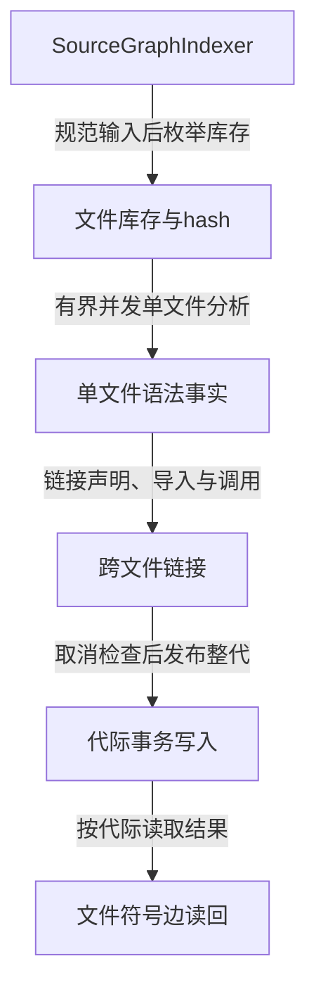
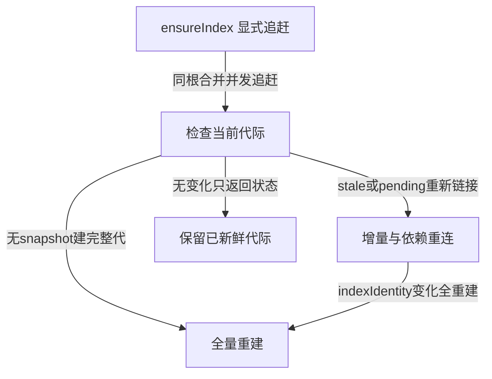
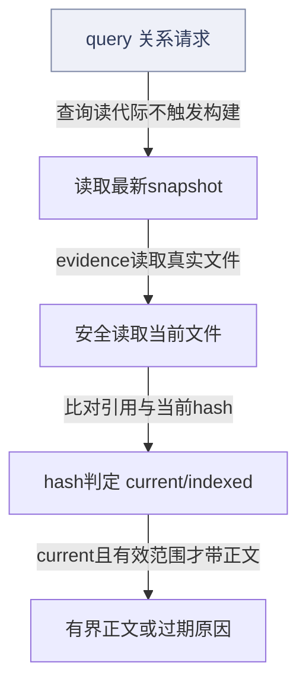
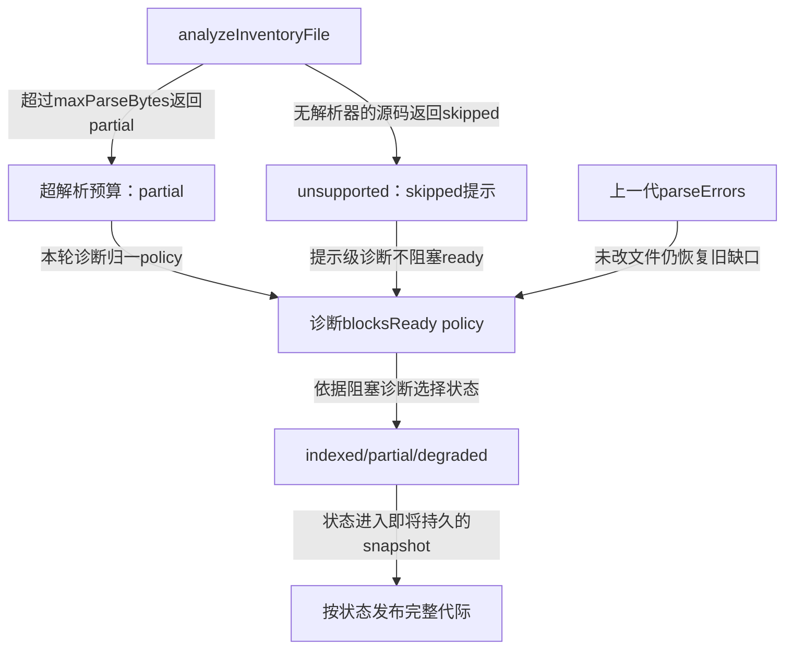
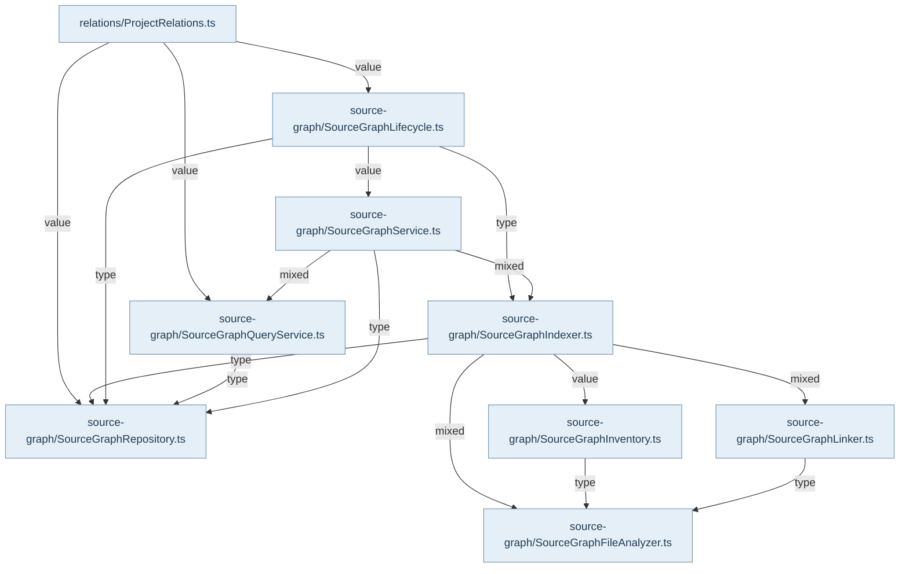

## 公开接缝与内部 owner

公开 `/project-context` 的 `createProjectRelations` 消费注入的 SourceGraphRepositoryImpl；`openProjectRelationsStore` 则在宿主指定路径打开独立 source-index SQLite，并返回 relations 与 close。宿主负责目录选择和关闭。这里没有独立 `/source-graph` package export；内部 SourceGraphIndexer、Lifecycle 和 QueryService 共同实现能力，图中内部类不能被误读成另一个公开子路径。

`ensureIndex` 是显式写入口，`query` 读取最新代际，查询不偷偷重建。Plugin 的 ProjectIndexRelations 真实调用 ensureIndex 后 query，允许30秒复用。Core按项目根合并并发追赶，只有成功状态进入 ensured 缓存；maxAgeMs是调用方主动允许的旧代复用，不是实时源码仍未变化的证明。evidence查询可以没有索引，它读取当前正文并核对引用。

## 构建与持久化

生命周期先 inspectFreshness：没有snapshot走full；stale、pending或变化文件走incremental；否则fresh-noop。Indexer规范选项、枚举文件、取内容hash、分析symbols/imports/exports/calls，再通过linkFile连接文件和符号。代际身份包含分析引擎及预算等条件；身份改变时即使源码相同仍全量重建，防止把新身份盖在旧事实之上。

增量不仅重算改动文件。导入目标内容变化会沿 importer/re-export 关系重连；新增、删除或模块配置变化会让所有参与模块解析的文件重新链接。外部CodeGraph边每代重新导入，不能从旧代沿用。外部引擎缺失、超时或失败只记录补边缺口；取消继续上抛，不能当作普通降级。保留文件的解析缺口从持久parseErrors重建，不因本轮未解析它们而假装fresh。

repository.replaceGeneration在一个同步SQLite事务中写代际、删除旧图、批量写文件/符号/边、刷新统计并读回。事务中不await，失败回滚，避免发布半图；取消检查发生在发布前。读回记录和统计支撑构建结果，但不能弥补上游提取器漏报。

## 查询、引用与恢复

QueryService支持search、callers、callees、relations、impact和受影响测试。certain表示自有证据，trusted包含惯例或外部来源，candidate通常不进入默认确定查询。ProjectRelations将内部节点投影为协议符号与ref，按请求限制结果数量。evidence重新读取文件，比较ref hash与当前内容；仅current且范围有效时返回最多200行正文。旧引用不因重建而自动改写，使用者应再次查询得到新ref。

## 已知限制

R06已确认：SourceGraphFileAnalyzer检查flow是否存在及unavailableReason，却未把callSitesComplete=false转为partial；调用提取失败可能留下parsed、空calls且无诊断。图中不能把indexed/ready解释为调用图必然完整。没有确定性test edge时验证计划仍是unknown。这里的恢复是显式追索引与重新查询，既有测试案例只支持所列场景，不证明所有语言和启发式链接都等同编译器解析。

## 视图与术语

本页手工图描述已核对的关系与关键分叉；F1 也承担所列调用范围的业务纵切（V0）阅读，不能推出未画出的宿主自动调度。F0 文件依赖精选由同页选择集和 TypeScript 导入图生成，不是运行时轨迹。S0/R0 只描述正文指定的 owner、状态和恢复前提。公开 API、全部文件及变更影响见阅读器的对应入口。

`source` 为代码来源，`direct` 为直接绑定调用及断言，`indirect` 为经 helper/fixture 或间接行为的断言，`none` 为明确未覆盖。正文中的“宿主”指真实外层装配，不属于 Core 内部运行时。

## 模块协作与恢复边界深化

索引有三个独立坐标：文件解析状态、整代ready/freshness、单次引用正文是否可验证。它们不能合并成一个绿灯。未超过文件大小门的文档/config进入inventoryOnly，不要求符号图；缺解析器的源码记录unsupported-language提示，但policy.blocksReady=false，所以单独这一缺口不会使代际不ready。真正阻塞的是受支持源码的失败/超解析预算，以及入库文件超过文件大小门。大小检查发生在readFile之后，所以不是I/O硬预算。partial代际仍可返回某个已按hash核对的文件正文；stale或unavailable则剥离正文，包括本轮先前已生成的section。

增量的可继承单位也不只是“文件字节没变”。符号边依赖目标声明和模块配置：直接importer与re-export闭包可能重连，文件集合或别名配置变化会扩大重连范围；本代未重新解析的缺口从parseErrors复原，不能因本轮diagnostics为空就洗成fresh。外部CodeGraph边每代重新获取，失败只退到自有边，取消则整次拒绝发布。外部ready与支持语言完整性因此不是一回事。

恢复是显式生命周期操作。query不修持久代际；查询发现漂移只改变响应context。没有代际时返回build_source_graph提示；宿主调用ensureIndex后再询问。maxAgeMs允许一段时间复用旧代，因此成功追赶结果只是当时快照。依赖目标在构建过程中二次变化时readPreservedFacts拒绝作为链接目标，下一轮新鲜度检查再触发重连。

R06是这套分类中已经确认的例外：提取器的callSitesComplete=false尚未进入SourceGraphFileAnalyzer缺口判定。Atlas保留它为当前限制，不用其他partial正例替代反例，也不宣称本轮已修复。

<!-- atlas:generated:start -->

## 功能单元与调用接缝

各单元按真实入口拆分职责；门面暴露、内部调用和宿主装配是不同关系。关联图提供相邻阅读上下文，故障产生位置以条目源码为准。

<a id="m-M07-01" class="stable-anchor"></a>
<a id="sourcegraphindexer完整与增量代际owner" class="stable-anchor"></a>

### SourceGraphIndexer：完整与增量代际owner

入口：`src/service/source-graph/SourceGraphIndexer.ts#SourceGraphIndexer`

| 检查项 | 功能与边界 |
| --- | --- |
| 输入 | 项目范围/选项、完整inventory、可选baseGeneration/changed/deleted、indexIdentity |
| 输出 | 持久代际snapshot、files/symbols/edges与diagnostics |
| 后续调用 / 绑定 | normalizeIndexOptions；collectInventory；detectChangedFiles；analyzeInventoryFile；linkFile；repository.replaceGeneration |
| 状态与副作用 | 分析/链接并原子发布代际；可调用外部CodeGraph补边 |
| 能力边界 | 身份变化全量；集合/配置改变会重连未改文件；发布前取消必须阻止新代 |

关联：[新鲜度检查与增量恢复](README.md#graph-sg-refresh) · [库存到事务性代际发布](README.md#graph-sg-build) · [本轮与沿用解析缺口怎样影响新代状态](README.md#graph-sg-partial-conservation) · [sgf-cancel-publication · 输入AbortSignal在分析/外部引擎执行后、replaceGeneration前取消](README.md#f-sgf-cancel-publication) · [sgf-dependent-change · 导入目标改动/删除/出现，或模块解析配置发生变化](README.md#f-sgf-dependent-change) · [sgf-optional-external · CodeGraph外部引擎未装、超时或非取消错误](README.md#f-sgf-optional-external)

返回业务旅程：[从源码读取到关系证据与认证工件 · 关系路径：显式 ensureIndex 并事务发布代际](../../journeys/j02.md#J02-04)

<a id="m-M07-02" class="stable-anchor"></a>
<a id="sourcegraphfreshnessservice不写入的新鲜度检查" class="stable-anchor"></a>

### SourceGraphFreshnessService：不写入的新鲜度检查

入口：`src/service/source-graph/SourceGraphIndexer.ts#SourceGraphFreshnessService`

| 检查项 | 功能与边界 |
| --- | --- |
| 输入 | 项目身份、索引选项与可选generationId |
| 输出 | snapshot、freshness、changed/deleted列表和下一步提示 |
| 后续调用 / 绑定 | normalizeIndexOptions；repository.getSnapshot/getLatestSnapshot；compareSourceGraphIndexIdentity；collectInventory；detectChangedFiles |
| 状态与副作用 | 读取库存/文件hash与数据库；不构建或发布代际 |
| 能力边界 | mtime/size相同仍用内容核对；只检查不自动执行nextAction |

关联：[当前正文必须与引用hash一致](README.md#graph-sg-evidence)

返回业务旅程：[从源码读取到关系证据与认证工件 · 关系查询：旧图身份与当前正文分开核对](../../journeys/j02.md#J02-05)

<a id="m-M07-03" class="stable-anchor"></a>
<a id="analyzeinventoryfile一次读取的解析状态" class="stable-anchor"></a>

### analyzeInventoryFile：一次读取的解析状态

入口：`src/service/source-graph/SourceGraphFileAnalyzer.ts#analyzeInventoryFile`

| 检查项 | 功能与边界 |
| --- | --- |
| 输入 | inventory文件、解析/文件预算、generation和可选declarationsOnly |
| 输出 | file节点、symbols、可选link facts、diagnostics |
| 后续调用 / 绑定 | readFileSyntaxEvidence；projectSourceGraphSymbols；skippedFile；partialFile；failedFile |
| 状态与副作用 | 真实读取一次UTF-8文本用于hash与语法；无DB写入 |
| 能力边界 | maxFileSizeBytes在readFile之后检查，限制图分析而非读取字节硬上限；超限适用于所有入库存文件；预算内文档/config才inventoryOnly；unsupported语言为非阻塞提示；R06仍漏判callSitesComplete=false |

关联：[新鲜度检查与增量恢复](README.md#graph-sg-refresh) · [库存到事务性代际发布](README.md#graph-sg-build) · [本轮与沿用解析缺口怎样影响新代状态](README.md#graph-sg-partial-conservation) · [sgf-parsing-gap · inventory文件超maxFileSizeBytes；或有解析器源码超maxParseBytes、语法/声明投影失败](README.md#f-sgf-parsing-gap) · [sgf-r06-call-completeness · flow对象存在且无unavailableReason，但callSitesComplete=false（既有R06）](README.md#f-sgf-r06-call-completeness)

返回业务旅程：[从源码读取到关系证据与认证工件 · 关系路径：显式 ensureIndex 并事务发布代际](../../journeys/j02.md#J02-04)

<a id="m-M07-04" class="stable-anchor"></a>
<a id="linkfile按声明证据连接关系" class="stable-anchor"></a>

### linkFile：按声明证据连接关系

入口：`src/service/source-graph/SourceGraphLinker.ts#linkFile`

| 检查项 | 功能与边界 |
| --- | --- |
| 输入 | 单文件facts及本代受限modules/factsOf访问 |
| 输出 | 依赖/继承/调用边与total/linked调用计数 |
| 后续调用 / 绑定 | linkModuleDependencies；linkTypeHierarchy；linkCalls；resolveModuleSpecifier |
| 状态与副作用 | 通过上下文读取本代目标与配置；返回边供Indexer保存 |
| 能力边界 | JS模块说明符路径证明最完整；惯例边trusted；未解决调用不入库，仅保留计数 |

关联：[新鲜度检查与增量恢复](README.md#graph-sg-refresh) · [库存到事务性代际发布](README.md#graph-sg-build) · [本轮与沿用解析缺口怎样影响新代状态](README.md#graph-sg-partial-conservation)

返回业务旅程：[从源码读取到关系证据与认证工件 · 关系路径：显式 ensureIndex 并事务发布代际](../../journeys/j02.md#J02-04)

<a id="m-M07-05" class="stable-anchor"></a>
<a id="lifecycle宿主显式追赶的编排" class="stable-anchor"></a>

### Lifecycle：宿主显式追赶的编排

入口：`src/service/source-graph/SourceGraphLifecycle.ts#SourceGraphLifecycleService`

| 检查项 | 功能与边界 |
| --- | --- |
| 输入 | cold-start/startup/file-change的索引输入 |
| 输出 | built-full/built-incremental/fresh-noop及durableTables计数 |
| 后续调用 / 绑定 | SourceGraphService.inspectFreshness；buildFullIndex；buildIncrementalIndex |
| 状态与副作用 | 只有选中build时写代际；不实现文件监听器 |
| 能力边界 | 结果action依据实际snapshot.mode，不按调用名虚报incremental |

关联：[新鲜度检查与增量恢复](README.md#graph-sg-refresh) · [库存到事务性代际发布](README.md#graph-sg-build) · [本轮与沿用解析缺口怎样影响新代状态](README.md#graph-sg-partial-conservation) · 包入口 [@alembic/core](../../data/public-api.json)

返回业务旅程：[从源码读取到关系证据与认证工件 · 关系路径：显式 ensureIndex 并事务发布代际](../../journeys/j02.md#J02-04)

<a id="m-M07-06" class="stable-anchor"></a>
<a id="repository整代同成同败" class="stable-anchor"></a>

### Repository：整代同成同败

入口：`src/repository/source-graph/SourceGraphRepository.ts#SourceGraphRepositoryImpl`

| 检查项 | 功能与边界 |
| --- | --- |
| 输入 | 预备snapshot、files、symbols、edges |
| 输出 | 读回snapshot和准确统计 |
| 后续调用 / 绑定 | writeGeneration；getRequiredSnapshot；insertInChunks；refreshGenerationStats |
| 状态与副作用 | 同步SQLite事务内删除旧行/写新行；错误回滚并记录 |
| 能力边界 | 事务回调不能await；回滚不修复上游提取缺口 |

关联：[新鲜度检查与增量恢复](README.md#graph-sg-refresh) · [库存到事务性代际发布](README.md#graph-sg-build) · [本轮与沿用解析缺口怎样影响新代状态](README.md#graph-sg-partial-conservation) · 包入口 [@alembic/core/repositories](../../data/public-api.json)

返回业务旅程：[从源码读取到关系证据与认证工件 · 关系路径：显式 ensureIndex 并事务发布代际](../../journeys/j02.md#J02-04)

<a id="m-M07-07" class="stable-anchor"></a>
<a id="queryservice排名关系与正文证据" class="stable-anchor"></a>

### QueryService：排名、关系与正文证据

入口：`src/service/source-graph/SourceGraphQueryService.ts#SourceGraphQueryService`

| 检查项 | 功能与边界 |
| --- | --- |
| 输入 | generation/query/关系目标、各级预算 |
| 输出 | 有freshness/diagnostics的sourceSections、symbols、edges、impact/validationPlan |
| 后续调用 / 绑定 | createContext；rankSymbols；buildRankedSymbolSections；buildTextRecallSections；finalizeSourceSections |
| 状态与副作用 | 查询读取live正文并核对realpath和hash；不改持久代际 |
| 能力边界 | partial可带经独立hash验证的正文；stale/unavailable不能；无确定test边时validationPlan unknown |

关联：[当前正文必须与引用hash一致](README.md#graph-sg-evidence) · [sgf-stale-live-text · 查询读到内容hash不匹配、丢失、symlink出界或不可读](README.md#f-sgf-stale-live-text)

返回业务旅程：[从源码读取到关系证据与认证工件 · 关系查询：旧图身份与当前正文分开核对](../../journeys/j02.md#J02-05)

<a id="m-M07-08" class="stable-anchor"></a>
<a id="projectrelations协议factory与显式写读分界" class="stable-anchor"></a>

### ProjectRelations：协议factory与显式写读分界

入口：`src/service/project-context/relations/ProjectRelations.ts#createProjectRelations`

| 检查项 | 功能与边界 |
| --- | --- |
| 输入 | 注入repository/indexRepoId；ensureIndex输入或关系query |
| 输出 | ProjectIndexState与ProjectRelationEnvelope，协议refs |
| 后续调用 / 绑定 | SourceGraphLifecycleService.catchUpOnStartup；repository.getLatestSnapshot；SourceGraphQueryService；loadSourceSliceFile |
| 状态与副作用 | ensureIndex按根合并/缓存成功追赶；query仅读；evidence可无索引读当前文件 |
| 能力边界 | maxAgeMs复用是调用方允许旧代；evidence hash当前与indexed状态分别判定 |

关联：[请求规范化、派发与结果封装](../06-project-context/README.md#graph-pc-request) · [当前正文必须与引用hash一致](README.md#graph-sg-evidence) · [接受的 scope 到认证工件](../08-certified-project-facts/README.md#graph-certified-capture-freeze) · [新鲜度检查与增量恢复](README.md#graph-sg-refresh) · [库存到事务性代际发布](README.md#graph-sg-build) · [本轮与沿用解析缺口怎样影响新代状态](README.md#graph-sg-partial-conservation) · [sgf-no-generation · 非evidence关系查询未找到项目代际](README.md#f-sgf-no-generation) · 包入口 [@alembic/core/project-context](../../data/public-api.json)

返回业务旅程：[从源码读取到关系证据与认证工件 · 按读取目标选择路径和身份](../../journeys/j02.md#J02-01) · [从源码读取到关系证据与认证工件 · 关系路径：显式 ensureIndex 并事务发布代际](../../journeys/j02.md#J02-04) · [从源码读取到关系证据与认证工件 · 关系查询：旧图身份与当前正文分开核对](../../journeys/j02.md#J02-05)


## 生成的图与逐边依据

此区域由同页结构化图模型生成；请修改 frontmatter，再显式运行 `npm run inventory:write`，不要单独修改表格或 Mermaid。

<a id="graph-sg-build"></a>

### 库存到事务性代际发布

图 ID：`sg-build` · F1 · 展示自有事实生产和持久化；可选外部补边有独立来源与降级状态。



| 边 ID | 关系 | 源码定位 | 断言关系 | case / 缺口 | 相关旅程步骤 |
| --- | --- | --- | --- | --- | --- |
| <a id="e-sg-build--sg-b1"></a>sg-b1 | 规范输入后枚举库存 | `src/service/source-graph/SourceGraphIndexer.ts#SourceGraphIndexer` | indirect | builds a full source graph generation with file inventory, symbols, imports, and fresh status |  |
| <a id="e-sg-build--sg-b2"></a>sg-b2 | 有界并发单文件分析 | `src/service/source-graph/SourceGraphIndexer.ts#SourceGraphIndexer` | indirect | builds a full source graph generation with file inventory, symbols, imports, and fresh status | [J02 · 关系路径：显式 ensureIndex 并事务发布代际](../../journeys/j02.md#J02-04) |
| <a id="e-sg-build--sg-b3"></a>sg-b3 | 链接声明、导入与调用 | `src/service/source-graph/SourceGraphIndexer.ts#SourceGraphIndexer` | indirect | builds a full source graph generation with file inventory, symbols, imports, and fresh status | [J02 · 关系路径：显式 ensureIndex 并事务发布代际](../../journeys/j02.md#J02-04) |
| <a id="e-sg-build--sg-b4"></a>sg-b4 | 取消检查后发布整代 | `src/service/source-graph/SourceGraphIndexer.ts#SourceGraphIndexer` | indirect | does not publish a generation when the build is cancelled before publication | [J02 · 关系路径：显式 ensureIndex 并事务发布代际](../../journeys/j02.md#J02-04) |
| <a id="e-sg-build--sg-b5"></a>sg-b5 | 按代际读取结果 | `src/service/source-graph/SourceGraphIndexer.ts#SourceGraphIndexer` | indirect | builds a full source graph generation with file inventory, symbols, imports, and fresh status |  |

<a id="graph-sg-refresh"></a>

### 新鲜度检查与增量恢复

图 ID：`sg-refresh` · R0 · 追索引是显式操作；没有代际或身份变化必须全量，依赖变化需要重连未改文件。



| 边 ID | 关系 | 源码定位 | 断言关系 | case / 缺口 | 相关旅程步骤 |
| --- | --- | --- | --- | --- | --- |
| <a id="e-sg-refresh--sg-r1"></a>sg-r1 | 同根合并并发追赶 | `src/service/project-context/relations/ProjectRelations.ts#catchUp` | indirect | shares concurrent index catch-ups and reuses a recent one only when asked to | [J02 · 关系路径：显式 ensureIndex 并事务发布代际](../../journeys/j02.md#J02-04) |
| <a id="e-sg-refresh--sg-r2"></a>sg-r2 | 无snapshot建完整代 | `src/service/source-graph/SourceGraphLifecycle.ts#SourceGraphLifecycleService` | indirect | builds a full source graph generation with file inventory, symbols, imports, and fresh status | [J02 · 关系路径：显式 ensureIndex 并事务发布代际](../../journeys/j02.md#J02-04) |
| <a id="e-sg-refresh--sg-r3"></a>sg-r3 | stale或pending重新链接 | `src/service/source-graph/SourceGraphLifecycle.ts#SourceGraphLifecycleService` | direct | keeps unchanged importers linked when their target changes, disappears, and returns | [J02 · 关系路径：显式 ensureIndex 并事务发布代际](../../journeys/j02.md#J02-04) |
| <a id="e-sg-refresh--sg-r4"></a>sg-r4 | indexIdentity变化全重建 | `src/service/source-graph/SourceGraphIndexer.ts#SourceGraphIndexer` | none | 本图只绑定实际分叉；identity不同种类组合尚未逐断言复核，不能用普通增量测试替代。 |  |
| <a id="e-sg-refresh--sg-r5"></a>sg-r5 | 无变化只返回状态 | `src/service/source-graph/SourceGraphLifecycle.ts#SourceGraphLifecycleService` | indirect | shares concurrent index catch-ups and reuses a recent one only when asked to |  |

<a id="graph-sg-evidence"></a>

### 当前正文必须与引用hash一致

图 ID：`sg-evidence` · V0 · 关系查询读最新代际；evidence另读当前文件，旧ref不附新正文。



| 边 ID | 关系 | 源码定位 | 断言关系 | case / 缺口 | 相关旅程步骤 |
| --- | --- | --- | --- | --- | --- |
| <a id="e-sg-evidence--sg-e1"></a>sg-e1 | 查询读代际不触发构建 | `src/service/project-context/relations/ProjectRelations.ts#createProjectRelations` | indirect | shares concurrent index catch-ups and reuses a recent one only when asked to | [J02 · 按读取目标选择路径和身份](../../journeys/j02.md#J02-01) · [J02 · 关系查询：旧图身份与当前正文分开核对](../../journeys/j02.md#J02-05) |
| <a id="e-sg-evidence--sg-e2"></a>sg-e2 | evidence读取真实文件 | `src/service/project-context/relations/ProjectRelations.ts#evidence` | indirect | checks whether a relation ref still matches the current source | [J02 · 关系查询：旧图身份与当前正文分开核对](../../journeys/j02.md#J02-05) |
| <a id="e-sg-evidence--sg-e3"></a>sg-e3 | 比对引用与当前hash | `src/service/project-context/relations/ProjectRelations.ts#evidence` | indirect | checks whether a relation ref still matches the current source | [J02 · 关系查询：旧图身份与当前正文分开核对](../../journeys/j02.md#J02-05) |
| <a id="e-sg-evidence--sg-e4"></a>sg-e4 | current且有效范围才带正文 | `src/service/project-context/relations/ProjectRelations.ts#evidence` | indirect | checks whether a relation ref still matches the current source | [J02 · 关系查询：旧图身份与当前正文分开核对](../../journeys/j02.md#J02-05) |

<a id="graph-sg-partial-conservation"></a>

### 本轮与沿用解析缺口怎样影响新代状态

图 ID：`sg-partial-conservation` · S0 · 区分阻塞partial/failed与unsupported提示；沿用缺口仍进入policy，不允许增量洗白。



| 边 ID | 关系 | 源码定位 | 断言关系 | case / 缺口 | 相关旅程步骤 |
| --- | --- | --- | --- | --- | --- |
| <a id="e-sg-partial-conservation--sgp-1"></a>sgp-1 | 超过maxParseBytes返回partial | `src/service/source-graph/SourceGraphFileAnalyzer.ts#analyzeInventoryFile` | indirect | records partial and degraded accounting for large, unsupported, timeout, and parse-failed files |  |
| <a id="e-sg-partial-conservation--sgp-2"></a>sgp-2 | 无解析器的源码返回skipped | `src/service/source-graph/SourceGraphFileAnalyzer.ts#analyzeInventoryFile` | indirect | reaches ready on a project with documents, configuration and a language it cannot parse |  |
| <a id="e-sg-partial-conservation--sgp-3"></a>sgp-3 | 本轮诊断归一policy | `src/service/source-graph/SourceGraphIndexer.ts#SourceGraphIndexer` | indirect | records partial and degraded accounting for large, unsupported, timeout, and parse-failed files |  |
| <a id="e-sg-partial-conservation--sgp-4"></a>sgp-4 | 提示级诊断不阻塞ready | `src/domain/source-graph/SourceGraphContracts.ts#createSourceGraphDiagnostic` | indirect | reaches ready on a project with documents, configuration and a language it cannot parse |  |
| <a id="e-sg-partial-conservation--sgp-5"></a>sgp-5 | 未改文件仍恢复旧缺口 | `src/service/source-graph/SourceGraphIndexer.ts#SourceGraphIndexer` | indirect | retains unchanged parsing gaps and diagnostics until those files are reparsed or deleted |  |
| <a id="e-sg-partial-conservation--sgp-6"></a>sgp-6 | 依据阻塞诊断选择状态 | `src/service/source-graph/SourceGraphIndexer.ts#SourceGraphIndexer` | indirect | records partial and degraded accounting for large, unsupported, timeout, and parse-failed files | [J02 · 关系路径：显式 ensureIndex 并事务发布代际](../../journeys/j02.md#J02-04) |
| <a id="e-sg-partial-conservation--sgp-7"></a>sgp-7 | 状态进入即将持久的snapshot | `src/service/source-graph/SourceGraphIndexer.ts#SourceGraphIndexer` | indirect | retains unchanged parsing gaps and diagnostics until those files are reparsed or deleted |  |

<a id="graph-dependencies-07"></a>

### 文件依赖精选 · 静态关系

图 ID：`dependencies-07` · F0 · 显式选择集内的实际导入；类型边不代表运行调用，动态未知保留在全量索引。



| 边 ID | 关系 | 源码定位 | 断言关系 | case / 缺口 | 相关旅程步骤 |
| --- | --- | --- | --- | --- | --- |
| <a id="e-dependencies-07--dep-07-0"></a>dep-07-0 | value | `src/service/project-context/relations/ProjectRelations.ts#<module>` | none | TypeScript AST 静态导入事实，不主张运行调用或断言覆盖。 |  |
| <a id="e-dependencies-07--dep-07-1"></a>dep-07-1 | value | `src/service/project-context/relations/ProjectRelations.ts#<module>` | none | TypeScript AST 静态导入事实，不主张运行调用或断言覆盖。 |  |
| <a id="e-dependencies-07--dep-07-2"></a>dep-07-2 | value | `src/service/project-context/relations/ProjectRelations.ts#<module>` | none | TypeScript AST 静态导入事实，不主张运行调用或断言覆盖。 |  |
| <a id="e-dependencies-07--dep-07-3"></a>dep-07-3 | type | `src/service/source-graph/SourceGraphIndexer.ts#<module>` | none | TypeScript AST 静态导入事实，不主张运行调用或断言覆盖。 |  |
| <a id="e-dependencies-07--dep-07-4"></a>dep-07-4 | mixed | `src/service/source-graph/SourceGraphIndexer.ts#<module>` | none | TypeScript AST 静态导入事实，不主张运行调用或断言覆盖。 |  |
| <a id="e-dependencies-07--dep-07-5"></a>dep-07-5 | value | `src/service/source-graph/SourceGraphIndexer.ts#<module>` | none | TypeScript AST 静态导入事实，不主张运行调用或断言覆盖。 |  |
| <a id="e-dependencies-07--dep-07-6"></a>dep-07-6 | mixed | `src/service/source-graph/SourceGraphIndexer.ts#<module>` | none | TypeScript AST 静态导入事实，不主张运行调用或断言覆盖。 |  |
| <a id="e-dependencies-07--dep-07-7"></a>dep-07-7 | type | `src/service/source-graph/SourceGraphInventory.ts#<module>` | none | TypeScript AST 静态导入事实，不主张运行调用或断言覆盖。 |  |
| <a id="e-dependencies-07--dep-07-8"></a>dep-07-8 | type | `src/service/source-graph/SourceGraphLifecycle.ts#<module>` | none | TypeScript AST 静态导入事实，不主张运行调用或断言覆盖。 |  |
| <a id="e-dependencies-07--dep-07-9"></a>dep-07-9 | type | `src/service/source-graph/SourceGraphLifecycle.ts#<module>` | none | TypeScript AST 静态导入事实，不主张运行调用或断言覆盖。 |  |
| <a id="e-dependencies-07--dep-07-10"></a>dep-07-10 | value | `src/service/source-graph/SourceGraphLifecycle.ts#<module>` | none | TypeScript AST 静态导入事实，不主张运行调用或断言覆盖。 |  |
| <a id="e-dependencies-07--dep-07-11"></a>dep-07-11 | type | `src/service/source-graph/SourceGraphLinker.ts#<module>` | none | TypeScript AST 静态导入事实，不主张运行调用或断言覆盖。 |  |
| <a id="e-dependencies-07--dep-07-12"></a>dep-07-12 | type | `src/service/source-graph/SourceGraphQueryService.ts#<module>` | none | TypeScript AST 静态导入事实，不主张运行调用或断言覆盖。 |  |
| <a id="e-dependencies-07--dep-07-13"></a>dep-07-13 | type | `src/service/source-graph/SourceGraphService.ts#<module>` | none | TypeScript AST 静态导入事实，不主张运行调用或断言覆盖。 |  |
| <a id="e-dependencies-07--dep-07-14"></a>dep-07-14 | mixed | `src/service/source-graph/SourceGraphService.ts#<module>` | none | TypeScript AST 静态导入事实，不主张运行调用或断言覆盖。 |  |
| <a id="e-dependencies-07--dep-07-15"></a>dep-07-15 | mixed | `src/service/source-graph/SourceGraphService.ts#<module>` | none | TypeScript AST 静态导入事实，不主张运行调用或断言覆盖。 |  |

## 失败后的状态与恢复责任

先检查已落盘状态，再决定恢复。自动动作只描述代码已执行的分支；显式恢复不能据提示文字推断为自动调用。

<a id="f-sgf-parsing-gap" class="stable-anchor"></a>
<a id="sgf-parsing-gap--inventory文件超maxfilesizebytes或有解析器源码超maxparsebytes语法声明投影失败" class="stable-anchor"></a>

### sgf-parsing-gap · inventory文件超maxFileSizeBytes；或有解析器源码超maxParseBytes、语法/声明投影失败

| 检查项 | 当前代码语义 |
| --- | --- |
| 已留下什么 | 代际仍可落盘，保存文件partial/skipped/failed、parseErrors与模块占位/剩余符号 |
| Core自动做什么 | 诊断policy标blocksReady；新代partial或degraded；未变文件从parseErrors恢复诊断 |
| 谁显式恢复 | 源码owner修复内容或宿主调整被授权解析预算，再显式增量/全量构建；只有重解析/删除该文件才能解除缺口 |
| 必须停止的条件 | 阻塞诊断未消除时不能宣称ready或完整调用图 |
| 源码定位 | `src/service/source-graph/SourceGraphFileAnalyzer.ts#partialFile` |

#### 恢复检查顺序

前提：已产生 partial/degraded 的代际，并能定位 blocksReady 的文件诊断；保留 maxParseBytes/maxFileSizeBytes、解析器与源码版本。

1. 读取 file.parseStatus/parseErrors 与 snapshot diagnostics — 区分解析失败、预算超限与 unsupported 这类可能非阻塞的提示。
2. 对比增量沿用文件的旧 parseErrors — 新 generation 不自动清除未重解析文件的缺口。

显式动作：由源码 owner 修正实际语法/声明问题，或由宿主在授权预算内调整解析参数，再显式重解析受影响文件/全量构建；真实删除的文件在库存重建时消除其旧诊断。

重试身份：新代指向修复后实际字节；不得只改 metadata/ready 标记，也不得把预算增大当成 parser 一定完整。

完成断言：对受影响文件重读 parseStatus、parseErrors、symbols/edges 和 snapshot diagnostics；未变缺口仍保留，已修复缺口仅在重解析/真实删除后消失。

停止条件：blocksReady 未消除就不能宣称 ready；R06 callSitesComplete=false 的已知漏判另行保留，不能用 ready 证明完整调用图。

```ts
parseStatus: 'partial',
```

关联：[analyzeInventoryFile：一次读取的解析状态](README.md#m-M07-03) · [新鲜度检查与增量恢复](README.md#graph-sg-refresh) · [库存到事务性代际发布](README.md#graph-sg-build) · [本轮与沿用解析缺口怎样影响新代状态](README.md#graph-sg-partial-conservation) · [当前正文必须与引用hash一致](README.md#graph-sg-evidence)

返回业务旅程：[从源码读取到关系证据与认证工件 · 关系路径：显式 ensureIndex 并事务发布代际](../../journeys/j02.md#J02-04) · [从源码读取到关系证据与认证工件 · 关系查询：旧图身份与当前正文分开核对](../../journeys/j02.md#J02-05)

断言关系：**indirect**。`test/SourceGraphIndexer.test.ts` · `retains unchanged parsing gaps and diagnostics until those files are reparsed or deleted`

未变文件的解析缺口沿用；真正修复/删除并增量后诊断清空。（recovery）。这里只定位断言；实际运行范围见独立运行证据。

```ts
expect(result.diagnostics).toEqual(full.diagnostics)
```

<a id="f-sgf-cancel-publication" class="stable-anchor"></a>
<a id="sgf-cancel-publication--输入abortsignal在分析外部引擎执行后replacegeneration前取消" class="stable-anchor"></a>

### sgf-cancel-publication · 输入AbortSignal在分析/外部引擎执行后、replaceGeneration前取消

| 检查项 | 当前代码语义 |
| --- | --- |
| 已留下什么 | 已算出的内存事实丢弃；旧持久代仍在；新generation不存在 |
| Core自动做什么 | throwIfSourceReadAborted直接抛出，不按外部不可用降级 |
| 谁显式恢复 | 宿主在未取消的新执行中显式重试构建；禁止发布已取消批次 |
| 必须停止的条件 | 取消检查后不得继续replaceGeneration |
| 源码定位 | `src/service/source-graph/SourceGraphIndexer.ts#SourceGraphIndexer` |

#### 恢复检查顺序

前提：AbortSignal 在分析/补边完成后、repository.replaceGeneration 前取消；持有旧 generationId 与本次拟发布 generationId。

1. 读取取消原因和构建日志，核对检查点在 publication 之前 — 仅对发布前取消承诺新代未落盘，不推广到任意取消时刻。
2. 用 repository.getSnapshot 读旧代和本次新代 — 旧代应保留，本次代应不存在；内存已分析事实不具有持久成功身份。

显式动作：宿主以未取消的新 signal 显式重新调用 ensureIndex 或构建入口，让库存/hash 在新执行中重新确认；不能继续发布已取消执行的内存批次。

重试身份：保留旧代用于对照；新的构建使用明确的新执行/代际身份或遵守现有 API 参数，不篡改旧 snapshot 时间来伪造追赶。

完成断言：确认取消代不存在、旧代仍可读；重试返回持久新代后，按 ref/hash 查询正文并检查 diagnostics，没有遗漏 partial 缺口。

停止条件：原 signal 仍 aborted、取消后意外出现新代或源持续变化时停止；不可直接删除旧代作为重试前提。

```ts
throwIfSourceReadAborted(input.options);
    const snapshot = await this.repository.replaceGeneration({
```

关联：[SourceGraphIndexer：完整与增量代际owner](README.md#m-M07-01) · [新鲜度检查与增量恢复](README.md#graph-sg-refresh) · [库存到事务性代际发布](README.md#graph-sg-build) · [本轮与沿用解析缺口怎样影响新代状态](README.md#graph-sg-partial-conservation)

返回业务旅程：[从源码读取到关系证据与认证工件 · 关系路径：显式 ensureIndex 并事务发布代际](../../journeys/j02.md#J02-04)

断言关系：**direct**。`test/SourceGraphIndexer.test.ts` · `does not publish a generation when the build is cancelled before publication`

发布前取消不产生新代，原代保留。（cancellation）。这里只定位断言；实际运行范围见独立运行证据。

```ts
expect(await repository.getSnapshot('cancelled')).toBeNull()
```

<a id="f-sgf-dependent-change" class="stable-anchor"></a>
<a id="sgf-dependent-change--导入目标改动删除出现或模块解析配置发生变化" class="stable-anchor"></a>

### sgf-dependent-change · 导入目标改动/删除/出现，或模块解析配置发生变化

| 检查项 | 当前代码语义 |
| --- | --- |
| 已留下什么 | 旧代仍保留；新代不能继承指向已变声明的旧符号边 |
| Core自动做什么 | 内容变化计算importer/re-export闭包；集合/配置改变重连所有模块解析文件；外部边不沿用 |
| 谁显式恢复 | 宿主显式ensureIndex/buildIncremental后重新查询ref；构建期间再次漂移的目标需下一次增量 |
| 必须停止的条件 | 目标facts缺失或hash与沿用记录不同则不链接为确定目标 |
| 源码定位 | `src/service/source-graph/SourceGraphIndexer.ts#SourceGraphIndexer` |

```ts
const reparsedFiles = relinkCandidates
```

关联：[SourceGraphIndexer：完整与增量代际owner](README.md#m-M07-01) · [新鲜度检查与增量恢复](README.md#graph-sg-refresh) · [库存到事务性代际发布](README.md#graph-sg-build) · [本轮与沿用解析缺口怎样影响新代状态](README.md#graph-sg-partial-conservation)

返回业务旅程：[从源码读取到关系证据与认证工件 · 关系路径：显式 ensureIndex 并事务发布代际](../../journeys/j02.md#J02-04)

断言关系：**direct**。`test/SourceGraphIndexer.test.ts` · `keeps unchanged importers linked when their target changes, disappears, and returns`

目标删除清掉关系、重新出现后未变importer重新链接。（recovery）。这里只定位断言；实际运行范围见独立运行证据。

```ts
expect(restored.edges).toEqual(expectedEdges('imports-restored'))
```

<a id="f-sgf-no-generation" class="stable-anchor"></a>
<a id="sgf-no-generation--非evidence关系查询未找到项目代际" class="stable-anchor"></a>

### sgf-no-generation · 非evidence关系查询未找到项目代际

| 检查项 | 当前代码语义 |
| --- | --- |
| 已留下什么 | 没有索引图；没有新的持久状态 |
| Core自动做什么 | query返回query-unavailable/retryable与build_source_graph提示，不偷偷建索引 |
| 谁显式恢复 | 宿主先调用ensureIndex成功，再重新query；独立store由宿主选择位置并关闭 |
| 必须停止的条件 | 无view时不返回伪确定的空callers/impact |
| 源码定位 | `src/service/project-context/relations/ProjectRelations.ts#createProjectRelations` |

```ts
unavailableIndex('uninitialized', 'No source index exists for this project.'),
```

关联：[ProjectRelations：协议factory与显式写读分界](README.md#m-M07-08) · [请求规范化、派发与结果封装](../06-project-context/README.md#graph-pc-request) · [当前正文必须与引用hash一致](README.md#graph-sg-evidence) · [接受的 scope 到认证工件](../08-certified-project-facts/README.md#graph-certified-capture-freeze) · 包入口 [@alembic/core/project-context](../../data/public-api.json)

返回业务旅程：[从源码读取到关系证据与认证工件 · 按读取目标选择路径和身份](../../journeys/j02.md#J02-01) · [从源码读取到关系证据与认证工件 · 关系查询：旧图身份与当前正文分开核对](../../journeys/j02.md#J02-05)

断言关系：**indirect**。`test/ProjectRelations.test.ts` · `reports a missing index, an unknown target and an ambiguous name as explicit errors`

无代际query显式unavailable，提示build_source_graph而非空确定结果。（failure）。这里只定位断言；实际运行范围见独立运行证据。

```ts
expect(unavailable.index).toMatchObject({ available: false, nextAction: 'build_source_graph' })
```

<a id="f-sgf-stale-live-text" class="stable-anchor"></a>
<a id="sgf-stale-live-text--查询读到内容hash不匹配丢失symlink出界或不可读" class="stable-anchor"></a>

### sgf-stale-live-text · 查询读到内容hash不匹配、丢失、symlink出界或不可读

| 检查项 | 当前代码语义 |
| --- | --- |
| 已留下什么 | 持久generation不修改；仅本次context被降级，先前section正文也会被剥离 |
| Core自动做什么 | changed→stale；不可验证→unavailable；移除text并给显式nextAction |
| 谁显式恢复 | 宿主先修复文件/路径，显式追索引；再查询新ref核对正文；不能把旧ref自动改成新hash |
| 必须停止的条件 | stale/unavailable期间不得引用新正文作旧索引证据 |
| 源码定位 | `src/service/source-graph/SourceGraphQueryService.ts#finalizeSourceSections` |

#### 恢复检查顺序

前提：query/evidence 发现文件 hash 不同、不可读或 realpath 出界；持有旧 ref/generation 与请求范围。

1. 核对 ref 内的 hash 与当前安全读取的文件 hash — 内容变化是 stale，不应把新字节标成旧 ref。
2. 查看 sourceSections 是否 text 未提供及 freshness/nextAction — 无正文是证据门主动保护；不可用不等于没有关系。

显式动作：先修复路径/可读性问题；若实际源码已变，宿主显式 ensureIndex 追赶，再从新代取得 ref。若目的只是复核旧冻结输入，应改用已存在且匹配的 certified artifact，而非猜测旧源码。

重试身份：旧 ref 保留原身份；新读取结果使用新 hash/ref，不修改原记录。

完成断言：重新 query 后核对新 ref/hash、范围、正文与 freshness；partial 的独立合法正文需保留相应覆盖诊断。

停止条件：路径仍出界、当前 hash 无法证明或旧证据没有冻结副本时停止引用正文；不在本任务里恢复删除的历史文件。

```ts
text: undefined,
```

关联：[QueryService：排名、关系与正文证据](README.md#m-M07-07) · [当前正文必须与引用hash一致](README.md#graph-sg-evidence)

返回业务旅程：[从源码读取到关系证据与认证工件 · 关系查询：旧图身份与当前正文分开核对](../../journeys/j02.md#J02-05)

断言关系：**indirect**。`test/SourceGraphQueryService.test.ts` · `gates source text when freshness is not fresh`

stale时保留有状态的section但不返回正文。（stale-input）。这里只定位断言；实际运行范围见独立运行证据。

```ts
expect(result.sourceSections[0]?.text).toBeUndefined()
```

<a id="f-sgf-optional-external" class="stable-anchor"></a>
<a id="sgf-optional-external--codegraph外部引擎未装超时或非取消错误" class="stable-anchor"></a>

### sgf-optional-external · CodeGraph外部引擎未装、超时或非取消错误

| 检查项 | 当前代码语义 |
| --- | --- |
| 已留下什么 | 自有symbols/edges仍能组成新代；externalLinker metadata记unavailable和reason |
| Core自动做什么 | 发布own edges only，允许ready；取消单独向上抛出 |
| 谁显式恢复 | 宿主恢复可选引擎后显式构建新代；不得仅因ready就宣称外部语言跨文件关系齐全 |
| 必须停止的条件 | 需要外部证据的调用方必须检查metadata与来源；不能把补边缺口当全覆盖 |
| 源码定位 | `src/service/source-graph/SourceGraphIndexer.ts#SourceGraphIndexer` |

```ts
return { edges: [], metadata: { ...base, status: 'unavailable', reason } };
```

关联：[SourceGraphIndexer：完整与增量代际owner](README.md#m-M07-01) · [新鲜度检查与增量恢复](README.md#graph-sg-refresh) · [库存到事务性代际发布](README.md#graph-sg-build) · [本轮与沿用解析缺口怎样影响新代状态](README.md#graph-sg-partial-conservation)

返回业务旅程：[从源码读取到关系证据与认证工件 · 关系路径：显式 ensureIndex 并事务发布代际](../../journeys/j02.md#J02-04)

断言关系：**direct**。`test/SourceGraphExternalEdges.test.ts` · `publishes the generation with own edges only when the engine is unavailable`

外部worker失败不阻止自有边发布；metadata标unavailable且自有事实仍ready。（fallback）。这里只定位断言；实际运行范围见独立运行证据。

```ts
expect(result.status.ready).toBe(true)
```

<a id="f-sgf-r06-call-completeness" class="stable-anchor"></a>
<a id="sgf-r06-call-completeness--flow对象存在且无unavailablereason但callsitescompletefalse既有r06" class="stable-anchor"></a>

### sgf-r06-call-completeness · flow对象存在且无unavailableReason，但callSitesComplete=false（既有R06）

| 检查项 | 当前代码语义 |
| --- | --- |
| 已留下什么 | 当前实现可能持久parsed文件与空calls、无诊断；snapshot可能ready |
| Core自动做什么 | 当前无可靠自动降级：分支只检查!flow或unavailableReason |
| 谁显式恢复 | 需Core实现owner另行修复并补负例，再重建受影响代际；本次文档不修产品 |
| 必须停止的条件 | 该条件未复核修复前，ready不证明调用点提取完整 |
| 源码定位 | `src/service/source-graph/SourceGraphFileAnalyzer.ts#analyzeInventoryFile` |

```ts
if (!flow || flow.unavailableReason) {
```

关联：[analyzeInventoryFile：一次读取的解析状态](README.md#m-M07-03) · [新鲜度检查与增量恢复](README.md#graph-sg-refresh) · [库存到事务性代际发布](README.md#graph-sg-build) · [本轮与沿用解析缺口怎样影响新代状态](README.md#graph-sg-partial-conservation)

返回业务旅程：[从源码读取到关系证据与认证工件 · 关系路径：显式 ensureIndex 并事务发布代际](../../journeys/j02.md#J02-04)

断言关系：**none**。R06来自前轮独立源码probe；仓库现有选读测试没有将callSitesComplete=false注入并断言partial，不虚挂正例。


<!-- atlas:generated:end -->
