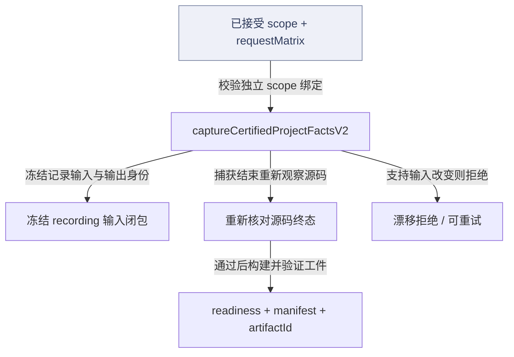
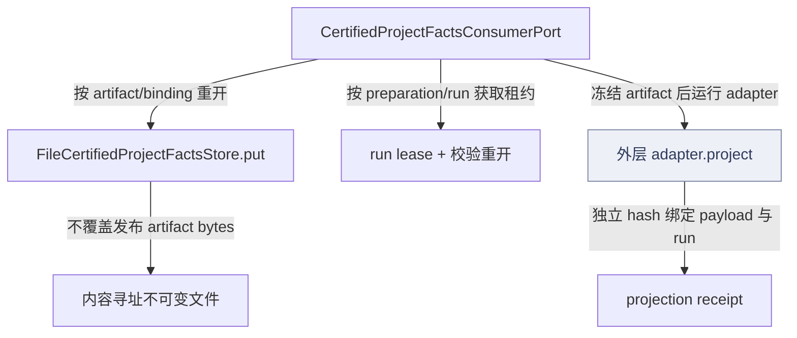
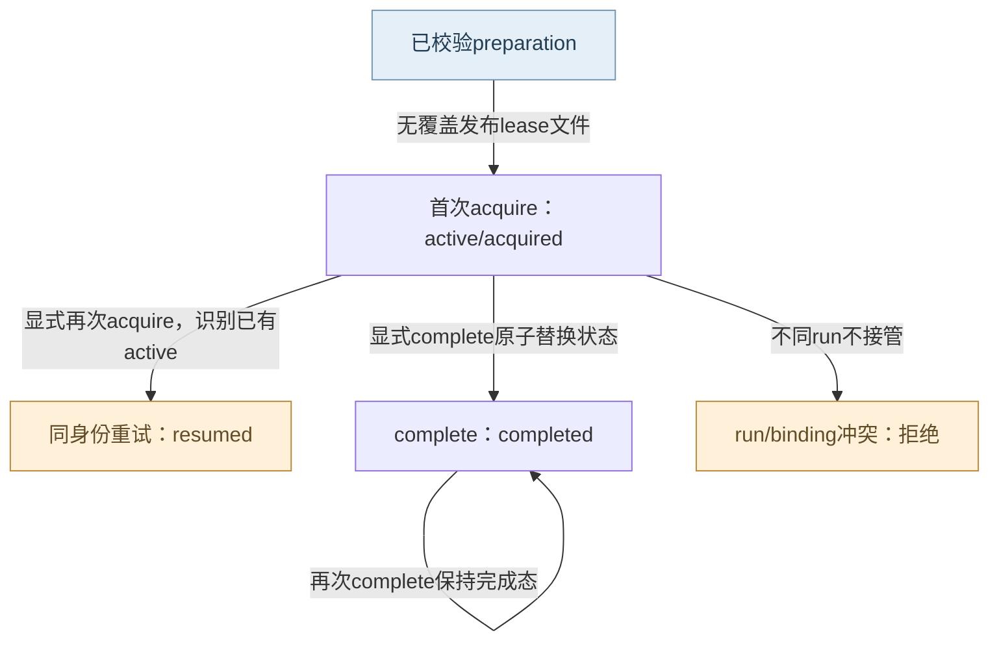
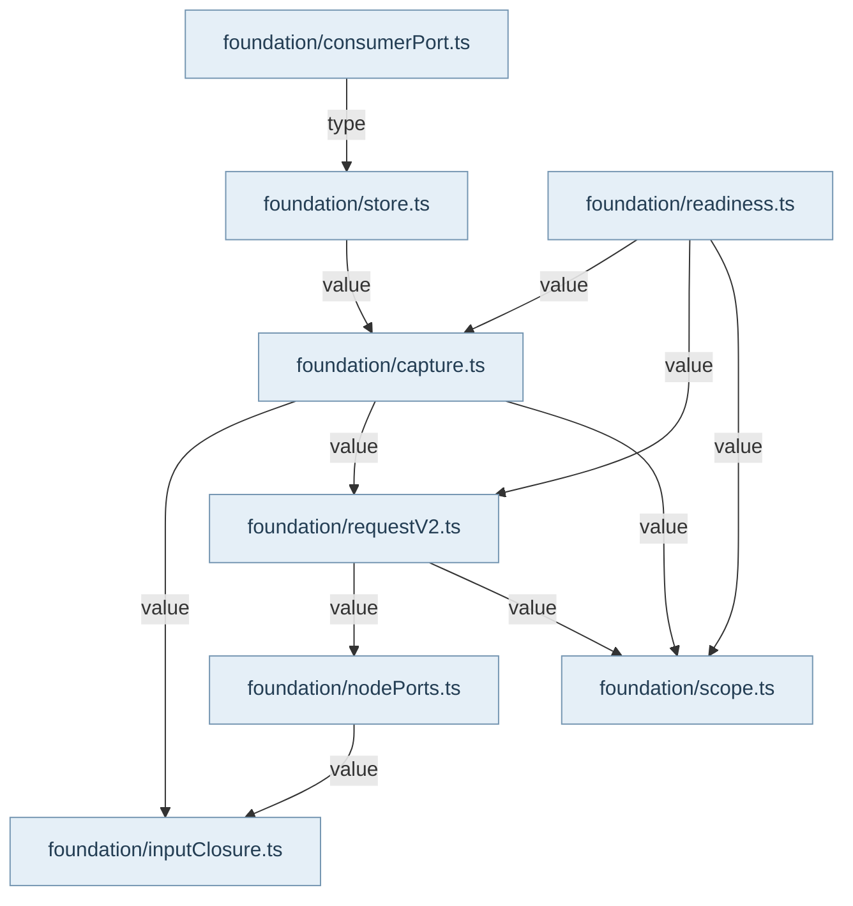

认证入口是 ./project-context-foundation 的 captureCertifiedProjectFactsV2。它先从调用输入取得脱离可变访问器的 scope/requestMatrix 快照，校验已接受 scope、源码绑定和矩阵身份，再进入内部 capture。V1 兼容路径与严格 V2 分开，不能只向旧对象追加字段便获得严格权限。核心输入包括 repository 库存、detail policy、请求计划和宿主端口；Core 负责守恒与身份规则，真实源码读取、Git 快照证明和分析会话由 host ports 接入。

捕获先枚举并读取库存，构建 inventory/detail 与字节 chunks；recording reader 记录请求实际依赖的目录、stat、realpath、配置及负读取。请求执行后 assertComplete，重新观察支持输入与源码终态，漂移即拒绝当前捕获。闭包冻结时记录这轮输出的 replayOutputHash，不在每次 capture 内额外重放一遍；离线 replay 能独立核验，但这个能力不能被写成每次生产捕获已执行第二轮分析。

factsContentHash、source revision vector、manifest、artifactId 和 certificationBindingHash 按非循环顺序形成。readiness 核对库存、细节、请求、owner 和依赖观察守恒；V2 再核对矩阵实际结果。语言×parser×owner 的代表请求不是每文件每调用的语义证明，缺能力和不适用要保留类型化结果，不能用成功总数掩盖空白。

FileCertifiedProjectFactsStore 仅接受通过 readiness 的工件。chunks、artifact、认证与 store receipt 内容寻址保存；临时文件 fsync、无覆盖发布、目录 fsync、回读支撑耐久性。同字节 replay 可恢复中断，碰撞字节拒绝。preparation 与 run lease 把一次准备绑定到一个 run；同 run 可以 resume，另一个 run 冲突，完成态不会被误写成新租约。

消费端先 acquireRunLease 和 open，重新校验工件与 certification，然后把 deepFreeze 的 artifact 交给真实 adapter.project，计算 payload hash 并生成 projection receipt。该链不回流 live ProjectContext，也不扫描当前源码补缺字段。Main 的 CertifiedProjectFactsRuntime 确实调用 capture V2、store.open 和 reopenWithAdapter，外层负责实际 adapter 与结束 lease。测试覆盖离线重放、输入漂移拒绝、不可变发布中断重放和投影不改基础认证；这些具体断言不等于所有宿主集成或真实新一次生产运行已经通过。

## 视图与术语

本页手工图描述已核对的关系与关键分叉；F1 也承担所列调用范围的业务纵切（V0）阅读，不能推出未画出的宿主自动调度。F0 文件依赖精选由同页选择集和 TypeScript 导入图生成，不是运行时轨迹。S0/R0 只描述正文指定的 owner、状态和恢复前提。公开 API、全部文件及变更影响见阅读器的对应入口。

`source` 为代码来源，`direct` 为直接绑定调用及断言，`indirect` 为经 helper/fixture 或间接行为的断言，`none` 为明确未覆盖。正文中的“宿主”指真实外层装配，不属于 Core 内部运行时。

## 模块协作与恢复边界深化

artifact、certification、preparation和run lease不是四个可以互换的ID。artifact表达内容地址；相同内容可携带不同accepted配置形成不同certificationBinding；preparation是一次消费准备的opaque身份；run lease只绑定这份preparation。故同工件允许创建另一份preparation，但不能在原preparation上悄悄换run或认证绑定。

存储的恢复语义要按发布阶段读：hardlink之前只可能有temp，之后可能有final而receipt尚缺。重新put不是覆盖写，而是逐项比较同字节并补齐剩余链；碰撞会保留旧final并拒绝。lease completion使用atomic rename，崩溃后同身份重试看见completed就返回completed，不要求再执行一次adapter。这里所有重放均由显式调用触发，无后台自动恢复器。

ConsumerPort取得lease之后才open和project，adapter异常不会回退成live ProjectContext，也不自动complete租约。requestMatrix/readiness解决的是已接受输入与请求结果守恒，不替代adapter真实成功或用户生产验收；frozen file/page和inputClosure都只读取工件已有字节，缺输入时必须停止。

<!-- atlas:generated:start -->

## 功能单元与调用接缝

各单元按真实入口拆分职责；门面暴露、内部调用和宿主装配是不同关系。关联图提供相邻阅读上下文，故障产生位置以条目源码为准。

<a id="m-M08-01" class="stable-anchor"></a>
<a id="scope-manifest与runtime-root绑定" class="stable-anchor"></a>

### Scope manifest与runtime root绑定

入口：`src/service/project-context/foundation/scope.ts#verifyProjectScopeCaptureBindingV1`

| 检查项 | 功能与边界 |
| --- | --- |
| 输入 | 已接受scope manifest与运行时controlRoot/sourceRoots |
| 输出 | 验证成功或拒绝替换/逃逸/同根别名 |
| 后续调用 / 绑定 | verifyProjectScopeManifest → resolveExistingRoot → 按controlRoot/relativeRoot重建 → canonical比较 |
| 状态与副作用 | 读取真实目录身份，不把绝对root加入portable semantic hash |
| 能力边界 | manifest自洽不够：真实root必须与accepted相对身份匹配；多个repo不允许别名同一物理根。 |

关联：[接受的 scope 到认证工件](README.md#graph-certified-capture-freeze) · 包入口 [@alembic/core/project-context-foundation](../../data/public-api.json)

返回业务旅程：[从源码读取到关系证据与认证工件 · 认证路径：scope、矩阵与输入围栏共同冻结](../../journeys/j02.md#J02-06)

<a id="m-M08-02" class="stable-anchor"></a>
<a id="requestmatrixtyped-na与实际结果守恒" class="stable-anchor"></a>

### RequestMatrix：typed N/A与实际结果守恒

入口：`src/service/project-context/foundation/requestV2.ts#evaluateProjectContextRequestMatrixV2`

| 检查项 | 功能与边界 |
| --- | --- |
| 输入 | expected矩阵、实际envelope rows、scope manifest |
| 输出 | ok与去重errors |
| 后续调用 / 绑定 | verify矩阵 → toIdentityRow →重复rowId检查 → expected/actual哈希比对 →重建每row identity |
| 状态与副作用 | 纯校验不执行查询，也不创造缺失结果 |
| 能力边界 | row身份含repo/kind/selector/scope/language/parser/owner；空输入仍有typed N/A，不能只凭结果数量相同通过。 |

关联：[接受的 scope 到认证工件](README.md#graph-certified-capture-freeze) · 包入口 [@alembic/core/project-context-foundation](../../data/public-api.json)

返回业务旅程：[从源码读取到关系证据与认证工件 · 认证路径：scope、矩阵与输入围栏共同冻结](../../journeys/j02.md#J02-06)

<a id="m-M08-03" class="stable-anchor"></a>
<a id="capture输入围栏和事实认证身份分离" class="stable-anchor"></a>

### Capture：输入围栏和事实/认证身份分离

入口：`src/service/project-context/foundation/capture.ts#captureCertifiedProjectFactsInternal`

| 检查项 | 功能与边界 |
| --- | --- |
| 输入 | 库存/细节policy、request plans、真实host ports、可选signal和strictV2上下文 |
| 输出 | 可重验artifact及readiness；漂移错误不返回成功工件 |
| 后续调用 / 绑定 | captureRepositories → detail/chunks → input capture → request outcomes → closure验证 → source终态重读 → readiness/manifest/artifact/binding |
| 状态与副作用 | 读取输入并冻结plain数据；本函数不写FileStore |
| 能力边界 | 没有inputCapture的host走显式legacy边界；replayOutputHash来自本次请求输出，离线重放是另一验证动作。 |

关联：[请求规范化、派发与结果封装](../06-project-context/README.md#graph-pc-request) · [当前正文必须与引用hash一致](../07-source-graph/README.md#graph-sg-evidence) · [接受的 scope 到认证工件](README.md#graph-certified-capture-freeze) · [F08-input-drift · 捕获后支持目录/配置/字节或source终态与起点不一致](README.md#f-F08-input-drift)

返回业务旅程：[从源码读取到关系证据与认证工件 · 按读取目标选择路径和身份](../../journeys/j02.md#J02-01) · [从源码读取到关系证据与认证工件 · 认证路径：scope、矩阵与输入围栏共同冻结](../../journeys/j02.md#J02-06)

<a id="m-M08-04" class="stable-anchor"></a>
<a id="inputclosure引用chunks重建完整离线输入" class="stable-anchor"></a>

### InputClosure：引用chunks重建完整离线输入

入口：`src/service/project-context/foundation/inputClosure.ts#hydrateProjectContextInputClosure`

| 检查项 | 功能与边界 |
| --- | --- |
| 输入 | closure引用表与已有chunks池 |
| 输出 | 完整ProjectInputSnapshot或结构/字节错误 |
| 后续调用 / 绑定 | 校验版本/hash/长度/重复引用 →匹配chunks → new ReplayProjectSourceReader虚拟roots → assertComplete |
| 状态与副作用 | 仅解码内存，不物化虚拟目录、不补读宿主FS |
| 能力边界 | 缺chunk、冲突bytes、非canonical引用都拒绝；frozen file/page也只消费artifact内部字节，不允许live补救。 |

关联：[接受的 scope 到认证工件](README.md#graph-certified-capture-freeze) · [不可变落盘与租约消费](README.md#graph-certified-durable-consumption)

返回业务旅程：[从源码读取到关系证据与认证工件 · 认证路径：scope、矩阵与输入围栏共同冻结](../../journeys/j02.md#J02-06) · [从源码读取到关系证据与认证工件 · 显式保存并按 artifact 与认证绑定重开](../../journeys/j02.md#J02-07)

<a id="m-M08-05" class="stable-anchor"></a>
<a id="filestore-putopen内容寻址与认证附属文件" class="stable-anchor"></a>

### FileStore put/open：内容寻址与认证附属文件

入口：`src/service/project-context/foundation/store.ts#FileCertifiedProjectFactsStore`

| 检查项 | 功能与边界 |
| --- | --- |
| 输入 | 完整artifact或artifactId+certificationBindingHash |
| 输出 | store receipt或重开工件 |
| 后续调用 / 绑定 | verifyArtifact/readiness → chunks不可变发布 → artifact → certification receipt → store receipt；open回读全链 |
| 状态与副作用 | 临时写/fsync/hardlink无覆盖/目录fsync/readback；同字节重试可补齐中断链 |
| 能力边界 | artifact身份与certificationBinding分离；同artifact不同认证需独立认证记录；已有不同字节绝不覆盖。 |

关联：[不可变落盘与租约消费](README.md#graph-certified-durable-consumption) · [F08-readiness-rejected · 请求超时/取消/失败等形成failed readiness](README.md#f-F08-readiness-rejected) · [F08-immutable-publish-crash · 临时文件fsync后或最终hardlink发布后、回执未完成时进程/注入故障](README.md#f-F08-immutable-publish-crash) · [F08-immutable-collision · 内容地址路径已有不同字节，包括伪造partial final](README.md#f-F08-immutable-collision) · 包入口 [@alembic/core/project-context-foundation](../../data/public-api.json)

返回业务旅程：[从源码读取到关系证据与认证工件 · 显式保存并按 artifact 与认证绑定重开](../../journeys/j02.md#J02-07)

<a id="m-M08-06" class="stable-anchor"></a>
<a id="preparation与run-lease不等于artifact全局锁" class="stable-anchor"></a>

### Preparation与run lease：不等于artifact全局锁

入口：`src/service/project-context/foundation/store.ts#FileCertifiedProjectFactsStore`

| 检查项 | 功能与边界 |
| --- | --- |
| 输入 | artifact+binding创建opaque preparation；prep/run/expectedBinding申请或完成 |
| 输出 | acquired/resumed/completed的lease receipt，或冲突 |
| 后续调用 / 绑定 | createPreparation先open →随机prepId immutable写；acquire无覆盖发布 →身份比较；complete acquire后atomic replace |
| 状态与副作用 | 一份preparation的lease文件绑定一个run，完成文件以rename替换 |
| 能力边界 | 同artifact可以有不同preparation；已有preparation不自动换run/换binding，completed仍返回completed而非重新激活。 |

关联：[不可变落盘与租约消费](README.md#graph-certified-durable-consumption) · [Preparation租约状态与显式中断重放](README.md#graph-foundation-lease-state-and-replay) · [F08-run-conflict · 同preparation已有不同run或expectedCertificationBindingHash改变](README.md#f-F08-run-conflict) · [F08-lease-completion-crash · active lease已发布，或complete的rename后中断](README.md#f-F08-lease-completion-crash) · 包入口 [@alembic/core/project-context-foundation](../../data/public-api.json)

返回业务旅程：[从源码读取到关系证据与认证工件 · 创建 preparation、租约消费并显式完成](../../journeys/j02.md#J02-08)

<a id="m-M08-07" class="stable-anchor"></a>
<a id="consumerportadapter隔离与单向消费" class="stable-anchor"></a>

### ConsumerPort：adapter隔离与单向消费

入口：`src/service/project-context/foundation/consumerPort.ts#CertifiedProjectFactsConsumerPort`

| 检查项 | 功能与边界 |
| --- | --- |
| 输入 | prep/run/consumer/expectedBinding和真实adapter版本、entrypoint/schema/load证据 |
| 输出 | payload、独立projection receipt和基础binding |
| 后续调用 / 绑定 | acquireRunLease → store.open →验证adapter标识 → deepFreeze → adapter.project → payload/hash/receipt |
| 状态与副作用 | 读取durable store；adapter自身效果由宿主负责；port不回扫live源码 |
| 能力边界 | adapter抛错或改冻结对象则没有成功receipt；port不自动complete lease，宿主必须显式完成或决定重试。 |

关联：[不可变落盘与租约消费](README.md#graph-certified-durable-consumption) · [Preparation租约状态与显式中断重放](README.md#graph-foundation-lease-state-and-replay) · [完整严格计划：校验、完整分母与上限拒绝](../09-planning-host-workflows/README.md#graph-strict-plan-compilation) · [F08-adapter-mutation · adapter.project尝试修改deepFreeze后的基础artifact或自行抛错](README.md#f-F08-adapter-mutation) · 包入口 [@alembic/core/project-context-foundation](../../data/public-api.json)

返回业务旅程：[从源码读取到关系证据与认证工件 · 创建 preparation、租约消费并显式完成](../../journeys/j02.md#J02-08) · [从认证规划输入到事实、机制与归纳反证回执 · 选择认证规划投影与已接受配置](../../journeys/j03.md#J03-S01)


## 生成的图与逐边依据

此区域由同页结构化图模型生成；请修改 frontmatter，再显式运行 `npm run inventory:write`，不要单独修改表格或 Mermaid。

<a id="graph-certified-capture-freeze"></a>

### 接受的 scope 到认证工件

图 ID：`certified-capture-freeze` · V0 · capture 先完成输入与终态校验再生成身份；漂移拒绝本轮工件。



| 边 ID | 关系 | 源码定位 | 断言关系 | case / 缺口 | 相关旅程步骤 |
| --- | --- | --- | --- | --- | --- |
| <a id="e-certified-capture-freeze--scope-v2-capture"></a>scope-v2-capture | 校验独立 scope 绑定 | `src/service/project-context/foundation/capture.ts#captureCertifiedProjectFactsV2` | direct | derives strict capture from an independently sealed project scope receipt | [J02 · 按读取目标选择路径和身份](../../journeys/j02.md#J02-01) · [J02 · 认证路径：scope、矩阵与输入围栏共同冻结](../../journeys/j02.md#J02-06) |
| <a id="e-certified-capture-freeze--capture-freeze-closure"></a>capture-freeze-closure | 冻结记录输入与输出身份 | `src/service/project-context/foundation/capture.ts#captureCertifiedProjectFactsInternal` | indirect | replays every certified request from serialized inputs after removing the source tree | [J02 · 认证路径：scope、矩阵与输入围栏共同冻结](../../journeys/j02.md#J02-06) |
| <a id="e-certified-capture-freeze--capture-source-fence"></a>capture-source-fence | 捕获结束重新观察源码 | `src/service/project-context/foundation/capture.ts#captureCertifiedProjectFactsInternal` | indirect | replays every certified request from serialized inputs after removing the source tree | [J02 · 认证路径：scope、矩阵与输入围栏共同冻结](../../journeys/j02.md#J02-06) |
| <a id="e-certified-capture-freeze--fence-artifact"></a>fence-artifact | 通过后构建并验证工件 | `src/service/project-context/foundation/capture.ts#captureCertifiedProjectFactsInternal` | indirect | replays every certified request from serialized inputs after removing the source tree | [J02 · 认证路径：scope、矩阵与输入围栏共同冻结](../../journeys/j02.md#J02-06) |
| <a id="e-certified-capture-freeze--capture-drift-reject"></a>capture-drift-reject | 支持输入改变则拒绝 | `src/service/project-context/foundation/capture.ts#captureCertifiedProjectFactsInternal` | direct | rejects supporting-input drift before certifying and retains deduplicated source blobs |  |

<a id="graph-certified-durable-consumption"></a>

### 不可变落盘与租约消费

图 ID：`certified-durable-consumption` · R0 · store 的耐久发布与 consumer adapter 的投影收据是分开的效果；重试仅复用相同字节/相同 run。



| 边 ID | 关系 | 源码定位 | 断言关系 | case / 缺口 | 相关旅程步骤 |
| --- | --- | --- | --- | --- | --- |
| <a id="e-certified-durable-consumption--store-immutable-publish"></a>store-immutable-publish | 不覆盖发布 artifact bytes | `src/service/project-context/foundation/store.ts#FileCertifiedProjectFactsStore` | direct | replays an immutable publish interrupted after the atomic publish step | [J02 · 显式保存并按 artifact 与认证绑定重开](../../journeys/j02.md#J02-07) |
| <a id="e-certified-durable-consumption--consumer-acquire-lease"></a>consumer-acquire-lease | 按 preparation/run 获取租约 | `src/service/project-context/foundation/consumerPort.ts#CertifiedProjectFactsConsumerPort` | direct | reopens durable content-addressed artifacts and refuses a second run consumer | [J02 · 创建 preparation、租约消费并显式完成](../../journeys/j02.md#J02-08) |
| <a id="e-certified-durable-consumption--consumer-open-store"></a>consumer-open-store | 按 artifact/binding 重开 | `src/service/project-context/foundation/consumerPort.ts#CertifiedProjectFactsConsumerPort` | direct | seals actual post-open projection receipts without mutating the base certification | [J02 · 创建 preparation、租约消费并显式完成](../../journeys/j02.md#J02-08) |
| <a id="e-certified-durable-consumption--consumer-project-adapter"></a>consumer-project-adapter | 冻结 artifact 后运行 adapter | `src/service/project-context/foundation/consumerPort.ts#CertifiedProjectFactsConsumerPort` | direct | seals actual post-open projection receipts without mutating the base certification | [J02 · 创建 preparation、租约消费并显式完成](../../journeys/j02.md#J02-08) |
| <a id="e-certified-durable-consumption--adapter-projection-receipt"></a>adapter-projection-receipt | 独立 hash 绑定 payload 与 run | `src/service/project-context/foundation/consumerPort.ts#CertifiedProjectFactsConsumerPort` | direct | seals actual post-open projection receipts without mutating the base certification | [J02 · 创建 preparation、租约消费并显式完成](../../journeys/j02.md#J02-08) |

<a id="graph-foundation-lease-state-and-replay"></a>

### Preparation租约状态与显式中断重放

图 ID：`foundation-lease-state-and-replay` · S0 · 同prep/run/binding才能恢复；completed不被重激活。中断后由宿主显式再次调用，不存在后台自动重试。



| 边 ID | 关系 | 源码定位 | 断言关系 | case / 缺口 | 相关旅程步骤 |
| --- | --- | --- | --- | --- | --- |
| <a id="e-foundation-lease-state-and-replay--LEASE-1"></a>LEASE-1 | 无覆盖发布lease文件 | `src/service/project-context/foundation/store.ts#FileCertifiedProjectFactsStore` | direct | replays lease acquisition and completion crashes without exposing partial JSON |  |
| <a id="e-foundation-lease-state-and-replay--LEASE-2"></a>LEASE-2 | 显式再次acquire，识别已有active | `src/service/project-context/foundation/store.ts#FileCertifiedProjectFactsStore` | direct | replays lease acquisition and completion crashes without exposing partial JSON |  |
| <a id="e-foundation-lease-state-and-replay--LEASE-3"></a>LEASE-3 | 显式complete原子替换状态 | `src/service/project-context/foundation/store.ts#FileCertifiedProjectFactsStore` | direct | replays lease acquisition and completion crashes without exposing partial JSON | [J02 · 创建 preparation、租约消费并显式完成](../../journeys/j02.md#J02-08) |
| <a id="e-foundation-lease-state-and-replay--LEASE-4"></a>LEASE-4 | 再次complete保持完成态 | `src/service/project-context/foundation/store.ts#FileCertifiedProjectFactsStore` | direct | replays lease acquisition and completion crashes without exposing partial JSON |  |
| <a id="e-foundation-lease-state-and-replay--LEASE-5"></a>LEASE-5 | 不同run不接管 | `src/service/project-context/foundation/store.ts#FileCertifiedProjectFactsStore` | direct | reopens durable content-addressed artifacts and refuses a second run consumer |  |

<a id="graph-dependencies-08"></a>

### 文件依赖精选 · 静态关系

图 ID：`dependencies-08` · F0 · 显式选择集内的实际导入；类型边不代表运行调用，动态未知保留在全量索引。



| 边 ID | 关系 | 源码定位 | 断言关系 | case / 缺口 | 相关旅程步骤 |
| --- | --- | --- | --- | --- | --- |
| <a id="e-dependencies-08--dep-08-0"></a>dep-08-0 | value | `src/service/project-context/foundation/capture.ts#<module>` | none | TypeScript AST 静态导入事实，不主张运行调用或断言覆盖。 |  |
| <a id="e-dependencies-08--dep-08-1"></a>dep-08-1 | value | `src/service/project-context/foundation/capture.ts#<module>` | none | TypeScript AST 静态导入事实，不主张运行调用或断言覆盖。 |  |
| <a id="e-dependencies-08--dep-08-2"></a>dep-08-2 | value | `src/service/project-context/foundation/capture.ts#<module>` | none | TypeScript AST 静态导入事实，不主张运行调用或断言覆盖。 |  |
| <a id="e-dependencies-08--dep-08-3"></a>dep-08-3 | type | `src/service/project-context/foundation/consumerPort.ts#<module>` | none | TypeScript AST 静态导入事实，不主张运行调用或断言覆盖。 |  |
| <a id="e-dependencies-08--dep-08-4"></a>dep-08-4 | value | `src/service/project-context/foundation/nodePorts.ts#<module>` | none | TypeScript AST 静态导入事实，不主张运行调用或断言覆盖。 |  |
| <a id="e-dependencies-08--dep-08-5"></a>dep-08-5 | value | `src/service/project-context/foundation/readiness.ts#<module>` | none | TypeScript AST 静态导入事实，不主张运行调用或断言覆盖。 |  |
| <a id="e-dependencies-08--dep-08-6"></a>dep-08-6 | value | `src/service/project-context/foundation/readiness.ts#<module>` | none | TypeScript AST 静态导入事实，不主张运行调用或断言覆盖。 |  |
| <a id="e-dependencies-08--dep-08-7"></a>dep-08-7 | value | `src/service/project-context/foundation/readiness.ts#<module>` | none | TypeScript AST 静态导入事实，不主张运行调用或断言覆盖。 |  |
| <a id="e-dependencies-08--dep-08-8"></a>dep-08-8 | value | `src/service/project-context/foundation/requestV2.ts#<module>` | none | TypeScript AST 静态导入事实，不主张运行调用或断言覆盖。 |  |
| <a id="e-dependencies-08--dep-08-9"></a>dep-08-9 | value | `src/service/project-context/foundation/requestV2.ts#<module>` | none | TypeScript AST 静态导入事实，不主张运行调用或断言覆盖。 |  |
| <a id="e-dependencies-08--dep-08-10"></a>dep-08-10 | value | `src/service/project-context/foundation/store.ts#<module>` | none | TypeScript AST 静态导入事实，不主张运行调用或断言覆盖。 |  |

## 失败后的状态与恢复责任

先检查已落盘状态，再决定恢复。自动动作只描述代码已执行的分支；显式恢复不能据提示文字推断为自动调用。

<a id="f-F08-input-drift" class="stable-anchor"></a>
<a id="f08-input-drift--捕获后支持目录配置字节或source终态与起点不一致" class="stable-anchor"></a>

### F08-input-drift · 捕获后支持目录/配置/字节或source终态与起点不一致

| 检查项 | 当前代码语义 |
| --- | --- |
| 已留下什么 | 本次内存结果不成为可认证artifact；尚未写store |
| Core自动做什么 | inputCapture.verify错误归类为ProjectContextSourceStateDriftError并重抛 |
| 谁显式恢复 | 调用者重新固定一致输入后显式重做capture；retryable是建议语义，不是内部自动循环 |
| 必须停止的条件 | 不能把瞬时漂移后恢复原字节当成读过原始快照 |
| 源码定位 | `src/service/project-context/foundation/capture.ts#captureCertifiedProjectFactsInternal` |

```ts
throw new ProjectContextSourceStateDriftError('analysis-inputs', error);
```

关联：[Capture：输入围栏和事实/认证身份分离](README.md#m-M08-03) · [请求规范化、派发与结果封装](../06-project-context/README.md#graph-pc-request) · [当前正文必须与引用hash一致](../07-source-graph/README.md#graph-sg-evidence) · [接受的 scope 到认证工件](README.md#graph-certified-capture-freeze)

返回业务旅程：[从源码读取到关系证据与认证工件 · 按读取目标选择路径和身份](../../journeys/j02.md#J02-01) · [从源码读取到关系证据与认证工件 · 认证路径：scope、矩阵与输入围栏共同冻结](../../journeys/j02.md#J02-06) · [从认证规划输入到事实、机制与归纳反证回执 · 显式装配冻结subject、witness和backend](../../journeys/j03.md#J03-S03)

断言关系：**direct**。`test/ProjectContextFoundation.test.ts` · `rejects supporting-input drift before certifying and retains deduplicated source blobs`

新增支持目录触发retryable漂移；恢复后捕获保留去重chunks（negative）。这里只定位断言；实际运行范围见独立运行证据。

```ts
await expect(
        captureCertifiedProjectFactsV2(fixture.input, fixture.ports)
      ).rejects.toMatchObject({
        code: 'PROJECT_CONTEXT_SOURCE_STATE_DRIFT',
        retryable: true,
      });
```

<a id="f-F08-readiness-rejected" class="stable-anchor"></a>
<a id="f08-readiness-rejected--请求超时取消失败等形成failed-readiness" class="stable-anchor"></a>

### F08-readiness-rejected · 请求超时/取消/失败等形成failed readiness

| 检查项 | 当前代码语义 |
| --- | --- |
| 已留下什么 | 调用者可检查失败artifact的outcomes，但put不发布它 |
| Core自动做什么 | FileStore.put先verify并拒绝readiness!=passed |
| 谁显式恢复 | 修复请求能力/取消原因后显式重新capture，再另行put |
| 必须停止的条件 | 失败readiness不可作为durable可消费真相 |
| 源码定位 | `src/service/project-context/foundation/store.ts#FileCertifiedProjectFactsStore` |

```ts
if (artifact.readiness.verdict !== 'passed') {
```

关联：[FileStore put/open：内容寻址与认证附属文件](README.md#m-M08-05) · [接受的 scope 到认证工件](README.md#graph-certified-capture-freeze) · [不可变落盘与租约消费](README.md#graph-certified-durable-consumption) · [完整严格计划：校验、完整分母与上限拒绝](../09-planning-host-workflows/README.md#graph-strict-plan-compilation) · 包入口 [@alembic/core/project-context-foundation](../../data/public-api.json)

返回业务旅程：[从源码读取到关系证据与认证工件 · 认证路径：scope、矩阵与输入围栏共同冻结](../../journeys/j02.md#J02-06) · [从源码读取到关系证据与认证工件 · 显式保存并按 artifact 与认证绑定重开](../../journeys/j02.md#J02-07) · [从认证规划输入到事实、机制与归纳反证回执 · 选择认证规划投影与已接受配置](../../journeys/j03.md#J03-S01)

断言关系：**direct**。`test/ProjectContextFoundation.test.ts` · `records cancellation, timeout, and errors honestly and blocks failed readiness storage`

failed readiness不能落盘（negative）。这里只定位断言；实际运行范围见独立运行证据。

```ts
await expect(
      new FileCertifiedProjectFactsStore(root, { logger: { info() {}, warn() {} } }).put(artifact)
    ).rejects.toThrow(/failed strict readiness/);
```

<a id="f-F08-immutable-publish-crash" class="stable-anchor"></a>
<a id="f08-immutable-publish-crash--临时文件fsync后或最终hardlink发布后回执未完成时进程注入故障" class="stable-anchor"></a>

### F08-immutable-publish-crash · 临时文件fsync后或最终hardlink发布后、回执未完成时进程/注入故障

| 检查项 | 当前代码语义 |
| --- | --- |
| 已留下什么 | 可能保留孤儿temp或已发布完整final；store receipt可能尚缺 |
| Core自动做什么 | 本次调用抛错；没有后台重试。下一次显式put会识别相同bytes并继续发布剩余记录 |
| 谁显式恢复 | 同artifact显式put重放，再open核对；不得用存在final单独认定整链完成 |
| 必须停止的条件 | 任何readback/receipt未完成前不声称durable链已确认 |
| 源码定位 | `src/service/project-context/foundation/store.ts#FileCertifiedProjectFactsStore` |

#### 恢复检查顺序

前提：put 在 temp fsync 或 final hardlink 发布之后、完整回执返回前中断；原完整 artifact、artifactId、certificationBindingHash 和 store root 均可确认。

1. 检查原调用错误和 durability checkpoint — 异常不证明 final 不存在；可能留下 temp 或已发布完整 final。
2. 以原 artifact/binding 尝试 open 并检查 chunk、认证及回执链 — 能识别哪些完整对象已发布、哪些附属步骤尚缺；不能直接覆盖冲突路径。

显式动作：在排除原环境故障后，以完全相同 artifact 字节显式重试 put；无覆盖发布允许复用相同内容并补齐缺失链，再 open 复验。

重试身份：严格复用原 artifactId、binding 与 chunk 字节；不同认证应是独立认证记录，不替换同地址内容。

完成断言：put 返回 receipt 后，以同 artifactId/binding open；检查 factsContentHash、manifest 与 chunks 字节/hash，确认没有半写 final 被接受。

停止条件：已有 final 不同字节、chunk 损坏、binding mismatch 或 readiness 未通过时停止；不能删除冲突文件后强行重试或 live 重捕获冒充原 artifact。

```ts
await this.#checkpoint(`${operation}-after-publish`, relativeRef);
```

关联：[FileStore put/open：内容寻址与认证附属文件](README.md#m-M08-05) · [不可变落盘与租约消费](README.md#graph-certified-durable-consumption) · 包入口 [@alembic/core/project-context-foundation](../../data/public-api.json)

返回业务旅程：[从源码读取到关系证据与认证工件 · 显式保存并按 artifact 与认证绑定重开](../../journeys/j02.md#J02-07)

断言关系：**direct**。`test/ProjectContextFoundation.test.ts` · `replays an immutable publish interrupted after the atomic publish step`

发布中断后显式同字节put可恢复并open保真（recovery）。这里只定位断言；实际运行范围见独立运行证据。

```ts
await expect(
      replayStore.open(artifact.artifactId, artifact.certificationBindingHash)
    ).resolves.toEqual(artifact);
```

<a id="f-F08-immutable-collision" class="stable-anchor"></a>
<a id="f08-immutable-collision--内容地址路径已有不同字节包括伪造partial-final" class="stable-anchor"></a>

### F08-immutable-collision · 内容地址路径已有不同字节，包括伪造partial final

| 检查项 | 当前代码语义 |
| --- | --- |
| 已留下什么 | 旧final保留；不覆盖，不构造成功receipt |
| Core自动做什么 | EEXIST读回已有文件；#writeImmutable比较不等抛collision |
| 谁显式恢复 | 调用者调查/隔离受损store并从可信artifact重建；Core无自动覆盖修复 |
| 必须停止的条件 | 不能把同名路径等同内容已认证 |
| 源码定位 | `src/service/project-context/foundation/store.ts#FileCertifiedProjectFactsStore` |

```ts
throw new TypeError(`Content-addressed store collision at ${relativeRef}.`);
```

关联：[FileStore put/open：内容寻址与认证附属文件](README.md#m-M08-05) · [不可变落盘与租约消费](README.md#graph-certified-durable-consumption) · 包入口 [@alembic/core/project-context-foundation](../../data/public-api.json)

返回业务旅程：[从源码读取到关系证据与认证工件 · 显式保存并按 artifact 与认证绑定重开](../../journeys/j02.md#J02-07)

断言关系：**direct**。`test/ProjectContextFoundation.test.ts` · `ignores an orphan temp after file fsync and refuses a partial immutable final`

partial final导致collision且原bytes仍保留（negative）。这里只定位断言；实际运行范围见独立运行证据。

```ts
await expect(collisionStore.put(artifact)).rejects.toThrow(/collision/);
```

<a id="f-F08-run-conflict" class="stable-anchor"></a>
<a id="f08-run-conflict--同preparation已有不同run或expectedcertificationbindinghash改变" class="stable-anchor"></a>

### F08-run-conflict · 同preparation已有不同run或expectedCertificationBindingHash改变

| 检查项 | 当前代码语义 |
| --- | --- |
| 已留下什么 | 原lease与工件不被替换 |
| Core自动做什么 | 抛ProjectFactsLeaseConflictError并诊断 |
| 谁显式恢复 | 由宿主确认是否使用新preparation/正确run；不存在强抢/自动接管 |
| 必须停止的条件 | 身份冲突时禁止继续adapter消费 |
| 源码定位 | `src/service/project-context/foundation/store.ts#FileCertifiedProjectFactsStore` |

```ts
existing.runId !== runId
```

关联：[Preparation与run lease：不等于artifact全局锁](README.md#m-M08-06) · [不可变落盘与租约消费](README.md#graph-certified-durable-consumption) · [Preparation租约状态与显式中断重放](README.md#graph-foundation-lease-state-and-replay) · 包入口 [@alembic/core/project-context-foundation](../../data/public-api.json)

返回业务旅程：[从源码读取到关系证据与认证工件 · 创建 preparation、租约消费并显式完成](../../journeys/j02.md#J02-08)

断言关系：**direct**。`test/ProjectContextFoundation.test.ts` · `reopens durable content-addressed artifacts and refuses a second run consumer`

同preparation其他run被拒绝，不替换已有lease（negative）。这里只定位断言；实际运行范围见独立运行证据。

```ts
await expect(
      store.acquireRunLease({
        preparationId: preparation.preparationId,
        runId: 'run-b',
        expectedCertificationBindingHash: artifact.certificationBindingHash,
      })
    ).rejects.toBeInstanceOf(ProjectFactsLeaseConflictError);
```

<a id="f-F08-lease-completion-crash" class="stable-anchor"></a>
<a id="f08-lease-completion-crash--active-lease已发布或complete的rename后中断" class="stable-anchor"></a>

### F08-lease-completion-crash · active lease已发布，或complete的rename后中断

| 检查项 | 当前代码语义 |
| --- | --- |
| 已留下什么 | lease文件是完整active/completed JSON；调用结果可能未确认 |
| Core自动做什么 | 本次抛错；下一次同run显式acquire得resumed，显式complete得completed |
| 谁显式恢复 | 宿主按同一prep/run/binding重试，不换身份绕过 |
| 必须停止的条件 | 不能用第一次异常判定租约未产生，也不能把已completed重激活 |
| 源码定位 | `src/service/project-context/foundation/store.ts#FileCertifiedProjectFactsStore` |

#### 恢复检查顺序

前提：active lease 发布或 complete 的原子 rename 后中断；已确认原 preparationId、runId、expectedCertificationBindingHash 和消费副作用记录。

1. 按相同身份显式 acquireRunLease — 返回 resumed 表示 active 已存在；completed 表示完成态已落盘，第一次异常不代表未执行。
2. 核对 adapter/宿主动作是否已成功产生 payload 与独立 receipt — 租约状态只证明租约，不证明宿主副作用可安全重复；ConsumerPort 不自动 complete。

显式动作：按已观察到的消费结果决定是否继续同 run，成功处理后显式 completeRunLease。若 complete 已落盘但回应丢失，同身份再次 complete 会返回 completed。

重试身份：始终保持同 preparation/run/binding；不换 run 或伪造 binding 绕过冲突。不同 preparation 是新的消费安排，不能称为接管旧 run。

完成断言：同身份 complete 返回 completed，随后 acquire 也仍 completed；重新 open 基础 artifact 确认原 binding/事实未变，保存宿主副作用与投影结果的独立记录。

停止条件：出现 ProjectFactsLeaseConflictError、无法确认副作用是否发生或 adapter 仍抛错时停止；不得把 resumed 自动视为“可以重放任何外部动作”。

```ts
await this.#replaceAtomically(current.leaseRef, canonicalJsonStringify(lease));
```

关联：[Preparation与run lease：不等于artifact全局锁](README.md#m-M08-06) · [不可变落盘与租约消费](README.md#graph-certified-durable-consumption) · [Preparation租约状态与显式中断重放](README.md#graph-foundation-lease-state-and-replay) · 包入口 [@alembic/core/project-context-foundation](../../data/public-api.json)

返回业务旅程：[从源码读取到关系证据与认证工件 · 创建 preparation、租约消费并显式完成](../../journeys/j02.md#J02-08)

断言关系：**direct**。`test/ProjectContextFoundation.test.ts` · `replays lease acquisition and completion crashes without exposing partial JSON`

完成状态rename后中断，显式再次complete得到completed（recovery）。这里只定位断言；实际运行范围见独立运行证据。

```ts
await expect(
      replay.completeRunLease({
        preparationId: preparation.preparationId,
        runId: 'run-crash',
        expectedCertificationBindingHash: artifact.certificationBindingHash,
      })
    ).resolves.toMatchObject({ status: 'completed' });
```

<a id="f-F08-adapter-mutation" class="stable-anchor"></a>
<a id="f08-adapter-mutation--adapterproject尝试修改deepfreeze后的基础artifact或自行抛错" class="stable-anchor"></a>

### F08-adapter-mutation · adapter.project尝试修改deepFreeze后的基础artifact或自行抛错

| 检查项 | 当前代码语义 |
| --- | --- |
| 已留下什么 | 已取得的lease仍存在；durable基础artifact不变；没有成功projection receipt |
| Core自动做什么 | 冻结对象使违规写失败；异常传播；不自动释放/complete lease |
| 谁显式恢复 | 宿主修复adapter后在同身份下决定显式重试或完成处理；不可借live扫描补未获批准输入 |
| 必须停止的条件 | 没有真实adapter成功payload时不签projection通过 |
| 源码定位 | `src/service/project-context/foundation/consumerPort.ts#CertifiedProjectFactsConsumerPort` |

```ts
const payload = toProjectFactsJson(await input.adapter.project(adapterView));
```

关联：[ConsumerPort：adapter隔离与单向消费](README.md#m-M08-07) · [不可变落盘与租约消费](README.md#graph-certified-durable-consumption) · [Preparation租约状态与显式中断重放](README.md#graph-foundation-lease-state-and-replay) · 包入口 [@alembic/core/project-context-foundation](../../data/public-api.json)

返回业务旅程：[从源码读取到关系证据与认证工件 · 创建 preparation、租约消费并显式完成](../../journeys/j02.md#J02-08)

断言关系：**direct**。`test/ProjectContextFoundation.test.ts` · `seals actual post-open projection receipts without mutating the base certification`

恶意adapter不能改变可重开的基础artifact（negative）。这里只定位断言；实际运行范围见独立运行证据。

```ts
await expect(
      store.open(artifact.artifactId, artifact.certificationBindingHash)
    ).resolves.toMatchObject({
      certificationBindingHash: sealedBase.certificationBindingHash,
      facts: { inventory: { fileCount: artifact.facts.inventory.fileCount } },
    });
```


<!-- atlas:generated:end -->
