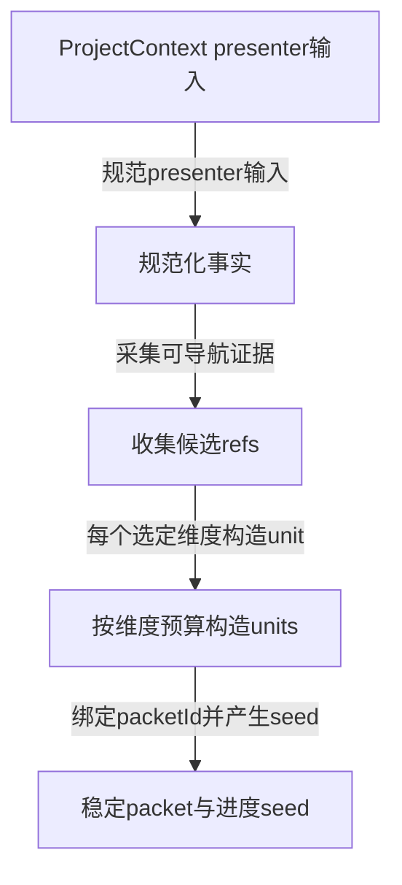
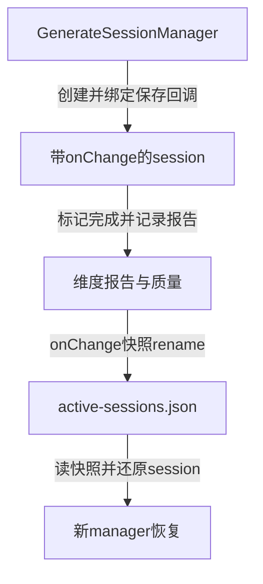
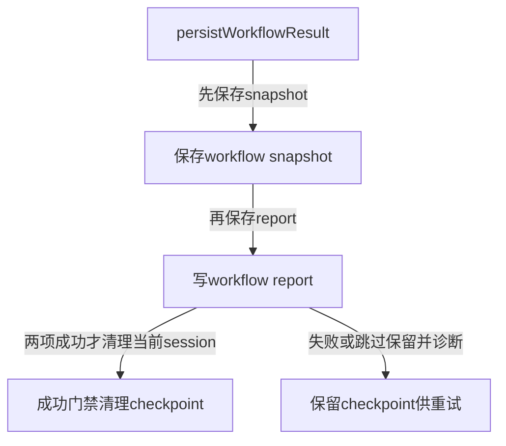
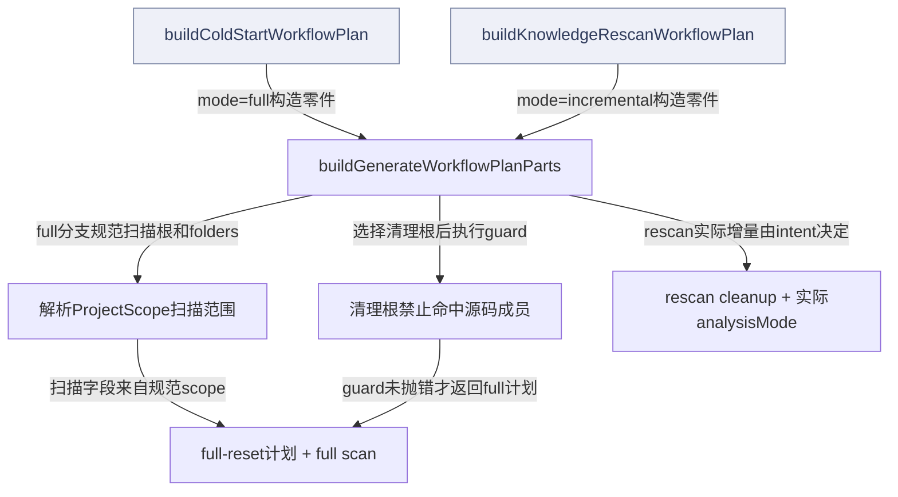
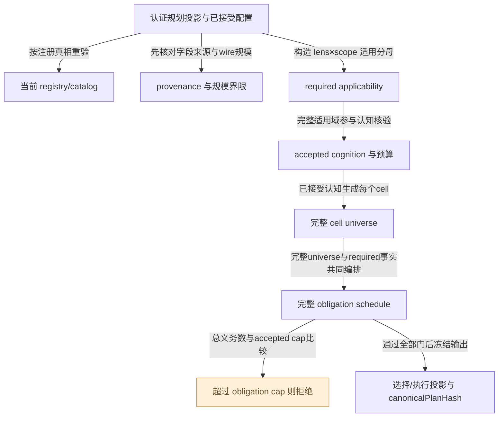
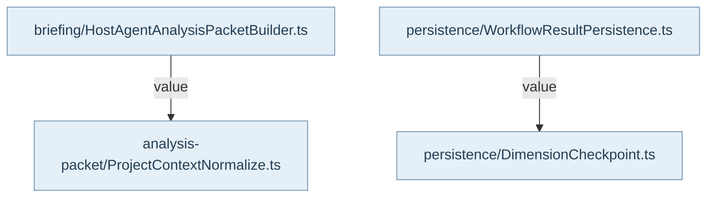

## 两条路线与真实边界

本专题连接计划事实、普通host-agent任务和工作流持久化。严格生产的完整分母、独立评审与authority另见专题15；普通维度target、quality score、coverage grade与CompletenessCritic均为建议，不能替代严格生产授权。Core提供可运行的采集、投影、会话、覆盖账本和保存逻辑；模型调用、工具执行、MCP、文件投递与外层调度仍归宿主。

collectPlanProjectContext在同一个ProjectContext session中采集space→repo→map，再按配置选少量文件细节。模块seed来自repo的canonical partition；maxFiles只限制扫描库存，不能用它偷偷截断模块划分。收集回执分别记录截断、过滤、缺口与来源。full与incremental计划由buildGenerateWorkflowPlanParts汇合，full-reset的清理根和扫描根不同；ProjectScope成员源码根不能成为误删清理目标。

## 面向宿主的任务投影

HostAgentAnalysisPacketBuilder消费presenter input和维度清单，归一事实、收集候选refs、按maxUnits投影units，再聚合requiredReadSet、structuralEvidenceRefs与progressSeed。稳定键包括scope、文件、符号和范围；shortAlias只用于展示搜索。遗漏通过budget表达，不把提示预算当全事实分母。MissionBriefing提供技术栈、维度SOP与submission contract，旧snapshot没有的数据保持空值，不生成假调用图。

Main的ProjectContextWorkflowFacts真实把同一presenterInput交给briefing与packet两个builder。两个产物并列服务宿主，Core中没有一条“briefing必然执行agent”的调用。图只展示实际builder调用，宿主编排在consumer证据中说明。

## 会话、落盘与恢复

GenerateSessionManager按项目管理阻塞lease，创建前重读存储并拒绝未过期同项目session；session维护维度报告、候选提交和跨维度hint。markDimensionComplete拒绝未知维度，写入sessionStore、提取负空间信号并计算质量，再触发onChange。配置dataRoot时manager将完整快照写临时文件再rename至active-sessions.json；未配置存储时是内存会话。重启后恢复同一session id和报告。

R11已确认：两个manager持有同一session时，普通onChange写前不重新加载磁盘、无revision CAS或共享写锁；顺序交错更新也可能丢另一manager已完成维度。rename仅避免半写，不解决丢更新。既有“createSession触发reload后再写”测试不能证明普通onChange多writer安全，当前Atlas保留此限制，不修复产品。

最终persistWorkflowResult先保存snapshot，再写report。只有snapshot=saved且report非null时才清理当前session的DimensionCheckpoint；失败或跳过保留检查点并记录重试诊断，其他session不受影响。它不是跨SQLite/JSON/检查点的一次事务，因此恢复者须检查每项实际结果后重试。CoverageLedgerAdvisor和CompletenessCritic仍返回建议，不自动派工、不阻止完成，也不授权发布。

## 视图与术语

本页手工图描述已核对的关系与关键分叉；F1 也承担所列调用范围的业务纵切（V0）阅读，不能推出未画出的宿主自动调度。F0 文件依赖精选由同页选择集和 TypeScript 导入图生成，不是运行时轨迹。S0/R0 只描述正文指定的 owner、状态和恢复前提。公开 API、全部文件及变更影响见阅读器的对应入口。

`source` 为代码来源，`direct` 为直接绑定调用及断言，`indirect` 为经 helper/fixture 或间接行为的断言，`none` 为明确未覆盖。正文中的“宿主”指真实外层装配，不属于 Core 内部运行时。

## 模块协作与恢复边界深化

计划对象表达将要做什么，不能替代已经扫描或清理的结果。full与incremental两个公开wrapper都会调用buildGenerateWorkflowPlanParts，但full固定清理意图full-reset与scan.incremental=false；rescan wrapper的mode虽然叫incremental，force意图仍输出incremental=false。图中清理节点因此是计划字段，不是文件系统操作。host-agent full以dataRoot为清理根，可把扫描根规范到ProjectScope controlRoot，并仅列成员sourceFolders；legacy executor标签只是兼容输入，不意味着Core实现internal agent。

计划事实还有两个分母：repo canonical partition和受maxFiles限制的扫描库存。前者不随后者硬截断，否则小预算会让真实模块消失。collection分别记录partitionTruncated、sourceScanTruncated、dropped与filtered。docs-only没有module seeds时可以contextStatus=complete且gaps为空；只有确有代码却缺模块、或seed有而详情无，才进入对应gap。applyPlanSelection的基础shape验证也不能替代阶段要求或严格生产计划验证，宿主必须选择正确入口。

会话与checkpoint是不同恢复面。GenerateSession保存lease、累计维度和submission evidence；DimensionCheckpoint按维度文件保存可恢复片段，默认24小时，仅承担文件读写，外层负责同一planSelection内消费。checkpoint save失败会记录告警但不抛出，load损坏文件直接略过，因而调用成功或空Map都不是完整耐久证明。最终结果先写snapshot再写report，二者都成功才删当前session的checkpoint；失败后部分结果可以已存在，重试应看返回状态而不是重建所有工作。

R11仍要求明确：同dataRoot多manager的普通onChange可能覆盖另一writer状态。rename只能避免半写，当前不存在revision CAS和增量合并。文档只能说明现状与恢复owner，不自动修复/重写会话，也不把普通coverage/quality建议升级为严格生产授权。

## 严格规划与普通任务选择的分界

`applyPlanSelection` 与 `compileColdStartPlan` 服务不同目标。普通计划是任务选择投影；严格编译器核对 registry、配置来源和已接受 cognition，再建立完整 module×dimension cell universe 与 required fact applicability。未适用的cell保留为excluded，已适用但缺backend的义务会阻断编译；不能靠只保留成功部分得到“完整”。

事实义务以 family、capability、canonical subject、analysis scale 和 complete-frozen-subject 去重，共享同一subject的cell不必重复抓取。完整schedule超过factQueryObligationCap时抛MINING_SCALE_UNSUPPORTED；该上限与module/cell wire bound都属于拒绝门，不是第一批N条的截断参数。编译输出仅提供冻结计划，后续冻结字节执行、语义观察与独立评审均是显式下一步。参见业务旅程J03。

<!-- atlas:generated:start -->

## 功能单元与调用接缝

各单元按真实入口拆分职责；门面暴露、内部调用和宿主装配是不同关系。关联图提供相邻阅读上下文，故障产生位置以条目源码为准。

<a id="m-M09-01" class="stable-anchor"></a>
<a id="计划事实采集scopepartition与独立预算" class="stable-anchor"></a>

### 计划事实采集：scope、partition与独立预算

入口：`src/service/plan/facts/collectProjectContext.ts#collectPlanProjectContext`

| 检查项 | 功能与边界 |
| --- | --- |
| 输入 | projectRoot、scope/hints、source tag及maxFiles/details预算 |
| 输出 | ProjectContext envelopes、presenterInput、moduleSeeds、collection与understandingGaps |
| 后续调用 / 绑定 | withProjectContextSession；collectPlanProjectContextInSession；collectProjectSourceFileFacts；createModuleSeeds；buildProjectContextUnderstandingGaps |
| 状态与副作用 | 静态读取源码/目录/manifest；不执行模型、不清理知识 |
| 能力边界 | repo partition使用其自身清单预算；maxFiles只裁扫描库存；docs-only无模块并不自动是gap |

关联：未声明跨项关联 · 包入口 [@alembic/core/service/planFacts](../../data/public-api.json)

<a id="m-M09-02" class="stable-anchor"></a>
<a id="普通planselection投影与阶段门" class="stable-anchor"></a>

### 普通PlanSelection投影与阶段门

入口：`src/service/plan/intent/planIntent.ts#applyPlanSelection`

| 检查项 | 功能与边界 |
| --- | --- |
| 输入 | 确认的stage、dimension列表、scale、moduleBindings与testMode控制 |
| 输出 | executionDimensions、budget、moduleScope与unknownDimensionIds |
| 后续调用 / 绑定 | assertPlanSelectionShape；resolvePlanDimensionDefinitions；resolvePlanSelectionBudget；selectPlanSelectionModuleScope |
| 状态与副作用 | 纯投影；不提交任务或调用模型 |
| 能力边界 | 调用apply本身只验基础shape；需阶段要求的宿主另调用assertPlanSelectionStageRequirements；不等同严格生产完整分母 |

关联：未声明跨项关联 · 包入口 [@alembic/core/plans](../../data/public-api.json)

<a id="m-M09-03" class="stable-anchor"></a>
<a id="fullincremental共享计划零件" class="stable-anchor"></a>

### full/incremental共享计划零件

入口：`src/workflows/project-index/ProjectIndexPlan.ts#buildGenerateWorkflowPlanParts`

| 检查项 | 功能与边界 |
| --- | --- |
| 输入 | mode、intent、projectRoot、dataRoot |
| 输出 | cleanup、prepare、scan、materialize计划对象 |
| 后续调用 / 绑定 | resolveFullProjectAnalysisScope；assertFullResetCleanupRoot |
| 状态与副作用 | 可读ProjectScope注册信息；不实际删除文件或启动扫描 |
| 能力边界 | full固定full-reset且scan.incremental=false；host清理dataRoot；rescan可force而实际非增量；别按函数名称猜行为 |

关联：未声明跨项关联 · 包入口 [@alembic/core/host-agent-workflows](../../data/public-api.json)、[@alembic/core/workflows](../../data/public-api.json)

<a id="m-M09-04" class="stable-anchor"></a>
<a id="knowledgerescanplan按缺口分配工作" class="stable-anchor"></a>

### KnowledgeRescanPlan：按缺口分配工作

入口：`src/workflows/surfaces/planning/knowledge/KnowledgeRescanPlanBuilder.ts#buildKnowledgeRescanPlan`

| 检查项 | 功能与边界 |
| --- | --- |
| 输入 | recipe snapshot、audit结果、确认目标、diff、覆盖账本与module cell bindings |
| 输出 | produce/verify-only/skip决策、理由、gap和createBudget |
| 后续调用 / 绑定 | buildCoverageByDimension；buildDimensionExecutionReasons；buildKnowledgeRescanExecutionDecision |
| 状态与副作用 | 纯计算；读取可配置per-cell默认值；不直接写Recipe |
| 能力边界 | 账本覆盖/确认目标优先；预算和coverage建议不构成生产授权或确定完整性 |

关联：未声明跨项关联 · 包入口 [@alembic/core/plans](../../data/public-api.json)、[@alembic/core/host-agent-workflows](../../data/public-api.json)、[@alembic/core/workflows](../../data/public-api.json)、[@alembic/core/workflows/surfaces](../../data/public-api.json)、[@alembic/core/workflows/surfaces/planning/knowledge](../../data/public-api.json)

<a id="m-M09-05" class="stable-anchor"></a>
<a id="generatesessionmanagerlease和状态保存" class="stable-anchor"></a>

### GenerateSessionManager：lease和状态保存

入口：`src/workflows/surfaces/host-agent/session/GenerateSession.ts#GenerateSessionManager`

| 检查项 | 功能与边界 |
| --- | --- |
| 输入 | projectRoot、dimensions、可选dataRoot、existing snapshots |
| 输出 | session与进度、报告、submission tracker、lease错误 |
| 后续调用 / 绑定 | loadFromDisk；GenerateSession；persist；session.toSnapshot |
| 状态与副作用 | 配置store时写临时JSON再rename；恢复时保持同一live对象身份 |
| 能力边界 | 2小时TTL；同项目create冲突；R11普通onChange没有跨managerCAS/合并 |

关联：[hwf-active-lease · 同project仍有未过期isBlockingLease且未明确replace](README.md#f-hwf-active-lease) · [hwf-r11-stale-writer · 两个manager恢复同session后，旧live对象普通onChange交错写入](README.md#f-hwf-r11-stale-writer) · 包入口 [@alembic/core/host-agent-workflows](../../data/public-api.json)、[@alembic/core/workflows](../../data/public-api.json)、[@alembic/core/workflows/surfaces](../../data/public-api.json)、[@alembic/core/workflows/surfaces/host-agent](../../data/public-api.json)

<a id="m-M09-06" class="stable-anchor"></a>
<a id="dimensioncheckpoint中断恢复文件" class="stable-anchor"></a>

### DimensionCheckpoint：中断恢复文件

入口：`src/workflows/surfaces/persistence/DimensionCheckpoint.ts#saveDimensionCheckpoint`

| 检查项 | 功能与边界 |
| --- | --- |
| 输入 | dataRoot、sessionId、dimId、结果与digest |
| 输出 | 每维度JSON；load返回未过TTL的Map；clear按可选session筛选 |
| 后续调用 / 绑定 | fs.mkdir；fs.writeFile；JSON.stringify；logger.warn（写入失败） |
| 状态与副作用 | 写bootstrap-checkpoint；save失败warn但不向上抛；load损坏文件跳过 |
| 能力边界 | 默认24小时TTL；文件名按dimId、不是session子目录；恢复与plan相容性由外层消费方判断；未知owner清理时保留；loadDimensionCheckpoints与clearDimensionCheckpoints是同文件的并列公开入口，不是save内部自动调用 |

关联：未声明跨项关联 · 包入口 [@alembic/core/host-agent-workflows](../../data/public-api.json)、[@alembic/core/workflows](../../data/public-api.json)、[@alembic/core/workflows/surfaces](../../data/public-api.json)、[@alembic/core/workflows/surfaces/persistence](../../data/public-api.json)

<a id="m-M09-07" class="stable-anchor"></a>
<a id="persistworkflowresult保存与清理门" class="stable-anchor"></a>

### persistWorkflowResult：保存与清理门

入口：`src/workflows/surfaces/persistence/WorkflowResultPersistence.ts#persistWorkflowResult`

| 检查项 | 功能与边界 |
| --- | --- |
| 输入 | workflow结果、文件集、sessionStore、统计和sessionId |
| 输出 | 独立snapshot状态、report、snapshotId与汇总 |
| 后续调用 / 绑定 | saveWorkflowSnapshot；writeWorkflowReport；clearDimensionCheckpoints |
| 状态与副作用 | 先SQLite/fileDiff snapshot，再JSON report/history；两者成功才清理本session恢复点 |
| 能力边界 | 跨存储非事务；失败/跳过结果仍返回给宿主决策重试，不能视日志摘要为耐久成功 |

关联：[hwf-result-not-durable · snapshot skipped/failed或writeWorkflowReport返回null](README.md#f-hwf-result-not-durable) · 包入口 [@alembic/core/host-agent-workflows](../../data/public-api.json)、[@alembic/core/workflows](../../data/public-api.json)、[@alembic/core/workflows/surfaces](../../data/public-api.json)、[@alembic/core/workflows/surfaces/persistence](../../data/public-api.json)

<a id="m-M09-08" class="stable-anchor"></a>
<a id="saveworkflowsnapshot缺依赖与失败语义" class="stable-anchor"></a>

### saveWorkflowSnapshot：缺依赖与失败语义

入口：`src/workflows/surfaces/persistence/WorkflowSnapshotStore.ts#saveWorkflowSnapshot`

| 检查项 | 功能与边界 |
| --- | --- |
| 输入 | container database、allFiles、dimensionStats、sessionStore与可注入planner |
| 输出 | saved{id/counts}、skipped{reason}或failed{reason} |
| 后续调用 / 绑定 | createFileDiffPlanner；fileDiffPlanner.saveSnapshot |
| 状态与副作用 | 成功时写工作流快照；失败记录warn |
| 能力边界 | 缺database或allFiles是skipped；捕获写入异常为failed，不自动重试 |

关联：未声明跨项关联 · 包入口 [@alembic/core/host-agent-workflows](../../data/public-api.json)、[@alembic/core/workflows](../../data/public-api.json)、[@alembic/core/workflows/surfaces](../../data/public-api.json)、[@alembic/core/workflows/surfaces/persistence](../../data/public-api.json)

<a id="m-M09-09" class="stable-anchor"></a>


### 严格冷启动编译器：完整分母、预算与确定性计划

入口：`src/service/plan/intent/coldStartProductionPlan.ts#compileColdStartPlan`

| 检查项 | 功能与边界 |
| --- | --- |
| 输入 | CertifiedPlanningFactsV1（模块 ownership、factsHash、sourceArtifactHash、sourceRevisionVectorHash）；当前 dimension/fact-query catalog；固定 semanticRepairLimit=2 的 policy；accepted cognition；带字段 provenance 的 resolvedStrictConfig。 |
| 输出 | deepFreeze 的 CompiledColdStartPlanV2：catalog、anatomy、requiredFactApplicability、完整 universe、schedule、selection、execution、canonicalPlanHash。cell universe 是模块×dimension；fact obligation 以 family/capability/subject/scale 去重，不按 cell 重复抓取。 |
| 后续调用 / 绑定 | 规范并核对 registry 真相→validateConfig/validateFactQueryCatalog→required applicability→validateCognition（subject/query/lens/预算/依赖）→buildCellUniverse→buildMiningSchedule→检查 factQueryObligationCap→buildSelection/buildExecution。 |
| 状态与副作用 | 无文件、数据库、网络或模型执行；排序/集合规范化、冻结和 hash 只改变返回值。失败抛错而不交出裁剪后的计划。 |
| 能力边界 | 普通 applyPlanSelection 不能替代此合同；complete universe 不等于已执行全部事实。module/cell/obligation 上限是拒绝门，不是 first-N 截断。编译器使用传入认证规划投影，不负责把任意 ProjectContext 响应升级为已认证工件。 |

关联：[完整严格计划：校验、完整分母与上限拒绝](README.md#graph-strict-plan-compilation) · [hwf-strict-backend-unavailable · 严格规划 query family 未加载或 required applicability 被 backend 阻断](README.md#f-hwf-strict-backend-unavailable) · [hwf-strict-scale-cap · 完整 module/cell universe 或事实义务总数超过已接受 strict 配置上限](README.md#f-hwf-strict-scale-cap) · 包入口 [@alembic/core/plans](../../data/public-api.json)

返回业务旅程：[从认证规划输入到事实、机制与归纳反证回执 · 选择认证规划投影与已接受配置](../../journeys/j03.md#J03-S01) · [从认证规划输入到事实、机制与归纳反证回执 · 编译完整cell宇宙和去重事实义务](../../journeys/j03.md#J03-S02)


## 生成的图与逐边依据

此区域由同页结构化图模型生成；请修改 frontmatter，再显式运行 `npm run inventory:write`，不要单独修改表格或 Mermaid。

<a id="graph-hw-packet"></a>

### ProjectContext事实到有界任务包

图 ID：`hw-packet` · F1 · 按真实builder内部调用绘制；briefing与模型执行由宿主另外编排。



| 边 ID | 关系 | 源码定位 | 断言关系 | case / 缺口 | 相关旅程步骤 |
| --- | --- | --- | --- | --- | --- |
| <a id="e-hw-packet--hw-p1"></a>hw-p1 | 规范presenter输入 | `src/workflows/surfaces/host-agent/briefing/HostAgentAnalysisPacketBuilder.ts#buildHostAgentAnalysisPacketFromProjectContext` | direct | builds ProjectContext-backed packet units without ProjectSnapshot or source body leakage |  |
| <a id="e-hw-packet--hw-p2"></a>hw-p2 | 采集可导航证据 | `src/workflows/surfaces/host-agent/briefing/HostAgentAnalysisPacketBuilder.ts#buildHostAgentAnalysisPacketFromProjectContext` | direct | builds ProjectContext-backed packet units without ProjectSnapshot or source body leakage |  |
| <a id="e-hw-packet--hw-p3"></a>hw-p3 | 每个选定维度构造unit | `src/workflows/surfaces/host-agent/briefing/HostAgentAnalysisPacketBuilder.ts#buildHostAgentAnalysisPacketFromProjectContext` | direct | builds ProjectContext-backed packet units without ProjectSnapshot or source body leakage |  |
| <a id="e-hw-packet--hw-p4"></a>hw-p4 | 绑定packetId并产生seed | `src/workflows/surfaces/host-agent/briefing/HostAgentAnalysisPacketBuilder.ts#buildHostAgentAnalysisPacketFromProjectContext` | none | seed专用用例尚未逐断言复核；packet正例不能替代进度合同的全部字段保证。 |  |

<a id="graph-hw-session"></a>

### 维度完成到会话恢复

图 ID：`hw-session` · S0 · 这是单manager正常保存链；R11说明多manager交错写入仍可丢更新。



| 边 ID | 关系 | 源码定位 | 断言关系 | case / 缺口 | 相关旅程步骤 |
| --- | --- | --- | --- | --- | --- |
| <a id="e-hw-session--hw-s1"></a>hw-s1 | 创建并绑定保存回调 | `src/workflows/surfaces/host-agent/session/GenerateSession.ts#GenerateSessionManager` | indirect | restores session progress and submission evidence after manager restart |  |
| <a id="e-hw-session--hw-s2"></a>hw-s2 | 标记完成并记录报告 | `src/workflows/surfaces/host-agent/session/GenerateSession.ts#GenerateSession` | indirect | restores session progress and submission evidence after manager restart |  |
| <a id="e-hw-session--hw-s3"></a>hw-s3 | onChange快照rename | `src/workflows/surfaces/host-agent/session/GenerateSession.ts#GenerateSessionManager` | indirect | restores session progress and submission evidence after manager restart |  |
| <a id="e-hw-session--hw-s4"></a>hw-s4 | 读快照并还原session | `src/workflows/surfaces/host-agent/session/GenerateSession.ts#GenerateSessionManager` | indirect | restores session progress and submission evidence after manager restart |  |

<a id="graph-hw-checkpoints"></a>

### 耐久结果成功后才能清理恢复点

图 ID：`hw-checkpoints` · R0 · snapshot和report分别保存；任一失败或跳过保留当前session检查点。



| 边 ID | 关系 | 源码定位 | 断言关系 | case / 缺口 | 相关旅程步骤 |
| --- | --- | --- | --- | --- | --- |
| <a id="e-hw-checkpoints--hw-c1"></a>hw-c1 | 先保存snapshot | `src/workflows/surfaces/persistence/WorkflowResultPersistence.ts#persistWorkflowResult` | direct | cleans recovery checkpoints only after durable results: %s |  |
| <a id="e-hw-checkpoints--hw-c2"></a>hw-c2 | 再保存report | `src/workflows/surfaces/persistence/WorkflowResultPersistence.ts#persistWorkflowResult` | direct | cleans recovery checkpoints only after durable results: %s |  |
| <a id="e-hw-checkpoints--hw-c3"></a>hw-c3 | 两项成功才清理当前session | `src/workflows/surfaces/persistence/WorkflowResultPersistence.ts#persistWorkflowResult` | direct | cleans recovery checkpoints only after durable results: %s |  |
| <a id="e-hw-checkpoints--hw-c4"></a>hw-c4 | 失败或跳过保留并诊断 | `src/workflows/surfaces/persistence/WorkflowResultPersistence.ts#persistWorkflowResult` | direct | cleans recovery checkpoints only after durable results: %s |  |

<a id="graph-hw-plan-modes"></a>

### full与rescan共享计划如何选择扫描和清理边界

图 ID：`hw-plan-modes` · F1 · 全部为计划构造调用与字段投影；图中没有实际删除/扫描动作。full-reset guard只保护计划边界，宿主执行另有责任。



| 边 ID | 关系 | 源码定位 | 断言关系 | case / 缺口 | 相关旅程步骤 |
| --- | --- | --- | --- | --- | --- |
| <a id="e-hw-plan-modes--hpm-1"></a>hpm-1 | mode=full构造零件 | `src/workflows/project-index/ColdStartPlan.ts#buildColdStartWorkflowPlan` | indirect | keeps full-index/coldStart plan byte shape and the R-2 cleanup root ternary |  |
| <a id="e-hw-plan-modes--hpm-2"></a>hpm-2 | mode=incremental构造零件 | `src/workflows/project-index/KnowledgeRescanWorkflowPlan.ts#buildKnowledgeRescanWorkflowPlan` | indirect | keeps incremental-index/rescan plan byte shape and dataRoot cleanup semantics |  |
| <a id="e-hw-plan-modes--hpm-3"></a>hpm-3 | full分支规范扫描根和folders | `src/workflows/project-index/ProjectIndexPlan.ts#buildGenerateWorkflowPlanParts` | indirect | threads native ProjectScope member folders into full-mode scan roots |  |
| <a id="e-hw-plan-modes--hpm-4"></a>hpm-4 | 选择清理根后执行guard | `src/workflows/project-index/ProjectIndexPlan.ts#buildGenerateWorkflowPlanParts` | indirect | refuses internal full-reset cleanup rooted at a native ProjectScope member |  |
| <a id="e-hw-plan-modes--hpm-5"></a>hpm-5 | 扫描字段来自规范scope | `src/workflows/project-index/ProjectIndexPlan.ts#buildGenerateWorkflowPlanParts` | indirect | threads native ProjectScope member folders into full-mode scan roots |  |
| <a id="e-hw-plan-modes--hpm-6"></a>hpm-6 | guard未抛错才返回full计划 | `src/workflows/project-index/ProjectIndexPlan.ts#buildGenerateWorkflowPlanParts` | indirect | keeps full-index/coldStart plan byte shape and the R-2 cleanup root ternary |  |
| <a id="e-hw-plan-modes--hpm-7"></a>hpm-7 | rescan实际增量由intent决定 | `src/workflows/project-index/ProjectIndexPlan.ts#buildGenerateWorkflowPlanParts` | indirect | keeps incremental-index/rescan plan byte shape and dataRoot cleanup semantics |  |

<a id="graph-strict-plan-compilation"></a>

### 完整严格计划：校验、完整分母与上限拒绝

图 ID：`strict-plan-compilation` · F1 · 这些边都在 compileColdStartPlan 内，表示真实调用或返回数据；它不会执行 schedule，也不把超限输入裁剪为 first-N。



| 边 ID | 关系 | 源码定位 | 断言关系 | case / 缺口 | 相关旅程步骤 |
| --- | --- | --- | --- | --- | --- |
| <a id="e-strict-plan-compilation--spc-1"></a>spc-1 | 按注册真相重验 | `src/service/plan/intent/coldStartProductionPlan.ts#compileColdStartPlan` | direct | is enumeration-order independent | [J03 · 选择认证规划投影与已接受配置](../../journeys/j03.md#J03-S01) |
| <a id="e-strict-plan-compilation--spc-2"></a>spc-2 | 先核对字段来源与wire规模 | `src/service/plan/intent/coldStartProductionPlan.ts#compileColdStartPlan` | direct | rejects cyclic question graphs, starvation, and cap overflow instead of first-N selection | [J03 · 选择认证规划投影与已接受配置](../../journeys/j03.md#J03-S01) |
| <a id="e-strict-plan-compilation--spc-3"></a>spc-3 | 构造 lens×scope 适用分母 | `src/service/plan/intent/coldStartProductionPlan.ts#compileColdStartPlan` | direct | compiles the complete module×dimension universe without a quantity floor or deferral | [J03 · 编译完整cell宇宙和去重事实义务](../../journeys/j03.md#J03-S02) |
| <a id="e-strict-plan-compilation--spc-4"></a>spc-4 | 完整适用域参与认知核验 | `src/service/plan/intent/coldStartProductionPlan.ts#compileColdStartPlan` | direct | compiles the complete module×dimension universe without a quantity floor or deferral | [J03 · 编译完整cell宇宙和去重事实义务](../../journeys/j03.md#J03-S02) |
| <a id="e-strict-plan-compilation--spc-5"></a>spc-5 | 已接受认知生成每个cell | `src/service/plan/intent/coldStartProductionPlan.ts#compileColdStartPlan` | direct | compiles the complete module×dimension universe without a quantity floor or deferral | [J03 · 编译完整cell宇宙和去重事实义务](../../journeys/j03.md#J03-S02) |
| <a id="e-strict-plan-compilation--spc-6"></a>spc-6 | 完整universe与required事实共同编排 | `src/service/plan/intent/coldStartProductionPlan.ts#compileColdStartPlan` | direct | compiles the complete module×dimension universe without a quantity floor or deferral | [J03 · 编译完整cell宇宙和去重事实义务](../../journeys/j03.md#J03-S02) |
| <a id="e-strict-plan-compilation--spc-7"></a>spc-7 | 总义务数与accepted cap比较 | `src/service/plan/intent/coldStartProductionPlan.ts#compileColdStartPlan` | none | 源码存在 factQueryObligationCap 拒绝分支；选读编译器 case 直接验证 module/cell cap，但没有独立触发此 obligation cap。 | [J03 · 编译完整cell宇宙和去重事实义务](../../journeys/j03.md#J03-S02) |
| <a id="e-strict-plan-compilation--spc-8"></a>spc-8 | 通过全部门后冻结输出 | `src/service/plan/intent/coldStartProductionPlan.ts#compileColdStartPlan` | direct | is enumeration-order independent | [J03 · 编译完整cell宇宙和去重事实义务](../../journeys/j03.md#J03-S02) |

<a id="graph-dependencies-09"></a>

### 文件依赖精选 · 静态关系

图 ID：`dependencies-09` · F0 · 显式选择集内的实际导入；类型边不代表运行调用，动态未知保留在全量索引。



| 边 ID | 关系 | 源码定位 | 断言关系 | case / 缺口 | 相关旅程步骤 |
| --- | --- | --- | --- | --- | --- |
| <a id="e-dependencies-09--dep-09-0"></a>dep-09-0 | value | `src/workflows/surfaces/host-agent/briefing/HostAgentAnalysisPacketBuilder.ts#<module>` | none | TypeScript AST 静态导入事实，不主张运行调用或断言覆盖。 |  |
| <a id="e-dependencies-09--dep-09-1"></a>dep-09-1 | value | `src/workflows/surfaces/persistence/WorkflowResultPersistence.ts#<module>` | none | TypeScript AST 静态导入事实，不主张运行调用或断言覆盖。 |  |

## 失败后的状态与恢复责任

先检查已落盘状态，再决定恢复。自动动作只描述代码已执行的分支；显式恢复不能据提示文字推断为自动调用。

<a id="f-hwf-unsafe-reset" class="stable-anchor"></a>
<a id="hwf-unsafe-reset--full模式清理根落在projectscope成员源码目录或其内部" class="stable-anchor"></a>

### hwf-unsafe-reset · full模式清理根落在ProjectScope成员源码目录或其内部

| 检查项 | 当前代码语义 |
| --- | --- |
| 已留下什么 | 没有返回可执行完整plan；源码未被builder删除 |
| Core自动做什么 | assertFullResetCleanupRoot抛错，停止计划构造 |
| 谁显式恢复 | 宿主改用合适dataRoot及明确scope后重新构造；禁止绕过guard直接执行清理 |
| 必须停止的条件 | 清理范围与成员源码重叠时停止 |
| 源码定位 | `src/workflows/project-index/ProjectIndexPlan.ts#assertFullResetCleanupRoot` |

```ts
throw new Error(
    `[ProjectIndexPlan] full-reset cleanup root must not point at a ProjectScope member folder: ${unsafeFolder.path}`
```

关联：未声明跨项关联

断言关系：**indirect**。`test/ProjectIndexWorkflowPlan.test.ts` · `refuses internal full-reset cleanup rooted at a native ProjectScope member`

清理根落在ProjectScope源码成员时直接拒绝，未返回可执行plan。（failure）。这里只定位断言；实际运行范围见独立运行证据。

```ts
expect(() =>
      buildColdStartWorkflowPlan({
        intent: createInternalColdStartIntent(),
        projectRoot: path.join(fixture.controlRoot, 'AlembicCore'),
        dataRoot: fixture.dataRoot,
      })
    ).toThrow(/full-reset cleanup root must not point at a ProjectScope member folder/)
```

<a id="f-hwf-code-partition-gap" class="stable-anchor"></a>
<a id="hwf-code-partition-gap--确有codefilecount0但没有moduleseeds或有seed却无mapmodules-details" class="stable-anchor"></a>

### hwf-code-partition-gap · 确有codeFileCount>0但没有moduleSeeds，或有seed却无map/modules details

| 检查项 | 当前代码语义 |
| --- | --- |
| 已留下什么 | 已收集repo/space仍存在；map可能未请求或结果不完整 |
| Core自动做什么 | understandingGaps追加modules-unavailable/partial；不虚构module seed |
| 谁显式恢复 | 输入/发现器owner修复partition或detail预算，宿主重新collect；docs-only无需伪造gap |
| 必须停止的条件 | 依赖模块完整性的后续计划不得把该批facts当完整；不要用docs-only测试标题代替此分支证据 |
| 源码定位 | `src/service/plan/facts/collectProjectContext.ts#buildProjectContextUnderstandingGaps` |

```ts
if (input.codeFileCount > 0 && input.moduleSeeds.length === 0) {
```

关联：未声明跨项关联

断言关系：**none**。现有名为missing partition的已审case是docs-only，实际assert understandingGaps=[]；不能冒充本codeFileCount>0分支覆盖。

<a id="f-hwf-active-lease" class="stable-anchor"></a>
<a id="hwf-active-lease--同project仍有未过期isblockinglease且未明确replace" class="stable-anchor"></a>

### hwf-active-lease · 同project仍有未过期isBlockingLease且未明确replace

| 检查项 | 当前代码语义 |
| --- | --- |
| 已留下什么 | 原session与已完成进度保留 |
| Core自动做什么 | createSession重读store后抛GenerateSessionLeaseError；可创建其他项目session |
| 谁显式恢复 | 宿主恢复原session，或按已授权流程release/过期后创建；不能因错误retryable就并行再建 |
| 必须停止的条件 | 同项目阻塞lease仍有效且无replace授权时停止新建 |
| 源码定位 | `src/workflows/surfaces/host-agent/session/GenerateSession.ts#GenerateSessionManager` |

```ts
throw new GenerateSessionLeaseError(existing);
```

关联：[GenerateSessionManager：lease和状态保存](README.md#m-M09-05) · 包入口 [@alembic/core/host-agent-workflows](../../data/public-api.json)、[@alembic/core/workflows](../../data/public-api.json)、[@alembic/core/workflows/surfaces](../../data/public-api.json)、[@alembic/core/workflows/surfaces/host-agent](../../data/public-api.json)

断言关系：**direct**。`test/GenerateSessionManager.test.ts` · `refuses concurrent bootstrap for the same project with public lease taxonomy`

同项目未过期阻塞lease拒绝第二次create，公开错误含BOOTSTRAP_IN_PROGRESS；其他项目可创建。（conflict）。这里只定位断言；实际运行范围见独立运行证据。

```ts
expect(err).toBeInstanceOf(GenerateSessionLeaseError)
```

<a id="f-hwf-r11-stale-writer" class="stable-anchor"></a>
<a id="hwf-r11-stale-writer--两个manager恢复同session后旧live对象普通onchange交错写入" class="stable-anchor"></a>

### hwf-r11-stale-writer · 两个manager恢复同session后，旧live对象普通onChange交错写入

| 检查项 | 当前代码语义 |
| --- | --- |
| 已留下什么 | 最后rename的全量内存snapshot可能覆盖另一manager完成维度；文件字节本身完整 |
| Core自动做什么 | 当前无并发合并/CAS；创建入口reload不能保证之后每次onChange新鲜 |
| 谁显式恢复 | 宿主应限制该dataRoot单writer；实现owner需另行修复并用现有报告核对丢失状态，本轮不自动重写用户进度 |
| 必须停止的条件 | 多writer未解决时不能声称active-sessions.json无丢更新 |
| 源码定位 | `src/workflows/surfaces/host-agent/session/GenerateSession.ts#GenerateSessionManager` |

```ts
sessions: [...this.#sessionsByProject.values()].map((session) => session.toSnapshot()),
```

关联：[GenerateSessionManager：lease和状态保存](README.md#m-M09-05) · 包入口 [@alembic/core/host-agent-workflows](../../data/public-api.json)、[@alembic/core/workflows](../../data/public-api.json)、[@alembic/core/workflows/surfaces](../../data/public-api.json)、[@alembic/core/workflows/surfaces/host-agent](../../data/public-api.json)

断言关系：**none**。R11前轮源码probe确认；现有reload后再写测试未覆盖普通onChange交错，保留明确未覆盖。

<a id="f-hwf-result-not-durable" class="stable-anchor"></a>
<a id="hwf-result-not-durable--snapshot-skippedfailed或writeworkflowreport返回null" class="stable-anchor"></a>

### hwf-result-not-durable · snapshot skipped/failed或writeWorkflowReport返回null

| 检查项 | 当前代码语义 |
| --- | --- |
| 已留下什么 | 此前成功的一项可能已落盘，checkpoint保留；跨存储不回滚成全无 |
| Core自动做什么 | persistWorkflowResult记录retained checkpoints诊断，返回各项结果 |
| 谁显式恢复 | 宿主补齐database/file list或修复写入错误，再重试结果保存；只有两项成功才清理同session恢复点 |
| 必须停止的条件 | snapshot未saved或report为null时不得清理唯一恢复点 |
| 源码定位 | `src/workflows/surfaces/persistence/WorkflowResultPersistence.ts#persistWorkflowResult` |

```ts
if (snapshot.status === 'saved' && report !== null) {
```

关联：[persistWorkflowResult：保存与清理门](README.md#m-M09-07) · 包入口 [@alembic/core/host-agent-workflows](../../data/public-api.json)、[@alembic/core/workflows](../../data/public-api.json)、[@alembic/core/workflows/surfaces](../../data/public-api.json)、[@alembic/core/workflows/surfaces/persistence](../../data/public-api.json)

断言关系：**direct**。`test/PublicHostAgentWorkflowEntrypoints.test.ts` · `cleans recovery checkpoints only after durable results: %s`

snapshot failed/skipped或report失败保留本session checkpoint；saved才清理，其他session不动。（recovery）。这里只定位断言；实际运行范围见独立运行证据。

```ts
expect((await loadDimensionCheckpoints(dataRoot)).has('architecture')).toBe(
        outcome !== 'saved'
      )
```

<a id="f-hwf-checkpoint-unreadable" class="stable-anchor"></a>
<a id="hwf-checkpoint-unreadable--维度checkpoint写入失败load遇损坏json或超过ttl" class="stable-anchor"></a>

### hwf-checkpoint-unreadable · 维度checkpoint写入失败、load遇损坏JSON或超过TTL

| 检查项 | 当前代码语义 |
| --- | --- |
| 已留下什么 | 文件可能不存在或保留原文件；load只返回仍可读且新鲜记录 |
| Core自动做什么 | save失败warn并吞错误；load损坏项跳过；按session清理未知owner文件时保留 |
| 谁显式恢复 | 宿主核对已完成报告，必要时重做该维度或明确repair；不能用load空Map断言从未完成 |
| 必须停止的条件 | 没有可验证checkpoint或计划语义已变化时不得自动宣告恢复成功 |
| 源码定位 | `src/workflows/surfaces/persistence/DimensionCheckpoint.ts#loadDimensionCheckpoints` |

```ts
if (data.dimId && data.completedAt && now - data.completedAt < ttlMs) {
```

关联：未声明跨项关联 · 包入口 [@alembic/core/host-agent-workflows](../../data/public-api.json)、[@alembic/core/workflows](../../data/public-api.json)、[@alembic/core/workflows/surfaces](../../data/public-api.json)、[@alembic/core/workflows/surfaces/persistence](../../data/public-api.json)

断言关系：**none**。本轮仅逐行核对TTL/损坏跳过/保留owner逻辑；现有checkpoint公开入口正例不覆盖损坏及写失败。

<a id="f-hwf-strict-backend-unavailable" class="stable-anchor"></a>


### hwf-strict-backend-unavailable · 严格规划 query family 未加载或 required applicability 被 backend 阻断

| 检查项 | 当前代码语义 |
| --- | --- |
| 已留下什么 | 已提供 facts/cognition/config 不变；没有成功返回的 CompiledColdStartPlan。 |
| Core自动做什么 | validateFactQueryCatalog 或 required applicability 门抛 FACT_QUERY_BACKEND_UNAVAILABLE；不跳过义务。 |
| 谁显式恢复 | 调用者补齐真实加载的 backend/catalog receipt 与证据，再取得匹配的新 cognition 后重新编译。 |
| 必须停止的条件 | 不能通过删除 required lens、family 或伪造 loadedProducer 来绕过完整分母。 |
| 源码定位 | `src/service/plan/intent/coldStartProductionPlan.ts#compileColdStartPlan` |

```ts
fail('FACT_QUERY_BACKEND_UNAVAILABLE', 'required applicability contains blocked backends');
```

关联：[严格冷启动编译器：完整分母、预算与确定性计划](README.md#m-M09-09) · [完整严格计划：校验、完整分母与上限拒绝](README.md#graph-strict-plan-compilation) · 包入口 [@alembic/core/plans](../../data/public-api.json)

返回业务旅程：[从认证规划输入到事实、机制与归纳反证回执 · 选择认证规划投影与已接受配置](../../journeys/j03.md#J03-S01)

断言关系：**indirect**。`test/ColdStartProductionPlanCompiler.test.ts` · `blocks a required applicability row when its loaded backend is missing`

catalog 中某个 family 的 loadedProducer 缺失时拒绝编译，不输出部分计划。（positive-and-negative）。这里只定位断言；实际运行范围见独立运行证据。

```ts
).toThrow('FACT_QUERY_BACKEND_UNAVAILABLE');
```

<a id="f-hwf-strict-scale-cap" class="stable-anchor"></a>


### hwf-strict-scale-cap · 完整 module/cell universe 或事实义务总数超过已接受 strict 配置上限

| 检查项 | 当前代码语义 |
| --- | --- |
| 已留下什么 | 输入保留，构造器不持久化，也不返回部分 schedule。 |
| Core自动做什么 | module/cell 超限抛 PLAN_SCALE_UNSUPPORTED；schedule obligation 超限抛 MINING_SCALE_UNSUPPORTED。 |
| 谁显式恢复 | 调用者检视实际规模和配置 provenance，在既定支持界限内重新批准配置/规划；若仍超界，应报告不支持。 |
| 必须停止的条件 | 禁止 first-N、减少required分母或把上限当数量目标；扩容超出支持范围不是本函数自动恢复。 |
| 源码定位 | `src/service/plan/intent/coldStartProductionPlan.ts#compileColdStartPlan` |

```ts
fail('MINING_SCALE_UNSUPPORTED', 'complete baseline exceeds accepted fact/query bound');
```

关联：[严格冷启动编译器：完整分母、预算与确定性计划](README.md#m-M09-09) · [完整严格计划：校验、完整分母与上限拒绝](README.md#graph-strict-plan-compilation) · 包入口 [@alembic/core/plans](../../data/public-api.json)

返回业务旅程：[从认证规划输入到事实、机制与归纳反证回执 · 编译完整cell宇宙和去重事实义务](../../journeys/j03.md#J03-S02)

断言关系：**indirect**。`test/ColdStartProductionPlanCompiler.test.ts` · `rejects cyclic question graphs, starvation, and cap overflow instead of first-N selection`

被接受配置的 cellWireBound 太小时拒绝整个计划；此断言不是 obligation cap 分支的独立证明。（positive-and-negative）。这里只定位断言；实际运行范围见独立运行证据。

```ts
).toThrow('PLAN_SCALE_UNSUPPORTED');
```


<!-- atlas:generated:end -->
