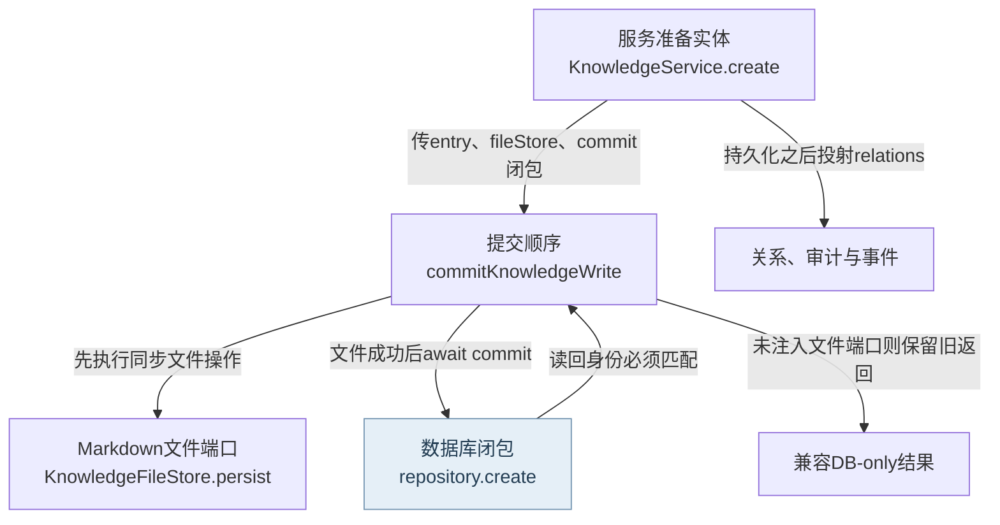
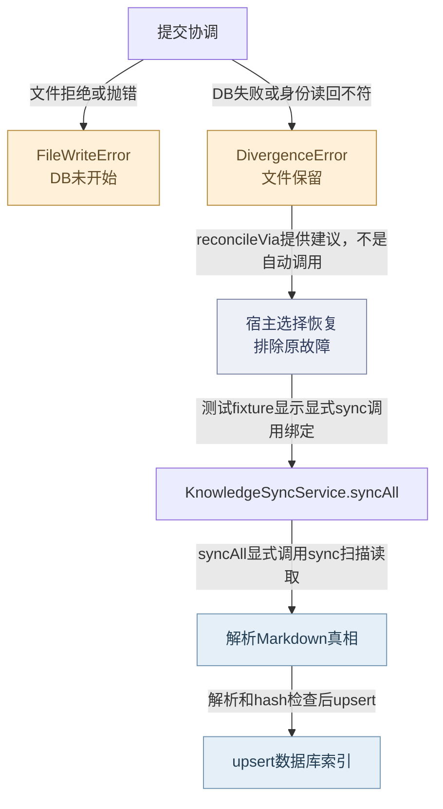
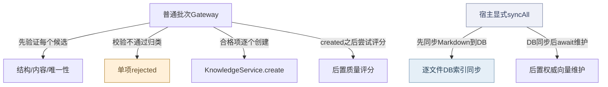
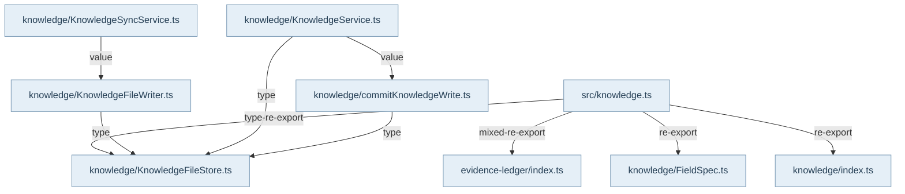

## 入口、输入与责任

公开入口是 `@alembic/core/knowledge`。`RecipeProductionGateway.create` 接收来源、items及策略选项，先做统一结构/唯一性校验，再做去重、相似度与融合；普通 `KnowledgeService.create` 也可直接被消费，不能画成所有创建必经Gateway。服务接收wire实体及userId，检查标题冲突、构造pending实体、运行提交Hook，再由ConfidenceRouter选择staging/pending/deprecated。严格生产的prepared写入与普通创建有不同准入凭据，详见专题15。

## 主持久化与衍生效果

`commitKnowledgeWrite`拥有提交顺序。注入fileStore时先调用同步文件端口，之后才执行异步repository闭包并检查读回id。`KnowledgeFileWriter`核对目标所有权，设置sourceFile，序列化完整Markdown，采用临时文件、文件fsync、rename、目录fsync；新路径耐久后才清理旧路径。Markdown是此模式的知识内容真相；SQLite仍有独立业务数据，不能把整库叫作缓存。外层KnowledgeModule真实注入repository、writer、Hook和eventBus。

服务在持久化之后投射relations、提交审计、触发创建Hook和knowledge:changed。自动关系发现与创建Hook含best-effort异步分支；它们不属于文件加数据库的跨资源原子事务。文件写入失败转成FileWriteError，DB闭包不执行。文件已成功而DB抛错或读回身份不符会保留文件并抛DivergenceError。没有fileStore时是显式legacy DB-only分支，保留旧null与后续错误/审计顺序。

## 分歧恢复与限制

DivergenceError中的reconcileVia只是恢复提示，不会自动调用sync。宿主/操作者排除DB故障后显式调用KnowledgeSyncService.sync或syncAll：扫描candidates/recipes，解析wire与hash，经RawDbSyncAdapter upsert索引，报告手改与孤儿。syncAll另行await可选的权威向量维护；它不能依赖此处没有发出的服务事件。部分读取/解析错误可跳过并报告，审计持久化错误继续上抛。

既有真实SQLite/Markdown测试覆盖文件拒绝和三种DB故障恢复；读回错误id分支尚未见对应具体case，不冒充完整覆盖。来源解析的symlink边界问题R02仍在专题02记录。此页是源码与既有断言复核，未重新执行产品测试，也未修复产品缺陷。

## 视图与术语

本页手工图描述已核对的关系与关键分叉；F1 也承担所列调用范围的业务纵切（V0）阅读，不能推出未画出的宿主自动调度。F0 文件依赖精选由同页选择集和 TypeScript 导入图生成，不是运行时轨迹。S0/R0 只描述正文指定的 owner、状态和恢复前提。公开 API、全部文件及变更影响见阅读器的对应入口。

`source` 为代码来源，`direct` 为直接绑定调用及断言，`indirect` 为经 helper/fixture 或间接行为的断言，`none` 为明确未覆盖。正文中的“宿主”指真实外层装配，不属于 Core 内部运行时。

## 模块协作与恢复边界深化

候选验证、服务创建和同步是三个用例边界。统一校验器同时返回结构诊断与含唯一性的最终结果；Gateway按候选收集拒绝/创建，不提供整批事务。普通融合建议故障会退回直接提交，质量评分故障可保留created，因此返回集合需要逐项理解。服务提交前的Hook block与提交后的关系/审计/事件不是同一阶段。同步是对Markdown内容的索引重建，逐文件前进；审计失败上抛，其余文件错误可跳过，后续孤儿扫描仍运行。syncAll在这些DB变更之后才等待向量维护。恢复必须先区分“未进入写入”“文件/DB分歧”“主数据已变而衍生失败”，而不是收到异常就重建全部或再次create。此处沿用既有测试源码，mock gateway测试仅证明策略分支；没有新执行产品测试。

[FigJam：知识写入与显式恢复](https://www.figma.com/board/NFOhWgtow19Hss7laEFzpC)是本页创建/更新路径的辅助总览，覆盖文件优先、DB分歧与调用者显式sync；不将其扩展到删除、批次补偿或后置衍生效果的事务保证。仓库图与源码锚点是维护依据。

<!-- atlas:generated:start -->

## 功能单元与调用接缝

各单元按真实入口拆分职责；门面暴露、内部调用和宿主装配是不同关系。关联图提供相邻阅读上下文，故障产生位置以条目源码为准。

<a id="m-M10-01" class="stable-anchor"></a>
<a id="结构内容唯一性分层校验" class="stable-anchor"></a>

### 结构、内容、唯一性分层校验

入口：`src/domain/knowledge/UnifiedValidator.ts#UnifiedValidator`

| 检查项 | 功能与边界 |
| --- | --- |
| 输入 | 候选wire、系统注入字段及是否跳过唯一性 |
| 输出 | 独立structural快照和最终pass/errors/warnings |
| 后续调用 / 绑定 | #checkFields；#checkContentQuality；#checkUniqueness |
| 状态与副作用 | 记录submission由调用者显式进行；validate本身不写知识库 |
| 能力边界 | 结构诊断在唯一性追加错误前复制；不得用最终错误文字反推结构是否有效。 |

关联：[校验、创建与同步的不同完成边界](README.md#graph-r3-authoring-and-sync-effects) · 包入口 [@alembic/core/knowledge](../../data/public-api.json)

返回业务旅程：[一次知识从提交到可查询 · 校验候选并选择普通创建入口](../../journeys/j01.md#J01-01)

<a id="m-M10-02" class="stable-anchor"></a>
<a id="普通candidate批次生产" class="stable-anchor"></a>

### 普通candidate批次生产

入口：`src/service/knowledge/RecipeProductionGateway.ts#RecipeProductionGateway`

| 检查项 | 功能与边界 |
| --- | --- |
| 输入 | source/items/options |
| 输出 | created/rejected/blocked/merged/duplicates及pendingSemanticReview |
| 后续调用 / 绑定 | UnifiedValidator.validate；Similarity/ConsolidationAdvisor；KnowledgeService.create；KnowledgeService.updateQuality |
| 状态与副作用 | 逐项创建；批内关系回填与评分是后续动作 |
| 能力边界 | 整批非原子；普通create与严格prepared准入不同；一个rejected不证明之前创建的条目撤销。 |

关联：[校验、创建与同步的不同完成边界](README.md#graph-r3-authoring-and-sync-effects) · [知识创建的文件优先提交](README.md#graph-knowledge-create) · [K3-VALIDATION · 字段/内容/唯一性不通过](README.md#f-K3-VALIDATION) · [K3-ADVISOR · ConsolidationAdvisor抛异常](README.md#f-K3-ADVISOR) · [K3-CREATE · 单项KnowledgeService.create抛错](README.md#f-K3-CREATE) · [K3-QUALITY · 创建后updateQuality失败](README.md#f-K3-QUALITY) · 包入口 [@alembic/core](../../data/public-api.json)、[@alembic/core/knowledge](../../data/public-api.json)

返回业务旅程：[一次知识从提交到可查询 · 校验候选并选择普通创建入口](../../journeys/j01.md#J01-01) · [一次知识从提交到可查询 · 区分主写入与衍生效果的完成](../../journeys/j01.md#J01-04)

<a id="m-M10-03" class="stable-anchor"></a>
<a id="服务提交hook与路由" class="stable-anchor"></a>

### 服务提交Hook与路由

入口：`src/service/knowledge/KnowledgeService.ts#KnowledgeService`

| 检查项 | 功能与边界 |
| --- | --- |
| 输入 | 已校验wire与ServiceContext |
| 输出 | 准备好的pending/staging/deprecated实体或ValidationError |
| 后续调用 / 绑定 | findByTitle；KnowledgeEntry.fromJSON；onKnowledgeSubmit；ConfidenceRouter.route |
| 状态与副作用 | 真实file-first后另投射关系/审计/事件 |
| 能力边界 | Hook block在持久化前拒绝；创建后的Hook和自动关系是best effort，不能捆成跨资源事务。 |

关联：[知识创建的文件优先提交](README.md#graph-knowledge-create) · [校验、创建与同步的不同完成边界](README.md#graph-r3-authoring-and-sync-effects) · 包入口 [@alembic/core](../../data/public-api.json)、[@alembic/core/knowledge](../../data/public-api.json)

返回业务旅程：[一次知识从提交到可查询 · 实体准备、提交 Hook 与置信路由](../../journeys/j01.md#J01-02) · [一次知识从提交到可查询 · 先持久化文件，再提交 DB 并核对实体 ID](../../journeys/j01.md#J01-03) · [一次知识从提交到可查询 · 区分主写入与衍生效果的完成](../../journeys/j01.md#J01-04)

<a id="m-M10-04" class="stable-anchor"></a>
<a id="markdown同步及后置向量维护" class="stable-anchor"></a>

### Markdown同步及后置向量维护

入口：`src/service/knowledge/KnowledgeSyncService.ts#KnowledgeSyncService`

| 检查项 | 功能与边界 |
| --- | --- |
| 输入 | DB句柄、dryRun/force/skipViolations、可选vectorMaintenance |
| 输出 | sync计数、violations/orphaned/skipped、向量维护状态 |
| 后续调用 / 绑定 | _collectMdFiles；parseKnowledgeMarkdown；RawDbSyncAdapter；_detectOrphans；reconcileAuthoritativeCorpus |
| 状态与副作用 | 逐文件upsert；手改审计；孤儿deprecated；最后显式await向量维护 |
| 能力边界 | 同步不经KnowledgeService事件；DB完成后向量失败不会反向回滚DB；dryRun不做这些写入。 |

关联：[文件与数据库分歧的显式恢复](README.md#graph-knowledge-recovery) · [校验、创建与同步的不同完成边界](README.md#graph-r3-authoring-and-sync-effects) · [影子代际到可见路由](../12-vector-generations/README.md#graph-vector-generation-visibility) · [K3-SYNC-AUDIT · 手改violation的审计insert失败](README.md#f-K3-SYNC-AUDIT) · [K3-SYNC-SKIP · 逐文件读取/解析等非PersistenceError](README.md#f-K3-SYNC-SKIP) · [K3-SYNC-VECTOR · syncAll中权威向量维护reject](README.md#f-K3-SYNC-VECTOR) · 包入口 [@alembic/core](../../data/public-api.json)、[@alembic/core/knowledge](../../data/public-api.json)

返回业务旅程：[一次知识从提交到可查询 · 需要修复或手改同步时，显式扫描 Markdown](../../journeys/j01.md#J01-05) · [一次知识从提交到可查询 · 需要 dense 检索时单独确认向量路由可见](../../journeys/j01.md#J01-07)

<a id="m-M10-05" class="stable-anchor"></a>
<a id="recipe就绪与发布委托" class="stable-anchor"></a>

### Recipe就绪与发布委托

入口：`src/service/knowledge/RecipeProductionGateway.ts#RecipeProductionGateway`

| 检查项 | 功能与边界 |
| --- | --- |
| 输入 | 已存在Recipe id、publish context |
| 输出 | readiness report或publish结果 |
| 后续调用 / 绑定 | evaluateRetrievalReadiness；KnowledgeService.publish |
| 状态与副作用 | 发布由知识服务统一状态/持久化链完成 |
| 能力边界 | 缺端口抛unavailable；普通create不是自动publish，active转移仍需readiness。 |

关联：[staging晋级、复核与分段发布](../14-sustain-proposals/README.md#graph-r3-staging-two-phase-effects) · 包入口 [@alembic/core](../../data/public-api.json)、[@alembic/core/knowledge](../../data/public-api.json)

返回业务旅程：[一次知识从提交到可查询 · 显式检查 readiness 并执行合法发布/晋级](../../journeys/j01.md#J01-06)


## 生成的图与逐边依据

此区域由同页结构化图模型生成；请修改 frontmatter，再显式运行 `npm run inventory:write`，不要单独修改表格或 Mermaid。

<a id="graph-knowledge-create"></a>

### 知识创建的文件优先提交

图 ID：`knowledge-create` · F1 · 已准备实体进入提交协调器；文件和SQLite按顺序写入，成功之后才运行衍生效果。



| 边 ID | 关系 | 源码定位 | 断言关系 | case / 缺口 | 相关旅程步骤 |
| --- | --- | --- | --- | --- | --- |
| <a id="e-knowledge-create--KW-01"></a>KW-01 | 传entry、fileStore、commit闭包 | `src/service/knowledge/KnowledgeService.ts#KnowledgeService` | indirect | commits durable truth that survives synchronization | [J01 · 先持久化文件，再提交 DB 并核对实体 ID](../../journeys/j01.md#J01-03) |
| <a id="e-knowledge-create--KW-02"></a>KW-02 | 先执行同步文件操作 | `src/service/knowledge/commitKnowledgeWrite.ts#commitKnowledgeWrite` | indirect | commits durable truth that survives synchronization | [J01 · 先持久化文件，再提交 DB 并核对实体 ID](../../journeys/j01.md#J01-03) |
| <a id="e-knowledge-create--KW-03"></a>KW-03 | 文件成功后await commit | `src/service/knowledge/commitKnowledgeWrite.ts#commitKnowledgeWrite` | indirect | commits durable truth that survives synchronization | [J01 · 先持久化文件，再提交 DB 并核对实体 ID](../../journeys/j01.md#J01-03) |
| <a id="e-knowledge-create--KW-04"></a>KW-04 | 读回身份必须匹配 | `src/service/knowledge/commitKnowledgeWrite.ts#commitKnowledgeWrite` | indirect | reports %s as divergence and sync can restore the durable file | [J01 · 先持久化文件，再提交 DB 并核对实体 ID](../../journeys/j01.md#J01-03) |
| <a id="e-knowledge-create--KW-05"></a>KW-05 | 持久化之后投射relations | `src/service/knowledge/KnowledgeService.ts#KnowledgeService` | none | 本边展示实际调用顺序；没有为关系、审计、事件的全部交错指定一个覆盖case。 | [J01 · 区分主写入与衍生效果的完成](../../journeys/j01.md#J01-04) |
| <a id="e-knowledge-create--KW-06"></a>KW-06 | 未注入文件端口则保留旧返回 | `src/service/knowledge/commitKnowledgeWrite.ts#commitKnowledgeWrite` | indirect | preserves %s null/error and audit ordering | [J01 · 先持久化文件，再提交 DB 并核对实体 ID](../../journeys/j01.md#J01-03) |

<a id="graph-knowledge-recovery"></a>

### 文件与数据库分歧的显式恢复

图 ID：`knowledge-recovery` · R0 · 文件失败阻断DB；文件成功后的分歧保留真相，恢复由外部显式选择，协调器不自动同步。



| 边 ID | 关系 | 源码定位 | 断言关系 | case / 缺口 | 相关旅程步骤 |
| --- | --- | --- | --- | --- | --- |
| <a id="e-knowledge-recovery--KR-01"></a>KR-01 | 文件拒绝或抛错 | `src/service/knowledge/commitKnowledgeWrite.ts#commitKnowledgeWrite` | indirect | aborts before DB mutation when the file store rejects the write |  |
| <a id="e-knowledge-recovery--KR-02"></a>KR-02 | DB失败或身份读回不符 | `src/service/knowledge/commitKnowledgeWrite.ts#commitKnowledgeWrite` | indirect | reports %s as divergence and sync can restore the durable file |  |
| <a id="e-knowledge-recovery--KR-03"></a>KR-03 | reconcileVia提供建议，不是自动调用 | `src/service/knowledge/commitKnowledgeWrite.ts#commitKnowledgeWrite` | indirect | reports %s as divergence and sync can restore the durable file | [J01 · 需要修复或手改同步时，显式扫描 Markdown](../../journeys/j01.md#J01-05) |
| <a id="e-knowledge-recovery--KR-04"></a>KR-04 | 测试fixture显示显式sync调用绑定 | `test/support/knowledge-runtime.ts#createKnowledgeRuntime` | indirect | reports %s as divergence and sync can restore the durable file |  |
| <a id="e-knowledge-recovery--KR-05"></a>KR-05 | syncAll显式调用sync扫描读取 | `src/service/knowledge/KnowledgeSyncService.ts#KnowledgeSyncService` | indirect | commits durable truth that survives synchronization | [J01 · 需要修复或手改同步时，显式扫描 Markdown](../../journeys/j01.md#J01-05) |
| <a id="e-knowledge-recovery--KR-06"></a>KR-06 | 解析和hash检查后upsert | `src/service/knowledge/KnowledgeSyncService.ts#KnowledgeSyncService` | indirect | commits durable truth that survives synchronization | [J01 · 需要修复或手改同步时，显式扫描 Markdown](../../journeys/j01.md#J01-05) |

<a id="graph-r3-authoring-and-sync-effects"></a>

### 校验、创建与同步的不同完成边界

图 ID：`r3-authoring-and-sync-effects` · A1 · 本图展开普通创作门和sync后置维护；不重复旧file-first图，也不声称Gateway失败会自动sync。



| 边 ID | 关系 | 源码定位 | 断言关系 | case / 缺口 | 相关旅程步骤 |
| --- | --- | --- | --- | --- | --- |
| <a id="e-r3-authoring-and-sync-effects--K3-E1"></a>K3-E1 | 先验证每个候选 | `src/service/knowledge/RecipeProductionGateway.ts#RecipeProductionGateway` | indirect | 应拒绝缺少必填字段的候选 | [J01 · 校验候选并选择普通创建入口](../../journeys/j01.md#J01-01) |
| <a id="e-r3-authoring-and-sync-effects--K3-E2"></a>K3-E2 | 校验不通过归类 | `src/service/knowledge/RecipeProductionGateway.ts#RecipeProductionGateway` | indirect | 应拒绝缺少必填字段的候选 | [J01 · 校验候选并选择普通创建入口](../../journeys/j01.md#J01-01) |
| <a id="e-r3-authoring-and-sync-effects--K3-E3"></a>K3-E3 | 合格项逐个创建 | `src/service/knowledge/RecipeProductionGateway.ts#RecipeProductionGateway` | indirect | 应通过验证并创建有效 Recipe | [J01 · 校验候选并选择普通创建入口](../../journeys/j01.md#J01-01) |
| <a id="e-r3-authoring-and-sync-effects--K3-E4"></a>K3-E4 | created之后尝试评分 | `src/service/knowledge/RecipeProductionGateway.ts#RecipeProductionGateway` | indirect | Quality scoring 失败不应阻塞创建 | [J01 · 区分主写入与衍生效果的完成](../../journeys/j01.md#J01-04) |
| <a id="e-r3-authoring-and-sync-effects--K3-E5"></a>K3-E5 | 先同步Markdown到DB | `src/service/knowledge/KnowledgeSyncService.ts#KnowledgeSyncService` | indirect | deprecates an orphan for an empty corpus and awaits authoritative vector maintenance |  |
| <a id="e-r3-authoring-and-sync-effects--K3-E6"></a>K3-E6 | DB同步后await维护 | `src/service/knowledge/KnowledgeSyncService.ts#KnowledgeSyncService` | indirect | deprecates an orphan for an empty corpus and awaits authoritative vector maintenance | [J01 · 需要修复或手改同步时，显式扫描 Markdown](../../journeys/j01.md#J01-05) |

<a id="graph-dependencies-10"></a>

### 文件依赖精选 · 静态关系

图 ID：`dependencies-10` · F0 · 显式选择集内的实际导入；类型边不代表运行调用，动态未知保留在全量索引。



| 边 ID | 关系 | 源码定位 | 断言关系 | case / 缺口 | 相关旅程步骤 |
| --- | --- | --- | --- | --- | --- |
| <a id="e-dependencies-10--dep-10-0"></a>dep-10-0 | mixed-re-export | `src/knowledge.ts#<module>` | none | TypeScript AST 静态导入事实，不主张运行调用或断言覆盖。 |  |
| <a id="e-dependencies-10--dep-10-1"></a>dep-10-1 | re-export | `src/knowledge.ts#<module>` | none | TypeScript AST 静态导入事实，不主张运行调用或断言覆盖。 |  |
| <a id="e-dependencies-10--dep-10-2"></a>dep-10-2 | re-export | `src/knowledge.ts#<module>` | none | TypeScript AST 静态导入事实，不主张运行调用或断言覆盖。 |  |
| <a id="e-dependencies-10--dep-10-3"></a>dep-10-3 | type-re-export | `src/knowledge.ts#<module>` | none | TypeScript AST 静态导入事实，不主张运行调用或断言覆盖。 |  |
| <a id="e-dependencies-10--dep-10-4"></a>dep-10-4 | type | `src/service/knowledge/KnowledgeFileWriter.ts#<module>` | none | TypeScript AST 静态导入事实，不主张运行调用或断言覆盖。 |  |
| <a id="e-dependencies-10--dep-10-5"></a>dep-10-5 | type | `src/service/knowledge/KnowledgeService.ts#<module>` | none | TypeScript AST 静态导入事实，不主张运行调用或断言覆盖。 |  |
| <a id="e-dependencies-10--dep-10-6"></a>dep-10-6 | value | `src/service/knowledge/KnowledgeService.ts#<module>` | none | TypeScript AST 静态导入事实，不主张运行调用或断言覆盖。 |  |
| <a id="e-dependencies-10--dep-10-7"></a>dep-10-7 | value | `src/service/knowledge/KnowledgeSyncService.ts#<module>` | none | TypeScript AST 静态导入事实，不主张运行调用或断言覆盖。 |  |
| <a id="e-dependencies-10--dep-10-8"></a>dep-10-8 | type | `src/service/knowledge/commitKnowledgeWrite.ts#<module>` | none | TypeScript AST 静态导入事实，不主张运行调用或断言覆盖。 |  |

## 失败后的状态与恢复责任

先检查已落盘状态，再决定恢复。自动动作只描述代码已执行的分支；显式恢复不能据提示文字推断为自动调用。

<a id="f-K3-VALIDATION" class="stable-anchor"></a>
<a id="k3-validation--字段内容唯一性不通过" class="stable-anchor"></a>

### K3-VALIDATION · 字段/内容/唯一性不通过

| 检查项 | 当前代码语义 |
| --- | --- |
| 已留下什么 | 当前候选未进入知识服务；同批其他候选可继续 |
| Core自动做什么 | 加入rejected并保留validation errors |
| 谁显式恢复 | 宿主修正wire与来源后重新提交该项 |
| 必须停止的条件 | validation.pass=false停止该项，不停止整个批次 |
| 源码定位 | `src/service/knowledge/RecipeProductionGateway.ts#RecipeProductionGateway` |

```ts
reason: 'validation_failed',
```

关联：[普通candidate批次生产](README.md#m-M10-02) · [校验、创建与同步的不同完成边界](README.md#graph-r3-authoring-and-sync-effects) · 包入口 [@alembic/core](../../data/public-api.json)、[@alembic/core/knowledge](../../data/public-api.json)

返回业务旅程：[一次知识从提交到可查询 · 校验候选并选择普通创建入口](../../journeys/j01.md#J01-01)

断言关系：**indirect**。`test/unit/RecipeProductionGateway.test.ts` · `应拒绝缺少必填字段的候选`

gateway真实validate路径，mock知识服务未创建；仅控制流证据（negative）。这里只定位断言；实际运行范围见独立运行证据。

```ts
expect(result.rejected[0].reason).toBe('validation_failed');
```

<a id="f-K3-ADVISOR" class="stable-anchor"></a>
<a id="k3-advisor--consolidationadvisor抛异常" class="stable-anchor"></a>

### K3-ADVISOR · ConsolidationAdvisor抛异常

| 检查项 | 当前代码语义 |
| --- | --- |
| 已留下什么 | 相似度阶段后的候选仍在内存，未因advisor异常被写入 |
| Core自动做什么 | 记录warn并把submittableItems恢复为afterSimilarityItems，继续普通create |
| 谁显式恢复 | 若需要融合语义，宿主修复advisor后显式再评审，不能假定已融合 |
| 必须停止的条件 | 本分支不阻断创建；strict入口另有门禁 |
| 源码定位 | `src/service/knowledge/RecipeProductionGateway.ts#RecipeProductionGateway` |

```ts
submittableItems = afterSimilarityItems;
```

关联：[普通candidate批次生产](README.md#m-M10-02) · [校验、创建与同步的不同完成边界](README.md#graph-r3-authoring-and-sync-effects) · 包入口 [@alembic/core](../../data/public-api.json)、[@alembic/core/knowledge](../../data/public-api.json)

返回业务旅程：[一次知识从提交到可查询 · 校验候选并选择普通创建入口](../../journeys/j01.md#J01-01)

断言关系：**indirect**。`test/unit/RecipeProductionGateway.test.ts` · `ConsolidationAdvisor 异常应降级为直接提交`

注入抛错advisor，gateway仍调用mock create成功（fallback）。这里只定位断言；实际运行范围见独立运行证据。

```ts
expect(result.created).toHaveLength(1);
```

<a id="f-K3-CREATE" class="stable-anchor"></a>
<a id="k3-create--单项knowledgeservicecreate抛错" class="stable-anchor"></a>

### K3-CREATE · 单项KnowledgeService.create抛错

| 检查项 | 当前代码语义 |
| --- | --- |
| 已留下什么 | 该项可能在底层写入/衍生阶段失败；此前成功项仍存在 |
| Core自动做什么 | 将该项记为create_failed并继续处理其余项 |
| 谁显式恢复 | 先按底层错误查文件/DB/审计状态，再决定sync或重提；不得盲目重复创建 |
| 必须停止的条件 | 异常停止当前项；DivergenceError提示不是自动sync |
| 源码定位 | `src/service/knowledge/RecipeProductionGateway.ts#RecipeProductionGateway` |

```ts
reason: 'create_failed',
```

关联：[普通candidate批次生产](README.md#m-M10-02) · [校验、创建与同步的不同完成边界](README.md#graph-r3-authoring-and-sync-effects) · [知识创建的文件优先提交](README.md#graph-knowledge-create) · 包入口 [@alembic/core](../../data/public-api.json)、[@alembic/core/knowledge](../../data/public-api.json)

返回业务旅程：[一次知识从提交到可查询 · 校验候选并选择普通创建入口](../../journeys/j01.md#J01-01) · [一次知识从提交到可查询 · 实体准备、提交 Hook 与置信路由](../../journeys/j01.md#J01-02) · [一次知识从提交到可查询 · 区分主写入与衍生效果的完成](../../journeys/j01.md#J01-04)

断言关系：**indirect**。`test/unit/RecipeProductionGateway.test.ts` · `KnowledgeService.create 失败应记入 rejected`

mock create抛错，gateway将其分类到rejected（negative）。这里只定位断言；实际运行范围见独立运行证据。

```ts
expect(result.rejected[0].reason).toBe('create_failed');
```

<a id="f-K3-QUALITY" class="stable-anchor"></a>
<a id="k3-quality--创建后updatequality失败" class="stable-anchor"></a>

### K3-QUALITY · 创建后updateQuality失败

| 检查项 | 当前代码语义 |
| --- | --- |
| 已留下什么 | created实体已加入返回集，正文创建不撤回 |
| Core自动做什么 | 吞评分异常，保留创建成功 |
| 谁显式恢复 | 宿主可显式调用updateQuality重新计算，需验证持久化结果 |
| 必须停止的条件 | 评分失败不阻断普通创建；不可把created等同评分成功 |
| 源码定位 | `src/service/knowledge/RecipeProductionGateway.ts#RecipeProductionGateway` |

```ts
await this.#knowledgeService.updateQuality(saved.id, { userId });
```

关联：[普通candidate批次生产](README.md#m-M10-02) · [知识创建的文件优先提交](README.md#graph-knowledge-create) · [校验、创建与同步的不同完成边界](README.md#graph-r3-authoring-and-sync-effects) · 包入口 [@alembic/core](../../data/public-api.json)、[@alembic/core/knowledge](../../data/public-api.json)

返回业务旅程：[一次知识从提交到可查询 · 区分主写入与衍生效果的完成](../../journeys/j01.md#J01-04)

断言关系：**indirect**。`test/unit/RecipeProductionGateway.test.ts` · `Quality scoring 失败不应阻塞创建`

mock updateQuality抛错，已创建实体仍保留created结果（fallback）。这里只定位断言；实际运行范围见独立运行证据。

```ts
expect(result.created).toHaveLength(1);
```

<a id="f-K3-SYNC-AUDIT" class="stable-anchor"></a>
<a id="k3-sync-audit--手改violation的审计insert失败" class="stable-anchor"></a>

### K3-SYNC-AUDIT · 手改violation的审计insert失败

| 检查项 | 当前代码语义 |
| --- | --- |
| 已留下什么 | 本文件后续upsert未执行，之前文件可能已经同步 |
| Core自动做什么 | 抛PersistenceError，经sync catch继续上抛 |
| 谁显式恢复 | 修复审计存储后显式重新sync并核对已有DB变化 |
| 必须停止的条件 | PersistenceError立即中断本次sync；无整体回滚 |
| 源码定位 | `src/service/knowledge/KnowledgeSyncService.ts#KnowledgeSyncService` |

```ts
'Audit insert failed — manual-edit violation record was not persisted',
```

关联：[Markdown同步及后置向量维护](README.md#m-M10-04) · [文件与数据库分歧的显式恢复](README.md#graph-knowledge-recovery) · [校验、创建与同步的不同完成边界](README.md#graph-r3-authoring-and-sync-effects) · 包入口 [@alembic/core](../../data/public-api.json)、[@alembic/core/knowledge](../../data/public-api.json)

返回业务旅程：[一次知识从提交到可查询 · 需要修复或手改同步时，显式扫描 Markdown](../../journeys/j01.md#J01-05)

断言关系：**indirect**。`test/FailureSemanticsCO3.test.ts` · `audit insert run failure throws PersistenceError instead of warn-and-continue`

直接调用真实_logViolation并注入失败stmt，错误操作分类保留（negative）。这里只定位断言；实际运行范围见独立运行证据。

```ts
expect((caught as PersistenceError).details.operation).toBe('audit-insert-run');
```

<a id="f-K3-SYNC-SKIP" class="stable-anchor"></a>
<a id="k3-sync-skip--逐文件读取解析等非persistenceerror" class="stable-anchor"></a>

### K3-SYNC-SKIP · 逐文件读取/解析等非PersistenceError

| 检查项 | 当前代码语义 |
| --- | --- |
| 已留下什么 | 可留原DB状态；没有成功登记ID的项可能随后参与孤儿判断 |
| Core自动做什么 | 记录error、skipped++，继续其他文件与孤儿检测 |
| 谁显式恢复 | 宿主检查失败路径是否仍存在/可读，再重试sync并核对lifecycle；不能把skipped看作无副作用 |
| 必须停止的条件 | 仅该文件步骤跳过；孤儿检测没有按同一文件再次确认存在的保证 |
| 源码定位 | `src/service/knowledge/KnowledgeSyncService.ts#KnowledgeSyncService` |

#### 恢复检查顺序

前提：sync 中发生逐文件读取/解析的非 PersistenceError，report.skipped 增加。此指南是源码导出的检查建议，现有 Atlas 未声明对应端到端恢复测试已覆盖。

1. 定位日志中的失败文件，确认文件仍存在且可读/可解析 — skip 可能来自暂时读取失败，不代表文件被删除。
2. 按该文件原 id 检查 DB lifecycle 与 orphaned 结果 — 本次失败项可能未登记到有效 ID 集，后续孤儿检测仍继续，不能假设完全无副作用。

显式动作：修复文件权限/内容或解析输入，先 dryRun 审阅同根同步将做的变化，再显式重新 sync；若已被判孤儿则单独核对文件和 lifecycle 纠正路径，不能无条件批量 reactivate。

重试身份：使用文件原 id 与实际来源路径；不要复制出另一个新 id 来绕开孤儿诊断。

完成断言：确认失败文件不再 skipped、DB 与文件内容一致，检查 lifecycle 与 orphaned 报告的最终值；单独记录仍无集成运行证明的限制。

停止条件：文件归属、id 或 lifecycle 改动原因不明时停止；审计 PersistenceError 不是可忽略 skip。

```ts
report.skipped++;
```

关联：[Markdown同步及后置向量维护](README.md#m-M10-04) · [文件与数据库分歧的显式恢复](README.md#graph-knowledge-recovery) · [校验、创建与同步的不同完成边界](README.md#graph-r3-authoring-and-sync-effects) · 包入口 [@alembic/core](../../data/public-api.json)、[@alembic/core/knowledge](../../data/public-api.json)

返回业务旅程：[一次知识从提交到可查询 · 需要修复或手改同步时，显式扫描 Markdown](../../journeys/j01.md#J01-05)

断言关系：**none**。本次未定位“现存文件临时不可读→孤儿分类”的同一集成断言；保留源码限制而非新复现缺陷。

<a id="f-K3-SYNC-VECTOR" class="stable-anchor"></a>
<a id="k3-sync-vector--syncall中权威向量维护reject" class="stable-anchor"></a>

### K3-SYNC-VECTOR · syncAll中权威向量维护reject

| 检查项 | 当前代码语义 |
| --- | --- |
| 已留下什么 | Markdown与DB同步已完成；向量可能部分变化 |
| Core自动做什么 | await的错误向调用方传播，不生成completed维护状态 |
| 谁显式恢复 | 排除provider/store问题后显式reconcile或syncAll；读者保留DB/向量不一致诊断 |
| 必须停止的条件 | 无自动重试、无DB回滚，不能当作整个syncAll未执行 |
| 源码定位 | `src/service/knowledge/KnowledgeSyncService.ts#KnowledgeSyncService` |

#### 恢复检查顺序

前提：syncAll 已执行 sync(db, opts) 后在 reconcileAuthoritativeCorpus await 处拒绝；能访问同一 DB 与注入的 vectorMaintenance 端口。

1. 分别检查 Markdown→DB 同步结果与 DB 当前行 — DB 部分已完成，reject 不能当作整次未执行。
2. 检查 provider/store 原始错误及活跃向量代际/维护诊断 — 向量可能未完成或部分变化，不能用 DB 更新计数代替 dense 可见性。

显式动作：修复明确的 provider/store 故障后，由宿主显式重试权威 corpus reconcile，或按原同步选项重试 syncAll；恢复过程中保留 DB/向量分歧说明。

重试身份：保持相同知识实体 ID 和权威 corpus 来源；新向量 generation 的身份遵从 manager/router，不能手工把 failed 改 ready。

完成断言：重读 DB 仍保留已同步条目；确认维护返回实际完成状态和期望代际/检查结果，再用受限业务 query 检查相应候选是否通过 live truth。

停止条件：向量端口缺失、权威 corpus 未确认或 inspection 未通过时不能宣称向量恢复；不得回滚已同步 DB 来掩盖后置失败。

```ts
report.vectorMaintenanceReport = await this.#vectorMaintenance.reconcileAuthoritativeCorpus();
```

关联：[Markdown同步及后置向量维护](README.md#m-M10-04) · [文件与数据库分歧的显式恢复](README.md#graph-knowledge-recovery) · [校验、创建与同步的不同完成边界](README.md#graph-r3-authoring-and-sync-effects) · [影子代际到可见路由](../12-vector-generations/README.md#graph-vector-generation-visibility) · 包入口 [@alembic/core](../../data/public-api.json)、[@alembic/core/knowledge](../../data/public-api.json)

返回业务旅程：[一次知识从提交到可查询 · 需要修复或手改同步时，显式扫描 Markdown](../../journeys/j01.md#J01-05) · [一次知识从提交到可查询 · 需要 dense 检索时单独确认向量路由可见](../../journeys/j01.md#J01-07)

断言关系：**none**。本轮未定位该reject穿过syncAll并核对DB保留的具体case；不借其他vector测试冒充。


<!-- atlas:generated:end -->
