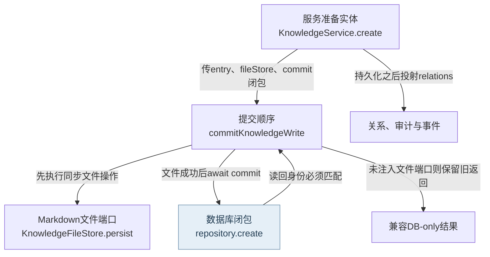
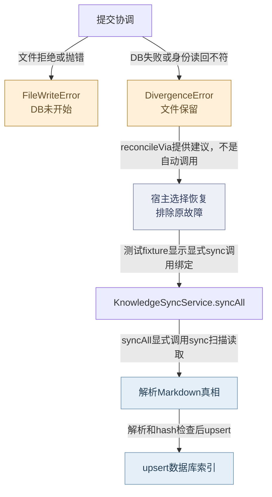
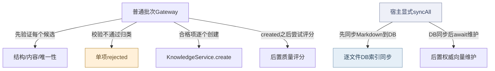
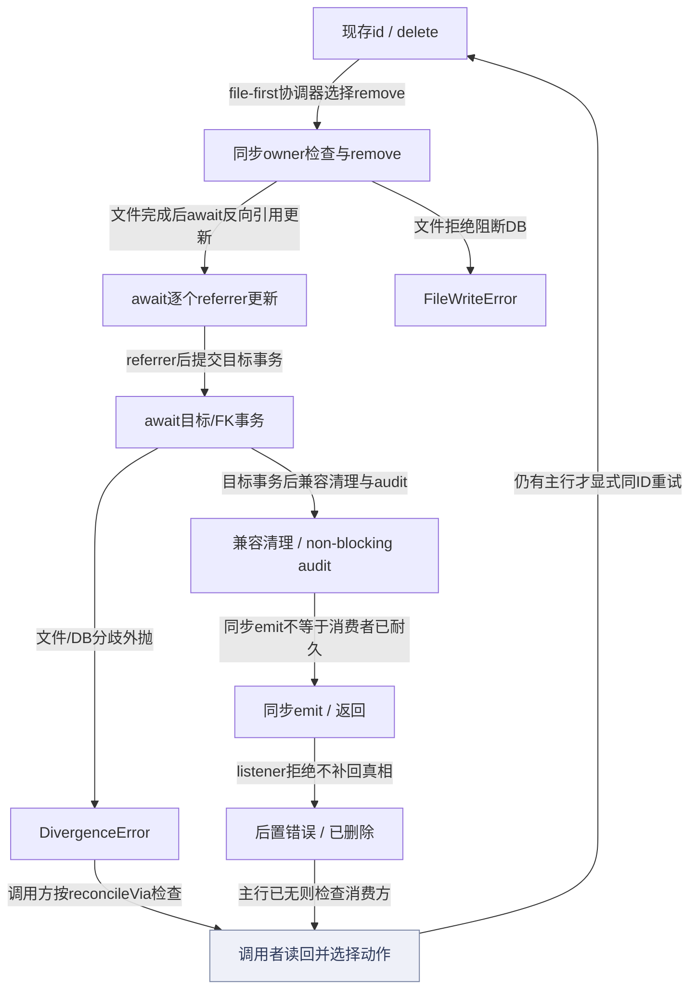
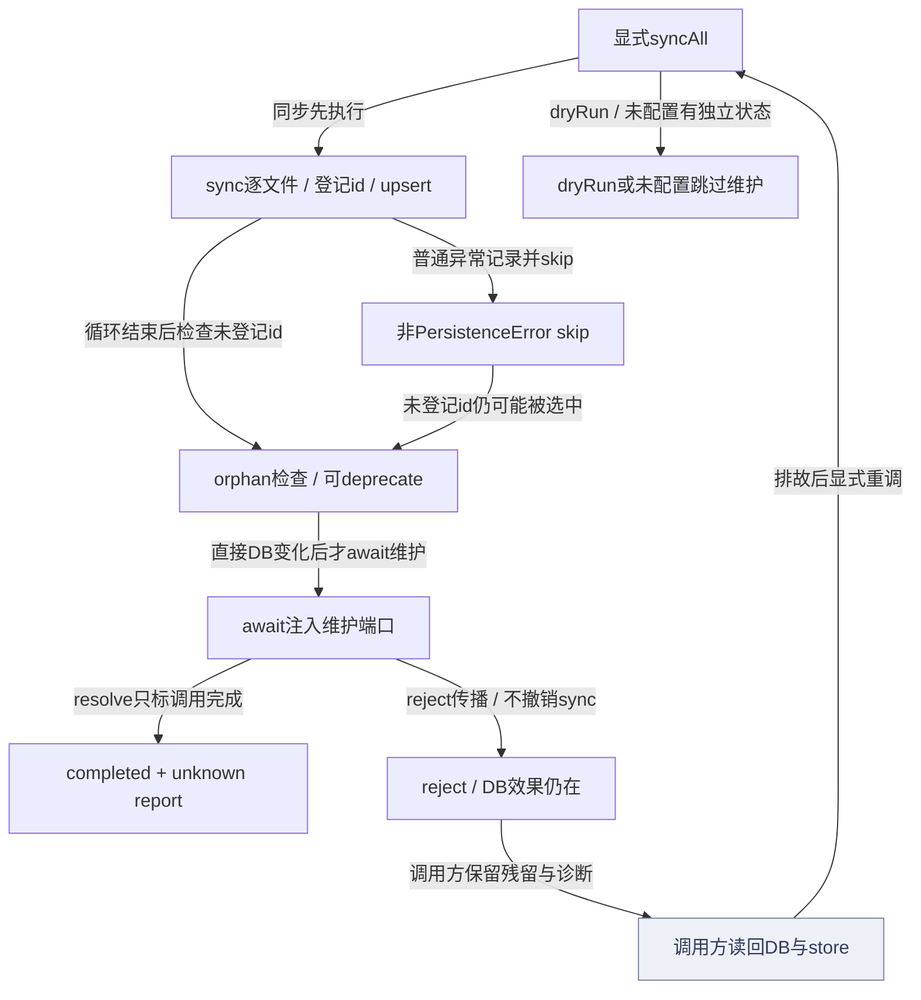
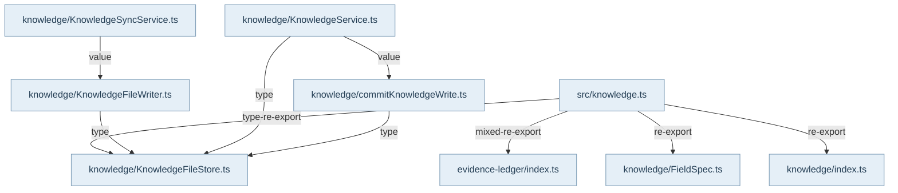

## 入口、输入与责任

公开入口是 `@alembic/core/knowledge`。`RecipeProductionGateway.create` 接收来源、items及策略选项，先做统一结构/唯一性校验，再做去重、相似度与融合；普通 `KnowledgeService.create` 也可直接被消费，不能画成所有创建必经Gateway。服务接收wire实体及userId，检查标题冲突、构造pending实体、运行提交Hook，再由ConfidenceRouter选择staging/pending/deprecated。严格生产的prepared写入与普通创建有不同准入凭据，详见专题15。

## 主持久化与衍生效果

`commitKnowledgeWrite`拥有提交顺序。注入fileStore时先调用同步文件端口，之后才执行异步repository闭包并检查读回id。`KnowledgeFileWriter`核对目标所有权，设置sourceFile，序列化完整Markdown，采用临时文件、文件fsync、rename、目录fsync；新路径耐久后才清理旧路径。Markdown是此模式的知识内容真相；SQLite仍有独立业务数据，不能把整库叫作缓存。外层KnowledgeModule真实注入repository、writer、Hook和eventBus。

服务在持久化之后投射relations、提交审计、触发创建Hook和knowledge:changed。自动关系发现与创建Hook含best-effort异步分支；它们不属于文件加数据库的跨资源原子事务。文件写入失败转成FileWriteError，DB闭包不执行。文件已成功而DB抛错或读回身份不符会保留文件并抛DivergenceError。没有fileStore时是显式legacy DB-only分支，保留旧null与后续错误/审计顺序。

## 分歧恢复与限制

DivergenceError中的operation/reconcileVia决定恢复分流。仅当create/update等persist路径保留原文件真相时，调用者排除DB故障后显式sync/syncAll；knowledge.delete分歧需确认主行仍在再同IDdelete，详见删除操作卡。sync/syncAll的扫描路径为：扫描candidates/recipes，解析wire与hash，经RawDbSyncAdapter upsert索引，报告手改与孤儿。syncAll另行await可选的权威向量维护；它不能依赖此处没有发出的服务事件。部分读取/解析错误可跳过并报告，审计持久化错误继续上抛。

既有真实SQLite/Markdown测试覆盖文件拒绝和三种DB故障恢复；读回错误id分支尚未见对应具体case，不冒充完整覆盖。来源解析的symlink边界问题R02仍在专题02记录。上述覆盖描述属于2026-10-22源码复核；0.3新增V06/V07的实际范围见独立证据记录，产品缺陷未修复。

## 视图与术语

本页手工图描述已核对的关系与关键分叉；F1 也承担所列调用范围的业务纵切（V0）阅读，不能推出未画出的宿主自动调度。F0 文件依赖精选由同页选择集和 TypeScript 导入图生成，不是运行时轨迹。S0/R0 只描述正文指定的 owner、状态和恢复前提。公开 API、全部文件及变更影响见阅读器的对应入口。

`source` 为代码来源，`direct` 为直接绑定调用及断言，`indirect` 为经 helper/fixture 或间接行为的断言，`none` 为明确未覆盖。正文中的“宿主”指真实外层装配，不属于 Core 内部运行时。

## 模块协作与恢复边界深化

候选验证、服务创建和同步是三个用例边界。统一校验器同时返回结构诊断与含唯一性的最终结果；Gateway按候选收集拒绝/创建，不提供整批事务。普通融合建议故障会退回直接提交，质量评分故障可保留created，因此返回集合需要逐项理解。服务提交前的Hook block与提交后的关系/审计/事件不是同一阶段。同步是对Markdown内容的索引重建，逐文件前进；审计失败上抛，其余文件错误可跳过，后续孤儿扫描仍运行。syncAll在这些DB变更之后才等待向量维护。恢复必须先区分“未进入写入”“文件/DB分歧”“主数据已变而衍生失败”，而不是收到异常就重建全部或再次create。该段形成于2026-10-22源码复核；mock gateway测试仅证明策略分支，后续V06/V07按各自运行范围单列。

[FigJam：知识写入与显式恢复](https://www.figma.com/board/NFOhWgtow19Hss7laEFzpC)是本页创建/更新路径的辅助总览，覆盖文件优先、DB分歧与调用者显式sync；不将其扩展到删除、批次补偿或后置衍生效果的事务保证。仓库图与源码锚点是维护依据。

## 0.3 删除与同步恢复操作

删除是独立操作，见[删除阅读路径](../../journeys/j05.md)。不能把create分歧的sync建议套用到已删除文件的DB cleanup。审计失败只warn，事件listener抛错则可能发生在主行已无之后；先读回当前真相。

syncAll先改DB，再等待注入维护。completed只表示端口resolve，未知业务report可能失败；reject则没有SyncAllReport而DB效果保留。V07分别给真实HNSW恢复、resolve-failed合同、短暂读取失败与真实缺文件对照。fixture把reconcileIndex.errors转reject的策略有单独说明，不声称当前宿主必然抛错。

<!-- atlas:generated:start -->

## 功能单元与调用接缝

各单元按真实入口拆分职责；门面暴露、内部调用和宿主装配是不同关系。关联图提供相邻阅读上下文，故障产生位置以条目源码为准。

<a id="m-M10-01" class="stable-anchor"></a>
<a id="结构内容唯一性分层校验" class="stable-anchor"></a>

### 结构、内容、唯一性分层校验

入口：`src/domain/knowledge/UnifiedValidator.ts#UnifiedValidator`

| 检查项 | 功能与边界 |
| --- | --- |
| 输入 | 候选wire、系统注入字段及是否跳过唯一性 |
| 输出 | 独立structural快照和最终pass/errors/warnings |
| 后续调用 / 绑定 | #checkFields；#checkContentQuality；#checkUniqueness |
| 状态与副作用 | 记录submission由调用者显式进行；validate本身不写知识库 |
| 能力边界 | 结构诊断在唯一性追加错误前复制；不得用最终错误文字反推结构是否有效。 |

关联：[校验、创建与同步的不同完成边界](README.md#graph-r3-authoring-and-sync-effects) · 包入口 [@alembic/core/knowledge](../../data/public-api.json)

返回业务旅程：[一次知识从提交到可查询 · 校验候选并选择普通创建入口](../../journeys/j01.md#J01-01)

<a id="m-M10-02" class="stable-anchor"></a>
<a id="普通candidate批次生产" class="stable-anchor"></a>

### 普通candidate批次生产

入口：`src/service/knowledge/RecipeProductionGateway.ts#RecipeProductionGateway`

| 检查项 | 功能与边界 |
| --- | --- |
| 输入 | source/items/options |
| 输出 | created/rejected/blocked/merged/duplicates及pendingSemanticReview |
| 后续调用 / 绑定 | UnifiedValidator.validate；Similarity/ConsolidationAdvisor；KnowledgeService.create；KnowledgeService.updateQuality |
| 状态与副作用 | 逐项创建；批内关系回填与评分是后续动作 |
| 能力边界 | 整批非原子；普通create与严格prepared准入不同；一个rejected不证明之前创建的条目撤销。 |

关联：[校验、创建与同步的不同完成边界](README.md#graph-r3-authoring-and-sync-effects) · [知识创建的文件优先提交](README.md#graph-knowledge-create) · [K3-VALIDATION · 字段/内容/唯一性不通过](README.md#f-K3-VALIDATION) · [K3-ADVISOR · ConsolidationAdvisor抛异常](README.md#f-K3-ADVISOR) · [K3-CREATE · 单项KnowledgeService.create抛错](README.md#f-K3-CREATE) · [K3-QUALITY · 创建后updateQuality失败](README.md#f-K3-QUALITY) · 包入口 [@alembic/core](../../data/public-api.json)、[@alembic/core/knowledge](../../data/public-api.json)

返回业务旅程：[一次知识从提交到可查询 · 校验候选并选择普通创建入口](../../journeys/j01.md#J01-01) · [一次知识从提交到可查询 · 区分主写入与衍生效果的完成](../../journeys/j01.md#J01-04)

<a id="m-M10-03" class="stable-anchor"></a>
<a id="服务提交hook与路由" class="stable-anchor"></a>

### 服务提交Hook与路由

入口：`src/service/knowledge/KnowledgeService.ts#KnowledgeService`

| 检查项 | 功能与边界 |
| --- | --- |
| 输入 | 已校验wire与ServiceContext |
| 输出 | 准备好的pending/staging/deprecated实体或ValidationError |
| 后续调用 / 绑定 | findByTitle；KnowledgeEntry.fromJSON；onKnowledgeSubmit；ConfidenceRouter.route |
| 状态与副作用 | 真实file-first后另投射关系/审计/事件 |
| 能力边界 | Hook block在持久化前拒绝；创建后的Hook和自动关系是best effort，不能捆成跨资源事务。 |

关联：[知识创建的文件优先提交](README.md#graph-knowledge-create) · [校验、创建与同步的不同完成边界](README.md#graph-r3-authoring-and-sync-effects) · 包入口 [@alembic/core](../../data/public-api.json)、[@alembic/core/knowledge](../../data/public-api.json)

返回业务旅程：[一次知识从提交到可查询 · 实体准备、提交 Hook 与置信路由](../../journeys/j01.md#J01-02) · [一次知识从提交到可查询 · 先持久化文件，再提交 DB 并核对实体 ID](../../journeys/j01.md#J01-03) · [一次知识从提交到可查询 · 区分主写入与衍生效果的完成](../../journeys/j01.md#J01-04)

<a id="m-M10-04" class="stable-anchor"></a>
<a id="markdown同步及后置向量维护" class="stable-anchor"></a>

### Markdown同步及后置向量维护

入口：`src/service/knowledge/KnowledgeSyncService.ts#KnowledgeSyncService`

| 检查项 | 功能与边界 |
| --- | --- |
| 输入 | DB句柄、dryRun/force/skipViolations、可选vectorMaintenance |
| 输出 | sync返回synced/created/updated/skipped/orphaned/violations；syncAll维护reject时不返回报告；resolve时原样携带unknown report，completed只表示端口完成调用。 |
| 后续调用 / 绑定 | syncAll先同步sync→收集Markdown→读取/解析→登记id→审计/构造行/upsert→孤儿检查，之后才await注入的reconcileAuthoritativeCorpus。sync本身不经KnowledgeService事件，向量维护须显式端口。 |
| 状态与副作用 | 逐文件upsert；手改审计；孤儿deprecated；最后显式await向量维护 |
| 能力边界 | 没有跨文件/DB/向量事务。非PersistenceError异常可skip，id登记前后决定是否进入孤儿集合；orphaned不独立证明磁盘文件已删除。completed不保证nested report成功或向量健康，未配置为not-configured，dryRun不调用维护。 |

关联：[文件与数据库分歧的显式恢复](README.md#graph-knowledge-recovery) · [校验、创建与同步的不同完成边界](README.md#graph-r3-authoring-and-sync-effects) · [影子代际到可见路由](../12-vector-generations/README.md#graph-vector-generation-visibility) · [syncAll先改变DB，再等待独立维护](README.md#graph-knowledge-sync-post-maintenance) · [K3-SYNC-AUDIT · 手改violation的审计insert失败](README.md#f-K3-SYNC-AUDIT) · [K3-SYNC-SKIP · 逐文件读取、解析或未分类处理异常，且不是PersistenceError](README.md#f-K3-SYNC-SKIP) · [K3-SYNC-VECTOR · syncAll中权威向量维护reject](README.md#f-K3-SYNC-VECTOR) · [K3-SYNC-RESULT · 维护端口resolve，但其unknown业务报告为failed/degraded](README.md#f-K3-SYNC-RESULT) · 包入口 [@alembic/core](../../data/public-api.json)、[@alembic/core/knowledge](../../data/public-api.json)

返回业务旅程：[一次知识从提交到可查询 · 需要修复或手改同步时，显式扫描 Markdown](../../journeys/j01.md#J01-05) · [一次知识从提交到可查询 · 需要 dense 检索时单独确认向量路由可见](../../journeys/j01.md#J01-07)

逐case运行依据（快照）：

- [V07-S1 · 维护端口拒绝时DB已deprecated且region仍在；显式重试后真实HNSW新adapter重开无遗留向量。](../../evidence/README.md#case-V07-S1) — 恢复验证；所列断言已核验
- [V07-S2 · completed只说明端口resolve；嵌套业务报告仍可failed。](../../evidence/README.md#case-V07-S2) — 边界观察；所列断言已核验
- [V07-S3 · 受控短暂读取失败可把仍存在的文件判作orphan；排故重扫恢复文件中的lifecycle。](../../evidence/README.md#case-V07-S3) — 风险观察；所列断言已核验
- [V07-S4 · 空文件语料仍做孤儿检查；syncAll等待维护Promise后返回。](../../evidence/README.md#case-V07-S4) — 正常路径；所列断言已核验

<a id="m-M10-05" class="stable-anchor"></a>
<a id="recipe就绪与发布委托" class="stable-anchor"></a>

### Recipe就绪与发布委托

入口：`src/service/knowledge/RecipeProductionGateway.ts#RecipeProductionGateway`

| 检查项 | 功能与边界 |
| --- | --- |
| 输入 | 已存在Recipe id、publish context |
| 输出 | readiness report或publish结果 |
| 后续调用 / 绑定 | evaluateRetrievalReadiness；KnowledgeService.publish |
| 状态与副作用 | 发布由知识服务统一状态/持久化链完成 |
| 能力边界 | 缺端口抛unavailable；普通create不是自动publish，active转移仍需readiness。 |

关联：[staging晋级、复核与分段发布](../14-sustain-proposals/README.md#graph-r3-staging-two-phase-effects) · 包入口 [@alembic/core](../../data/public-api.json)、[@alembic/core/knowledge](../../data/public-api.json)

返回业务旅程：[一次知识从提交到可查询 · 显式检查 readiness 并执行合法发布/晋级](../../journeys/j01.md#J01-06)

<a id="m-M10-06" class="stable-anchor"></a>


### 知识删除：文件、目标事务与后置效果分段

入口：`src/service/knowledge/KnowledgeService.ts#KnowledgeService`

| 检查项 | 功能与边界 |
| --- | --- |
| 输入 | 现存知识id、ServiceContext、明确注入的fileStore/仓储及可选审计与事件端口。 |
| 输出 | 主链完成返回{success:true,id}；FileWriteError、DivergenceError或后置listener错误分别对应不同已发生状态。起初主行不存在时NotFound。 |
| 后续调用 / 绑定 | delete先登记activeDeletes并移除该id待处理关系任务→_findOrThrow→commitKnowledgeWrite(remove)→逐个referrer持久更新→目标/FK仓储事务→兼容清理→_audit→同步emit。 |
| 状态与副作用 | 目标Markdown先移除；referrer逐个file-first更新不属于目标删除事务。目标/FK事务后仍有兼容清理、non-blocking审计及同步事件；finally只解除activeDeletes计数。 |
| 能力边界 | fileStore缺失为DB-only兼容路径。remove=false可继续索引清理；成功返回不证明异步边清理、审计或向量已耐久。同ID重试只针对仍有主行的分歧，主行已无不能靠再次delete重放listener。 |

关联：[删除失败后先确定哪一段已完成](README.md#graph-knowledge-delete-recovery) · [K3-DELETE-FILE · 目标remove遇到unlink、读取或owner歧义拒绝](README.md#f-K3-DELETE-FILE) · [K3-DELETE-DB · 目标文件移除后，referrer更新或目标/FK提交失败](README.md#f-K3-DELETE-DB) · [K3-DELETE-POST · 目标删除完成后同步knowledge:deleted listener抛错](README.md#f-K3-DELETE-POST) · 包入口 [@alembic/core/knowledge](../../data/public-api.json)

返回业务旅程：[知识删除与部分完成后的恢复 · 确认目标存在、文件归属和删除入口](../../journeys/j05.md#J05-01) · [知识删除与部分完成后的恢复 · 文件先移除，再更新referrer与删除目标事务](../../journeys/j05.md#J05-02) · [知识删除与部分完成后的恢复 · 独立观察兼容清理、审计和事件](../../journeys/j05.md#J05-03) · [知识删除与部分完成后的恢复 · 读回状态后选择显式重试或停止](../../journeys/j05.md#J05-04)

逐case运行依据（快照）：

- [V06-D1 · unlink拒绝后文件和主行仍在，未发删除事件。](../../evidence/README.md#case-V06-D1) — 拒绝验证；所列断言已核验
- [V06-D2 · 文件ID归属歧义阻断删除，DB未改变。](../../evidence/README.md#case-V06-D2) — 拒绝验证；所列断言已核验
- [V06-D3 · 文件已不存在仍可清理现存DB主行。](../../evidence/README.md#case-V06-D3) — 正常路径；所列断言已核验
- [V06-D4 · 目标/FK事务拒绝时保留从表；排故后service.delete清理主行与所列从表。](../../evidence/README.md#case-V06-D4) — 恢复验证；所列断言已核验
- [V06-D5 · ABORT后目标文件已无、主行仍在；同ID再次delete完成清理。](../../evidence/README.md#case-V06-D5) — 恢复验证；所列断言已核验
- [V06-D6 · IGNORE不会成为假成功；分歧后同ID再次delete完成清理。](../../evidence/README.md#case-V06-D6) — 恢复验证；所列断言已核验
- [V06-D7 · 同一fixture记录文件先删、DB拒绝、同ID重试后主行消失与事件一次。](../../evidence/README.md#case-V06-D7) — 恢复验证；所列断言已核验
- [V06-D8 · 审计拒绝不阻断；同步事件报错发生在删除后，再delete得到NotFound。](../../evidence/README.md#case-V06-D8) — 边界观察；所列断言已核验
- [V06-D9 · 删除目标后反向引用清理在显式sync之后仍保持。](../../evidence/README.md#case-V06-D9) — 正常路径；所列断言已核验


## 生成的图与逐边依据

此区域由同页结构化图模型生成；请修改 frontmatter，再显式运行 `npm run inventory:write`，不要单独修改表格或 Mermaid。

<a id="graph-knowledge-create"></a>

### 知识创建的文件优先提交

图 ID：`knowledge-create` · F1 · 已准备实体进入提交协调器；文件和SQLite按顺序写入，成功之后才运行衍生效果。



| 边 ID | 关系 | 源码定位 | 断言关系 | case / 缺口 | 相关旅程步骤 |
| --- | --- | --- | --- | --- | --- |
| <a id="e-knowledge-create--KW-01"></a>KW-01 | 传entry、fileStore、commit闭包 | `src/service/knowledge/KnowledgeService.ts#KnowledgeService` | indirect | commits durable truth that survives synchronization | [J01 · 先持久化文件，再提交 DB 并核对实体 ID](../../journeys/j01.md#J01-03) |
| <a id="e-knowledge-create--KW-02"></a>KW-02 | 先执行同步文件操作 | `src/service/knowledge/commitKnowledgeWrite.ts#commitKnowledgeWrite` | indirect | commits durable truth that survives synchronization | [J01 · 先持久化文件，再提交 DB 并核对实体 ID](../../journeys/j01.md#J01-03) |
| <a id="e-knowledge-create--KW-03"></a>KW-03 | 文件成功后await commit | `src/service/knowledge/commitKnowledgeWrite.ts#commitKnowledgeWrite` | indirect | commits durable truth that survives synchronization | [J01 · 先持久化文件，再提交 DB 并核对实体 ID](../../journeys/j01.md#J01-03) |
| <a id="e-knowledge-create--KW-04"></a>KW-04 | 读回身份必须匹配 | `src/service/knowledge/commitKnowledgeWrite.ts#commitKnowledgeWrite` | indirect | reports %s as divergence and sync can restore the durable file | [J01 · 先持久化文件，再提交 DB 并核对实体 ID](../../journeys/j01.md#J01-03) |
| <a id="e-knowledge-create--KW-05"></a>KW-05 | 持久化之后投射relations | `src/service/knowledge/KnowledgeService.ts#KnowledgeService` | none | 本边展示实际调用顺序；没有为关系、审计、事件的全部交错指定一个覆盖case。 | [J01 · 区分主写入与衍生效果的完成](../../journeys/j01.md#J01-04) |
| <a id="e-knowledge-create--KW-06"></a>KW-06 | 未注入文件端口则保留旧返回 | `src/service/knowledge/commitKnowledgeWrite.ts#commitKnowledgeWrite` | indirect | preserves %s null/error and audit ordering | [J01 · 先持久化文件，再提交 DB 并核对实体 ID](../../journeys/j01.md#J01-03) |

<a id="graph-knowledge-recovery"></a>

### 文件与数据库分歧的显式恢复

图 ID：`knowledge-recovery` · R0 · 文件失败阻断DB；文件成功后的分歧保留真相，恢复由外部显式选择，协调器不自动同步。



| 边 ID | 关系 | 源码定位 | 断言关系 | case / 缺口 | 相关旅程步骤 |
| --- | --- | --- | --- | --- | --- |
| <a id="e-knowledge-recovery--KR-01"></a>KR-01 | 文件拒绝或抛错 | `src/service/knowledge/commitKnowledgeWrite.ts#commitKnowledgeWrite` | indirect | aborts before DB mutation when the file store rejects the write |  |
| <a id="e-knowledge-recovery--KR-02"></a>KR-02 | DB失败或身份读回不符 | `src/service/knowledge/commitKnowledgeWrite.ts#commitKnowledgeWrite` | indirect | reports %s as divergence and sync can restore the durable file |  |
| <a id="e-knowledge-recovery--KR-03"></a>KR-03 | reconcileVia提供建议，不是自动调用 | `src/service/knowledge/commitKnowledgeWrite.ts#commitKnowledgeWrite` | indirect | reports %s as divergence and sync can restore the durable file | [J01 · 需要修复或手改同步时，显式扫描 Markdown](../../journeys/j01.md#J01-05) |
| <a id="e-knowledge-recovery--KR-04"></a>KR-04 | 测试fixture显示显式sync调用绑定 | `test/support/knowledge-runtime.ts#createKnowledgeRuntime` | indirect | reports %s as divergence and sync can restore the durable file |  |
| <a id="e-knowledge-recovery--KR-05"></a>KR-05 | syncAll显式调用sync扫描读取 | `src/service/knowledge/KnowledgeSyncService.ts#KnowledgeSyncService` | indirect | commits durable truth that survives synchronization | [J01 · 需要修复或手改同步时，显式扫描 Markdown](../../journeys/j01.md#J01-05) |
| <a id="e-knowledge-recovery--KR-06"></a>KR-06 | 解析和hash检查后upsert | `src/service/knowledge/KnowledgeSyncService.ts#KnowledgeSyncService` | indirect | commits durable truth that survives synchronization | [J01 · 需要修复或手改同步时，显式扫描 Markdown](../../journeys/j01.md#J01-05) |

<a id="graph-r3-authoring-and-sync-effects"></a>

### 校验、创建与同步的不同完成边界

图 ID：`r3-authoring-and-sync-effects` · A1 · 本图展开普通创作门和sync后置维护；不重复旧file-first图，也不声称Gateway失败会自动sync。



| 边 ID | 关系 | 源码定位 | 断言关系 | case / 缺口 | 相关旅程步骤 |
| --- | --- | --- | --- | --- | --- |
| <a id="e-r3-authoring-and-sync-effects--K3-E1"></a>K3-E1 | 先验证每个候选 | `src/service/knowledge/RecipeProductionGateway.ts#RecipeProductionGateway` | indirect | 应拒绝缺少必填字段的候选 | [J01 · 校验候选并选择普通创建入口](../../journeys/j01.md#J01-01) |
| <a id="e-r3-authoring-and-sync-effects--K3-E2"></a>K3-E2 | 校验不通过归类 | `src/service/knowledge/RecipeProductionGateway.ts#RecipeProductionGateway` | indirect | 应拒绝缺少必填字段的候选 | [J01 · 校验候选并选择普通创建入口](../../journeys/j01.md#J01-01) |
| <a id="e-r3-authoring-and-sync-effects--K3-E3"></a>K3-E3 | 合格项逐个创建 | `src/service/knowledge/RecipeProductionGateway.ts#RecipeProductionGateway` | indirect | 应通过验证并创建有效 Recipe | [J01 · 校验候选并选择普通创建入口](../../journeys/j01.md#J01-01) |
| <a id="e-r3-authoring-and-sync-effects--K3-E4"></a>K3-E4 | created之后尝试评分 | `src/service/knowledge/RecipeProductionGateway.ts#RecipeProductionGateway` | indirect | Quality scoring 失败不应阻塞创建 | [J01 · 区分主写入与衍生效果的完成](../../journeys/j01.md#J01-04) |
| <a id="e-r3-authoring-and-sync-effects--K3-E5"></a>K3-E5 | 先同步Markdown到DB | `src/service/knowledge/KnowledgeSyncService.ts#KnowledgeSyncService` | indirect | deprecates an orphan for an empty corpus and awaits authoritative vector maintenance |  |
| <a id="e-r3-authoring-and-sync-effects--K3-E6"></a>K3-E6 | DB同步后await维护 | `src/service/knowledge/KnowledgeSyncService.ts#KnowledgeSyncService` | indirect | deprecates an orphan for an empty corpus and awaits authoritative vector maintenance | [J01 · 需要修复或手改同步时，显式扫描 Markdown](../../journeys/j01.md#J01-05) |

<a id="graph-knowledge-delete-recovery"></a>

### 删除失败后先确定哪一段已完成

图 ID：`knowledge-delete-recovery` · R0 · 只画fileStore已注入路径；文件、referrer、目标/FK事务、审计、事件并非一个事务。恢复箭头由调用者显式执行。



| 边 ID | 关系 | 源码定位 | 断言关系 | case / 缺口 | 相关旅程步骤 |
| --- | --- | --- | --- | --- | --- |
| <a id="e-knowledge-delete-recovery--kd-1"></a>kd-1 | file-first协调器选择remove | `src/service/knowledge/KnowledgeService.ts#KnowledgeService` | direct | preserves DB truth on %s failure | [J05 · 确认目标存在、文件归属和删除入口](../../journeys/j05.md#J05-01) |
| <a id="e-knowledge-delete-recovery--kd-2"></a>kd-2 | 文件完成后await反向引用更新 | `src/service/knowledge/KnowledgeService.ts#KnowledgeService` | direct | keeps reverse-reference cleanup durable after deleting its target | [J05 · 文件先移除，再更新referrer与删除目标事务](../../journeys/j05.md#J05-02) |
| <a id="e-knowledge-delete-recovery--kd-3"></a>kd-3 | referrer后提交目标事务 | `src/service/knowledge/KnowledgeService.ts#KnowledgeService` | direct | deletes dependent proposal, warning and lifecycle rows in the repository transaction | [J05 · 文件先移除，再更新referrer与删除目标事务](../../journeys/j05.md#J05-02) |
| <a id="e-knowledge-delete-recovery--kd-4"></a>kd-4 | 目标事务后兼容清理与audit | `src/service/knowledge/KnowledgeService.ts#KnowledgeService` | direct | deletion listener failure does not restore committed truth | [J05 · 独立观察兼容清理、审计和事件](../../journeys/j05.md#J05-03) |
| <a id="e-knowledge-delete-recovery--kd-5"></a>kd-5 | 同步emit不等于消费者已耐久 | `src/service/knowledge/KnowledgeService.ts#KnowledgeService` | direct | deletion listener failure does not restore committed truth | [J05 · 独立观察兼容清理、审计和事件](../../journeys/j05.md#J05-03) |
| <a id="e-knowledge-delete-recovery--kd-6"></a>kd-6 | 文件拒绝阻断DB | `src/service/knowledge/commitKnowledgeWrite.ts#commitKnowledgeWrite` | direct | preserves DB truth on %s failure | [J05 · 确认目标存在、文件归属和删除入口](../../journeys/j05.md#J05-01) |
| <a id="e-knowledge-delete-recovery--kd-7"></a>kd-7 | 文件/DB分歧外抛 | `src/service/knowledge/commitKnowledgeWrite.ts#commitKnowledgeWrite` | direct | reports a DB %s after file removal and supports retry | [J05 · 文件先移除，再更新referrer与删除目标事务](../../journeys/j05.md#J05-02) |
| <a id="e-knowledge-delete-recovery--kd-8"></a>kd-8 | listener拒绝不补回真相 | `src/service/knowledge/KnowledgeService.ts#KnowledgeService` | direct | deletion listener failure does not restore committed truth | [J05 · 独立观察兼容清理、审计和事件](../../journeys/j05.md#J05-03) |
| <a id="e-knowledge-delete-recovery--kd-9"></a>kd-9 | 调用方按reconcileVia检查 | `src/service/knowledge/KnowledgeService.ts#KnowledgeService` | direct | deletion DB failure leaves a retryable identity | [J05 · 读回状态后选择显式重试或停止](../../journeys/j05.md#J05-04) |
| <a id="e-knowledge-delete-recovery--kd-10"></a>kd-10 | 仍有主行才显式同ID重试 | `src/service/knowledge/KnowledgeService.ts#KnowledgeService` | direct | deletion DB failure leaves a retryable identity | [J05 · 读回状态后选择显式重试或停止](../../journeys/j05.md#J05-04) |
| <a id="e-knowledge-delete-recovery--kd-11"></a>kd-11 | 主行已无则检查消费方 | `src/service/knowledge/KnowledgeService.ts#KnowledgeService` | direct | deletion listener failure does not restore committed truth | [J05 · 读回状态后选择显式重试或停止](../../journeys/j05.md#J05-04) |

<a id="graph-knowledge-sync-post-maintenance"></a>

### syncAll先改变DB，再等待独立维护

图 ID：`knowledge-sync-post-maintenance` · R0 · completed仅表示维护调用返回。reject与resolve-failed是不同分支；真实store恢复由单独标注的fixture接线验证。



| 边 ID | 关系 | 源码定位 | 断言关系 | case / 缺口 | 相关旅程步骤 |
| --- | --- | --- | --- | --- | --- |
| <a id="e-knowledge-sync-post-maintenance--ks-1"></a>ks-1 | 同步先执行 | `src/service/knowledge/KnowledgeSyncService.ts#KnowledgeSyncService` | direct | sync maintenance rejection preserves DB changes and recovers the real vector store | [J01 · 需要修复或手改同步时，显式扫描 Markdown](../../journeys/j01.md#J01-05) |
| <a id="e-knowledge-sync-post-maintenance--ks-2"></a>ks-2 | 循环结束后检查未登记id | `src/service/knowledge/KnowledgeSyncService.ts#KnowledgeSyncService` | direct | sync read failure and real file absence produce distinguishable orphan observations | [J01 · 需要修复或手改同步时，显式扫描 Markdown](../../journeys/j01.md#J01-05) |
| <a id="e-knowledge-sync-post-maintenance--ks-3"></a>ks-3 | 普通异常记录并skip | `src/service/knowledge/KnowledgeSyncService.ts#KnowledgeSyncService` | direct | sync read failure and real file absence produce distinguishable orphan observations | [J01 · 需要修复或手改同步时，显式扫描 Markdown](../../journeys/j01.md#J01-05) |
| <a id="e-knowledge-sync-post-maintenance--ks-4"></a>ks-4 | 未登记id仍可能被选中 | `src/service/knowledge/KnowledgeSyncService.ts#KnowledgeSyncService` | direct | sync read failure and real file absence produce distinguishable orphan observations | [J01 · 需要修复或手改同步时，显式扫描 Markdown](../../journeys/j01.md#J01-05) |
| <a id="e-knowledge-sync-post-maintenance--ks-5"></a>ks-5 | 直接DB变化后才await维护 | `src/service/knowledge/KnowledgeSyncService.ts#KnowledgeSyncService` | direct | deprecates an orphan for an empty corpus and awaits authoritative vector maintenance | [J01 · 需要修复或手改同步时，显式扫描 Markdown](../../journeys/j01.md#J01-05) |
| <a id="e-knowledge-sync-post-maintenance--ks-6"></a>ks-6 | resolve只标调用完成 | `src/service/knowledge/KnowledgeSyncService.ts#KnowledgeSyncService` | direct | sync completed can carry a failed maintenance business report | [J01 · 需要修复或手改同步时，显式扫描 Markdown](../../journeys/j01.md#J01-05) |
| <a id="e-knowledge-sync-post-maintenance--ks-7"></a>ks-7 | reject传播 / 不撤销sync | `src/service/knowledge/KnowledgeSyncService.ts#KnowledgeSyncService` | direct | sync maintenance rejection preserves DB changes and recovers the real vector store | [J01 · 需要修复或手改同步时，显式扫描 Markdown](../../journeys/j01.md#J01-05) |
| <a id="e-knowledge-sync-post-maintenance--ks-8"></a>ks-8 | 调用方保留残留与诊断 | `src/service/knowledge/KnowledgeSyncService.ts#KnowledgeSyncService` | direct | sync maintenance rejection preserves DB changes and recovers the real vector store | [J01 · 需要修复或手改同步时，显式扫描 Markdown](../../journeys/j01.md#J01-05) |
| <a id="e-knowledge-sync-post-maintenance--ks-9"></a>ks-9 | 排故后显式重调 | `src/service/knowledge/KnowledgeSyncService.ts#KnowledgeSyncService` | direct | sync maintenance rejection preserves DB changes and recovers the real vector store | [J01 · 需要修复或手改同步时，显式扫描 Markdown](../../journeys/j01.md#J01-05) |
| <a id="e-knowledge-sync-post-maintenance--ks-10"></a>ks-10 | dryRun / 未配置有独立状态 | `src/service/knowledge/KnowledgeSyncService.ts#KnowledgeSyncService` | direct | sync read failure and real file absence produce distinguishable orphan observations | [J01 · 需要修复或手改同步时，显式扫描 Markdown](../../journeys/j01.md#J01-05) |

<a id="graph-dependencies-10"></a>

### 文件依赖精选 · 静态关系

图 ID：`dependencies-10` · F0 · 显式选择集内的实际导入；类型边不代表运行调用，动态未知保留在全量索引。



| 边 ID | 关系 | 源码定位 | 断言关系 | case / 缺口 | 相关旅程步骤 |
| --- | --- | --- | --- | --- | --- |
| <a id="e-dependencies-10--dep-10-0"></a>dep-10-0 | mixed-re-export | `src/knowledge.ts#<module>` | none | TypeScript AST 静态导入事实，不主张运行调用或断言覆盖。 |  |
| <a id="e-dependencies-10--dep-10-1"></a>dep-10-1 | re-export | `src/knowledge.ts#<module>` | none | TypeScript AST 静态导入事实，不主张运行调用或断言覆盖。 |  |
| <a id="e-dependencies-10--dep-10-2"></a>dep-10-2 | re-export | `src/knowledge.ts#<module>` | none | TypeScript AST 静态导入事实，不主张运行调用或断言覆盖。 |  |
| <a id="e-dependencies-10--dep-10-3"></a>dep-10-3 | type-re-export | `src/knowledge.ts#<module>` | none | TypeScript AST 静态导入事实，不主张运行调用或断言覆盖。 |  |
| <a id="e-dependencies-10--dep-10-4"></a>dep-10-4 | type | `src/service/knowledge/KnowledgeFileWriter.ts#<module>` | none | TypeScript AST 静态导入事实，不主张运行调用或断言覆盖。 |  |
| <a id="e-dependencies-10--dep-10-5"></a>dep-10-5 | type | `src/service/knowledge/KnowledgeService.ts#<module>` | none | TypeScript AST 静态导入事实，不主张运行调用或断言覆盖。 |  |
| <a id="e-dependencies-10--dep-10-6"></a>dep-10-6 | value | `src/service/knowledge/KnowledgeService.ts#<module>` | none | TypeScript AST 静态导入事实，不主张运行调用或断言覆盖。 |  |
| <a id="e-dependencies-10--dep-10-7"></a>dep-10-7 | value | `src/service/knowledge/KnowledgeSyncService.ts#<module>` | none | TypeScript AST 静态导入事实，不主张运行调用或断言覆盖。 |  |
| <a id="e-dependencies-10--dep-10-8"></a>dep-10-8 | type | `src/service/knowledge/commitKnowledgeWrite.ts#<module>` | none | TypeScript AST 静态导入事实，不主张运行调用或断言覆盖。 |  |

## 失败后的状态与恢复责任

先检查已落盘状态，再决定恢复。自动动作只描述代码已执行的分支；显式恢复不能据提示文字推断为自动调用。

<a id="f-K3-VALIDATION" class="stable-anchor"></a>
<a id="k3-validation--字段内容唯一性不通过" class="stable-anchor"></a>

### K3-VALIDATION · 字段/内容/唯一性不通过

| 检查项 | 当前代码语义 |
| --- | --- |
| 已留下什么 | 当前候选未进入知识服务；同批其他候选可继续 |
| Core自动做什么 | 加入rejected并保留validation errors |
| 谁显式恢复 | 宿主修正wire与来源后重新提交该项 |
| 必须停止的条件 | validation.pass=false停止该项，不停止整个批次 |
| 源码定位 | `src/service/knowledge/RecipeProductionGateway.ts#RecipeProductionGateway` |

```ts
reason: 'validation_failed',
```

关联：[普通candidate批次生产](README.md#m-M10-02) · [校验、创建与同步的不同完成边界](README.md#graph-r3-authoring-and-sync-effects) · 包入口 [@alembic/core](../../data/public-api.json)、[@alembic/core/knowledge](../../data/public-api.json)

返回业务旅程：[一次知识从提交到可查询 · 校验候选并选择普通创建入口](../../journeys/j01.md#J01-01)

断言关系：**indirect**。`test/unit/RecipeProductionGateway.test.ts` · `应拒绝缺少必填字段的候选`

gateway真实validate路径，mock知识服务未创建；仅控制流证据（negative）。这里只定位断言；实际运行范围见独立运行证据。

```ts
expect(result.rejected[0].reason).toBe('validation_failed');
```

<a id="f-K3-ADVISOR" class="stable-anchor"></a>
<a id="k3-advisor--consolidationadvisor抛异常" class="stable-anchor"></a>

### K3-ADVISOR · ConsolidationAdvisor抛异常

| 检查项 | 当前代码语义 |
| --- | --- |
| 已留下什么 | 相似度阶段后的候选仍在内存，未因advisor异常被写入 |
| Core自动做什么 | 记录warn并把submittableItems恢复为afterSimilarityItems，继续普通create |
| 谁显式恢复 | 若需要融合语义，宿主修复advisor后显式再评审，不能假定已融合 |
| 必须停止的条件 | 本分支不阻断创建；strict入口另有门禁 |
| 源码定位 | `src/service/knowledge/RecipeProductionGateway.ts#RecipeProductionGateway` |

```ts
submittableItems = afterSimilarityItems;
```

关联：[普通candidate批次生产](README.md#m-M10-02) · [校验、创建与同步的不同完成边界](README.md#graph-r3-authoring-and-sync-effects) · 包入口 [@alembic/core](../../data/public-api.json)、[@alembic/core/knowledge](../../data/public-api.json)

返回业务旅程：[一次知识从提交到可查询 · 校验候选并选择普通创建入口](../../journeys/j01.md#J01-01)

断言关系：**indirect**。`test/unit/RecipeProductionGateway.test.ts` · `ConsolidationAdvisor 异常应降级为直接提交`

注入抛错advisor，gateway仍调用mock create成功（fallback）。这里只定位断言；实际运行范围见独立运行证据。

```ts
expect(result.created).toHaveLength(1);
```

<a id="f-K3-CREATE" class="stable-anchor"></a>
<a id="k3-create--单项knowledgeservicecreate抛错" class="stable-anchor"></a>

### K3-CREATE · 单项KnowledgeService.create抛错

| 检查项 | 当前代码语义 |
| --- | --- |
| 已留下什么 | 该项可能在底层写入/衍生阶段失败；此前成功项仍存在 |
| Core自动做什么 | 将该项记为create_failed并继续处理其余项 |
| 谁显式恢复 | 先按底层错误查文件/DB/审计状态，再决定sync或重提；不得盲目重复创建 |
| 必须停止的条件 | 异常停止当前项；DivergenceError提示不是自动sync |
| 源码定位 | `src/service/knowledge/RecipeProductionGateway.ts#RecipeProductionGateway` |

```ts
reason: 'create_failed',
```

关联：[普通candidate批次生产](README.md#m-M10-02) · [校验、创建与同步的不同完成边界](README.md#graph-r3-authoring-and-sync-effects) · [知识创建的文件优先提交](README.md#graph-knowledge-create) · 包入口 [@alembic/core](../../data/public-api.json)、[@alembic/core/knowledge](../../data/public-api.json)

返回业务旅程：[一次知识从提交到可查询 · 校验候选并选择普通创建入口](../../journeys/j01.md#J01-01) · [一次知识从提交到可查询 · 实体准备、提交 Hook 与置信路由](../../journeys/j01.md#J01-02) · [一次知识从提交到可查询 · 区分主写入与衍生效果的完成](../../journeys/j01.md#J01-04)

断言关系：**indirect**。`test/unit/RecipeProductionGateway.test.ts` · `KnowledgeService.create 失败应记入 rejected`

mock create抛错，gateway将其分类到rejected（negative）。这里只定位断言；实际运行范围见独立运行证据。

```ts
expect(result.rejected[0].reason).toBe('create_failed');
```

<a id="f-K3-QUALITY" class="stable-anchor"></a>
<a id="k3-quality--创建后updatequality失败" class="stable-anchor"></a>

### K3-QUALITY · 创建后updateQuality失败

| 检查项 | 当前代码语义 |
| --- | --- |
| 已留下什么 | created实体已加入返回集，正文创建不撤回 |
| Core自动做什么 | 吞评分异常，保留创建成功 |
| 谁显式恢复 | 宿主可显式调用updateQuality重新计算，需验证持久化结果 |
| 必须停止的条件 | 评分失败不阻断普通创建；不可把created等同评分成功 |
| 源码定位 | `src/service/knowledge/RecipeProductionGateway.ts#RecipeProductionGateway` |

```ts
await this.#knowledgeService.updateQuality(saved.id, { userId });
```

关联：[普通candidate批次生产](README.md#m-M10-02) · [知识创建的文件优先提交](README.md#graph-knowledge-create) · [校验、创建与同步的不同完成边界](README.md#graph-r3-authoring-and-sync-effects) · 包入口 [@alembic/core](../../data/public-api.json)、[@alembic/core/knowledge](../../data/public-api.json)

返回业务旅程：[一次知识从提交到可查询 · 区分主写入与衍生效果的完成](../../journeys/j01.md#J01-04)

断言关系：**indirect**。`test/unit/RecipeProductionGateway.test.ts` · `Quality scoring 失败不应阻塞创建`

mock updateQuality抛错，已创建实体仍保留created结果（fallback）。这里只定位断言；实际运行范围见独立运行证据。

```ts
expect(result.created).toHaveLength(1);
```

<a id="f-K3-SYNC-AUDIT" class="stable-anchor"></a>
<a id="k3-sync-audit--手改violation的审计insert失败" class="stable-anchor"></a>

### K3-SYNC-AUDIT · 手改violation的审计insert失败

| 检查项 | 当前代码语义 |
| --- | --- |
| 已留下什么 | 本文件后续upsert未执行，之前文件可能已经同步 |
| Core自动做什么 | 抛PersistenceError，经sync catch继续上抛 |
| 谁显式恢复 | 修复审计存储后显式重新sync并核对已有DB变化 |
| 必须停止的条件 | PersistenceError立即中断本次sync；无整体回滚 |
| 源码定位 | `src/service/knowledge/KnowledgeSyncService.ts#KnowledgeSyncService` |

```ts
'Audit insert failed — manual-edit violation record was not persisted',
```

关联：[Markdown同步及后置向量维护](README.md#m-M10-04) · [文件与数据库分歧的显式恢复](README.md#graph-knowledge-recovery) · [校验、创建与同步的不同完成边界](README.md#graph-r3-authoring-and-sync-effects) · 包入口 [@alembic/core](../../data/public-api.json)、[@alembic/core/knowledge](../../data/public-api.json)

返回业务旅程：[一次知识从提交到可查询 · 需要修复或手改同步时，显式扫描 Markdown](../../journeys/j01.md#J01-05)

断言关系：**indirect**。`test/FailureSemanticsCO3.test.ts` · `audit insert run failure throws PersistenceError instead of warn-and-continue`

直接调用真实_logViolation并注入失败stmt，错误操作分类保留（negative）。这里只定位断言；实际运行范围见独立运行证据。

```ts
expect((caught as PersistenceError).details.operation).toBe('audit-insert-run');
```

<a id="f-K3-SYNC-SKIP" class="stable-anchor"></a>
<a id="k3-sync-skip--逐文件读取解析等非persistenceerror" class="stable-anchor"></a>

### K3-SYNC-SKIP · 逐文件读取、解析或未分类处理异常，且不是PersistenceError

| 检查项 | 当前代码语义 |
| --- | --- |
| 已留下什么 | 本轮已有DB写入保留；失败发生在登记id之前时，仍存在的文件可能进入orphan并被deprecated；登记后失败不由本轮缺id分支再判孤儿。 |
| Core自动做什么 | 记录error、skipped++，继续其他文件与孤儿检测 |
| 谁显式恢复 | 宿主检查失败路径是否仍存在/可读，再重试sync并核对lifecycle；不能把skipped看作无副作用 |
| 必须停止的条件 | 仅该文件步骤跳过；孤儿检测没有按同一文件再次确认存在的保证 |
| 源码定位 | `src/service/knowledge/KnowledgeSyncService.ts#KnowledgeSyncService` |

#### 恢复检查顺序

前提：保留同一root/DB/id、原文件字节和本轮skipped/orphaned报告；先确认失败发生于读取/登记id之前还是之后。

1. 读实际sourceFile是否仍在、id与hash是否一致，核对skipped及orphaned。 — 受控一次读取失败能产生orphan，即便文件仍在；报告名称不独立证明磁盘删除。（观察来源：`src/service/knowledge/KnowledgeSyncService.ts#KnowledgeSyncService`；字段：sourceFile、id、skipped、orphaned）
2. 重读DB lifecycle并比较文件中lifecycle。 — 正式扫描可能已deprecated，dryRun只报告；内容与向量需另核。（观察来源：`src/service/knowledge/KnowledgeSyncService.ts#KnowledgeSyncService`；字段：lifecycle、syncedIds）
3. 检查PersistenceError还是普通skip日志。 — 前者直接终止；后者记录错误后继续，不自动重试读取。（观察来源：`src/service/knowledge/KnowledgeSyncService.ts#KnowledgeSyncService`；字段：error、skipped）

显式动作：排除读取故障并确认文件真相后显式重扫；有维护端口时分别检查其报告与store。先dryRun不能替代正式写后的读回。

重试身份：复用原id与原文件；不能用重新create掩盖暂时读失败。

完成断言：读取恢复后skipped=0，文件仍同hash，DB按文件恢复；真实缺文件control与读取失败分开。当前样本不证明向量修复。

停止条件：文件归属/hash不明、PersistenceError或真实写入仍失败时停止；不因orphaned直接删除仍在的文件。

```ts
report.skipped++;
```

关联：[Markdown同步及后置向量维护](README.md#m-M10-04) · [文件与数据库分歧的显式恢复](README.md#graph-knowledge-recovery) · [校验、创建与同步的不同完成边界](README.md#graph-r3-authoring-and-sync-effects) · [syncAll先改变DB，再等待独立维护](README.md#graph-knowledge-sync-post-maintenance) · 包入口 [@alembic/core](../../data/public-api.json)、[@alembic/core/knowledge](../../data/public-api.json)

返回业务旅程：[一次知识从提交到可查询 · 需要修复或手改同步时，显式扫描 Markdown](../../journeys/j01.md#J01-05)

逐case运行依据（快照）：

- [V07-S3 · 受控短暂读取失败可把仍存在的文件判作orphan；排故重扫恢复文件中的lifecycle。](../../evidence/README.md#case-V07-S3) — 风险观察；所列断言已核验

断言关系：**direct**。`alembic-core-architecture-atlas/probes/persistence-recovery.test.ts` · `sync read failure and real file absence produce distinguishable orphan observations`

受控短暂读取失败可把仍存在的文件判作orphan；排故重扫恢复文件中的lifecycle。（risk-observed）。这里只定位断言；实际运行范围见独立运行证据。

```ts
expect(recovered).toMatchObject(
```

<a id="f-K3-SYNC-VECTOR" class="stable-anchor"></a>
<a id="k3-sync-vector--syncall中权威向量维护reject" class="stable-anchor"></a>

### K3-SYNC-VECTOR · syncAll中权威向量维护reject

| 检查项 | 当前代码语义 |
| --- | --- |
| 已留下什么 | Markdown与DB同步已完成；向量可能部分变化 |
| Core自动做什么 | await维护端口reject直接传播，syncAll没有专用错误重试/DB回滚；此前同步效果保留。 |
| 谁显式恢复 | 排除provider/store问题后显式reconcile或syncAll；读者保留DB/向量不一致诊断 |
| 必须停止的条件 | 无自动重试、无DB回滚，不能当作整个syncAll未执行 |
| 源码定位 | `src/service/knowledge/KnowledgeSyncService.ts#KnowledgeSyncService` |

#### 恢复检查顺序

前提：确认syncAll已完成同步后，注入维护端口确实reject；保存原id、root、DB与端口错误。不要把resolve的failed报告误归为此分支。

1. 重读DB lifecycle/正文及源Markdown，确认直接同步的效果。 — 调用拒绝不代表DB没改；本样本文件已无且DB已deprecated。（观察来源：`src/service/knowledge/KnowledgeSyncService.ts#KnowledgeSyncService`；字段：id、lifecycle、sourceFile）
2. 保存端口错误及实际对账errors/inspection，读真实store残留ID。 — Core此层没有专用向量失败诊断；fixture将reconcileIndex.errors转reject，非宿主默认策略。（观察来源：`src/service/knowledge/KnowledgeSyncService.ts#KnowledgeSyncService`；字段：errors、initialInspection、finalInspection、vectorIds）
3. 明确store.flush与新adapter读回是否都完成。 — 内存删除不等于快照耐久；本样本以真实HNSW新adapter确认两类向量均已无。（观察来源：`src/infrastructure/vector/HnswVectorAdapter.ts#HnswVectorAdapter`；字段：listIds、getById、flush）

显式动作：修复实际store故障，再由调用方同root/DB/options显式syncAll或其明确维护协议；检查nested report后显式flush并读回。

重试身份：复用原知识id与权威语料；二次sync的orphaned可为空，因为DB前次已变更。

完成断言：DB保持目标状态、维护errors为空、真实store不再暴露目标；本probe另用同进程新HNSW adapter重开确认。

停止条件：errors/degraded/inspection仍不符合目标、来源冲突或flush失败时停止；不能把completed本身作为健康证明。

```ts
report.vectorMaintenanceReport = await this.#vectorMaintenance.reconcileAuthoritativeCorpus();
```

关联：[Markdown同步及后置向量维护](README.md#m-M10-04) · [文件与数据库分歧的显式恢复](README.md#graph-knowledge-recovery) · [校验、创建与同步的不同完成边界](README.md#graph-r3-authoring-and-sync-effects) · [影子代际到可见路由](../12-vector-generations/README.md#graph-vector-generation-visibility) · [syncAll先改变DB，再等待独立维护](README.md#graph-knowledge-sync-post-maintenance) · 包入口 [@alembic/core](../../data/public-api.json)、[@alembic/core/knowledge](../../data/public-api.json)

返回业务旅程：[一次知识从提交到可查询 · 需要修复或手改同步时，显式扫描 Markdown](../../journeys/j01.md#J01-05) · [一次知识从提交到可查询 · 需要 dense 检索时单独确认向量路由可见](../../journeys/j01.md#J01-07)

逐case运行依据（快照）：

- [V07-S1 · 维护端口拒绝时DB已deprecated且region仍在；显式重试后真实HNSW新adapter重开无遗留向量。](../../evidence/README.md#case-V07-S1) — 恢复验证；所列断言已核验

断言关系：**direct**。`alembic-core-architecture-atlas/probes/persistence-recovery.test.ts` · `sync maintenance rejection preserves DB changes and recovers the real vector store`

维护端口拒绝时DB已deprecated且region仍在；显式重试后真实HNSW新adapter重开无遗留向量。（recovered）。这里只定位断言；实际运行范围见独立运行证据。

```ts
expect(recovered.reopenedIds).toEqual([]);
```

<a id="f-K3-DELETE-FILE" class="stable-anchor"></a>


### K3-DELETE-FILE · 目标remove遇到unlink、读取或owner歧义拒绝

| 检查项 | 当前代码语义 |
| --- | --- |
| 已留下什么 | 协调器尚未开始DB回调；目标文件是否存在仍需读回。 |
| Core自动做什么 | 记录entryId/operation/fileOperation并抛FileWriteError，不继续DB提交。 |
| 谁显式恢复 | 先核对owner/路径，再排除明确I/O故障，主行仍在时同ID delete。 |
| 必须停止的条件 | 归属不清时停止，不能直接unlink或清DB。 |
| 源码定位 | `src/service/knowledge/commitKnowledgeWrite.ts#commitKnowledgeWrite` |

#### 恢复检查顺序

前提：只处理已确认归属的同一知识根/DB/id；保存原异常和当前状态，先确定失败阶段。

1. 先保存FileWriteError的name/cause、原id/sourceFile及文件错误日志，再读文件归属和主行。 — FileWriteError没有DivergenceError.details；entryId/operation/fileOperation来自对应日志。（观察来源：`src/service/knowledge/commitKnowledgeWrite.ts#commitKnowledgeWrite`；字段：error.name、error.cause、entryId、operation、fileOperation）
2. 读回目标主行、目标FK从表和相关referrer的关系/Markdown。 — referrer可先变化；它们不与目标删除组成一个跨文件事务。（观察来源：`src/service/knowledge/KnowledgeService.ts#KnowledgeService`；字段：id、sourceFile、relations.related）
3. 主行已无时检查audit warning与同步listener错误，另外核对消费方。 — 审计拒绝被warn；同步emit异常可让调用拒绝但不会补回已删除数据。（观察来源：`src/service/knowledge/KnowledgeService.ts#KnowledgeService`；字段：knowledge:deleted、entryId、Audit log failed (non-blocking)）

显式动作：修复可核验的文件I/O原因后显式重试同ID delete。

重试身份：复用原id和原目标。只有目标主行仍存在时才能按同ID重试delete；不得新建替代实体或用sync代替删除。

完成断言：目标文件和主行均不存在；所列FK从表已清理，referrer关系经读回/同步后仍无旧引用；事件发出和消费者完成分别记录。

停止条件：owner/路径无法确认、错误原因仍在时停止。

```ts
throw new FileWriteError(fileFailureMessage, { cause: error });
```

关联：[知识删除：文件、目标事务与后置效果分段](README.md#m-M10-06) · [删除失败后先确定哪一段已完成](README.md#graph-knowledge-delete-recovery) · 包入口 [@alembic/core/knowledge](../../data/public-api.json)

返回业务旅程：[知识删除与部分完成后的恢复 · 确认目标存在、文件归属和删除入口](../../journeys/j05.md#J05-01) · [知识删除与部分完成后的恢复 · 读回状态后选择显式重试或停止](../../journeys/j05.md#J05-04)

逐case运行依据（快照）：

- [V06-D1 · unlink拒绝后文件和主行仍在，未发删除事件。](../../evidence/README.md#case-V06-D1) — 拒绝验证；所列断言已核验
- [V06-D2 · 文件ID归属歧义阻断删除，DB未改变。](../../evidence/README.md#case-V06-D2) — 拒绝验证；所列断言已核验

断言关系：**direct**。`test/KnowledgeServicePersistence.test.ts` · `preserves DB truth on %s failure`

unlink拒绝后文件和主行仍在，未发删除事件。（rejected）。这里只定位断言；实际运行范围见独立运行证据。

```ts
expect(fs.existsSync(file)).toBe(true);
```

<a id="f-K3-DELETE-DB" class="stable-anchor"></a>


### K3-DELETE-DB · 目标文件移除后，referrer更新或目标/FK提交失败

| 检查项 | 当前代码语义 |
| --- | --- |
| 已留下什么 | 文件已无；目标主行可能仍在；部分referrer可能已经改写。目标事务内失败的从表回滚不扩展到其他资源。 |
| Core自动做什么 | 抛带knowledge.delete与reconcileVia=KnowledgeService.delete的DivergenceError，无自动sync或文件恢复。 |
| 谁显式恢复 | 排除DB根因并读回确认目标仍在，再同ID显式delete。 |
| 必须停止的条件 | 目标已无或身份冲突时停止统一重试，转入后置效果检查。 |
| 源码定位 | `src/service/knowledge/commitKnowledgeWrite.ts#commitKnowledgeWrite` |

#### 恢复检查顺序

前提：只处理已确认归属的同一知识根/DB/id；保存原异常和当前状态，先确定失败阶段。

1. 先保存FileWriteError的name/cause、原id/sourceFile及文件错误日志，再读文件归属和主行。 — FileWriteError没有DivergenceError.details；entryId/operation/fileOperation来自对应日志。（观察来源：`src/service/knowledge/commitKnowledgeWrite.ts#commitKnowledgeWrite`；字段：error.name、error.cause、entryId、operation、fileOperation）
2. 读回目标主行、目标FK从表和相关referrer的关系/Markdown。 — referrer可先变化；它们不与目标删除组成一个跨文件事务。（观察来源：`src/service/knowledge/KnowledgeService.ts#KnowledgeService`；字段：id、sourceFile、relations.related）
3. 主行已无时检查audit warning与同步listener错误，另外核对消费方。 — 审计拒绝被warn；同步emit异常可让调用拒绝但不会补回已删除数据。（观察来源：`src/service/knowledge/KnowledgeService.ts#KnowledgeService`；字段：knowledge:deleted、entryId、Audit log failed (non-blocking)）

显式动作：目标主行仍在时，排除锁/受控触发器/连接故障后显式KnowledgeService.delete(id, context)。

重试身份：复用原id和原目标。只有目标主行仍存在时才能按同ID重试delete；不得新建替代实体或用sync代替删除。

完成断言：目标文件和主行均不存在；所列FK从表已清理，referrer关系经读回/同步后仍无旧引用；事件发出和消费者完成分别记录。

停止条件：不以重新create、删除DB或sync替代删除；referrer失败原因未核实不能声称全体一致。

```ts
throw new DivergenceError(dbFailureMessage, details, { cause: error });
```

关联：[知识删除：文件、目标事务与后置效果分段](README.md#m-M10-06) · [文件优先知识提交](../01-overall-package-boundaries/README.md#m-M01-05) · [删除失败后先确定哪一段已完成](README.md#graph-knowledge-delete-recovery) · 包入口 [@alembic/core/knowledge](../../data/public-api.json)

返回业务旅程：[知识删除与部分完成后的恢复 · 文件先移除，再更新referrer与删除目标事务](../../journeys/j05.md#J05-02) · [知识删除与部分完成后的恢复 · 读回状态后选择显式重试或停止](../../journeys/j05.md#J05-04)

逐case运行依据（快照）：

- [V06-D4 · 目标/FK事务拒绝时保留从表；排故后service.delete清理主行与所列从表。](../../evidence/README.md#case-V06-D4) — 恢复验证；所列断言已核验
- [V06-D5 · ABORT后目标文件已无、主行仍在；同ID再次delete完成清理。](../../evidence/README.md#case-V06-D5) — 恢复验证；所列断言已核验
- [V06-D6 · IGNORE不会成为假成功；分歧后同ID再次delete完成清理。](../../evidence/README.md#case-V06-D6) — 恢复验证；所列断言已核验
- [V06-D7 · 同一fixture记录文件先删、DB拒绝、同ID重试后主行消失与事件一次。](../../evidence/README.md#case-V06-D7) — 恢复验证；所列断言已核验

断言关系：**direct**。`test/KnowledgeServicePersistence.test.ts` · `reports a DB %s after file removal and supports retry`

ABORT后目标文件已无、主行仍在；同ID再次delete完成清理。（recovered）。这里只定位断言；实际运行范围见独立运行证据。

```ts
expect(await env.repo.findById(id)).toBeNull();
```

<a id="f-K3-DELETE-POST" class="stable-anchor"></a>


### K3-DELETE-POST · 目标删除完成后同步knowledge:deleted listener抛错

| 检查项 | 当前代码语义 |
| --- | --- |
| 已留下什么 | 文件和主行已删除，审计可能仅尝试；失败listener的效果未证明完成。 |
| Core自动做什么 | delete外层记录错误并重抛；finally释放删除标记，不补回已删实体。 |
| 谁显式恢复 | 读回已提交状态，定位具体listener/消费方的恢复协议；本入口没有统一重放消费者能力。 |
| 必须停止的条件 | 再次delete通常NotFound，不能以新create或盲目重试恢复后置效果。 |
| 源码定位 | `src/service/knowledge/KnowledgeService.ts#KnowledgeService` |

#### 恢复检查顺序

前提：只处理已确认归属的同一知识根/DB/id；保存原异常和当前状态，先确定失败阶段。

1. 先保存FileWriteError的name/cause、原id/sourceFile及文件错误日志，再读文件归属和主行。 — FileWriteError没有DivergenceError.details；entryId/operation/fileOperation来自对应日志。（观察来源：`src/service/knowledge/commitKnowledgeWrite.ts#commitKnowledgeWrite`；字段：error.name、error.cause、entryId、operation、fileOperation）
2. 读回目标主行、目标FK从表和相关referrer的关系/Markdown。 — referrer可先变化；它们不与目标删除组成一个跨文件事务。（观察来源：`src/service/knowledge/KnowledgeService.ts#KnowledgeService`；字段：id、sourceFile、relations.related）
3. 主行已无时检查audit warning与同步listener错误，另外核对消费方。 — 审计拒绝被warn；同步emit异常可让调用拒绝但不会补回已删除数据。（观察来源：`src/service/knowledge/KnowledgeService.ts#KnowledgeService`；字段：knowledge:deleted、entryId、Audit log failed (non-blocking)）

显式动作：先确认持久删除已经完成，再按实际消费方合同处置；当前样本只观察listener失败，不签消费者恢复。

重试身份：复用原id和原目标。只有目标主行仍存在时才能按同ID重试delete；不得新建替代实体或用sync代替删除。

完成断言：目标文件和主行均不存在；所列FK从表已清理，referrer关系经读回/同步后仍无旧引用；事件发出和消费者完成分别记录。

停止条件：主行已无时停止重复delete；未找到明确消费恢复入口则保留失败材料，交调用方判断。

```ts
this._eventBus.emit('knowledge:deleted', { entryId: id });
```

关联：[知识删除：文件、目标事务与后置效果分段](README.md#m-M10-06) · [删除失败后先确定哪一段已完成](README.md#graph-knowledge-delete-recovery) · 包入口 [@alembic/core/knowledge](../../data/public-api.json)

返回业务旅程：[知识删除与部分完成后的恢复 · 独立观察兼容清理、审计和事件](../../journeys/j05.md#J05-03) · [知识删除与部分完成后的恢复 · 读回状态后选择显式重试或停止](../../journeys/j05.md#J05-04)

逐case运行依据（快照）：

- [V06-D8 · 审计拒绝不阻断；同步事件报错发生在删除后，再delete得到NotFound。](../../evidence/README.md#case-V06-D8) — 边界观察；所列断言已核验

断言关系：**direct**。`alembic-core-architecture-atlas/probes/persistence-recovery.test.ts` · `deletion listener failure does not restore committed truth`

审计拒绝不阻断；同步事件报错发生在删除后，再delete得到NotFound。（observed-boundary）。这里只定位断言；实际运行范围见独立运行证据。

```ts
expect({ auditAttempts, listenerAttempts }).toEqual(
```

<a id="f-K3-SYNC-RESULT" class="stable-anchor"></a>


### K3-SYNC-RESULT · 维护端口resolve，但其unknown业务报告为failed/degraded

| 检查项 | 当前代码语义 |
| --- | --- |
| 已留下什么 | syncAll已设置vectorMaintenanceStatus=completed；nested report未被Core解释。 |
| Core自动做什么 | 原样返回维护report，不转译其业务status/errors为异常。 |
| 谁显式恢复 | 调用者读取真实报告并按端口协议处理；另外核对store。 |
| 必须停止的条件 | 不能把completed当向量健康、检索完整或公开可见。 |
| 源码定位 | `src/service/knowledge/KnowledgeSyncService.ts#KnowledgeSyncService` |

#### 恢复检查顺序

前提：端口正常resolve，且报告内容可读。

1. 同时读取vectorMaintenanceStatus和vectorMaintenanceReport。 — completed与nested failed可以同时出现；本case只证明返回合同。（观察来源：`src/service/knowledge/KnowledgeSyncService.ts#KnowledgeSyncService`；字段：vectorMaintenanceStatus、vectorMaintenanceReport）

显式动作：按注入端口的实际report合同判断下一步；没有可核验store结果时保留未知。

重试身份：保留本次报告与源/DB身份，不将它改写为新的恢复回执。

完成断言：业务成功需独立report与store断言，本合同case没有该证明。

停止条件：报告failed/degraded或含未知诊断时停止宣称维护健康。

```ts
report.vectorMaintenanceStatus = 'completed';
```

关联：[Markdown同步及后置向量维护](README.md#m-M10-04) · [syncAll先改变DB，再等待独立维护](README.md#graph-knowledge-sync-post-maintenance) · 包入口 [@alembic/core/knowledge](../../data/public-api.json)

返回业务旅程：[一次知识从提交到可查询 · 需要修复或手改同步时，显式扫描 Markdown](../../journeys/j01.md#J01-05)

逐case运行依据（快照）：

- [V07-S2 · completed只说明端口resolve；嵌套业务报告仍可failed。](../../evidence/README.md#case-V07-S2) — 边界观察；所列断言已核验

断言关系：**direct**。`alembic-core-architecture-atlas/probes/persistence-recovery.test.ts` · `sync completed can carry a failed maintenance business report`

completed只说明端口resolve；嵌套业务报告仍可failed。（observed-boundary）。这里只定位断言；实际运行范围见独立运行证据。

```ts
expect(report.vectorMaintenanceStatus).toBe('completed');
```


<!-- atlas:generated:end -->
