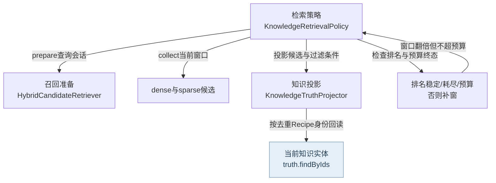
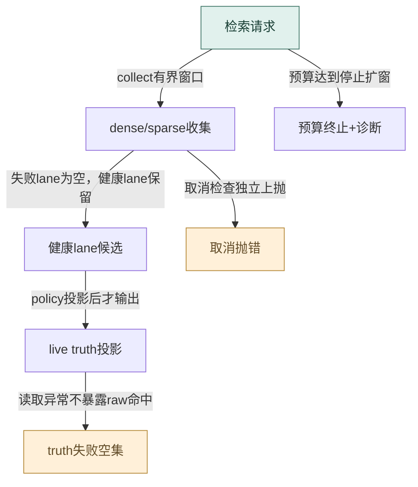
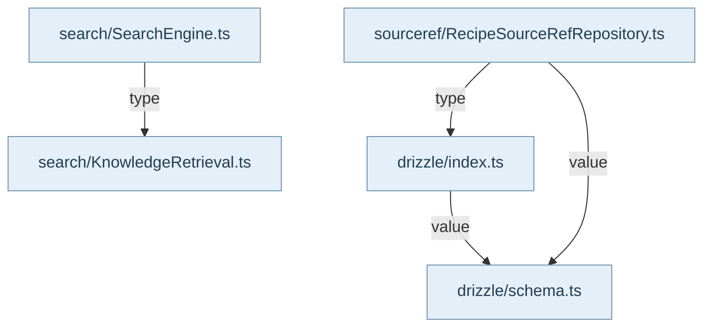

## 两层查询入口

`@alembic/core/search`公开SearchEngine兼容入口和统一检索原语；`@alembic/core/recipe-context-capabilities`提供RecipeContext所需能力。没有`@alembic/core/recipe-context`包入口。SearchEngine仍支持keyword/weighted/semantic/auto、缓存、详情补齐与source drift降权；canonical检索结果跳过旧的粗排/多信号重排。RecipeContext的search和prime优先使用注入的KnowledgeRetrievalPort，否则分别使用旧search/vector端口；后者是兼容绑定，不证明所有宿主已经采用新组合。

## 候选不是真相

`HybridCandidateRetriever.prepare`区分query embedding和document embedding，embedding缺失、空向量、熔断或lane失败形成明确fallback。collect并行收集dense与sparse；一个lane失败不会让另一个lane失效，但取消继续传播。`KnowledgeTruthProjector.project`先把region命中折叠到Recipe身份，再经truth.findByIds读取当前实体，剔除孤儿、deprecated与不匹配元数据。每Recipe每lane只贡献一次RRF，原dense相似度和sparse分数作为证据保留，多个region不能靠重复数抬高排名。

`KnowledgeRetrievalPolicy.retrieve`控制Top-K、初始窗口和最大预算。它先过滤live truth，再判断Top-K的顺序上界是否稳定；否则逐轮扩窗，直到排名稳定、来源耗尽或预算达到。truth读取失败返回空候选与诊断，不能泄出未核验命中。结果同时给出候选、region证据和过滤/补窗/fallback诊断。prime投影候选的语义块与预算，不在普通读取时现场重建向量；同一候选模型使search与prime不会各自发明知识身份。

## 适配器限制与证据

真实Main的KnowledgeRetrievalModule装配SearchEngine、vector store、HybridRetriever和代际管理；这个样本证明兼容链仍有消费者，不等同canonical policy全接通。RecipeContext只读适配器通过KnowledgeService.get/list访问知识，不拥有创建、发布或生命周期写入。

R07仍存在：仓储裸文件查询能命中带行范围sourcePath，但handler又作字符串严格相等过滤，将其丢掉。R08仍存在：toListFilters未透传moduleName，tags只取第一项，查询含义和分页总数可能改变。既有policy过滤测试不覆盖这个真实adapter缺口，因此不能用它宣称RecipeContext所有过滤正确。这里继承产品测试源码断言，未新执行，也未修复上述问题。

## 视图与术语

本页手工图描述已核对的关系与关键分叉；F1 也承担所列调用范围的业务纵切（V0）阅读，不能推出未画出的宿主自动调度。F0 文件依赖精选由同页选择集和 TypeScript 导入图生成，不是运行时轨迹。S0/R0 只描述正文指定的 owner、状态和恢复前提。公开 API、全部文件及变更影响见阅读器的对应入口。

`source` 为代码来源，`direct` 为直接绑定调用及断言，`indirect` 为经 helper/fixture 或间接行为的断言，`none` 为明确未覆盖。正文中的“宿主”指真实外层装配，不属于 Core 内部运行时。

## 模块协作与恢复边界深化

召回故障需按三层判断。embedding失联、空向量或熔断是dense准备层的降级；dense/sparse端口失败由allSettled隔离，剩余lane仍须经过live truth；truth失败则停止可信候选投影并返回空集，而不能沿用raw候选。取消是独立终止路径，传播请求signal的reason，不是一次成功的稀疏回退。Policy以排序稳定性、来源耗尽和预算三个条件结束，budget fallback下有候选并不等于全局Top-K已稳定。RecipeContext与SearchEngine是消费面，是否连接canonical port由宿主决定；来源有界引用丢失R07和list的module/tags语义丢失R08继续作为已知限制，本轮不修复。

<!-- atlas:generated:start -->

## 功能单元与调用接缝

各单元按真实入口拆分职责；门面暴露、内部调用和宿主装配是不同关系。关联图提供相邻阅读上下文，故障产生位置以条目源码为准。

<a id="m-M11-01" class="stable-anchor"></a>
<a id="召回会话与embedding熔断" class="stable-anchor"></a>

### 召回会话与embedding熔断

入口：`src/service/search/KnowledgeRetrieval.ts#HybridCandidateRetriever`

| 检查项 | 功能与边界 |
| --- | --- |
| 输入 | query/mode/filter/signal |
| 输出 | 可反复collect(window)的会话与fallback原因 |
| 后续调用 / 绑定 | embedQuery；reader.getStats；reader.searchVector；sparse |
| 状态与副作用 | 进程内连续失败计数与熔断截止时间；不写知识/向量 |
| 能力边界 | 可选inventory读取失败只失去预算hint；embedding不能恢复时仍允许sparse。 |

关联：[影子代际到可见路由](../12-vector-generations/README.md#graph-vector-generation-visibility) · [召回、真相过滤与有界补窗](README.md#graph-retrieval-live-truth) · [Q3-EMBED · embedding连续失败或熔断未到期](README.md#f-Q3-EMBED) · [Q3-LANE · dense或sparse端口同步/异步抛错](README.md#f-Q3-LANE) · [Q3-CANCEL · signal在prepare或collect/refill检查点已取消](README.md#f-Q3-CANCEL) · 包入口 [@alembic/core](../../data/public-api.json)、[@alembic/core/search](../../data/public-api.json)

返回业务旅程：[一次知识从提交到可查询 · 需要 dense 检索时单独确认向量路由可见](../../journeys/j01.md#J01-07) · [一次知识从提交到可查询 · 查询候选，再按 live truth 投影与预算收敛](../../journeys/j01.md#J01-08)

<a id="m-M11-02" class="stable-anchor"></a>
<a id="live-truth投影与聚合" class="stable-anchor"></a>

### live truth投影与聚合

入口：`src/service/search/KnowledgeRetrieval.ts#KnowledgeTruthProjector`

| 检查项 | 功能与边界 |
| --- | --- |
| 输入 | dense/sparse raw命中、metadata filter、RRF参数 |
| 输出 | 按Recipe聚合且经当前实体筛选的candidates/diagnostics |
| 后续调用 / 绑定 | resolveRecipeId；truth.findByIds；matchesFilter |
| 状态与副作用 | 只读；保留region证据与原lane分数 |
| 能力边界 | 不能把向量存在当知识仍active；truth读取失败交由policy fail-closed。 |

关联：[召回、真相过滤与有界补窗](README.md#graph-retrieval-live-truth) · 包入口 [@alembic/core](../../data/public-api.json)、[@alembic/core/search](../../data/public-api.json)

返回业务旅程：[一次知识从提交到可查询 · 查询候选，再按 live truth 投影与预算收敛](../../journeys/j01.md#J01-08)

<a id="m-M11-03" class="stable-anchor"></a>
<a id="有界top-k策略" class="stable-anchor"></a>

### 有界Top-K策略

入口：`src/service/search/KnowledgeRetrieval.ts#KnowledgeRetrievalPolicy`

| 检查项 | 功能与边界 |
| --- | --- |
| 输入 | topK、candidateBudget、query、signal |
| 输出 | 有限候选与ranking/budget/exhausted/fallback诊断 |
| 后续调用 / 绑定 | retriever.prepare；session.collect；projector.project；hasStableTopKRanking |
| 状态与副作用 | 只在本次请求内扩窗 |
| 能力边界 | 候选数量足够不等于顺序稳定；预算耗尽可返回未充分稳定的结果，必须保留诊断。 |

关联：[召回、真相过滤与有界补窗](README.md#graph-retrieval-live-truth) · [Q3-TRUTH · truth.findByIds/projector抛错](README.md#f-Q3-TRUTH) · [Q3-BUDGET · 候选顺序未证明稳定但window达到预算](README.md#f-Q3-BUDGET) · 包入口 [@alembic/core](../../data/public-api.json)、[@alembic/core/search](../../data/public-api.json)

返回业务旅程：[一次知识从提交到可查询 · 查询候选，再按 live truth 投影与预算收敛](../../journeys/j01.md#J01-08)

<a id="m-M11-04" class="stable-anchor"></a>
<a id="recipecontext搜索投影" class="stable-anchor"></a>

### RecipeContext搜索投影

入口：`src/service/recipe-context/handlers/search.ts#makeSearchHandler`

| 检查项 | 功能与边界 |
| --- | --- |
| 输入 | RecipeContext query与过滤、limit |
| 输出 | 协议化候选、refs与metadata |
| 后续调用 / 绑定 | retrieval.retrieve 或 legacy search.search |
| 状态与副作用 | 只读 |
| 能力边界 | legacy兼容与canonical binding区分；R07来源range过滤、R08list adapter字段丢失不由本策略解决。 |

关联：[召回、真相过滤与有界补窗](README.md#graph-retrieval-live-truth)

返回业务旅程：[一次知识从提交到可查询 · 查询候选，再按 live truth 投影与预算收敛](../../journeys/j01.md#J01-08)


## 生成的图与逐边依据

此区域由同页结构化图模型生成；请修改 frontmatter，再显式运行 `npm run inventory:write`，不要单独修改表格或 Mermaid。

<a id="graph-retrieval-live-truth"></a>

### 召回、真相过滤与有界补窗

图 ID：`retrieval-live-truth` · F1 · policy拥有补窗，retriever提供候选，projector从当前知识真相确认身份与过滤；查询不写向量。



| 边 ID | 关系 | 源码定位 | 断言关系 | case / 缺口 | 相关旅程步骤 |
| --- | --- | --- | --- | --- | --- |
| <a id="e-retrieval-live-truth--RT-01"></a>RT-01 | prepare查询会话 | `src/service/search/KnowledgeRetrieval.ts#KnowledgeRetrievalPolicy` | direct | returns sparse truth when the embedding provider is missing | [J01 · 查询候选，再按 live truth 投影与预算收敛](../../journeys/j01.md#J01-08) |
| <a id="e-retrieval-live-truth--RT-02"></a>RT-02 | collect当前窗口 | `src/service/search/KnowledgeRetrieval.ts#KnowledgeRetrievalPolicy` | direct | refills beyond an orphan-heavy first window until distinct live truth fills topK | [J01 · 查询候选，再按 live truth 投影与预算收敛](../../journeys/j01.md#J01-08) |
| <a id="e-retrieval-live-truth--RT-03"></a>RT-03 | 投影候选与过滤条件 | `src/service/search/KnowledgeRetrieval.ts#KnowledgeRetrievalPolicy` | direct | applies authoritative metadata filters before deciding whether to refill | [J01 · 查询候选，再按 live truth 投影与预算收敛](../../journeys/j01.md#J01-08) |
| <a id="e-retrieval-live-truth--RT-04"></a>RT-04 | 按去重Recipe身份回读 | `src/service/search/KnowledgeRetrieval.ts#KnowledgeTruthProjector` | indirect | refills beyond an orphan-heavy first window until distinct live truth fills topK | [J01 · 查询候选，再按 live truth 投影与预算收敛](../../journeys/j01.md#J01-08) |
| <a id="e-retrieval-live-truth--RT-05"></a>RT-05 | 检查排名与预算终态 | `src/service/search/KnowledgeRetrieval.ts#KnowledgeRetrievalPolicy` | direct | refills beyond an orphan-heavy first window until distinct live truth fills topK | [J01 · 查询候选，再按 live truth 投影与预算收敛](../../journeys/j01.md#J01-08) |
| <a id="e-retrieval-live-truth--RT-06"></a>RT-06 | 窗口翻倍但不超预算 | `src/service/search/KnowledgeRetrieval.ts#KnowledgeRetrievalPolicy` | direct | refills beyond an orphan-heavy first window until distinct live truth fills topK | [J01 · 查询候选，再按 live truth 投影与预算收敛](../../journeys/j01.md#J01-08) |

<a id="graph-r3-retrieval-stop-and-degrade"></a>

### 检索中的降级与停止

图 ID：`r3-retrieval-stop-and-degrade` · R0 · 区分健康lane继续、truth失败空集、取消抛错与预算有界返回。



| 边 ID | 关系 | 源码定位 | 断言关系 | case / 缺口 | 相关旅程步骤 |
| --- | --- | --- | --- | --- | --- |
| <a id="e-r3-retrieval-stop-and-degrade--Q3-E1"></a>Q3-E1 | collect有界窗口 | `src/service/search/KnowledgeRetrieval.ts#KnowledgeRetrievalPolicy` | indirect | reports the budget fallback when a full Top-K remains unstable |  |
| <a id="e-r3-retrieval-stop-and-degrade--Q3-E2"></a>Q3-E2 | 失败lane为空，健康lane保留 | `src/service/search/KnowledgeRetrieval.ts#HybridCandidateRetriever` | indirect | retains the healthy lane when the %s port throws synchronously |  |
| <a id="e-r3-retrieval-stop-and-degrade--Q3-E3"></a>Q3-E3 | policy投影后才输出 | `src/service/search/KnowledgeRetrieval.ts#KnowledgeRetrievalPolicy` | indirect | retains the healthy lane when the %s port throws synchronously |  |
| <a id="e-r3-retrieval-stop-and-degrade--Q3-E4"></a>Q3-E4 | 读取异常不暴露raw命中 | `src/service/search/KnowledgeRetrieval.ts#KnowledgeRetrievalPolicy` | none | 无指定失败case，保留未覆盖。 |  |
| <a id="e-r3-retrieval-stop-and-degrade--Q3-E5"></a>Q3-E5 | 取消检查独立上抛 | `src/service/search/KnowledgeRetrieval.ts#HybridCandidateRetriever` | indirect | propagates AbortSignal cancellation during candidate collection |  |
| <a id="e-r3-retrieval-stop-and-degrade--Q3-E6"></a>Q3-E6 | 预算达到停止扩窗 | `src/service/search/KnowledgeRetrieval.ts#KnowledgeRetrievalPolicy` | indirect | reports the budget fallback when a full Top-K remains unstable |  |

<a id="graph-dependencies-11"></a>

### 文件依赖精选 · 静态关系

图 ID：`dependencies-11` · F0 · 显式选择集内的实际导入；类型边不代表运行调用，动态未知保留在全量索引。



| 边 ID | 关系 | 源码定位 | 断言关系 | case / 缺口 | 相关旅程步骤 |
| --- | --- | --- | --- | --- | --- |
| <a id="e-dependencies-11--dep-11-0"></a>dep-11-0 | value | `src/infrastructure/database/drizzle/index.ts#<module>` | none | TypeScript AST 静态导入事实，不主张运行调用或断言覆盖。 |  |
| <a id="e-dependencies-11--dep-11-1"></a>dep-11-1 | type | `src/repository/sourceref/RecipeSourceRefRepository.ts#<module>` | none | TypeScript AST 静态导入事实，不主张运行调用或断言覆盖。 |  |
| <a id="e-dependencies-11--dep-11-2"></a>dep-11-2 | value | `src/repository/sourceref/RecipeSourceRefRepository.ts#<module>` | none | TypeScript AST 静态导入事实，不主张运行调用或断言覆盖。 |  |
| <a id="e-dependencies-11--dep-11-3"></a>dep-11-3 | type | `src/service/search/SearchEngine.ts#<module>` | none | TypeScript AST 静态导入事实，不主张运行调用或断言覆盖。 |  |

## 失败后的状态与恢复责任

先检查已落盘状态，再决定恢复。自动动作只描述代码已执行的分支；显式恢复不能据提示文字推断为自动调用。

<a id="f-Q3-EMBED" class="stable-anchor"></a>
<a id="q3-embed--embedding连续失败或熔断未到期" class="stable-anchor"></a>

### Q3-EMBED · embedding连续失败或熔断未到期

| 检查项 | 当前代码语义 |
| --- | --- |
| 已留下什么 | sparse候选仍可用；dense本轮为空 |
| Core自动做什么 | 计失败、达到阈值开启冷却；返回fallbackReason |
| 谁显式恢复 | 冷却后下一次请求可尝试provider，宿主也可修provider后重试 |
| 必须停止的条件 | 请求不因embed故障全部失败；不得宣称dense成功 |
| 源码定位 | `src/service/search/KnowledgeRetrieval.ts#HybridCandidateRetriever` |

```ts
fallbackReason = 'embed-circuit-open';
```

关联：[召回会话与embedding熔断](README.md#m-M11-01) · [召回、真相过滤与有界补窗](README.md#graph-retrieval-live-truth) · 包入口 [@alembic/core](../../data/public-api.json)、[@alembic/core/search](../../data/public-api.json)

返回业务旅程：[一次知识从提交到可查询 · 查询候选，再按 live truth 投影与预算收敛](../../journeys/j01.md#J01-08)

断言关系：**indirect**。`test/KnowledgeRetrievalPolicy.test.ts` · `opens the embedding circuit after repeated failures while preserving sparse truth`

阈值2之后第三次不再调用embed，稀疏truth仍返回（fallback）。这里只定位断言；实际运行范围见独立运行证据。

```ts
expect(third.diagnostics.fallbackReason).toBe('embed-circuit-open');
```

<a id="f-Q3-LANE" class="stable-anchor"></a>
<a id="q3-lane--dense或sparse端口同步异步抛错" class="stable-anchor"></a>

### Q3-LANE · dense或sparse端口同步/异步抛错

| 检查项 | 当前代码语义 |
| --- | --- |
| 已留下什么 | 健康lane保留，失败lane归为空并记exhaustion |
| Core自动做什么 | Promise.allSettled局部吸收失败并投影健康lane |
| 谁显式恢复 | 宿主按fallbackReason修复失败port后再次查询 |
| 必须停止的条件 | 两个lane均无可用结果则候选耗尽；没有自动创建向量 |
| 源码定位 | `src/service/search/KnowledgeRetrieval.ts#HybridCandidateRetriever` |

```ts
const dense = denseResult.status === 'fulfilled' ? denseResult.value : [];
```

关联：[召回会话与embedding熔断](README.md#m-M11-01) · [召回、真相过滤与有界补窗](README.md#graph-retrieval-live-truth) · 包入口 [@alembic/core](../../data/public-api.json)、[@alembic/core/search](../../data/public-api.json)

返回业务旅程：[一次知识从提交到可查询 · 查询候选，再按 live truth 投影与预算收敛](../../journeys/j01.md#J01-08)

断言关系：**indirect**。`test/KnowledgeRetrievalPolicy.test.ts` · `retains the healthy lane when the %s port throws synchronously`

policy经retriever将同步lane抛错归一为局部失败，健康lane仍经truth返回（negative）。这里只定位断言；实际运行范围见独立运行证据。

```ts
expect(result.candidates.map((candidate) => candidate.recipeId)).toEqual(['live-recipe']);
```

<a id="f-Q3-TRUTH" class="stable-anchor"></a>
<a id="q3-truth--truthfindbyidsprojector抛错" class="stable-anchor"></a>

### Q3-TRUTH · truth.findByIds/projector抛错

| 检查项 | 当前代码语义 |
| --- | --- |
| 已留下什么 | 本轮raw命中不能确认live truth |
| Core自动做什么 | 清空最终候选、将两lane标exhausted并返回knowledge-truth-failed |
| 谁显式恢复 | 修复知识读取端口后重新查询；不应将raw命中直接暴露给调用者 |
| 必须停止的条件 | 立即停止补窗；回传空集不等于知识库确实为空 |
| 源码定位 | `src/service/search/KnowledgeRetrieval.ts#KnowledgeRetrievalPolicy` |

```ts
fallbackReason: `knowledge-truth-failed:${readErrorMessage(error)}`,
```

关联：[有界Top-K策略](README.md#m-M11-03) · [召回、真相过滤与有界补窗](README.md#graph-retrieval-live-truth) · 包入口 [@alembic/core](../../data/public-api.json)、[@alembic/core/search](../../data/public-api.json)

返回业务旅程：[一次知识从提交到可查询 · 查询候选，再按 live truth 投影与预算收敛](../../journeys/j01.md#J01-08)

断言关系：**none**。本次未定位truth读取失败且确认raw候选不泄出的具体case；源码失败分支明确。

<a id="f-Q3-CANCEL" class="stable-anchor"></a>
<a id="q3-cancel--signal在prepare或collectrefill检查点已取消" class="stable-anchor"></a>

### Q3-CANCEL · signal在prepare或collect/refill检查点已取消

| 检查项 | 当前代码语义 |
| --- | --- |
| 已留下什么 | 已发出的provider/read调用可能已发生；不新增持久写入 |
| Core自动做什么 | throwIfAborted或normalizeAbortError传播取消 |
| 谁显式恢复 | 宿主只有新意图时创建新请求；不能在旧请求自动清除signal重试 |
| 必须停止的条件 | 取消停止请求，不归类普通lane降级 |
| 源码定位 | `src/service/search/KnowledgeRetrieval.ts#HybridCandidateRetriever` |

```ts
request.signal?.throwIfAborted();
```

关联：[召回会话与embedding熔断](README.md#m-M11-01) · [召回、真相过滤与有界补窗](README.md#graph-retrieval-live-truth) · 包入口 [@alembic/core](../../data/public-api.json)、[@alembic/core/search](../../data/public-api.json)

返回业务旅程：[一次知识从提交到可查询 · 查询候选，再按 live truth 投影与预算收敛](../../journeys/j01.md#J01-08)

断言关系：**indirect**。`test/KnowledgeRetrievalPolicy.test.ts` · `propagates AbortSignal cancellation during candidate collection`

candidate收集时signal取消，拒绝原始reason而不返回正常候选（negative）。这里只定位断言；实际运行范围见独立运行证据。

```ts
).rejects.toBe('stop-refill');
```

<a id="f-Q3-BUDGET" class="stable-anchor"></a>
<a id="q3-budget--候选顺序未证明稳定但window达到预算" class="stable-anchor"></a>

### Q3-BUDGET · 候选顺序未证明稳定但window达到预算

| 检查项 | 当前代码语义 |
| --- | --- |
| 已留下什么 | 已有live truth候选保留 |
| Core自动做什么 | 停止扩窗并标candidate-budget-exhausted |
| 谁显式恢复 | 宿主明确增加预算或缩窄query/filter后重查 |
| 必须停止的条件 | 窗口/预算停止是有限结果，不是完整穷尽保证 |
| 源码定位 | `src/service/search/KnowledgeRetrieval.ts#KnowledgeRetrievalPolicy` |

```ts
? { fallbackReason: 'candidate-budget-exhausted' }
```

关联：[有界Top-K策略](README.md#m-M11-03) · [召回、真相过滤与有界补窗](README.md#graph-retrieval-live-truth) · 包入口 [@alembic/core](../../data/public-api.json)、[@alembic/core/search](../../data/public-api.json)

返回业务旅程：[一次知识从提交到可查询 · 查询候选，再按 live truth 投影与预算收敛](../../journeys/j01.md#J01-08)

断言关系：**indirect**。`test/KnowledgeRetrievalPolicy.test.ts` · `reports the budget fallback when a full Top-K remains unstable`

预算32时不再扩窗，仍返回2个候选并标预算终止（budget）。这里只定位断言；实际运行范围见独立运行证据。

```ts
expect(windows).toEqual([32]);
```


<!-- atlas:generated:end -->
