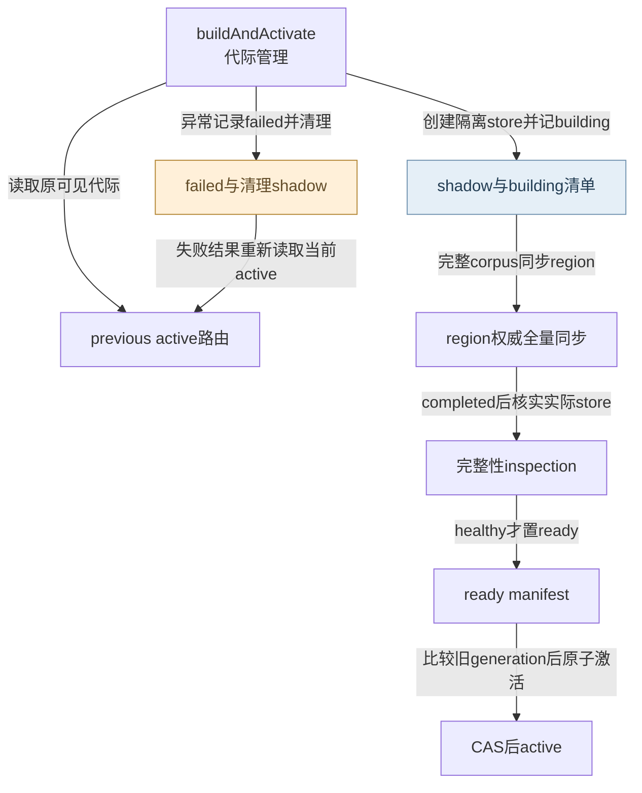
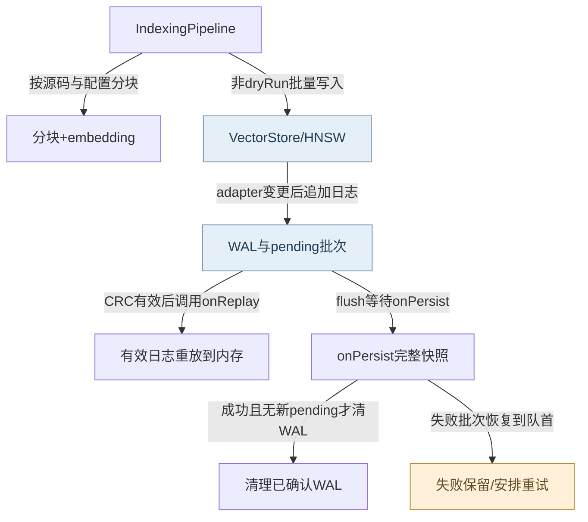
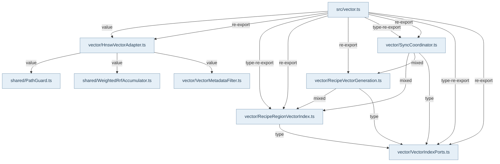

## 两条索引与公开端口

`@alembic/core/vector`提供文件分块索引、Recipe region投影、向量存储与代际管理。文件通路由IndexingPipeline扫描、Chunker按AST/section/fixed分块、sourceHash判断增量、BatchEmbedder批处理后写入store。Recipe通路以canonical retrieval document set为身份来源，RecipeRegionVectorIndex产生region chunks和检索元数据。query与document embedding端口区分用途；provider适配层报告对称或非对称能力，Core不负责宿主模型安装或API密钥管理。

## 影子构建与可见性

`RecipeVectorGenerationManager.buildAndActivate`先读当前route，再按provider、model、dimension、projection/schema和corpusFingerprint生成manifest。相同manifest也要重新inspection且存在ready清单，才能返回already-active。其他情况创建shadow并先写building清单，以完整authoritative corpus调用region同步；仅当同步completed、实际IDs/metadata/hash/dimension检查healthy后写ready，再调用router.activate(next, expectedPreviousGenerationId)。这个compare-and-swap是可见性切换点，创建shadow不是发布成功。

失败会记录errors、尝试写failed清单并清理shadow，本次失败不主动切换active；错误结果重新读取当前route，没有并发外部切换时仍是旧代际。回滚也是显式调用，不能靠失败结果假定宿主已回滚。Main的KnowledgeRetrievalModule实际把同一storage注入factory/router，另用GenerationRoutingVectorStore负责外层读取路由；这些是宿主接线，与Core的确定性状态检查分工。

## 增量维护、删除与恢复边界

region子集刷新不能删除未列入子集的Recipe；删除全量孤儿需要显式authoritative Recipe IDs。活知识的旧chunk要等replacement写后读回成功再删除。VectorLifecycleCoordinator按事件排队，终态删除不依赖embedding在线，flush/destroy等待清理。普通检索只用reader，不在读取路径隐式重建region。

HNSW存原始向量与图，SQ8用于粗排，最终候选仍用原向量余弦重排；ASVEC快照与CRC32 WAL提供持久恢复。显式flush失败应传播并保留dirty/WAL，兼容destroy和旧JSON后端的best-effort路径承诺较弱。IndexingPipeline只在完整扫描和确证消失时删旧块；dryRun限制store写入，但前序分块/enrichment/embedding仍可能执行。此页对manager边引用内存router测试，不把它冒充磁盘崩溃或宿主路由端到端测试；本轮未重跑产品测试或外部embedding服务。

## 视图与术语

本页手工图描述已核对的关系与关键分叉；F1 也承担所列调用范围的业务纵切（V0）阅读，不能推出未画出的宿主自动调度。F0 文件依赖精选由同页选择集和 TypeScript 导入图生成，不是运行时轨迹。S0/R0 只描述正文指定的 owner、状态和恢复前提。公开 API、全部文件及变更影响见阅读器的对应入口。

`source` 为代码来源，`direct` 为直接绑定调用及断言，`indirect` 为经 helper/fixture 或间接行为的断言，`none` 为明确未覆盖。正文中的“宿主”指真实外层装配，不属于 Core 内部运行时。

## 模块协作与恢复边界深化

文件索引与Recipe代际是两条不同写链。文件链的删除权限来自producer marker、扫描完整性和ENOENT确认，不来自“本次列表里没有”。AST fallback、enrichment失败与embedding失败可能继续产生可用文本，但这些结果不能冒充完整语义向量。HNSW适配器当前先修改内存再append WAL；AsyncPersistence的文件头设计描述不能替代调用顺序。recover逐行CRC检查，仅把有效日志投射回内存并加入pending，真正确认点是onPersist成功之后清理该批WAL；快照进行时新增的操作保留供下一批。后台持久化失败会按间隔重试，显式flush则拒绝并要求调用方处理。坏CRC、无可重放append及进程终止前未确认的内存状态并非自动可恢复。现有EISDIR测试是真实文件系统失败与重开验证，onReplay/onPersist收集fixture则仅证明WAL协议，不混称真实断电/磁盘崩溃证据。

<!-- atlas:generated:start -->

## 功能单元与调用接缝

各单元按真实入口拆分职责；门面暴露、内部调用和宿主装配是不同关系。关联图提供相邻阅读上下文，故障产生位置以条目源码为准。

<a id="m-M12-01" class="stable-anchor"></a>
<a id="文件扫描hash增量与清理授权" class="stable-anchor"></a>

### 文件扫描、hash增量与清理授权

入口：`src/infrastructure/vector/IndexingPipeline.ts#IndexingPipeline`

| 检查项 | 功能与边界 |
| --- | --- |
| 输入 | 扫描目录、chunking、force/clear/dryRun、注入vectorStore与provider |
| 输出 | scanned/chunked/skipped/embedded/upserted/errors计数 |
| 后续调用 / 绑定 | #scanInputs；hashContent；chunk；BatchEmbedder.embedAll；vectorStore.batchUpsert/remove |
| 状态与副作用 | 写owned chunks；仅完整扫描与确证ENOENT后删过时owned块 |
| 能力边界 | dryRun仍可分块/enrich/embed；扫描没看到文件不等于已删除；清理失败单项计error。 |

关联：[V3-SCAN · 扫描目录/源文件读取失败](README.md#f-V3-SCAN) · 包入口 [@alembic/core](../../data/public-api.json)、[@alembic/core/vector](../../data/public-api.json)

<a id="m-M12-02" class="stable-anchor"></a>
<a id="语义固定窗口分块" class="stable-anchor"></a>

### 语义/固定窗口分块

入口：`src/infrastructure/vector/Chunker.ts#chunk`

| 检查项 | 功能与边界 |
| --- | --- |
| 输入 | 源码、语言、metadata、token与overlap预算 |
| 输出 | 带source身份和chunkIndex的分块 |
| 后续调用 / 绑定 | chunkByAST；chunkBySection；chunkFixed |
| 状态与副作用 | 纯内存投影 |
| 能力边界 | AST不可用会fallback fixed；降级可得到文本块但不证明语义边界完整。 |

关联：[V3-AST · AST不支持该语言或未产出块](README.md#f-V3-AST) · 包入口 [@alembic/core](../../data/public-api.json)、[@alembic/core/vector](../../data/public-api.json)

<a id="m-M12-03" class="stable-anchor"></a>
<a id="有背压的文档embedding" class="stable-anchor"></a>

### 有背压的文档embedding

入口：`src/infrastructure/vector/BatchEmbedder.ts#BatchEmbedder`

| 检查项 | 功能与边界 |
| --- | --- |
| 输入 | id/content集合、provider能力/容量hint |
| 输出 | id→vector Map，可小于输入数 |
| 后续调用 / 绑定 | embedDocuments；createLimit；#embedBatch |
| 状态与副作用 | 外部provider请求；失败可逐条重试 |
| 能力边界 | 无provider返回空Map；批次/单条失败不能用零向量伪造完整语义索引。 |

关联：[V3-EMBED · 整批embedding请求失败](README.md#f-V3-EMBED) · 包入口 [@alembic/core](../../data/public-api.json)、[@alembic/core/vector](../../data/public-api.json)

<a id="m-M12-04" class="stable-anchor"></a>
<a id="hnsw适配dirty与显式flush" class="stable-anchor"></a>

### HNSW适配、dirty与显式flush

入口：`src/infrastructure/vector/HnswVectorAdapter.ts#HnswVectorAdapter`

| 检查项 | 功能与边界 |
| --- | --- |
| 输入 | 向量条目/metadata、存储位置、flush配置 |
| 输出 | 可查索引；flush返回落盘完成或reject |
| 后续调用 / 绑定 | HnswIndex.addPoint/removePoint；AsyncPersistence.appendWal/flush；BinaryPersistence |
| 状态与副作用 | 内存图和内容先更新，再记WAL与调度持久化 |
| 能力边界 | 当前adapter不是WAL先于内存变更的原子协议；空vector会移除旧ANN向量，保留关键词记录。 |

关联：未声明跨项关联 · 包入口 [@alembic/core](../../data/public-api.json)、[@alembic/core/vector](../../data/public-api.json)

<a id="m-M12-05" class="stable-anchor"></a>
<a id="wal批次与重放确认" class="stable-anchor"></a>

### WAL批次与重放确认

入口：`src/infrastructure/vector/AsyncPersistence.ts#AsyncPersistence`

| 检查项 | 功能与边界 |
| --- | --- |
| 输入 | WAL操作、onPersist/onReplay回调 |
| 输出 | pendingCount、replayed/skipped与flush结果 |
| 后续调用 / 绑定 | crc32；appendFileSync；onReplay；onPersist；#clearWal |
| 状态与副作用 | WAL磁盘append、快照后删/重写WAL、后台重试timer |
| 能力边界 | recover只恢复内存；坏CRC跳过不可自愈；destroy仅停timer，不负责flush。 |

关联：[V3-WAL-CORRUPT · WAL行缺分隔符、CRC错误、JSON/replay异常](README.md#f-V3-WAL-CORRUPT) · [V3-SNAPSHOT · HNSW snapshot写入失败](README.md#f-V3-SNAPSHOT) · [V3-WAL-APPEND · WAL序列化或append失败](README.md#f-V3-WAL-APPEND) · 包入口 [@alembic/core](../../data/public-api.json)、[@alembic/core/vector](../../data/public-api.json)

<a id="m-M12-06" class="stable-anchor"></a>
<a id="二进制快照原子替换" class="stable-anchor"></a>

### 二进制快照原子替换

入口：`src/infrastructure/vector/BinaryPersistence.ts#BinaryPersistence`

| 检查项 | 功能与边界 |
| --- | --- |
| 输入 | HNSW/quantizer/content/metadata snapshot |
| 输出 | ASVEC字节与磁盘快照 |
| 后续调用 / 绑定 | encode；prepareSnapshotMode；commitSnapshot；discardTemporarySnapshot |
| 状态与副作用 | 同目录temp文件与rename，失败清temp再抛错 |
| 能力边界 | 结构校验不能恢复丢失的WAL条目；不要把rename实验等同断电持久保证。 |

关联：未声明跨项关联 · 包入口 [@alembic/core](../../data/public-api.json)、[@alembic/core/vector](../../data/public-api.json)


## 生成的图与逐边依据

此区域由同页结构化图模型生成；请修改 frontmatter，再显式运行 `npm run inventory:write`，不要单独修改表格或 Mermaid。

<a id="graph-vector-generation-visibility"></a>

### 影子代际到可见路由

图 ID：`vector-generation-visibility` · S0 · 完整同步和inspection先于ready；CAS之后才成为可见active，失败保留旧代际。



| 边 ID | 关系 | 源码定位 | 断言关系 | case / 缺口 | 相关旅程步骤 |
| --- | --- | --- | --- | --- | --- |
| <a id="e-vector-generation-visibility--VG-01"></a>VG-01 | 读取原可见代际 | `src/service/vector/RecipeVectorGeneration.ts#RecipeVectorGenerationManager` | direct | activates only a fully verified shadow generation and can atomically roll back |  |
| <a id="e-vector-generation-visibility--VG-02"></a>VG-02 | 创建隔离store并记building | `src/service/vector/RecipeVectorGeneration.ts#RecipeVectorGenerationManager` | direct | activates only a fully verified shadow generation and can atomically roll back |  |
| <a id="e-vector-generation-visibility--VG-03"></a>VG-03 | 完整corpus同步region | `src/service/vector/RecipeVectorGeneration.ts#RecipeVectorGenerationManager` | direct | activates only a fully verified shadow generation and can atomically roll back | [J01 · 需要 dense 检索时单独确认向量路由可见](../../journeys/j01.md#J01-07) |
| <a id="e-vector-generation-visibility--VG-04"></a>VG-04 | completed后核实实际store | `src/service/vector/RecipeVectorGeneration.ts#RecipeVectorGenerationManager` | direct | activates only a fully verified shadow generation and can atomically roll back | [J01 · 需要 dense 检索时单独确认向量路由可见](../../journeys/j01.md#J01-07) |
| <a id="e-vector-generation-visibility--VG-05"></a>VG-05 | healthy才置ready | `src/service/vector/RecipeVectorGeneration.ts#RecipeVectorGenerationManager` | direct | activates only a fully verified shadow generation and can atomically roll back | [J01 · 需要 dense 检索时单独确认向量路由可见](../../journeys/j01.md#J01-07) |
| <a id="e-vector-generation-visibility--VG-06"></a>VG-06 | 比较旧generation后原子激活 | `src/service/vector/RecipeVectorGeneration.ts#RecipeVectorGenerationManager` | direct | activates only a fully verified shadow generation and can atomically roll back | [J01 · 需要 dense 检索时单独确认向量路由可见](../../journeys/j01.md#J01-07) |
| <a id="e-vector-generation-visibility--VG-07"></a>VG-07 | 异常记录failed并清理 | `src/service/vector/RecipeVectorGeneration.ts#RecipeVectorGenerationManager` | direct | leaves the old generation queryable when shadow embedding fails |  |
| <a id="e-vector-generation-visibility--VG-08"></a>VG-08 | 失败结果重新读取当前active | `src/service/vector/RecipeVectorGeneration.ts#RecipeVectorGenerationManager` | direct | leaves the old generation queryable when shadow embedding fails | [J01 · 需要 dense 检索时单独确认向量路由可见](../../journeys/j01.md#J01-07) |

<a id="graph-r3-file-index-and-wal"></a>

### 文件索引与WAL确认边界

图 ID：`r3-file-index-and-wal` · R0 · 文件索引写入所注入store；选择HNSW实现时，后续WAL确认按本支运行。恢复后的内存不是已完成持久化。



| 边 ID | 关系 | 源码定位 | 断言关系 | case / 缺口 | 相关旅程步骤 |
| --- | --- | --- | --- | --- | --- |
| <a id="e-r3-file-index-and-wal--V3-E1"></a>V3-E1 | 按源码与配置分块 | `src/infrastructure/vector/IndexingPipeline.ts#IndexingPipeline` | none | 图为源码链，AST fallback另有专门断言。 |  |
| <a id="e-r3-file-index-and-wal--V3-E2"></a>V3-E2 | 非dryRun批量写入 | `src/infrastructure/vector/IndexingPipeline.ts#IndexingPipeline` | indirect | retains owned chunks when a scan or source read fails instead of inferring deletion |  |
| <a id="e-r3-file-index-and-wal--V3-E3"></a>V3-E3 | adapter变更后追加日志 | `src/infrastructure/vector/HnswVectorAdapter.ts#HnswVectorAdapter` | indirect | rejects flush and retains WAL when the HNSW snapshot cannot be written |  |
| <a id="e-r3-file-index-and-wal--V3-E4"></a>V3-E4 | CRC有效后调用onReplay | `src/infrastructure/vector/AsyncPersistence.ts#AsyncPersistence` | indirect | recover should replay valid WAL entries and retain them until a snapshot succeeds |  |
| <a id="e-r3-file-index-and-wal--V3-E5"></a>V3-E5 | flush等待onPersist | `src/infrastructure/vector/AsyncPersistence.ts#AsyncPersistence` | indirect | recover should replay valid WAL entries and retain them until a snapshot succeeds |  |
| <a id="e-r3-file-index-and-wal--V3-E6"></a>V3-E6 | 成功且无新pending才清WAL | `src/infrastructure/vector/AsyncPersistence.ts#AsyncPersistence` | indirect | recover should replay valid WAL entries and retain them until a snapshot succeeds |  |
| <a id="e-r3-file-index-and-wal--V3-E7"></a>V3-E7 | 失败批次恢复到队首 | `src/infrastructure/vector/AsyncPersistence.ts#AsyncPersistence` | indirect | rejects flush and retains WAL when the HNSW snapshot cannot be written |  |

<a id="graph-dependencies-12"></a>

### 文件依赖精选 · 静态关系

图 ID：`dependencies-12` · F0 · 显式选择集内的实际导入；类型边不代表运行调用，动态未知保留在全量索引。



| 边 ID | 关系 | 源码定位 | 断言关系 | case / 缺口 | 相关旅程步骤 |
| --- | --- | --- | --- | --- | --- |
| <a id="e-dependencies-12--dep-12-0"></a>dep-12-0 | value | `src/infrastructure/vector/HnswVectorAdapter.ts#<module>` | none | TypeScript AST 静态导入事实，不主张运行调用或断言覆盖。 |  |
| <a id="e-dependencies-12--dep-12-1"></a>dep-12-1 | value | `src/infrastructure/vector/HnswVectorAdapter.ts#<module>` | none | TypeScript AST 静态导入事实，不主张运行调用或断言覆盖。 |  |
| <a id="e-dependencies-12--dep-12-2"></a>dep-12-2 | value | `src/infrastructure/vector/HnswVectorAdapter.ts#<module>` | none | TypeScript AST 静态导入事实，不主张运行调用或断言覆盖。 |  |
| <a id="e-dependencies-12--dep-12-3"></a>dep-12-3 | type | `src/service/vector/RecipeRegionVectorIndex.ts#<module>` | none | TypeScript AST 静态导入事实，不主张运行调用或断言覆盖。 |  |
| <a id="e-dependencies-12--dep-12-4"></a>dep-12-4 | mixed | `src/service/vector/RecipeVectorGeneration.ts#<module>` | none | TypeScript AST 静态导入事实，不主张运行调用或断言覆盖。 |  |
| <a id="e-dependencies-12--dep-12-5"></a>dep-12-5 | type | `src/service/vector/RecipeVectorGeneration.ts#<module>` | none | TypeScript AST 静态导入事实，不主张运行调用或断言覆盖。 |  |
| <a id="e-dependencies-12--dep-12-6"></a>dep-12-6 | mixed | `src/service/vector/SyncCoordinator.ts#<module>` | none | TypeScript AST 静态导入事实，不主张运行调用或断言覆盖。 |  |
| <a id="e-dependencies-12--dep-12-7"></a>dep-12-7 | mixed | `src/service/vector/SyncCoordinator.ts#<module>` | none | TypeScript AST 静态导入事实，不主张运行调用或断言覆盖。 |  |
| <a id="e-dependencies-12--dep-12-8"></a>dep-12-8 | type | `src/service/vector/SyncCoordinator.ts#<module>` | none | TypeScript AST 静态导入事实，不主张运行调用或断言覆盖。 |  |
| <a id="e-dependencies-12--dep-12-9"></a>dep-12-9 | value | `src/vector.ts#<module>` | none | TypeScript AST 静态导入事实，不主张运行调用或断言覆盖。 |  |
| <a id="e-dependencies-12--dep-12-10"></a>dep-12-10 | re-export | `src/vector.ts#<module>` | none | TypeScript AST 静态导入事实，不主张运行调用或断言覆盖。 |  |
| <a id="e-dependencies-12--dep-12-11"></a>dep-12-11 | type-re-export | `src/vector.ts#<module>` | none | TypeScript AST 静态导入事实，不主张运行调用或断言覆盖。 |  |
| <a id="e-dependencies-12--dep-12-12"></a>dep-12-12 | re-export | `src/vector.ts#<module>` | none | TypeScript AST 静态导入事实，不主张运行调用或断言覆盖。 |  |
| <a id="e-dependencies-12--dep-12-13"></a>dep-12-13 | re-export | `src/vector.ts#<module>` | none | TypeScript AST 静态导入事实，不主张运行调用或断言覆盖。 |  |
| <a id="e-dependencies-12--dep-12-14"></a>dep-12-14 | type-re-export | `src/vector.ts#<module>` | none | TypeScript AST 静态导入事实，不主张运行调用或断言覆盖。 |  |
| <a id="e-dependencies-12--dep-12-15"></a>dep-12-15 | re-export | `src/vector.ts#<module>` | none | TypeScript AST 静态导入事实，不主张运行调用或断言覆盖。 |  |
| <a id="e-dependencies-12--dep-12-16"></a>dep-12-16 | type-re-export | `src/vector.ts#<module>` | none | TypeScript AST 静态导入事实，不主张运行调用或断言覆盖。 |  |
| <a id="e-dependencies-12--dep-12-17"></a>dep-12-17 | re-export | `src/vector.ts#<module>` | none | TypeScript AST 静态导入事实，不主张运行调用或断言覆盖。 |  |

## 失败后的状态与恢复责任

先检查已落盘状态，再决定恢复。自动动作只描述代码已执行的分支；显式恢复不能据提示文字推断为自动调用。

<a id="f-V3-SCAN" class="stable-anchor"></a>
<a id="v3-scan--扫描目录源文件读取失败" class="stable-anchor"></a>

### V3-SCAN · 扫描目录/源文件读取失败

| 检查项 | 当前代码语义 |
| --- | --- |
| 已留下什么 | 已存在owned chunks保留；部分新chunk可能仍被写入 |
| Core自动做什么 | cleanupSafe=false，计错误，禁止本轮stale清理 |
| 谁显式恢复 | 修复目录/读取权限后显式重新run；确认原文件删除再清理 |
| 必须停止的条件 | 不完整扫描停止删除，不必停止所有成功文件的更新 |
| 源码定位 | `src/infrastructure/vector/IndexingPipeline.ts#IndexingPipeline` |

```ts
Logger.getInstance().warn('[IndexingPipeline] cleanup skipped after incomplete scan/read', {
```

关联：[文件扫描、hash增量与清理授权](README.md#m-M12-01) · 包入口 [@alembic/core](../../data/public-api.json)、[@alembic/core/vector](../../data/public-api.json)

断言关系：**indirect**。`test/VectorPipeline.test.ts` · `retains owned chunks when a scan or source read fails instead of inferring deletion`

真实临时文件与JsonVectorAdapter，加受控read故障；不完整扫描留旧chunk，修复后才删（recovery）。这里只定位断言；实际运行范围见独立运行证据。

```ts
expect(await store.getById(ownedId)).not.toBeNull();
```

<a id="f-V3-AST" class="stable-anchor"></a>
<a id="v3-ast--ast不支持该语言或未产出块" class="stable-anchor"></a>

### V3-AST · AST不支持该语言或未产出块

| 检查项 | 当前代码语义 |
| --- | --- |
| 已留下什么 | 原始文本仍在，语义块未建立 |
| Core自动做什么 | 退回fixed分块，pipeline可继续 |
| 谁显式恢复 | 需要语义精度时宿主先修grammar/语言配置后force重建 |
| 必须停止的条件 | fallback不是解析成功证明 |
| 源码定位 | `src/infrastructure/vector/Chunker.ts#chunk` |

```ts
return chunkFixed(content, metadata, maxChunkTokens, overlapTokens);
```

关联：[语义/固定窗口分块](README.md#m-M12-02) · 包入口 [@alembic/core](../../data/public-api.json)、[@alembic/core/vector](../../data/public-api.json)

断言关系：**direct**。`test/VectorPipeline.test.ts` · `explicit ast strategy: falls back to fixed when language unsupported`

未知语言明确退为多块fixed文本（fallback）。这里只定位断言；实际运行范围见独立运行证据。

```ts
expect(result.length).toBeGreaterThan(1);
```

<a id="f-V3-EMBED" class="stable-anchor"></a>
<a id="v3-embed--整批embedding请求失败" class="stable-anchor"></a>

### V3-EMBED · 整批embedding请求失败

| 检查项 | 当前代码语义 |
| --- | --- |
| 已留下什么 | 未失败条目可保留vector，其余只剩文本/metadata |
| Core自动做什么 | BatchEmbedder逐条尝试；仍失败者不入vectorMap，pipeline可写vector=[] |
| 谁显式恢复 | provider恢复后显式force重建或对应权威维护，不能等普通搜索自动补齐 |
| 必须停止的条件 | 无向量条目不能宣称dense可召回 |
| 源码定位 | `src/infrastructure/vector/BatchEmbedder.ts#BatchEmbedder` |

```ts
const vec = await this.#embeddingPort!.embedDocuments([item.content.slice(0, 8000)]);
```

关联：[有背压的文档embedding](README.md#m-M12-03) · 包入口 [@alembic/core](../../data/public-api.json)、[@alembic/core/vector](../../data/public-api.json)

断言关系：**none**。本次未为批失败→逐条失败→真实store空vector整链选择case；不借mock批量成功测试充数。

<a id="f-V3-WAL-CORRUPT" class="stable-anchor"></a>
<a id="v3-wal-corrupt--wal行缺分隔符crc错误jsonreplay异常" class="stable-anchor"></a>

### V3-WAL-CORRUPT · WAL行缺分隔符、CRC错误、JSON/replay异常

| 检查项 | 当前代码语义 |
| --- | --- |
| 已留下什么 | 有效行可重放；坏行对应未入快照操作可能不可恢复 |
| Core自动做什么 | 逐行skipped++，继续有效行，等待快照确认 |
| 谁显式恢复 | 保留诊断；由权威源码/Recipe重建缺失索引，无法靠坏CRC自动找回原向量 |
| 必须停止的条件 | replayed数量不等于日志全部恢复；坏行无隐式重试 |
| 源码定位 | `src/infrastructure/vector/AsyncPersistence.ts#AsyncPersistence` |

```ts
if (actualCrc !== expectedCrc) {
```

关联：[WAL批次与重放确认](README.md#m-M12-05) · 包入口 [@alembic/core](../../data/public-api.json)、[@alembic/core/vector](../../data/public-api.json)

断言关系：**indirect**。`test/VectorPersistence.test.ts` · `recover should skip corrupted WAL entries`

真实临时WAL文本中CRC错误项被跳过，onReplay为收集fixture，不是磁盘崩溃实验（recovery）。这里只定位断言；实际运行范围见独立运行证据。

```ts
expect(result.skipped).toBe(1);
```

<a id="f-V3-SNAPSHOT" class="stable-anchor"></a>
<a id="v3-snapshot--hnsw-snapshot写入失败" class="stable-anchor"></a>

### V3-SNAPSHOT · HNSW snapshot写入失败

| 检查项 | 当前代码语义 |
| --- | --- |
| 已留下什么 | dirty/原WAL及pending批次保留，原快照仍为旧版本 |
| Core自动做什么 | 显式flush reject；后台失败记录warn并按间隔重新调度 |
| 谁显式恢复 | 修复磁盘路径/权限后显式flush并重开检查；关闭前必须等待该结果 |
| 必须停止的条件 | 未flush成功不能称持久完成，destroy不替代flush |
| 源码定位 | `src/infrastructure/vector/AsyncPersistence.ts#AsyncPersistence` |

```ts
this.#pendingOps.unshift(...ops);
```

关联：[WAL批次与重放确认](README.md#m-M12-05) · 包入口 [@alembic/core](../../data/public-api.json)、[@alembic/core/vector](../../data/public-api.json)

断言关系：**indirect**。`test/VectorPersistence.test.ts` · `rejects flush and retains WAL when the HNSW snapshot cannot be written`

真实HNSW临时目录以EISDIR阻止snapshot，显式flush拒绝并保留WAL，移除故障后重开可读（recovery）。这里只定位断言；实际运行范围见独立运行证据。

```ts
await expect(store.flush()).rejects.toMatchObject({ code: 'EISDIR' });
```

<a id="f-V3-WAL-APPEND" class="stable-anchor"></a>
<a id="v3-wal-append--wal序列化或append失败" class="stable-anchor"></a>

### V3-WAL-APPEND · WAL序列化或append失败

| 检查项 | 当前代码语义 |
| --- | --- |
| 已留下什么 | 操作可已在内存生效，pending保留；缺可重放日志 |
| Core自动做什么 | warn并请求完整快照；不回滚内存 |
| 谁显式恢复 | 尽快修复磁盘并显式flush核对；进程在快照前崩溃时不能保证恢复缺失操作 |
| 必须停止的条件 | 日志缺失的操作无自动恢复凭据，不能声称已durable |
| 源码定位 | `src/infrastructure/vector/AsyncPersistence.ts#AsyncPersistence` |

```ts
Logger.getInstance().warn('[AsyncPersistence] WAL append failed; snapshot required', {
```

关联：[WAL批次与重放确认](README.md#m-M12-05) · 包入口 [@alembic/core](../../data/public-api.json)、[@alembic/core/vector](../../data/public-api.json)

断言关系：**none**。本次未见真实append失败到进程重开完整case；仅源码确认降级，不能当作崩溃验证。


<!-- atlas:generated:end -->
