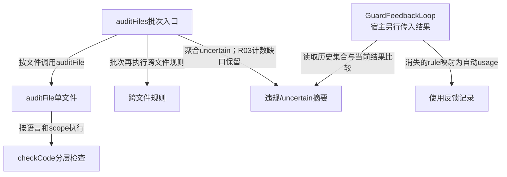
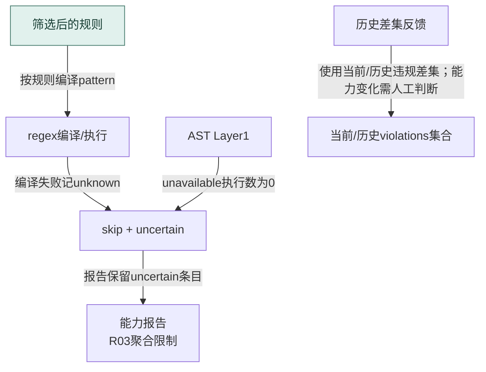
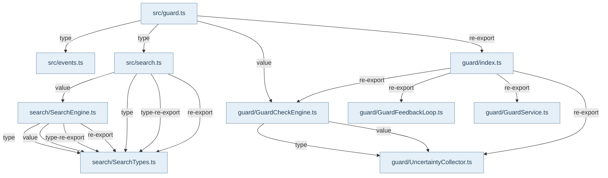

## 规则与检查的分工

`@alembic/core/guard`暴露GuardService、GuardCheckEngine、反馈循环与规则学习工具。GuardService管理kind=rule、knowledgeType=boundary-constraint的KnowledgeEntry，规则存在constraints.guards中；它的create/enable/disable和普通知识一样使用文件优先提交，成功后刷新引擎缓存。AST-only规则保存真实query和description，不要求伪造regex正文。宿主GuardModule负责合并基础与项目配置、注入knowledgeRepository、fileStore与signalBus。

GuardCheckEngine接收源码文本、语言、scope、文件路径及测试标识，组合内置、数据库与注入规则。checkCode先按language、excludePaths、skipTestFiles及project/target/file层级过滤，再计算注释/测试块掩码，逐行regex检查；之后执行code-level规则、AST规则和第二层AST分析。缺grammar或无法执行的规则形成uncertain/skip，不能把空violations自动解释为已证明安全。命中会尝试回写Recipe统计，结果补充whatViolated、whyItMatters和suggestedFix。

## 文件、批次与反馈

auditFile重置单文件collector并返回violations、uncertainResults和摘要；auditFiles逐个调用它，再加跨文件检查、汇总和去重guard信号。GuardFeedbackLoop独立比较当前与上次违规集合，发现消失的ruleId后解析fixSuggestion或规则映射，通过FeedbackCollector记一次自动使用，并可发usage信号。这里的“修复”是违规不再出现的启发式观察，不等同宿主确认已采用某段建议；反馈读取错误和消费者失败采用best-effort诊断。

## 已知限制不能被绿灯隐藏

R03：批次aggregateCollector只加入uncertain条目，没有合并单文件executed/skipped层计数；buildReport在总检查数为零时给出100，因此可能同时显示uncertain和100% checkCoverage。这是实现缺口，不能用coverage数字代替能力完备结论。R04：注入的全局RegExp跨行复用而未重置lastIndex，连续匹配行可交替漏报；非全局pattern并不因此全部失效。两项是上一轮已复现问题，本轮Atlas只显式记录。

既有测试分别验证batch/cross-file结构、相同摘要信号只发一次、真实Markdown/SQLite规则生命周期和反馈记录。它们没有覆盖上述两个反例，也不证明所有语言/AST规则均执行。阅读器应分别展示违规、未知与测试证据，不将图可渲染冒充Guard正确性。

## 视图与术语

本页手工图描述已核对的关系与关键分叉；F1 也承担所列调用范围的业务纵切（V0）阅读，不能推出未画出的宿主自动调度。F0 文件依赖精选由同页选择集和 TypeScript 导入图生成，不是运行时轨迹。S0/R0 只描述正文指定的 owner、状态和恢复前提。公开 API、全部文件及变更影响见阅读器的对应入口。

`source` 为代码来源，`direct` 为直接绑定调用及断言，`indirect` 为经 helper/fixture 或间接行为的断言，`none` 为明确未覆盖。正文中的“宿主”指真实外层装配，不属于 Core 内部运行时。

## 模块协作与恢复边界深化

Guard需要分开“规则未进入执行”“规则执行但不命中”“执行无法确认”三种结果。scope/path/test筛选是预期排除，不必等价错误；编译失败和Layer1 parser不可用则有skip/uncertain；Layer2异常的现有路径日志后返回空数组，不能按统一collector推导覆盖完备。UncertaintyCollector保存计数事实，auditFiles重建时的R03会丢统计；R04则使全局正则lastIndex跨行泄漏。两者继续保留，不因新图增加了失败节点而假定已修复。反馈链依赖两次审计具有可比较性：违规消失可能源于代码修改，也可能源于规则关闭、范围变化或AST未执行。自动usage是现有启发式记录，并非宿主确认采用了修复。

<!-- atlas:generated:start -->

## 功能单元与调用接缝

各单元按真实入口拆分职责；门面暴露、内部调用和宿主装配是不同关系。关联图提供相邻阅读上下文，故障产生位置以条目源码为准。

<a id="m-M13-01" class="stable-anchor"></a>
<a id="规则选择与regex执行" class="stable-anchor"></a>

### 规则选择与regex执行

入口：`src/service/guard/GuardCheckEngine.ts#GuardCheckEngine`

| 检查项 | 功能与边界 |
| --- | --- |
| 输入 | 代码、language、scope、filePath、isTest |
| 输出 | violations与reasoning |
| 后续调用 / 绑定 | getRules；compilePattern；注释/测试块掩码；runCodeLevelChecks |
| 状态与副作用 | 尝试回写guard hits |
| 能力边界 | disabled/path/test/scope是执行前筛选；无违规不能证明被过滤规则已经执行。 |

关联：未声明跨项关联 · 包入口 [@alembic/core](../../data/public-api.json)、[@alembic/core/guard](../../data/public-api.json)

<a id="m-M13-02" class="stable-anchor"></a>
<a id="ast规则与深层ast检查" class="stable-anchor"></a>

### AST规则与深层AST检查

入口：`src/service/guard/GuardCheckEngine.ts#GuardCheckEngine`

| 检查项 | 功能与边界 |
| --- | --- |
| 输入 | 已筛选AST规则、源码及语言 |
| 输出 | Layer1/Layer2违规、部分skip/uncertain记录 |
| 后续调用 / 绑定 | _getAstAnalyzer；AST规则query；AstAnalyzer.analyzeFile |
| 状态与副作用 | 语法查询与collector计数 |
| 能力边界 | Layer2某些catch直接返回[]，记录强度与Layer1不同，不可宣称所有跳过都可见。 |

关联：未声明跨项关联 · 包入口 [@alembic/core](../../data/public-api.json)、[@alembic/core/guard](../../data/public-api.json)

<a id="m-M13-03" class="stable-anchor"></a>
<a id="不确定性与能力报告" class="stable-anchor"></a>

### 不确定性与能力报告

入口：`src/service/guard/UncertaintyCollector.ts#UncertaintyCollector`

| 检查项 | 功能与边界 |
| --- | --- |
| 输入 | 分层total/executed、skip与uncertain事实 |
| 输出 | boundaries/executedChecks/skippedChecks/checkCoverage |
| 后续调用 / 绑定 | recordSkip；recordLayerStats；buildReport |
| 状态与副作用 | 进程内单次审计统计，可reset |
| 能力边界 | R03批量仅重放uncertain，不能据聚合checkCoverage=100判已完整检查。 |

关联：未声明跨项关联 · 包入口 [@alembic/core](../../data/public-api.json)、[@alembic/core/guard](../../data/public-api.json)

<a id="m-M13-04" class="stable-anchor"></a>
<a id="违规消失到使用反馈" class="stable-anchor"></a>

### 违规消失到使用反馈

入口：`src/service/guard/GuardFeedbackLoop.ts#GuardFeedbackLoop`

| 检查项 | 功能与边界 |
| --- | --- |
| 输入 | 当前结果、历史runs与可选规则映射 |
| 输出 | fixed列表和自动usage记录 |
| 后续调用 / 绑定 | getRunsByFile；_findFixRecipe；autoConfirmUsage；feedbackCollector.record |
| 状态与副作用 | 反馈记录和可选usage信号 |
| 能力边界 | 缺历史/读取错误返回[]；规则消失可能是配置或能力变化，不等价人工采用修复。 |

关联：[G3-FEEDBACK · 历史违规存储读取异常](README.md#f-G3-FEEDBACK) · 包入口 [@alembic/core](../../data/public-api.json)、[@alembic/core/guard](../../data/public-api.json)


## 生成的图与逐边依据

此区域由同页结构化图模型生成；请修改 frontmatter，再显式运行 `npm run inventory:write`，不要单独修改表格或 Mermaid。

<a id="graph-guard-audit-feedback"></a>

### 分层审计与独立反馈循环

图 ID：`guard-audit-feedback` · F1 · 批次审计组合单文件和跨文件结果，规则/能力未知与使用反馈保持不同含义。



| 边 ID | 关系 | 源码定位 | 断言关系 | case / 缺口 | 相关旅程步骤 |
| --- | --- | --- | --- | --- | --- |
| <a id="e-guard-audit-feedback--GD-01"></a>GD-01 | 按文件调用auditFile | `src/service/guard/GuardCheckEngine.ts#GuardCheckEngine` | indirect | summarizes batch audit and cross-file violations |  |
| <a id="e-guard-audit-feedback--GD-02"></a>GD-02 | 按语言和scope执行 | `src/service/guard/GuardCheckEngine.ts#GuardCheckEngine` | indirect | returns full single-file audit result |  |
| <a id="e-guard-audit-feedback--GD-03"></a>GD-03 | 批次再执行跨文件规则 | `src/service/guard/GuardCheckEngine.ts#GuardCheckEngine` | indirect | summarizes batch audit and cross-file violations |  |
| <a id="e-guard-audit-feedback--GD-04"></a>GD-04 | 聚合uncertain；R03计数缺口保留 | `src/service/guard/GuardCheckEngine.ts#GuardCheckEngine` | none | 已有batch测试只断言报告存在；未对R03反例作产品回归，不能据此声称覆盖率正确。 |  |
| <a id="e-guard-audit-feedback--GD-05"></a>GD-05 | 读取历史集合与当前结果比较 | `src/service/guard/GuardFeedbackLoop.ts#GuardFeedbackLoop` | direct | auto-confirms Recipe usage when previous violations disappear |  |
| <a id="e-guard-audit-feedback--GD-06"></a>GD-06 | 消失的rule映射为自动usage | `src/service/guard/GuardFeedbackLoop.ts#GuardFeedbackLoop` | direct | auto-confirms Recipe usage when previous violations disappear |  |

<a id="graph-r3-guard-uncertainty"></a>

### Guard的skip、uncertain和反馈前提

图 ID：`r3-guard-uncertainty` · R0 · 没有违规与没有能力结论分开；R03聚合缺口保持可见。



| 边 ID | 关系 | 源码定位 | 断言关系 | case / 缺口 | 相关旅程步骤 |
| --- | --- | --- | --- | --- | --- |
| <a id="e-r3-guard-uncertainty--G3-E1"></a>G3-E1 | 按规则编译pattern | `src/service/guard/GuardCheckEngine.ts#GuardCheckEngine` | none | 源码调用；本图不声明正则全覆盖。 |  |
| <a id="e-r3-guard-uncertainty--G3-E2"></a>G3-E2 | 编译失败记unknown | `src/service/guard/GuardCheckEngine.ts#GuardCheckEngine` | none | 未绑定该分支case。 |  |
| <a id="e-r3-guard-uncertainty--G3-E3"></a>G3-E3 | unavailable执行数为0 | `src/service/guard/GuardCheckEngine.ts#GuardCheckEngine` | none | 未绑定该分支case。 |  |
| <a id="e-r3-guard-uncertainty--G3-E4"></a>G3-E4 | 报告保留uncertain条目 | `src/service/guard/UncertaintyCollector.ts#UncertaintyCollector` | none | 报告生成与批量统计完整性是不同保证。 |  |
| <a id="e-r3-guard-uncertainty--G3-E5"></a>G3-E5 | 使用当前/历史违规差集；能力变化需人工判断 | `src/service/guard/GuardFeedbackLoop.ts#GuardFeedbackLoop` | indirect | auto-confirms Recipe usage when previous violations disappear |  |

<a id="graph-dependencies-13"></a>

### 文件依赖精选 · 静态关系

图 ID：`dependencies-13` · F0 · 显式选择集内的实际导入；类型边不代表运行调用，动态未知保留在全量索引。



| 边 ID | 关系 | 源码定位 | 断言关系 | case / 缺口 | 相关旅程步骤 |
| --- | --- | --- | --- | --- | --- |
| <a id="e-dependencies-13--dep-13-0"></a>dep-13-0 | type | `src/guard.ts#<module>` | none | TypeScript AST 静态导入事实，不主张运行调用或断言覆盖。 |  |
| <a id="e-dependencies-13--dep-13-1"></a>dep-13-1 | type | `src/guard.ts#<module>` | none | TypeScript AST 静态导入事实，不主张运行调用或断言覆盖。 |  |
| <a id="e-dependencies-13--dep-13-2"></a>dep-13-2 | value | `src/guard.ts#<module>` | none | TypeScript AST 静态导入事实，不主张运行调用或断言覆盖。 |  |
| <a id="e-dependencies-13--dep-13-3"></a>dep-13-3 | re-export | `src/guard.ts#<module>` | none | TypeScript AST 静态导入事实，不主张运行调用或断言覆盖。 |  |
| <a id="e-dependencies-13--dep-13-4"></a>dep-13-4 | value | `src/search.ts#<module>` | none | TypeScript AST 静态导入事实，不主张运行调用或断言覆盖。 |  |
| <a id="e-dependencies-13--dep-13-5"></a>dep-13-5 | type | `src/search.ts#<module>` | none | TypeScript AST 静态导入事实，不主张运行调用或断言覆盖。 |  |
| <a id="e-dependencies-13--dep-13-6"></a>dep-13-6 | type-re-export | `src/search.ts#<module>` | none | TypeScript AST 静态导入事实，不主张运行调用或断言覆盖。 |  |
| <a id="e-dependencies-13--dep-13-7"></a>dep-13-7 | re-export | `src/search.ts#<module>` | none | TypeScript AST 静态导入事实，不主张运行调用或断言覆盖。 |  |
| <a id="e-dependencies-13--dep-13-8"></a>dep-13-8 | type | `src/service/guard/GuardCheckEngine.ts#<module>` | none | TypeScript AST 静态导入事实，不主张运行调用或断言覆盖。 |  |
| <a id="e-dependencies-13--dep-13-9"></a>dep-13-9 | value | `src/service/guard/GuardCheckEngine.ts#<module>` | none | TypeScript AST 静态导入事实，不主张运行调用或断言覆盖。 |  |
| <a id="e-dependencies-13--dep-13-10"></a>dep-13-10 | re-export | `src/service/guard/index.ts#<module>` | none | TypeScript AST 静态导入事实，不主张运行调用或断言覆盖。 |  |
| <a id="e-dependencies-13--dep-13-11"></a>dep-13-11 | re-export | `src/service/guard/index.ts#<module>` | none | TypeScript AST 静态导入事实，不主张运行调用或断言覆盖。 |  |
| <a id="e-dependencies-13--dep-13-12"></a>dep-13-12 | re-export | `src/service/guard/index.ts#<module>` | none | TypeScript AST 静态导入事实，不主张运行调用或断言覆盖。 |  |
| <a id="e-dependencies-13--dep-13-13"></a>dep-13-13 | re-export | `src/service/guard/index.ts#<module>` | none | TypeScript AST 静态导入事实，不主张运行调用或断言覆盖。 |  |
| <a id="e-dependencies-13--dep-13-14"></a>dep-13-14 | type | `src/service/search/SearchEngine.ts#<module>` | none | TypeScript AST 静态导入事实，不主张运行调用或断言覆盖。 |  |
| <a id="e-dependencies-13--dep-13-15"></a>dep-13-15 | value | `src/service/search/SearchEngine.ts#<module>` | none | TypeScript AST 静态导入事实，不主张运行调用或断言覆盖。 |  |
| <a id="e-dependencies-13--dep-13-16"></a>dep-13-16 | type-re-export | `src/service/search/SearchEngine.ts#<module>` | none | TypeScript AST 静态导入事实，不主张运行调用或断言覆盖。 |  |
| <a id="e-dependencies-13--dep-13-17"></a>dep-13-17 | re-export | `src/service/search/SearchEngine.ts#<module>` | none | TypeScript AST 静态导入事实，不主张运行调用或断言覆盖。 |  |

## 失败后的状态与恢复责任

先检查已落盘状态，再决定恢复。自动动作只描述代码已执行的分支；显式恢复不能据提示文字推断为自动调用。

<a id="f-G3-REGEX" class="stable-anchor"></a>
<a id="g3-regex--pattern无法编译" class="stable-anchor"></a>

### G3-REGEX · pattern无法编译

| 检查项 | 当前代码语义 |
| --- | --- |
| 已留下什么 | 该规则未执行，其他规则仍可继续 |
| Core自动做什么 | recordSkip invalid_regex并addUncertain，跳过该条 |
| 谁显式恢复 | 维护者修正规则后重新审计；不能把空violations当pass |
| 必须停止的条件 | 停止该条regex，不自动改写规则 |
| 源码定位 | `src/service/guard/GuardCheckEngine.ts#GuardCheckEngine` |

```ts
`Pattern compilation failed: ${rule.pattern}`
```

关联：未声明跨项关联 · 包入口 [@alembic/core](../../data/public-api.json)、[@alembic/core/guard](../../data/public-api.json)

断言关系：**none**。本次未定位非法regex的同case断言；原batch测试仅断言结构。

<a id="f-G3-AST" class="stable-anchor"></a>
<a id="g3-ast--已知语言的ast规则存在但parser不可用加载失败" class="stable-anchor"></a>

### G3-AST · 已知语言的AST规则存在，但parser不可用/加载失败

| 检查项 | 当前代码语义 |
| --- | --- |
| 已留下什么 | 该AST规则无有效结论 |
| Core自动做什么 | Layer1为每规则记skip+uncertain并记执行数0 |
| 谁显式恢复 | 宿主恢复grammar/parser，再明确重新audit；没有自动下载或替换规则 |
| 必须停止的条件 | 返回[]表示该层未完成，不是规则合规 |
| 源码定位 | `src/service/guard/GuardCheckEngine.ts#GuardCheckEngine` |

```ts
this._uncertaintyCollector.recordLayerStats('ast', astRules.length, 0);
```

关联：未声明跨项关联 · 包入口 [@alembic/core](../../data/public-api.json)、[@alembic/core/guard](../../data/public-api.json)

断言关系：**none**。本次未定位Layer1 unavailable分支的精确case，保留未覆盖。

<a id="f-G3-LAYER2" class="stable-anchor"></a>
<a id="g3-layer2--深层astanalyzeranalyzefile抛错" class="stable-anchor"></a>

### G3-LAYER2 · 深层AstAnalyzer.analyzeFile抛错

| 检查项 | 当前代码语义 |
| --- | --- |
| 已留下什么 | Layer2不产出违规；已完成其他层结果保留 |
| Core自动做什么 | debug日志后返回[]；此catch不补充逐规则uncertain |
| 谁显式恢复 | 排查AST异常后显式重跑；消费者不能用空数组证明深层检查通过 |
| 必须停止的条件 | 终止本层深层检查，非自动恢复 |
| 源码定位 | `src/service/guard/GuardCheckEngine.ts#GuardCheckEngine` |

```ts
this.logger.debug(`AST Layer 2 analyzeFile failed: ${(err as Error).message}`);
```

关联：未声明跨项关联 · 包入口 [@alembic/core](../../data/public-api.json)、[@alembic/core/guard](../../data/public-api.json)

断言关系：**none**。源码确认catch语义；未新增反例执行或用Layer1测试替代。

<a id="f-G3-AGGREGATE-R03" class="stable-anchor"></a>
<a id="g3-aggregate-r03--auditfiles重建aggregatecollector只复制uncertain" class="stable-anchor"></a>

### G3-AGGREGATE-R03 · auditFiles重建aggregateCollector只复制uncertain

| 检查项 | 当前代码语义 |
| --- | --- |
| 已留下什么 | 单文件skip/层计数在批量能力报告中缺失 |
| Core自动做什么 | 当前仍buildReport；零total会显示100 |
| 谁显式恢复 | 维护者应同时阅读单文件诊断与已知R03，产品修复需要另行授权 |
| 必须停止的条件 | 不能以100%关闭盲区或报完整通过 |
| 源码定位 | `src/service/guard/GuardCheckEngine.ts#GuardCheckEngine` |

```ts
aggregateCollector.addUncertain(u.ruleId, u.message, u.layer, u.reason, u.detail);
```

关联：未声明跨项关联 · 包入口 [@alembic/core](../../data/public-api.json)、[@alembic/core/guard](../../data/public-api.json)

断言关系：**none**。R03上一轮已复现；未存在本轮新增产品回归case。

<a id="f-G3-GLOBAL-REGEX-R04" class="stable-anchor"></a>
<a id="g3-global-regex-r04--外部g-regexp跨行复用" class="stable-anchor"></a>

### G3-GLOBAL-REGEX-R04 · 外部/g RegExp跨行复用

| 检查项 | 当前代码语义 |
| --- | --- |
| 已留下什么 | 前一行lastIndex可能影响下一行命中 |
| Core自动做什么 | 当前循环直接re.test，不保证重置 |
| 谁显式恢复 | 人工复核连续命中行，产品修复另行授权；本图不悄悄修正代码语义 |
| 必须停止的条件 | 可能漏报；不能把不命中当未违反 |
| 源码定位 | `src/service/guard/GuardCheckEngine.ts#GuardCheckEngine` |

```ts
if (re.test(lines[i])) {
```

关联：未声明跨项关联 · 包入口 [@alembic/core](../../data/public-api.json)、[@alembic/core/guard](../../data/public-api.json)

断言关系：**none**。R04上一轮已复现，未将普通regex成功case当回归覆盖。

<a id="f-G3-FEEDBACK" class="stable-anchor"></a>
<a id="g3-feedback--历史违规存储读取异常" class="stable-anchor"></a>

### G3-FEEDBACK · 历史违规存储读取异常

| 检查项 | 当前代码语义 |
| --- | --- |
| 已留下什么 | 没有可靠历史差集，不生成fixed列表 |
| Core自动做什么 | debug记录后返回[] |
| 谁显式恢复 | 宿主恢复history读取后重新processFixDetection；无自动重放反馈 |
| 必须停止的条件 | 不产生自动usage不等于没有修复行为 |
| 源码定位 | `src/service/guard/GuardFeedbackLoop.ts#GuardFeedbackLoop` |

```ts
`[GuardFeedbackLoop] detectFixedViolations error: ${(err as Error).message}`
```

关联：[违规消失到使用反馈](README.md#m-M13-04) · 包入口 [@alembic/core](../../data/public-api.json)、[@alembic/core/guard](../../data/public-api.json)

断言关系：**none**。已有positive反馈case不覆盖history失败；故明确none。


<!-- atlas:generated:end -->
