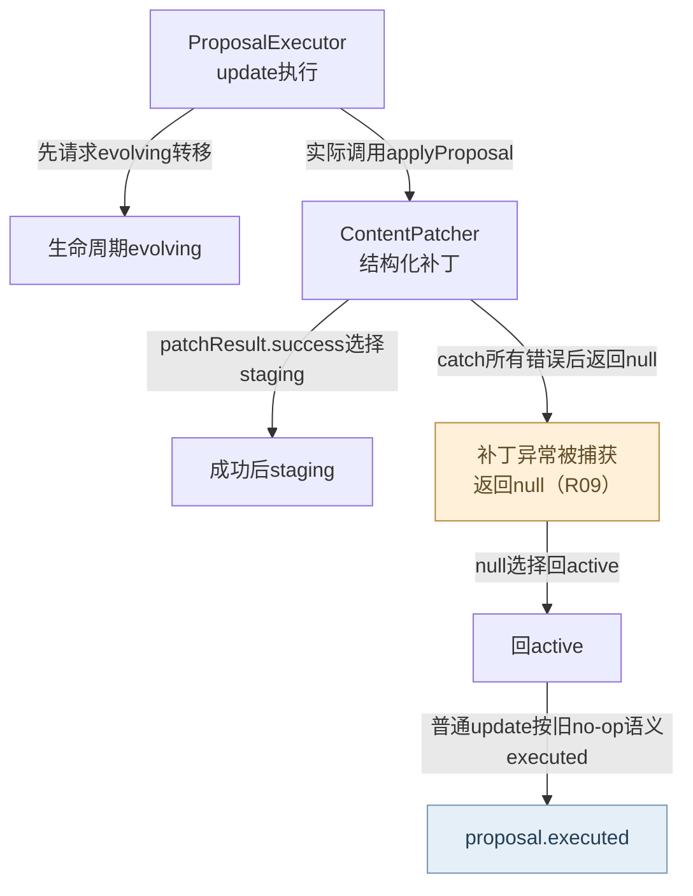
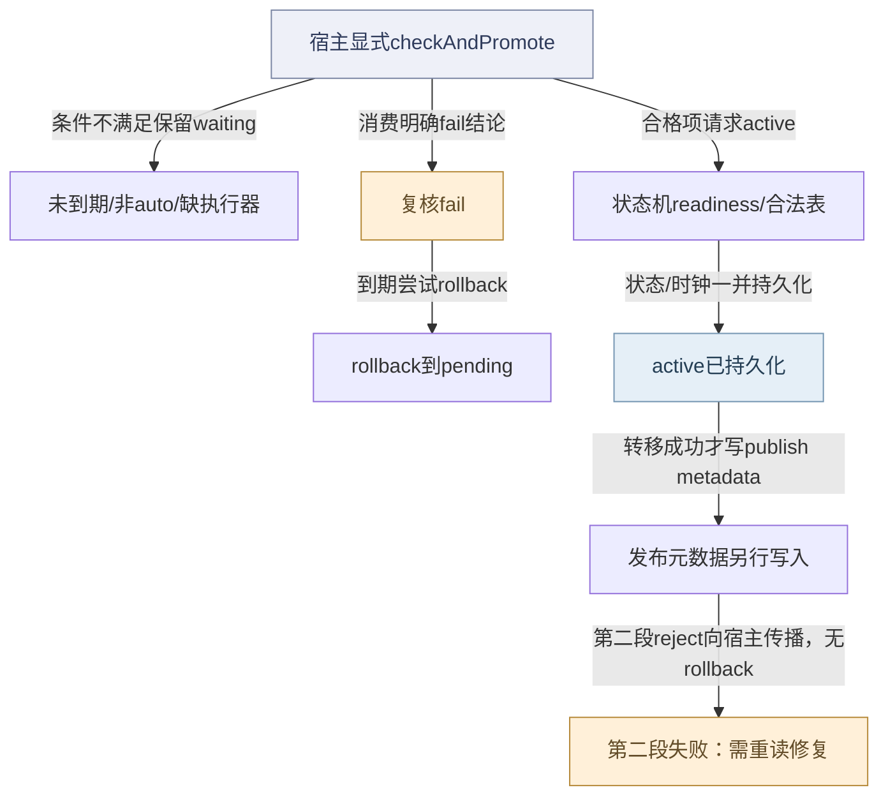
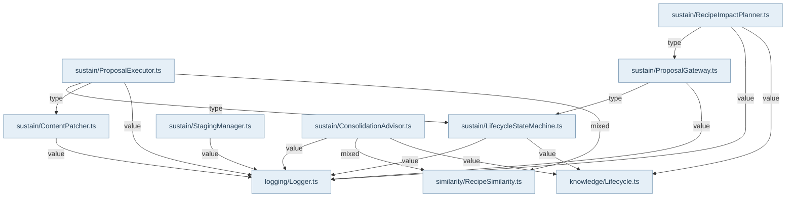

## 维护输入与确定性决策

`@alembic/core/sustain`和`@alembic/core/evolution`提供知识维护原语。ConsolidationAdvisor在生产前比较内容、trigger与相似度并给create/merge/reorganize/insufficient建议；普通路径有候选上限，strict accepted-corpus入口使用调用方认证的完整集合，不能沿用普通30条启发式分母。RecipeImpactPlanner把added/modified/deleted diff和source-ref桥投射为受影响Recipe，区分来源全丢、部分丢失与内容漂移。GitDiffCheckpointService只在成功routed/catch-up-routed或显式reset后推进baseline，失败/截断保留旧范围。

## 状态、提案与写入

ProposalGateway接收valid/update/deprecate；高置信deprecate可先尝试状态转移，guard拒绝则留提案。ProposalExecutor由信号、人工executeOne或有界checkAndExecute驱动，观察窗口、usage、false-positive和状态门控制执行；manual与drift修复豁免范围不同。inFlight集合阻止自身lifecycle信号造成再入。update主链是active→evolving→ContentPatcher→staging；没有可应用patch时回active，consolidation空patch要reject。

ContentPatcher仅解析结构化白名单修改，支持replace/append/section/array等操作，保留before/after快照；正文与canonical reasoning先经persistKnowledgeUpdate文件优先落地，然后重建source-ref桥。桥表更新是后续效果，不能画成同一个事务。LifecycleStateMachine核对六态合法表，转active时检查retrieval readiness，合并时钟后持久化，再记transition事件和发lifecycle信号。审计写失败可能只warn，返回event对象不等于耐久审计已经成功。

## 时限与失败边界

StagingManager到期时处理复核；缺复核仍沿既有兼容语义自动晋级，不能把缺报告解释为必然阻断。timeout扫描共享cap，evolving七天回active，pending/decaying三十天deprecated，恢复active仍过readiness。DecayDetector、RedundancyAnalyzer和EnhancementSuggester提供评分或建议，不能替代宿主语义审阅或擅自删除知识。

R09仍存在：#tryApplyPatch捕获ContentPatcher异常后返回null，普通非consolidation update把它当无patch回active并标executed。真实FileWriteError会因此被报告为完成；合法no-op兼容语义与持久化失败必须区分。此页把该错误分叉单独画出，未实施修复。Main的KnowledgeEvolutionModule确实装配executor、lifecycle和patcher，本轮仅复核调用与既有测试，没有重新执行产品测试。

## 视图与术语

本页手工图描述已核对的关系与关键分叉；F1 也承担所列调用范围的业务纵切（V0）阅读，不能推出未画出的宿主自动调度。F0 文件依赖精选由同页选择集和 TypeScript 导入图生成，不是运行时轨迹。S0/R0 只描述正文指定的 owner、状态和恢复前提。公开 API、全部文件及变更影响见阅读器的对应入口。

`source` 为代码来源，`direct` 为直接绑定调用及断言，`indirect` 为经 helper/fixture 或间接行为的断言，`none` 为明确未覆盖。正文中的“宿主”指真实外层装配，不属于 Core 内部运行时。

## 模块协作与恢复边界深化

维护流程有三种时间：stagingDeadline、生命周期enteredAt/创建时钟、proposal观察窗口，不能把它们混成单一过期任务。StagingManager登记宿主复核，不执行概率性判断；到期autoApprovable才尝试晋级，fail复核成功回滚pending，而pass和缺复核维持兼容晋级。晋级调用状态机先写active，之后另写发布元数据，这个分段意味着第二段异常时不能只重扫staging并期望自动补齐。LifecycleStateMachine将状态写入与审计/信号分开，事件失败只warn，状态不回滚。timeout按扫描行数共享预算，staging由另一路管理，返回checked/timedOut不表示整个队列清空。内容补丁仍受R09吞异常问题影响；本轮深化只陈述现有行为和恢复责任，不修产品。

<!-- atlas:generated:start -->

## 功能单元与调用接缝

各单元按真实入口拆分职责；门面暴露、内部调用和宿主装配是不同关系。关联图提供相邻阅读上下文，故障产生位置以条目源码为准。

<a id="m-M14-01" class="stable-anchor"></a>
<a id="生命周期合法转移与readiness" class="stable-anchor"></a>

### 生命周期合法转移与readiness

入口：`src/service/sustain/LifecycleStateMachine.ts#LifecycleStateMachine`

| 检查项 | 功能与边界 |
| --- | --- |
| 输入 | recipeId/targetState/trigger/evidence |
| 输出 | success/fromState/toState/event或错误详情 |
| 后续调用 / 绑定 | knowledgeRepo.findById；isValidTransition；retrievalReadinessEvaluator；persistKnowledgeUpdate |
| 状态与副作用 | 状态与时钟文件优先提交；之后审计event/发signal |
| 能力边界 | 活跃readiness失败不回退直接updateLifecycle；事件对象返回不证明eventRepo已写成功。 |

关联：[staging晋级、复核与分段发布](README.md#graph-r3-staging-two-phase-effects) · [L3-ILLEGAL · 实体不存在或from→to不在六态表](README.md#f-L3-ILLEGAL) · [L3-READINESS · 非guard知识转active时readiness.ready=false](README.md#f-L3-READINESS) · [L3-AUDIT · 状态持久化后eventRepo.record失败](README.md#f-L3-AUDIT) · 包入口 [@alembic/core](../../data/public-api.json)、[@alembic/core/evolution](../../data/public-api.json)、[@alembic/core/sustain](../../data/public-api.json)

返回业务旅程：[一次知识从提交到可查询 · 显式检查 readiness 并执行合法发布/晋级](../../journeys/j01.md#J01-06)

<a id="m-M14-02" class="stable-anchor"></a>
<a id="staging进入与复核记录" class="stable-anchor"></a>

### staging进入与复核记录

入口：`src/service/sustain/StagingManager.ts#StagingManager`

| 检查项 | 功能与边界 |
| --- | --- |
| 输入 | pending条目/grace，或staging条目的pass/fail/reviewer/notes |
| 输出 | enter/recordReview布尔结果与可读复核队列 |
| 后续调用 / 绑定 | persistKnowledgeUpdate；getStagingReviewSync；listReviewQueue |
| 状态与副作用 | deadline与stats.stagingReview持久化、lifecycle信号 |
| 能力边界 | Core只登记宿主结论；不自行读代码证明断言。队列limit先施加再过滤已review项。 |

关联：未声明跨项关联 · 包入口 [@alembic/core](../../data/public-api.json)、[@alembic/core/evolution](../../data/public-api.json)、[@alembic/core/sustain](../../data/public-api.json)

<a id="m-M14-03" class="stable-anchor"></a>
<a id="到期晋级与发布元数据" class="stable-anchor"></a>

### 到期晋级与发布元数据

入口：`src/service/sustain/StagingManager.ts#StagingManager`

| 检查项 | 功能与边界 |
| --- | --- |
| 输入 | 到期autoApprovable条目及可选lifecycle端口 |
| 输出 | promoted/rolledBack/waiting集合 |
| 后续调用 / 绑定 | rollback；#promote；LifecycleStateMachine.transition；persistKnowledgeUpdate |
| 状态与副作用 | 先转active，再单独写publishedAt/publishedBy/清deadline |
| 能力边界 | 两段写入非原子；未配置状态机只能waiting；缺复核仍遵循既有自动晋级兼容语义。 |

关联：[staging晋级、复核与分段发布](README.md#graph-r3-staging-two-phase-effects) · [L3-REVIEW-FAIL · 到期autoApprovable条目有fail复核](README.md#f-L3-REVIEW-FAIL) · [L3-NO-EXECUTOR · 到期候选但未注入lifecycle，或transition返回success=false](README.md#f-L3-NO-EXECUTOR) · [L3-PUBLISH-METADATA · active转移已成功，后续staging-publish-metadata写失败](README.md#f-L3-PUBLISH-METADATA) · 包入口 [@alembic/core](../../data/public-api.json)、[@alembic/core/evolution](../../data/public-api.json)、[@alembic/core/sustain](../../data/public-api.json)

返回业务旅程：[一次知识从提交到可查询 · 显式检查 readiness 并执行合法发布/晋级](../../journeys/j01.md#J01-06)

<a id="m-M14-04" class="stable-anchor"></a>
<a id="中间态timeout扫描" class="stable-anchor"></a>

### 中间态timeout扫描

入口：`src/service/sustain/LifecycleStateMachine.ts#LifecycleStateMachine`

| 检查项 | 功能与边界 |
| --- | --- |
| 输入 | 可选cap与当前时间 |
| 输出 | checked与timedOut列表 |
| 后续调用 / 绑定 | findAllByLifecycles；transition |
| 状态与副作用 | evolving超7天尝试active；pending/decaying超30天尝试deprecated |
| 能力边界 | 按扫描行数而非成功转移数消耗共享cap；staging不在该路径；不会自行调度下一tick。 |

关联：[L3-CAP · timeout的共享remaining预算耗尽](README.md#f-L3-CAP) · 包入口 [@alembic/core](../../data/public-api.json)、[@alembic/core/evolution](../../data/public-api.json)、[@alembic/core/sustain](../../data/public-api.json)

<a id="m-M14-05" class="stable-anchor"></a>
<a id="提案补丁与维护恢复边界" class="stable-anchor"></a>

### 提案补丁与维护恢复边界

入口：`src/service/sustain/ProposalExecutor.ts#ProposalExecutor`

| 检查项 | 功能与边界 |
| --- | --- |
| 输入 | proposal与metrics/策略 |
| 输出 | executed/rejected/expired/skipped |
| 后续调用 / 绑定 | #gateUpdate；lifecycle.transition；ContentPatcher.applyProposal |
| 状态与副作用 | 修改知识、proposal状态与关系 |
| 能力边界 | 保留R09：#tryApplyPatch吞异常返回null，普通update可能回active并executed；新生命周期图不能覆盖这个已知问题。 |

关联：未声明跨项关联 · 包入口 [@alembic/core](../../data/public-api.json)、[@alembic/core/evolution](../../data/public-api.json)、[@alembic/core/sustain](../../data/public-api.json)


## 生成的图与逐边依据

此区域由同页结构化图模型生成；请修改 frontmatter，再显式运行 `npm run inventory:write`，不要单独修改表格或 Mermaid。

<a id="graph-proposal-update-and-failure"></a>

### update提案与被吞掉的补丁失败

图 ID：`proposal-update-and-failure` · R0 · 状态门通过后尝试结构化补丁；成功到staging，普通无patch/被吞异常到active并可能executed，R09明确标出。



| 边 ID | 关系 | 源码定位 | 断言关系 | case / 缺口 | 相关旅程步骤 |
| --- | --- | --- | --- | --- | --- |
| <a id="e-proposal-update-and-failure--PR-01"></a>PR-01 | 先请求evolving转移 | `src/service/sustain/ProposalExecutor.ts#ProposalExecutor` | indirect | cap 模式不破坏正常流转：合格 update（有 usage）经 transition 执行 |  |
| <a id="e-proposal-update-and-failure--PR-02"></a>PR-02 | 实际调用applyProposal | `src/service/sustain/ProposalExecutor.ts#ProposalExecutor` | none | 边的调用由源码确认；当前选取的executor正例允许no-op，不能冒充已成功执行具体patch断言。 |  |
| <a id="e-proposal-update-and-failure--PR-03"></a>PR-03 | patchResult.success选择staging | `src/service/sustain/ProposalExecutor.ts#ProposalExecutor` | none | 源码明确选择分支；本图未指定assert staging且核对内容的同一executor集成case。 |  |
| <a id="e-proposal-update-and-failure--PR-04"></a>PR-04 | catch所有错误后返回null | `src/service/sustain/ProposalExecutor.ts#ProposalExecutor` | none | R09的文件持久化异常被吞掉是已复现缺陷；既有产品case未覆盖此路径，不能用普通no-op测试当作异常成功证据。 |  |
| <a id="e-proposal-update-and-failure--PR-05"></a>PR-05 | null选择回active | `src/service/sustain/ProposalExecutor.ts#ProposalExecutor` | none | R09的文件持久化异常被吞掉是已复现缺陷；既有产品case未覆盖此路径，不能用普通no-op测试当作异常成功证据。 |  |
| <a id="e-proposal-update-and-failure--PR-06"></a>PR-06 | 普通update按旧no-op语义executed | `src/service/sustain/ProposalExecutor.ts#ProposalExecutor` | none | R09的文件持久化异常被吞掉是已复现缺陷；既有产品case未覆盖此路径，不能用普通no-op测试当作异常成功证据。 |  |

<a id="graph-r3-staging-two-phase-effects"></a>

### staging晋级、复核与分段发布

图 ID：`r3-staging-two-phase-effects` · R0 · 真实active转移和发布元数据是两个写入阶段，失败恢复不能假设跨阶段回滚。



| 边 ID | 关系 | 源码定位 | 断言关系 | case / 缺口 | 相关旅程步骤 |
| --- | --- | --- | --- | --- | --- |
| <a id="e-r3-staging-two-phase-effects--L3-E1"></a>L3-E1 | 条件不满足保留waiting | `src/service/sustain/StagingManager.ts#StagingManager` | indirect | promotes only due auto-approvable staging recipes through lifecycle events |  |
| <a id="e-r3-staging-two-phase-effects--L3-E2"></a>L3-E2 | 消费明确fail结论 | `src/service/sustain/StagingManager.ts#StagingManager` | indirect | review outcome fail rolls a due auto-approvable entry back to pending instead of promoting |  |
| <a id="e-r3-staging-two-phase-effects--L3-E3"></a>L3-E3 | 到期尝试rollback | `src/service/sustain/StagingManager.ts#StagingManager` | indirect | review outcome fail rolls a due auto-approvable entry back to pending instead of promoting |  |
| <a id="e-r3-staging-two-phase-effects--L3-E4"></a>L3-E4 | 合格项请求active | `src/service/sustain/StagingManager.ts#StagingManager` | indirect | promotes only due auto-approvable staging recipes through lifecycle events | [J01 · 显式检查 readiness 并执行合法发布/晋级](../../journeys/j01.md#J01-06) |
| <a id="e-r3-staging-two-phase-effects--L3-E5"></a>L3-E5 | 状态/时钟一并持久化 | `src/service/sustain/LifecycleStateMachine.ts#LifecycleStateMachine` | indirect | does not mutate the DB or emit a transition when the real durable write fails | [J01 · 显式检查 readiness 并执行合法发布/晋级](../../journeys/j01.md#J01-06) |
| <a id="e-r3-staging-two-phase-effects--L3-E6"></a>L3-E6 | 转移成功才写publish metadata | `src/service/sustain/StagingManager.ts#StagingManager` | indirect | promotes only due auto-approvable staging recipes through lifecycle events | [J01 · 显式检查 readiness 并执行合法发布/晋级](../../journeys/j01.md#J01-06) |
| <a id="e-r3-staging-two-phase-effects--L3-E7"></a>L3-E7 | 第二段reject向宿主传播，无rollback | `src/service/sustain/StagingManager.ts#StagingManager` | none | 无同case失败注入；根据await后无catch/rollback的调用链声明边界。 |  |

<a id="graph-dependencies-14"></a>

### 文件依赖精选 · 静态关系

图 ID：`dependencies-14` · F0 · 显式选择集内的实际导入；类型边不代表运行调用，动态未知保留在全量索引。



| 边 ID | 关系 | 源码定位 | 断言关系 | case / 缺口 | 相关旅程步骤 |
| --- | --- | --- | --- | --- | --- |
| <a id="e-dependencies-14--dep-14-0"></a>dep-14-0 | value | `src/service/sustain/ConsolidationAdvisor.ts#<module>` | none | TypeScript AST 静态导入事实，不主张运行调用或断言覆盖。 |  |
| <a id="e-dependencies-14--dep-14-1"></a>dep-14-1 | mixed | `src/service/sustain/ConsolidationAdvisor.ts#<module>` | none | TypeScript AST 静态导入事实，不主张运行调用或断言覆盖。 |  |
| <a id="e-dependencies-14--dep-14-2"></a>dep-14-2 | value | `src/service/sustain/ConsolidationAdvisor.ts#<module>` | none | TypeScript AST 静态导入事实，不主张运行调用或断言覆盖。 |  |
| <a id="e-dependencies-14--dep-14-3"></a>dep-14-3 | value | `src/service/sustain/ContentPatcher.ts#<module>` | none | TypeScript AST 静态导入事实，不主张运行调用或断言覆盖。 |  |
| <a id="e-dependencies-14--dep-14-4"></a>dep-14-4 | value | `src/service/sustain/LifecycleStateMachine.ts#<module>` | none | TypeScript AST 静态导入事实，不主张运行调用或断言覆盖。 |  |
| <a id="e-dependencies-14--dep-14-5"></a>dep-14-5 | value | `src/service/sustain/LifecycleStateMachine.ts#<module>` | none | TypeScript AST 静态导入事实，不主张运行调用或断言覆盖。 |  |
| <a id="e-dependencies-14--dep-14-6"></a>dep-14-6 | mixed | `src/service/sustain/ProposalExecutor.ts#<module>` | none | TypeScript AST 静态导入事实，不主张运行调用或断言覆盖。 |  |
| <a id="e-dependencies-14--dep-14-7"></a>dep-14-7 | value | `src/service/sustain/ProposalExecutor.ts#<module>` | none | TypeScript AST 静态导入事实，不主张运行调用或断言覆盖。 |  |
| <a id="e-dependencies-14--dep-14-8"></a>dep-14-8 | type | `src/service/sustain/ProposalExecutor.ts#<module>` | none | TypeScript AST 静态导入事实，不主张运行调用或断言覆盖。 |  |
| <a id="e-dependencies-14--dep-14-9"></a>dep-14-9 | type | `src/service/sustain/ProposalExecutor.ts#<module>` | none | TypeScript AST 静态导入事实，不主张运行调用或断言覆盖。 |  |
| <a id="e-dependencies-14--dep-14-10"></a>dep-14-10 | value | `src/service/sustain/ProposalGateway.ts#<module>` | none | TypeScript AST 静态导入事实，不主张运行调用或断言覆盖。 |  |
| <a id="e-dependencies-14--dep-14-11"></a>dep-14-11 | type | `src/service/sustain/ProposalGateway.ts#<module>` | none | TypeScript AST 静态导入事实，不主张运行调用或断言覆盖。 |  |
| <a id="e-dependencies-14--dep-14-12"></a>dep-14-12 | value | `src/service/sustain/RecipeImpactPlanner.ts#<module>` | none | TypeScript AST 静态导入事实，不主张运行调用或断言覆盖。 |  |
| <a id="e-dependencies-14--dep-14-13"></a>dep-14-13 | value | `src/service/sustain/RecipeImpactPlanner.ts#<module>` | none | TypeScript AST 静态导入事实，不主张运行调用或断言覆盖。 |  |
| <a id="e-dependencies-14--dep-14-14"></a>dep-14-14 | type | `src/service/sustain/RecipeImpactPlanner.ts#<module>` | none | TypeScript AST 静态导入事实，不主张运行调用或断言覆盖。 |  |
| <a id="e-dependencies-14--dep-14-15"></a>dep-14-15 | value | `src/service/sustain/StagingManager.ts#<module>` | none | TypeScript AST 静态导入事实，不主张运行调用或断言覆盖。 |  |

## 失败后的状态与恢复责任

先检查已落盘状态，再决定恢复。自动动作只描述代码已执行的分支；显式恢复不能据提示文字推断为自动调用。

<a id="f-L3-ILLEGAL" class="stable-anchor"></a>
<a id="l3-illegal--实体不存在或fromto不在六态表" class="stable-anchor"></a>

### L3-ILLEGAL · 实体不存在或from→to不在六态表

| 检查项 | 当前代码语义 |
| --- | --- |
| 已留下什么 | 原持久状态不变 |
| Core自动做什么 | 返回success=false与错误，不写新状态 |
| 谁显式恢复 | 宿主重读当前状态并选择合法迁移；不得直接改DB绕过 |
| 必须停止的条件 | 停止本次transition，非自动重试 |
| 源码定位 | `src/service/sustain/LifecycleStateMachine.ts#LifecycleStateMachine` |

```ts
error: `Invalid transition: ${fromState} → ${targetState}`,
```

关联：[生命周期合法转移与readiness](README.md#m-M14-01) · [staging晋级、复核与分段发布](README.md#graph-r3-staging-two-phase-effects) · 包入口 [@alembic/core](../../data/public-api.json)、[@alembic/core/evolution](../../data/public-api.json)、[@alembic/core/sustain](../../data/public-api.json)

返回业务旅程：[一次知识从提交到可查询 · 显式检查 readiness 并执行合法发布/晋级](../../journeys/j01.md#J01-06)

断言关系：**none**。本次未绑定该负例的精确case，不借其他状态正例替代。

<a id="f-L3-READINESS" class="stable-anchor"></a>
<a id="l3-readiness--非guard知识转active时readinessreadyfalse" class="stable-anchor"></a>

### L3-READINESS · 非guard知识转active时readiness.ready=false

| 检查项 | 当前代码语义 |
| --- | --- |
| 已留下什么 | 候选/中间态仍保留 |
| Core自动做什么 | 返回失败与readiness详情 |
| 谁显式恢复 | 补齐retrievalProfile/来源等实际违反项后显式重试transition/publish |
| 必须停止的条件 | 不发布、不fallback直接updateLifecycle |
| 源码定位 | `src/service/sustain/LifecycleStateMachine.ts#LifecycleStateMachine` |

```ts
error: 'Recipe retrieval readiness blocks active transition',
```

关联：[生命周期合法转移与readiness](README.md#m-M14-01) · [staging晋级、复核与分段发布](README.md#graph-r3-staging-two-phase-effects) · 包入口 [@alembic/core](../../data/public-api.json)、[@alembic/core/evolution](../../data/public-api.json)、[@alembic/core/sustain](../../data/public-api.json)

返回业务旅程：[一次知识从提交到可查询 · 显式检查 readiness 并执行合法发布/晋级](../../journeys/j01.md#J01-06)

断言关系：**none**。该分支源码确定；本次未选择覆盖全部readiness缺项的同一case。

<a id="f-L3-REVIEW-FAIL" class="stable-anchor"></a>
<a id="l3-review-fail--到期autoapprovable条目有fail复核" class="stable-anchor"></a>

### L3-REVIEW-FAIL · 到期autoApprovable条目有fail复核

| 检查项 | 当前代码语义 |
| --- | --- |
| 已留下什么 | review记录仍在；成功rollback后lifecycle=pending、deadline清空 |
| Core自动做什么 | 尝试rollback；成功记rolledBack |
| 谁显式恢复 | 宿主修正内容/来源、重新复核并按合法路径进入staging |
| 必须停止的条件 | fail不能视为pass；若rollback自身抛错本轮中断；当前false返回会继续后续promote分支，不能泛化为无条件fail-closed |
| 源码定位 | `src/service/sustain/StagingManager.ts#StagingManager` |

```ts
if (entry.reviewOutcome === 'fail') {
```

关联：[到期晋级与发布元数据](README.md#m-M14-03) · [staging晋级、复核与分段发布](README.md#graph-r3-staging-two-phase-effects) · 包入口 [@alembic/core](../../data/public-api.json)、[@alembic/core/evolution](../../data/public-api.json)、[@alembic/core/sustain](../../data/public-api.json)

返回业务旅程：[一次知识从提交到可查询 · 显式检查 readiness 并执行合法发布/晋级](../../journeys/j01.md#J01-06)

断言关系：**indirect**。`test/StagingManager.test.ts` · `review outcome fail rolls a due auto-approvable entry back to pending instead of promoting`

同case登记fail/pass，fail到期回pending，pass和缺复核按兼容路径到active（recovery）。这里只定位断言；实际运行范围见独立运行证据。

```ts
expect(result.rolledBack.map((entry) => entry.id)).toEqual([failing.id]);
```

<a id="f-L3-NO-EXECUTOR" class="stable-anchor"></a>
<a id="l3-no-executor--到期候选但未注入lifecycle或transition返回successfalse" class="stable-anchor"></a>

### L3-NO-EXECUTOR · 到期候选但未注入lifecycle，或transition返回success=false

| 检查项 | 当前代码语义 |
| --- | --- |
| 已留下什么 | 条目不由#promote写成active，保持waiting（以真实重读为准） |
| Core自动做什么 | warn并return false，checkAndPromote把它放waiting |
| 谁显式恢复 | 配置真实状态机/解决拒绝原因后由宿主再次checkAndPromote |
| 必须停止的条件 | 没有隐式直写active兼容fallback |
| 源码定位 | `src/service/sustain/StagingManager.ts#StagingManager` |

```ts
if (!this.#lifecycle) {
```

关联：[到期晋级与发布元数据](README.md#m-M14-03) · [staging晋级、复核与分段发布](README.md#graph-r3-staging-two-phase-effects) · 包入口 [@alembic/core](../../data/public-api.json)、[@alembic/core/evolution](../../data/public-api.json)、[@alembic/core/sustain](../../data/public-api.json)

返回业务旅程：[一次知识从提交到可查询 · 显式检查 readiness 并执行合法发布/晋级](../../journeys/j01.md#J01-06)

断言关系：**none**。本次未定位缺lifecycle的具体负例case。

<a id="f-L3-PUBLISH-METADATA" class="stable-anchor"></a>
<a id="l3-publish-metadata--active转移已成功后续staging-publish-metadata写失败" class="stable-anchor"></a>

### L3-PUBLISH-METADATA · active转移已成功，后续staging-publish-metadata写失败

| 检查项 | 当前代码语义 |
| --- | --- |
| 已留下什么 | lifecycle可能已active且审计/signal已发，publish metadata未完成或发生文件/DB分歧 |
| Core自动做什么 | 错误上抛，无反向rollback到staging |
| 谁显式恢复 | 宿主重读lifecycle与文件/DB，按失败类型sync/补写元数据；单纯再次扫staging可能不再选中此条目 |
| 必须停止的条件 | 不得把promoted列表缺项解释为active从未发生 |
| 源码定位 | `src/service/sustain/StagingManager.ts#StagingManager` |

```ts
'staging-publish-metadata'
```

关联：[到期晋级与发布元数据](README.md#m-M14-03) · [staging晋级、复核与分段发布](README.md#graph-r3-staging-two-phase-effects) · 包入口 [@alembic/core](../../data/public-api.json)、[@alembic/core/evolution](../../data/public-api.json)、[@alembic/core/sustain](../../data/public-api.json)

返回业务旅程：[一次知识从提交到可查询 · 显式检查 readiness 并执行合法发布/晋级](../../journeys/j01.md#J01-06)

断言关系：**none**。未见该第二段失败的精确集成case；正常promotion测试不能证明两段原子。

<a id="f-L3-AUDIT" class="stable-anchor"></a>
<a id="l3-audit--状态持久化后eventreporecord失败" class="stable-anchor"></a>

### L3-AUDIT · 状态持久化后eventRepo.record失败

| 检查项 | 当前代码语义 |
| --- | --- |
| 已留下什么 | 状态已变；返回event对象可能没有耐久审计记录 |
| Core自动做什么 | warn后继续signal并返回success |
| 谁显式恢复 | 宿主检查审计库与历史缺口；无自动事件重放保证 |
| 必须停止的条件 | 不能据event对象断言审计已落盘 |
| 源码定位 | `src/service/sustain/LifecycleStateMachine.ts#LifecycleStateMachine` |

```ts
`[LifecycleStateMachine] Failed to record transition event (table may not exist)`
```

关联：[生命周期合法转移与readiness](README.md#m-M14-01) · 包入口 [@alembic/core](../../data/public-api.json)、[@alembic/core/evolution](../../data/public-api.json)、[@alembic/core/sustain](../../data/public-api.json)

断言关系：**none**。未绑定审计写失败case；源码明确容错，与状态写失败不同。

<a id="f-L3-CAP" class="stable-anchor"></a>
<a id="l3-cap--timeout的共享remaining预算耗尽" class="stable-anchor"></a>

### L3-CAP · timeout的共享remaining预算耗尽

| 检查项 | 当前代码语义 |
| --- | --- |
| 已留下什么 | 剩余中间态仍存在；已处理状态不回滚 |
| Core自动做什么 | break后续状态扫描，返回本tick统计 |
| 谁显式恢复 | 宿主安排后续显式tick；先理解waiting/未到期项是否持续占窗口 |
| 必须停止的条件 | cap是本轮停止条件，不证明积压全部排空 |
| 源码定位 | `src/service/sustain/LifecycleStateMachine.ts#LifecycleStateMachine` |

```ts
if (remaining !== undefined && remaining <= 0) {
```

关联：[中间态timeout扫描](README.md#m-M14-04) · 包入口 [@alembic/core](../../data/public-api.json)、[@alembic/core/evolution](../../data/public-api.json)、[@alembic/core/sustain](../../data/public-api.json)

断言关系：**indirect**。`test/LifecycleStateMachineTimeouts.test.ts` · `cap：预算跨 timeout 状态共享，总扫描+迁移 ≤cap（evolving 先、pending 后）`

checkTimeouts(3)跨状态消费扫描预算，未处理pending继续保留（budget）。这里只定位断言；实际运行范围见独立运行证据。

```ts
expect((await knowledgeRepo.findById(p2.id))?.lifecycle).toBe('pending');
```


<!-- atlas:generated:end -->
