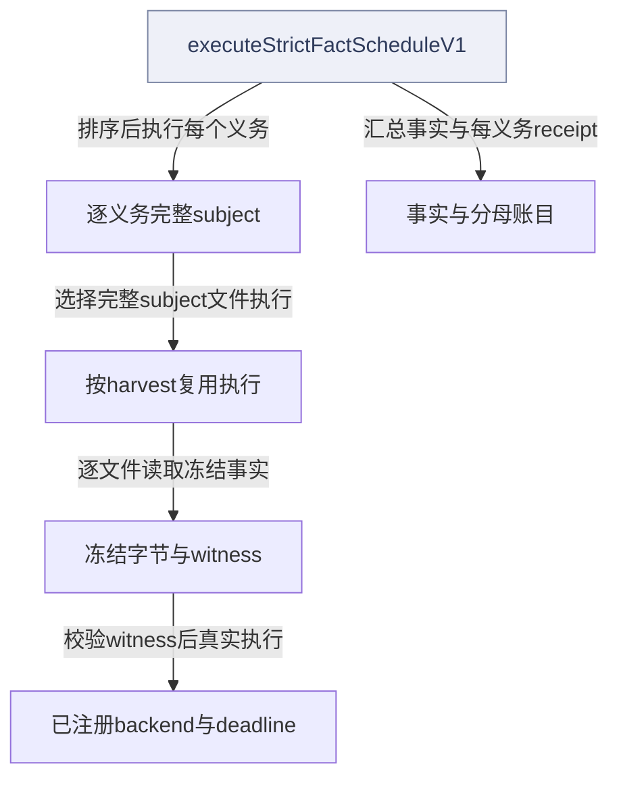
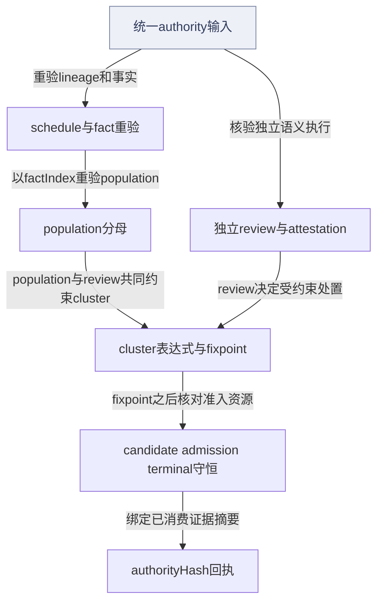
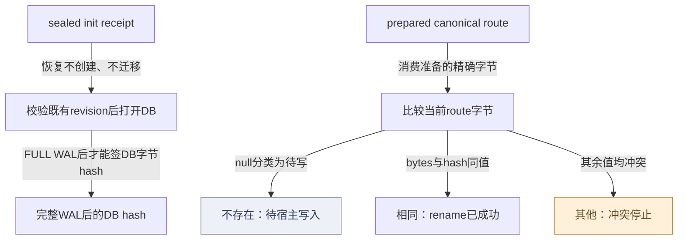
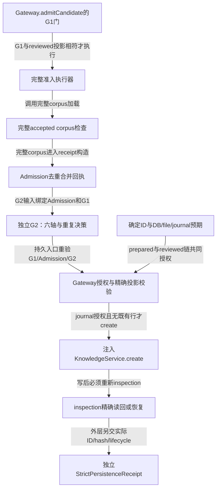
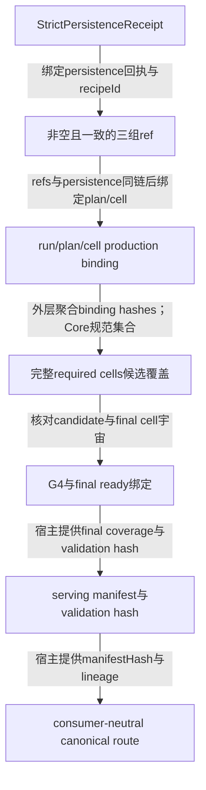
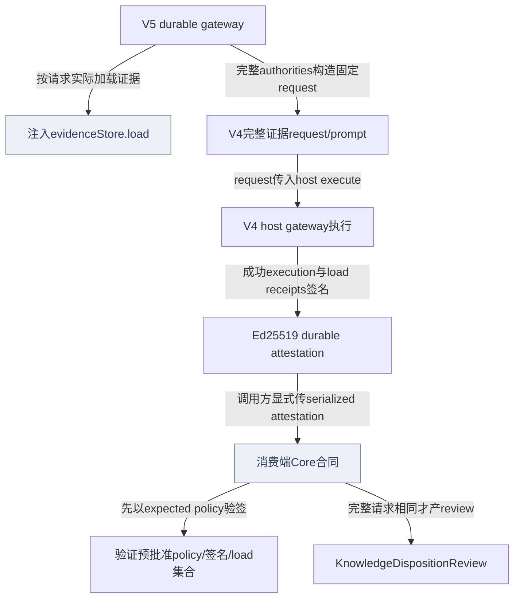
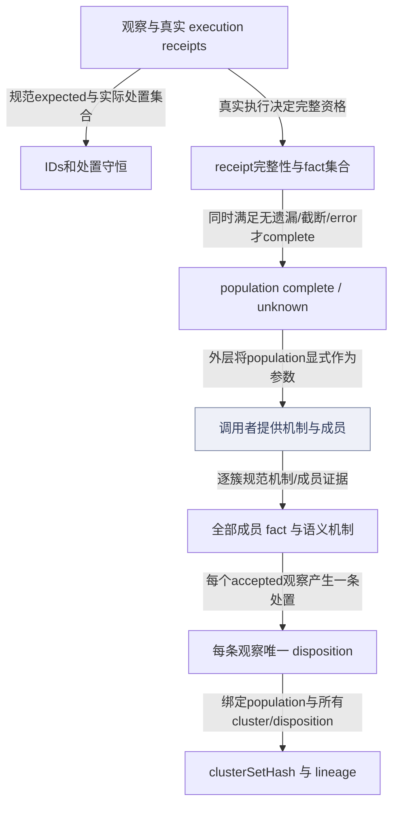
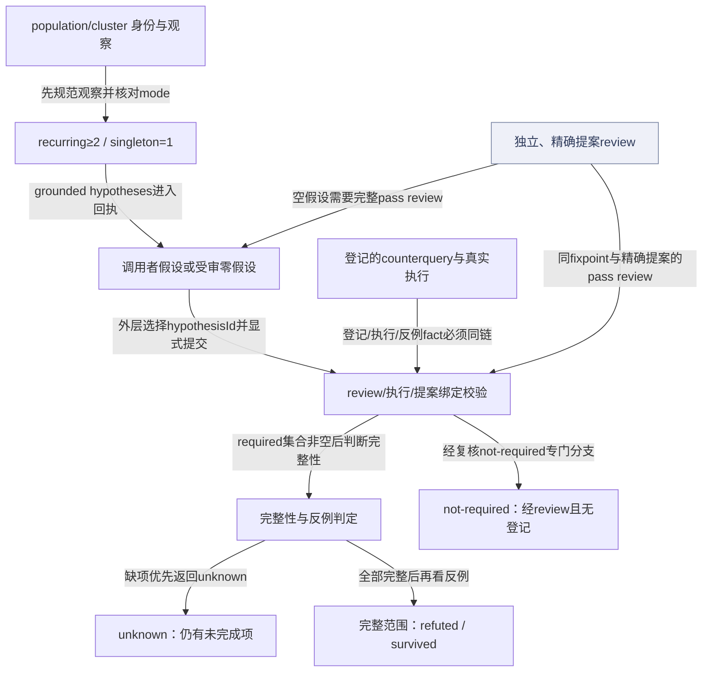
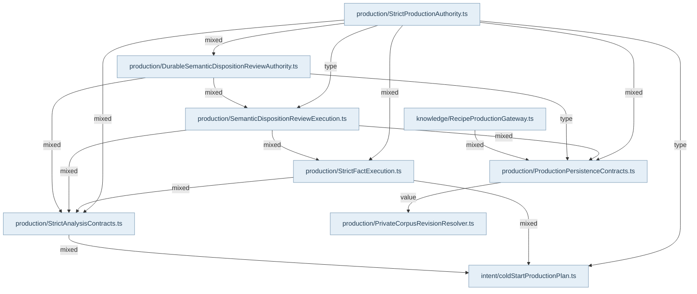

## 分母、执行与独立评审

严格计划从认证planning facts、维度和lens catalog及runtime硬预算生成完整义务分母；超cap或缺backend时关闭成功路径，不用first-N裁掉义务。executeStrictFactScheduleV1先校验输入和注册身份，再按义务执行。subject binding来自认证inventory，文件内容来自冻结工件；direct witness需要Evidence Ledger真实code.read内容、行范围、blob与ProjectContext ref共同匹配。

内部harvest逐文件调用真实AST、ProjectContext或配置backend。backend/witness authority有进程内注册身份，自报executeFile不能代替注册。每个文件都有执行账目；任一失败后不发布该harvest的部分fact，但保留staged/discarded/emitted分母。unknown、failed和完整空结果不同。Population保留重复、排除、无模式等处置；cluster、induction、falsification与expression lineage必须守恒，不能靠“已完成”字符串授权。

独立语义评审要求Producer和Reviewer的run/invocation/output不同。V5 durable gateway从evidenceStore实际load证据，核对harvest group、reviewer模型装载回执，再签Ed25519回执；消费端使用预先批准的trust policy验证，不能信任任务payload自带key root。模型推理由外层host adapter完成，Core拥有确定性约束和回执验证。

## 统一入口与接通范围

createStrictProductionAuthorityReceiptV1重验schedule lineage、fact execution、population、review、cluster、analysis evidence、expression closure、fixpoint以及candidate/admission/terminal证据，再产生authorityHash。它已实现且有公共合同组合测试，但本轮在Main、Plugin、Agent真实源码中仍未发现直接外层调用。Main实际消费executeStrictFactScheduleV1、private revision和route primitives；不能把统一入口画成所有外层生产必经节点。

R01已确认：结构复制后的FactRecord.value被改写而保留factId/valueHash等字段时，公开统一authority仍可能通过且authorityHash相同。当前validateFactRecordGraphV1校验ID图、premise和无环，未从value重建其hash；正例测试不抵消此缺口。该结论限定Core公开重验边界，不宣称已证明完整外层发布利用链。

## 准入、持久与恢复

G1硬轴通过后，Admission对完整accepted corpus做去重/合并；独立G2再绑定G1和Admission的fingerprint、revision与novelty/duplicate决策。prepared persistence由run/fixpoint/revision/admission/fingerprint派生确定ID并绑定DB/file/journal hash，真正Gateway写入后才能签持久回执。Candidate coverage与final serving coverage不同，不能用content-ready代替ready。

私有revision初始化创建固定且原先不存在的namespace，逐层拒绝symlink、执行真实migration、检查空corpus和SQLite；恢复只打开已有revision，不创建或迁移。checkpoint必须FULL WAL完成才能签DB hash。route preparation输出canonical bytes，Core仅分类null需写、完全相同表示rename已成功、其余冲突；真实route安装与切换由外层完成。下面恢复图包含两组独立保证，未用虚构箭头把checkpoint直接等同serving或发布。

## 准入到serving：精确输入输出与真实接线

| Core owner | 输入与输出 | 不能自动推导的结论 |
| --- | --- | --- |
| `RecipeProductionGateway.admitCandidate` | item、G1、reviewed projection与run/fixpoint/revision；通过注入inspection加载完整accepted corpus，输出projection与Admission receipt | 这是评估阶段，不调用知识写入；complete/truncated/continuation必须匹配 |
| `createStrictG2ReceiptV1` | G1、Admission、reviewed fingerprint、Producer/Reviewer身份、六轴、novelty、duplicate；输出pass/revise/reject receipt | 构造器不执行模型；相同Producer/Reviewer identity拒绝 |
| `prepareRecipePersistenceV1` | run、fixpoint、revision、admission、authoredFingerprint及预期DB/file/journal hashes；输出确定preparedRecipeId与preparedHash | 它不消费G2，也不写盘；顺序由宿主控制，不能画成G2内部自动调用prepare |
| `persistPreparedReviewedCandidate` | item、prepared、G1/Admission/G2、reviewedProjection、journalToken；校验后返回created/recovered与精确inspection | 先inspection已有行可直接恢复；新写才调用注入KnowledgeService.create，随后必须再inspection |
| `createStrictPersistenceReceiptV1` | prepared与完整授权链，以及实际ID、authoredFingerprint、storage/DB/file hashes、lifecycle；输出独立receipt | 此函数不读磁盘；Main从真实Gateway与存储检查结果组装输入，它并非Gateway内部自动调用 |
| refs与production binding | 三组非空同集ref、persistence receipt、run/plan/manifest/cell/module；输出ref receipt与bindingHash | 不能把外层未核验的普通字符串冒充已观察存储事实 |
| candidate/final coverage | 完整required cell宇宙和binding hashes→candidate receipt；candidate receipt、G4/data hashes、final IDs/fingerprints→final receipt | content-ready与ready是两个阶段；Core核对集合和绑定，实际G4/ready检查由宿主实施 |
| serving与route | finalCoverage、servingValidation、vector、certified facts等hash→serving manifest；manifest hash与lineage→canonical route | Core不构建向量、不执行外层serving oracle、不安装公共route |

真实Main `StrictPrivateCorpusRuntime`为Gateway注入KnowledgeService、repository/file inspection和journal授权，实际调用prepared写入；随后另行构造持久receipt、refs、binding并推进private corpus状态。`StrictFinalizationRuntime`聚合required cells，调用Core final coverage，执行外层serving验证后绑定Core serving manifest和route。Atlas的data边只表示这些构造器消费字段；消费者证据记录真实外层接线，不把它升级为统一authority已接通。Gateway测试中的create/inspection是注入fixture，能证明调用和幂等分支；真实Markdown/SQLite耐久写链另见知识持久化专题及其真实runtime测试。


## 视图与术语

本页手工图描述已核对的关系与关键分叉；F1 也承担所列调用范围的业务纵切（V0）阅读，不能推出未画出的宿主自动调度。F0 文件依赖精选由同页选择集和 TypeScript 导入图生成，不是运行时轨迹。S0/R0 只描述正文指定的 owner、状态和恢复前提。公开 API、全部文件及变更影响见阅读器的对应入口。

`source` 为代码来源，`direct` 为直接绑定调用及断言，`indirect` 为经 helper/fixture 或间接行为的断言，`none` 为明确未覆盖。正文中的“宿主”指真实外层装配，不属于 Core 内部运行时。

## 模块协作与恢复边界深化

独立语义评审的权威来自三段不同事实：证据store实际读到了什么，宿主adapter实际返回了什么，以及消费端预先信任谁。V5 gateway先按semanticRequest的完整harvest-group集合加载证据，生成evidence authority与load receipt，再构造固定V4 request/prompt交hostGateway。这里同一物理文件可支持多个scale/harvest，但不能丢掉其中一条执行receipt，也不能通过复制证据根多算分母。

V4 hostGateway保存实际adapter和模型load receipt的进程内authority。execute核对当前request，调用adapter.invoke，然后检查success、零tool calls、精确JSON decision和reviewer独立身份。之后才检查execution/invocation/output是否复用并登记Set。因此这套重复防护是结果权威防复用，不是外部模型调用前去重；失败或重复时已经发生的load/invoke不会被Core回滚。模型重试与执行日志属于宿主owner。

签名也有清晰边界。createDurableAttestationV5对request、host execution与load receipts的规范payload签Ed25519，并自验结果。新进程的assertSemanticDispositionReviewDurableAttestationV5只需要serialized材料和预批准trust policy，不依赖原WeakMap；它重建每个load receipt，核对一对一证据authority、完整执行集合、模型load receipt及签名。这个纯验证器不写跨进程一次消费账本，不能把valid signature误读成“本次从未消费”。消费合同还必须把完整请求与expectedSemanticRequest再比对，才产出可用于处置的KnowledgeDispositionReview。

可恢复与不可修补的情形也不同：损坏attestation应从可信store重取；输入请求变了就需新评审；reader阻塞WAL应由持有事务者释放后重试checkpoint。Core不自动丢弃已创建私有revision、不自动修改模型输出、不让旧签名改绑新请求。现有Atlas仍没有统一createStrictProductionAuthorityReceiptV1直接外层消费证据；本轮仅Core深化，不把primitive接线提升为统一入口必经。R01明确保留为当前内容完整性缺口，说明hash集合自洽与实际value内容可信仍有差距。

## 从执行结果形成可核验分析材料

事实执行返回receipt后，调用者还要说明每条观察的去向。population把accepted、duplicate、excluded、error、inspected-no-pattern与omitted都纳入完整分母，并以真实execution集合决定complete或unknown。仅传若干hash、标记complete或删去失败观察，都不能获得完整资格。

cluster承载调用者提出的机制，Core核验成员和全部事实，允许一条观察进入多个机制簇，但保留唯一disposition。induction记录recurring或bounded-singleton，既不生成假设也不扩写证据；零假设必须有独立精确review。falsification核验已登记反证、真实execution和review，缺项优先unknown，只有完整范围才能survived/refuted。R01仍限制fact.value完整性，不因新增解释或hash节点而消失。

## 评审、准入、写入和服务是不同完成点

V5 durable知识处置review与候选G1/Admission/G2是不同合同。全库Admission不写Recipe；prepared确定ID也不执行G2；Gateway仅在同链授权和journal许可后写入或精确恢复。持久化之后还需实际refs、production binding、完整candidate coverage、final ready与serving validation；Core的manifest/route构造器不代替这些外层检查，也不执行公开rename。J04逐段标明call、data/binding和host-action，避免把阅读顺序画成无人接线的自动流水线。

<!-- atlas:generated:start -->

## 功能单元与调用接缝

各单元按真实入口拆分职责；门面暴露、内部调用和宿主装配是不同关系。关联图提供相邻阅读上下文，故障产生位置以条目源码为准。

<a id="m-M15-01" class="stable-anchor"></a>
<a id="严格事实执行完整冻结subject" class="stable-anchor"></a>

### 严格事实执行：完整冻结subject

入口：`src/service/production/StrictFactExecution.ts#executeStrictFactScheduleV1`

| 检查项 | 功能与边界 |
| --- | --- |
| 输入 | 认证artifact、planningFacts、catalog/schedule、完整subject与witness bindings、已注册backend |
| 输出 | facts、每义务/每文件执行receipt与manifest |
| 后续调用 / 绑定 | verifyStrictFactExecutionInputs；executeStrictFactObligation；createStrictFactScheduleResult |
| 状态与副作用 | 读冻结字节，执行已注册真实backend；内存登记authority，不调用模型 |
| 能力边界 | 缺backend/witness不以空成功替代；部分失败保留账目但整harvest不放行局部facts |

关联：[完整冻结分母到事实执行回执](README.md#graph-strict-facts) · 包入口 [@alembic/core/host-agent-workflows](../../data/public-api.json)、[@alembic/core/production](../../data/public-api.json)

返回业务旅程：[从认证规划输入到事实、机制与归纳反证回执 · 显式装配冻结subject、witness和backend](../../journeys/j03.md#J03-S03) · [从认证规划输入到事实、机制与归纳反证回执 · 逐义务执行完整冻结文件分母](../../journeys/j03.md#J03-S04)

<a id="m-M15-02" class="stable-anchor"></a>
<a id="v4-review-request绑定完整证据与固定prompt" class="stable-anchor"></a>

### V4 review request：绑定完整证据与固定prompt

入口：`src/service/production/SemanticDispositionReviewExecution.ts#createAgentSemanticDispositionReviewRequestV4`

| 检查项 | 功能与边界 |
| --- | --- |
| 输入 | semanticRequest与由实际读取认证的evidenceAuthorities |
| 输出 | 规范request、requestHash、compiledPrompt与promptHash |
| 后续调用 / 绑定 | assertSemanticDispositionReviewRequestV1；assertAndFreezeEvidenceAuthorityV4；evidenceSummaryFromAuthorityV4；JSON.stringify（固定prompt）；hashBytes；hashCanonicalJson |
| 状态与副作用 | 纯构造验证；不调用模型或存储 |
| 能力边界 | 同一物理证据跨scale/harvest必须完整集合，重排/遗漏不能重新hash自证 |

关联：[实际取证、独立host执行与跨进程durable消费](README.md#graph-strict-durable-review)

返回业务旅程：[从独立评审到准入、prepared写入与公开Serving合同 · 读取真实证据并执行独立语义评审](../../journeys/j04.md#J04-S01)

<a id="m-M15-03" class="stable-anchor"></a>
<a id="v4-host-execution真实adapter调用与独立性" class="stable-anchor"></a>

### V4 host execution：真实adapter调用与独立性

入口：`src/service/production/SemanticDispositionReviewExecution.ts#createAgentSemanticDispositionReviewHostGatewayV4`

| 检查项 | 功能与边界 |
| --- | --- |
| 输入 | reviewerModelLoadReceipt与invoke adapter |
| 输出 | 带进程内authority的execute；产出验证后的host execution和decision |
| 后续调用 / 绑定 | executeAgentSemanticDispositionReviewV4；adapter.invoke；buildSemanticDispositionReviewExecutionV4 |
| 状态与副作用 | WeakMap存储adapter与已接受execution/invocation/output集合；invoke可有真实宿主效果 |
| 能力边界 | 必须success/无tools/JSON精确匹配；reviewer独立于Producer；重复检测在invoke之后，不保证模型只调用一次 |

关联：[实际取证、独立host执行与跨进程durable消费](README.md#graph-strict-durable-review) · [stf-host-output-independence · host非success、包含tool调用、输出非合法精确decision JSON，或reviewer与Producer的run/invocation/output身份重合](README.md#f-stf-host-output-independence) · [stf-host-execution-reused · 同一gateway返回已经接受过的execution hash、evaluatorRun/invocation坐标或output hash](README.md#f-stf-host-execution-reused)

返回业务旅程：[从独立评审到准入、prepared写入与公开Serving合同 · 读取真实证据并执行独立语义评审](../../journeys/j04.md#J04-S01)

<a id="m-M15-04" class="stable-anchor"></a>
<a id="v5-durable-gateway实际取证与签名" class="stable-anchor"></a>

### V5 durable gateway：实际取证与签名

入口：`src/service/production/DurableSemanticDispositionReviewAuthority.ts#createAgentSemanticDispositionReviewDurableGatewayV5`

| 检查项 | 功能与边界 |
| --- | --- |
| 输入 | 预批准trust坐标、Ed25519私钥、reviewerHost和evidenceStore adapters |
| 输出 | signed attestation、evidenceLoadReceipts与trustPolicy |
| 后续调用 / 绑定 | evidenceStore.load；createSemanticDispositionReviewEvidenceAuthorityV4；createAgentSemanticDispositionReviewRequestV4；hostGateway.execute；createDurableAttestationV5 |
| 状态与副作用 | 调用证据store与host；本函数本身不持久保存receipt文件 |
| 能力边界 | loadOperationId只在单次execute内唯一；每次load要与证据ID/session/role/harvest集合相符；失败无有效attestation |

关联：[实际取证、独立host执行与跨进程durable消费](README.md#graph-strict-durable-review) · [stf-evidence-load · evidenceStore loadOperationId为空/同次重复，或证据ID/session/semanticRole/harvest集合与请求不一致](README.md#f-stf-evidence-load) · 包入口 [@alembic/core/host-agent-workflows](../../data/public-api.json)

返回业务旅程：[从独立评审到准入、prepared写入与公开Serving合同 · 读取真实证据并执行独立语义评审](../../journeys/j04.md#J04-S01)

<a id="m-M15-05" class="stable-anchor"></a>
<a id="v5-durable-verifier新进程可复验" class="stable-anchor"></a>

### V5 durable verifier：新进程可复验

入口：`src/service/production/DurableSemanticDispositionReviewAuthority.ts#assertSemanticDispositionReviewDurableAttestationV5`

| 检查项 | 功能与边界 |
| --- | --- |
| 输入 | serialized attestation与调用方预先批准expectedTrustPolicy |
| 输出 | 验证成功返回void；不符则带code抛错 |
| 后续调用 / 绑定 | assertSemanticDispositionReviewTrustPolicyV3；assertSemanticDispositionReviewExecutionStructureV4ForDurableTrust；assertEvidenceStoreLoadReceiptsV5；verifyAttestationSignatureV3 |
| 状态与副作用 | 纯验证，无数据库消耗记录 |
| 能力边界 | 不依赖producer WeakMap；签名验证不构成跨进程一次消费账本；不得从attestation自带字段自选信任根 |

关联：[实际取证、独立host执行与跨进程durable消费](README.md#graph-strict-durable-review) · [stf-durable-tamper · serialized attestation的group、root、request、load receipt、hash或signature被改；或expected trust policy不符](README.md#f-stf-durable-tamper) · 包入口 [@alembic/core/production](../../data/public-api.json)

返回业务旅程：[从独立评审到准入、prepared写入与公开Serving合同 · 消费端验证同一预期请求并形成处置review](../../journeys/j04.md#J04-S02)

<a id="m-M15-06" class="stable-anchor"></a>
<a id="main消费合同绑定当前预期请求" class="stable-anchor"></a>

### Main消费合同：绑定当前预期请求

入口：`src/service/production/DurableSemanticDispositionReviewAuthority.ts#consumeMainSemanticDispositionReviewDurableAttestationV5`

| 检查项 | 功能与边界 |
| --- | --- |
| 输入 | attestation、expectedSemanticRequest、expectedTrustPolicy |
| 输出 | KnowledgeDispositionReviewV1，绑定semanticExecutionResultHash |
| 后续调用 / 绑定 | assertSemanticDispositionReviewDurableAttestationV5；assertSemanticDispositionReviewRequestV1；createKnowledgeDispositionReviewV1 |
| 状态与副作用 | 纯构造review；不写入producer/consumer日志 |
| 能力边界 | requestHash和完整canonical request都须等于预期；不能把别次有效签名移用到当前处置 |

关联：[实际取证、独立host执行与跨进程durable消费](README.md#graph-strict-durable-review) · [stf-current-request-mismatch · 签名本身有效，但消费端expectedSemanticRequest与attestation内请求不完全相同](README.md#f-stf-current-request-mismatch) · 包入口 [@alembic/core/production](../../data/public-api.json)

返回业务旅程：[从独立评审到准入、prepared写入与公开Serving合同 · 消费端验证同一预期请求并形成处置review](../../journeys/j04.md#J04-S02)

<a id="m-M15-07" class="stable-anchor"></a>
<a id="private-revision耐久命名空间与checkpoint" class="stable-anchor"></a>

### private revision：耐久命名空间与checkpoint

入口：`src/service/production/ProductionPersistenceContracts.ts#initializePrivateCorpusRevisionV1`

| 检查项 | 功能与边界 |
| --- | --- |
| 输入 | workspace resolver、run/revision/fixpoint/config/migration身份；恢复另用sealed receipt |
| 输出 | 受授权handle/runtime/initReceipt；checkpoint另产DB字节hash回执 |
| 后续调用 / 绑定 | preparePrivateCorpusRevisionRoot；openAlembicDatabase；createPrivateCorpusRevisionInitReceipt |
| 状态与副作用 | 创建独占leaf并执行迁移；rehydrate是独立入口只打开已有库；checkpoint FULL WAL会写主DB |
| 能力边界 | 初始化失败可能留leaf；不自动删除证据；WAL未全落主DB不能签hash；旧handle替换后失效 |

关联：[stf-wal-not-sealed · 旧读事务使FULL WAL checkpoint busy或log页未全部checkpointed](README.md#f-stf-wal-not-sealed) · 包入口 [@alembic/core/production](../../data/public-api.json)、[@alembic/core/workspace](../../data/public-api.json)

<a id="m-M15-08" class="stable-anchor"></a>
<a id="统一authority证据集合守恒重验" class="stable-anchor"></a>

### 统一authority：证据集合守恒重验

入口：`src/service/production/StrictProductionAuthority.ts#createStrictProductionAuthorityReceiptV1`

| 检查项 | 功能与边界 |
| --- | --- |
| 输入 | schedule lineage、fact/population/cluster/review/fixpoint、候选/准入/终态及资源cap |
| 输出 | authorityHash与被消费证据摘要、资源守恒 |
| 后续调用 / 绑定 | validateFactExecution；validatePopulations；validateSemanticDispositionReviewExecutions；validateClusters；validateCandidateAndAdmissionConservation |
| 状态与副作用 | 纯验证与冻结receipt；无真实发布或外层route切换 |
| 能力边界 | 现有Atlas证据未找到直接外层consumer；统一入口可用不等于外层已收口；R01 value/hash重验缺口仍在 |

关联：[stf-r01-value-integrity-gap · 结构复制/序列化后的FactRecord.value改变但保留factId/valueHash等身份（R01）](README.md#f-stf-r01-value-integrity-gap) · 包入口 [@alembic/core/production](../../data/public-api.json)

<a id="m-M15-09" class="stable-anchor"></a>


### ObservationPopulation：每条观察与执行分母守恒

入口：`src/service/production/StrictAnalysisContracts.ts#canonicalizeObservationPopulationV1`

| 检查项 | 功能与边界 |
| --- | --- |
| 输入 | populationId/revision/parentPopulationHash/sourceRevisionVectorHash；expected observation/obligation 与 receipt/output/denominator hashes；五类观察和 omitted IDs；实际 executionReceipts。 |
| 输出 | 按 ID 规范的 ObservationPopulationV1、conservation、completion=complete\|unknown、populationHash。revision=1 无 parent，后续 revision 必须带 parent。 |
| 后续调用 / 绑定 | revision→rows→denominator→execution receipts→观察 lineage/duplicate target/no-pattern→conservation→receipt conservation；complete 还要求 caller complete、无 truncation/continuation/omitted/error。 |
| 状态与副作用 | 纯内存规范化与冻结。不会扫描源码、补跑缺失义务或删除失败观察；unknown 返回保留输入中的可解释分母。 |
| 能力边界 | 只有哈希字符串而没有实际执行 receipt，不能签出 complete；每个 disposition 的去向需与 expected IDs 一致。canonicalizer 只核验本合同，完整 fact value 真实性仍受 R01 已知缺口约束。 |

关联：[执行分母如何变为 population 与机制簇](README.md#graph-strict-population-cluster-formation) · [stf-population-unknown · 声明 complete 但实际执行不足、含 error/omitted，或仍有 truncation/continuation](README.md#f-stf-population-unknown) · 包入口 [@alembic/core/host-agent-workflows](../../data/public-api.json)、[@alembic/core/production](../../data/public-api.json)

返回业务旅程：[从认证规划输入到事实、机制与归纳反证回执 · 把观察与所有处置归入population](../../journeys/j03.md#J03-S05)

<a id="m-M15-10" class="stable-anchor"></a>


### KnowledgeClusterSet：成员证据与逐观察处置

入口：`src/service/production/StrictAnalysisContracts.ts#canonicalizeKnowledgeClustersV1`

| 检查项 | 功能与边界 |
| --- | --- |
| 输入 | 已构造 population 与 Analyst 提供的 clusters（机制内容、observationIds、全部 mechanismEvidenceFactIds、lens IDs），以及未成簇观察的 nonClusteredDispositions。 |
| 输出 | 每个簇的 canonical clusterId/memberLineage/成员 facts、subject/variant/outlier/negativeControl 聚合；每条 accepted observation 恰一条 disposition；clusterSetHash。 |
| 后续调用 / 绑定 | canonicalizeKnowledgeCluster→校验重复 cluster/disposition→createKnowledgeClusterDisposition→validateNonClusteredDisposition；discarded 必须独立 review 绑定同 population 和精确提案，unresolved 必须 owner/resumePoint。 |
| 状态与副作用 | 不自动推断或生成语义机制，不调用模型，不改变 population。一个 observation 可属于多个簇，但不能同时被声明 non-clustered。 |
| 能力边界 | 同名 mechanismKey 不是合并授权：机制内容与所有成员 fact 也进入身份。unknown population 可以被规范化，不因此变成可终结的生产授权；终态须由后续 authority/fixpoint 再验。 |

关联：[执行分母如何变为 population 与机制簇](README.md#graph-strict-population-cluster-formation) · [stf-cluster-member-evidence · 机制簇声明的成员 facts 与 mechanismEvidenceFactIds 不相等](README.md#f-stf-cluster-member-evidence) · 包入口 [@alembic/core/host-agent-workflows](../../data/public-api.json)、[@alembic/core/production](../../data/public-api.json)

返回业务旅程：[从认证规划输入到事实、机制与归纳反证回执 · 提交机制分簇并保存每条观察的去向](../../journeys/j03.md#J03-S06)

<a id="m-M15-11" class="stable-anchor"></a>


### InductionReceipt：重复模式、有界单例与零假设复核

入口：`src/service/production/StrictAnalysisContracts.ts#createInductionReceiptV1`

| 检查项 | 功能与边界 |
| --- | --- |
| 输入 | populationHash/clusterHash/clusterId/observationIds/currentAnalysisFixpointHash；mode；调用者提出的 hypotheses（ID、statement、premiseFactIds）；零假设时的 reason 与独立 disposition review。 |
| 输出 | 规范、冻结的 InductionReceiptV1 和 receiptHash；保留 mode、当前 fixpoint、假设及零假设 review ID。 |
| 后续调用 / 绑定 | 验证 fixpoint SHA→规范 observations 并核对 mode→规范 grounded hypotheses→核验 zeroReview integrity→validateZeroInductionDisposition→hash。 |
| 状态与副作用 | 无生成式推理或 I/O；函数只构造/拒绝调用者提供的结果。不会把单例扩写成重复规律，也不会自动申请独立 review。 |
| 能力边界 | recurring 至少2条不同观察，bounded-singleton 恰好1条。空 hypotheses 需要匹配 population、cluster、observations、mode、reason 和当前 fixpoint 的 pass review；单个 receiptId 字符串不足。事实集合与簇内容的全链重验仍在统一 authority。 |

关联：[归纳与反证回执：先保留分母，再作有界判定](README.md#graph-strict-induction-falsification-formation) · [stf-induction-mode · recurring 只有一条观察，或 bounded-singleton 不是恰一条](README.md#f-stf-induction-mode) · [stf-induction-zero-unreviewed · 空 hypotheses 没有精确绑定当前 population/cluster/observations/fixpoint 的独立 pass review](README.md#f-stf-induction-zero-unreviewed) · 包入口 [@alembic/core/host-agent-workflows](../../data/public-api.json)、[@alembic/core/production](../../data/public-api.json)

返回业务旅程：[从认证规划输入到事实、机制与归纳反证回执 · 按真实证据形成归纳回执](../../journeys/j03.md#J03-S07)

<a id="m-M15-12" class="stable-anchor"></a>


### FalsificationReceipt：已登记反证、真实执行与三种判定

入口：`src/service/production/StrictAnalysisContracts.ts#createFalsificationReceiptV1`

| 检查项 | 功能与边界 |
| --- | --- |
| 输入 | hypothesisId、enrolledCounterqueryIds、CounterqueryExecutionV1（execution receipt 与 counterexampleFactIds）、required/not-required applicability、currentAnalysisFixpointHash、独立 dispositionReview。 |
| 输出 | 冻结的 FalsificationReceiptV1、receiptHash，verdict 为 unknown/refuted/survived/not-required。每项反例必须属于相应 execution receipt emittedFactIds。 |
| 后续调用 / 绑定 | review integrity/current fixpoint→执行去重并检查 enrolled/receipt 身份→applicability→精确提案 hash→not-required 专门分支，或校验 review执行集合→判定完整性和反例。 |
| 状态与副作用 | 不会运行 counterquery、寻找反例或重试；只核验已提供的执行和独立评审材料。 |
| 能力边界 | required 至少登记一项；漏执行、failed/unknown、零 expectedFileCount、未完全 inspected、truncated/continuation 均使 verdict unknown。survived 只对已登记且完整执行的范围成立；not-required 需要 review 证明且登记/执行都为空。 |

关联：[归纳与反证回执：先保留分母，再作有界判定](README.md#graph-strict-induction-falsification-formation) · [stf-falsification-unknown · 已登记 counterquery 未全部执行，或执行 failed/unknown/零分母/未完全检查/截断](README.md#f-stf-falsification-unknown) · [stf-falsification-receipt-tamper · counterquery execution 的 outputHash 等内容与 receipt 身份不一致](README.md#f-stf-falsification-receipt-tamper) · 包入口 [@alembic/core/host-agent-workflows](../../data/public-api.json)、[@alembic/core/production](../../data/public-api.json)

返回业务旅程：[从认证规划输入到事实、机制与归纳反证回执 · 执行材料齐备后才判定反证结果](../../journeys/j03.md#J03-S08)

<a id="m-M15-13" class="stable-anchor"></a>


### G1 与全库 Admission：先验投影，准入不写入

入口：`src/service/knowledge/RecipeProductionGateway.ts#RecipeProductionGateway`

| 检查项 | 功能与边界 |
| --- | --- |
| 输入 | CreateRecipeItem、reviewedProjection、G1 receipt、run/fixpoint/private revision 坐标；注入完整 accepted corpus inspector 与 consolidation advisor。 |
| 输出 | StrictCandidateAdmissionResultV1：与同一 reviewed fingerprint 绑定的 admission 结果和 corpus inspection；尚无新的 Recipe 持久写入。 |
| 后续调用 / 绑定 | admitCandidate 检查必要 adapter/G1 pass/投影相同后 executeStrictCandidateAdmission；加载完整 corpus，再运行现有 validation/dedup/consolidation 并构造 receipt。 |
| 状态与副作用 | 读取完整 accepted corpus；此准入方法不调用 KnowledgeService.create/update 或 proposal 写路径。G1 receipt 自身是轴结果的纯构造。 |
| 能力边界 | 缺 inspector/advisor、G1 mismatch 或 corpus incomplete/truncated 必须停止；不得用局部搜索结果冒充完整 accepted corpus。准入与后续 G2/持久化是独立调用。 |

关联：[完整准入、独立G2与真实prepared写入口](README.md#graph-strict-admission-persistence) · [stf-admission-corpus-incomplete · accepted corpus inspection 不完整、truncated 或有 continuation](README.md#f-stf-admission-corpus-incomplete) · 包入口 [@alembic/core](../../data/public-api.json)、[@alembic/core/knowledge](../../data/public-api.json)

返回业务旅程：[从独立评审到准入、prepared写入与公开Serving合同 · 候选通过G1后对完整accepted corpus做准入](../../journeys/j04.md#J04-S03)

<a id="m-M15-14" class="stable-anchor"></a>


### 独立 G2：固定准入链上的语义决策

入口：`src/service/production/ProductionPersistenceContracts.ts#createStrictG2ReceiptV1`

| 检查项 | 功能与边界 |
| --- | --- |
| 输入 | 同 candidate fingerprint 的 G1 pass、Admission admit；producer/reviewer 身份；六轴 rows、novelty、duplicate、repairAttempt、calibration/ruleVersion 与 permittedRepairFields。 |
| 输出 | 包含 G1/Admission hashes、run/fixpoint/private revision、各轴与 novelty/duplicate 决策的 StrictG2ReceiptV1；deriveStrictG2Verdict 决定 verdict。 |
| 后续调用 / 绑定 | 先 assert G1/Admission 完整性和 fingerprint 链，再规范并区分 producer/reviewer；duplicate 必须与同一 corpus revision/算法的 no-match 一致；规范修复字段后冻结。 |
| 状态与副作用 | 纯构造，不调用评审模型、Admission 或 prepared writer；也不因构造成功而自动创建 recipe。 |
| 能力边界 | producer/reviewer 同身份拒绝；admission 的合并/重复结果不能改写成 admit；只有 revise 可带 permittedRepairFields。此卡不把 V5 知识处置评审自动等同于候选 G2。 |

关联：[完整准入、独立G2与真实prepared写入口](README.md#graph-strict-admission-persistence) · 包入口 [@alembic/core/knowledge](../../data/public-api.json)、[@alembic/core/production](../../data/public-api.json)

返回业务旅程：[从独立评审到准入、prepared写入与公开Serving合同 · 独立G2与同一fingerprint链绑定](../../journeys/j04.md#J04-S04)

<a id="m-M15-15" class="stable-anchor"></a>


### Prepared 持久化：确定 ID、journal 授权与精确读回

入口：`src/service/knowledge/RecipeProductionGateway.ts#RecipeProductionGateway`

| 检查项 | 功能与边界 |
| --- | --- |
| 输入 | reviewed item/projection；prepareRecipePersistenceV1 派生的 ID 和预期 DB/file/journal hashes；G1/Admission/G2 同链 receipts；journalToken 与 authorize/inspect adapters。 |
| 输出 | Gateway 返回 created 或 recovered、精确 inspection、prepared 和 strictUuidAllocations=0；调用者再用实际 ID/hash/lifecycle 构造独立 StrictPersistenceReceipt。 |
| 后续调用 / 绑定 | prepare helper 只派生身份；persistPreparedReviewedCandidate 重验投影与授权链→journal 授权→已有行精确 inspection 则 recovered，否则 KnowledgeService.create→核对 ID→重新 inspect→返回。 |
| 状态与副作用 | 可能真实调用知识写入；授权前不写、已有一致行不重复写。发生写后读回失败时主写入可能已存在，不能当作回滚；显式恢复继续使用同 prepared 身份。 |
| 能力边界 | 缺 authorize/inspect、任一 fingerprint/receipt 链不符或已有行hash冲突均停止。不得换新 UUID 掩盖分歧；Gateway 的 created/recovered 不自动等于 refs、coverage 或 serving 完成。 |

关联：[完整准入、独立G2与真实prepared写入口](README.md#graph-strict-admission-persistence) · [持久绑定、候选覆盖与最终serving绑定](README.md#graph-strict-final-serving) · [stf-prepared-authority-mismatch · G1 → Admission → G2 链或 reviewed fingerprint 与 prepared 不匹配](README.md#f-stf-prepared-authority-mismatch) · [stf-prepared-after-write · 真实写入端口已保存行后抛错，Gateway尚未完成读回/消费结果](README.md#f-stf-prepared-after-write) · 包入口 [@alembic/core](../../data/public-api.json)、[@alembic/core/knowledge](../../data/public-api.json)

返回业务旅程：[从独立评审到准入、prepared写入与公开Serving合同 · 准备确定身份并写入或精确恢复](../../journeys/j04.md#J04-S05) · [从独立评审到准入、prepared写入与公开Serving合同 · 把真实读回结果绑定持久化与引用](../../journeys/j04.md#J04-S06)

<a id="m-M15-16" class="stable-anchor"></a>


### Coverage 到 Serving：逐段绑定，公开切换由调用者完成

入口：`src/service/production/ProductionPersistenceContracts.ts#createFinalCoverageBindingReceiptV1`

| 检查项 | 功能与边界 |
| --- | --- |
| 输入 | candidate coverage 的完整 required cells 与 production binding hashes；实际 G4/candidate data manifest；final recipe IDs/fingerprints；serving validation/vector/certified facts 与 route lineage。 |
| 输出 | 独立的 CandidateCoverageReceipt、FinalCoverageBindingReceipt、ServingSnapshotManifest 和 PreparedPublicKnowledgeRoute。每段各有 hash，不能相互替代。 |
| 后续调用 / 绑定 | createCandidateCoverageReceiptV1 拒绝 missing/duplicate/nonterminal cells；createFinalCoverageBindingReceiptV1 重验 candidate hash 与相同 cell/recipe 集合；createServingSnapshotManifestV1 绑定 validation hash；preparePublicKnowledgeRouteV1 仅返回 canonical bytes，classify... 按字节分类恢复。 |
| 状态与副作用 | 这些构造器不查询磁盘、不执行 G4/向量检索、不 rename 公共路由。实际检查、收集各 hash 和原子切换由外层显式调用方负责。 |
| 能力边界 | content-ready candidate 与 final ready 不同；hash 绑定不证明被引用材料确实执行。公开 route 时间变化即使 semanticHash 相同也可能 byte conflict；不得把语义相等当作可覆盖授权。 |

关联：[持久绑定、候选覆盖与最终serving绑定](README.md#graph-strict-final-serving) · [私有revision与公共route的独立恢复边界](README.md#graph-strict-recovery) · [stf-coverage-nonterminal · candidate coverage 中存在 failed/unknown cell](README.md#f-stf-coverage-nonterminal) · [stf-route-byte-conflict · 当前公开 route 字节与 prepared canonicalBytes 不同，即使语义hash相同](README.md#f-stf-route-byte-conflict) · 包入口 [@alembic/core/knowledge](../../data/public-api.json)、[@alembic/core/production](../../data/public-api.json)

返回业务旅程：[从独立评审到准入、prepared写入与公开Serving合同 · 完整候选覆盖与最终ready集合分别闭合](../../journeys/j04.md#J04-S07) · [从独立评审到准入、prepared写入与公开Serving合同 · 形成Serving快照合同，公开route仍显式切换](../../journeys/j04.md#J04-S08)


## 生成的图与逐边依据

此区域由同页结构化图模型生成；请修改 frontmatter，再显式运行 `npm run inventory:write`，不要单独修改表格或 Mermaid。

<a id="graph-strict-facts"></a>

### 完整冻结分母到事实执行回执

图 ID：`strict-facts` · F1 · 每个义务检查完整subject；文件失败保留账目但不放行局部harvest。



| 边 ID | 关系 | 源码定位 | 断言关系 | case / 缺口 | 相关旅程步骤 |
| --- | --- | --- | --- | --- | --- |
| <a id="e-strict-facts--st-f1"></a>st-f1 | 排序后执行每个义务 | `src/service/production/StrictFactExecution.ts#executeStrictFactScheduleV1` | indirect | executes a real AST backend over every frozen subject file and binds direct witnesses | [J03 · 逐义务执行完整冻结文件分母](../../journeys/j03.md#J03-S04) |
| <a id="e-strict-facts--st-f2"></a>st-f2 | 选择完整subject文件执行 | `src/service/production/StrictFactExecution.ts#executeStrictFactObligation` | indirect | executes a real AST backend over every frozen subject file and binds direct witnesses | [J03 · 逐义务执行完整冻结文件分母](../../journeys/j03.md#J03-S04) |
| <a id="e-strict-facts--st-f3"></a>st-f3 | 逐文件读取冻结事实 | `src/service/production/StrictFactExecution.ts#executeStrictDirectFactHarvest` | indirect | executes a real AST backend over every frozen subject file and binds direct witnesses | [J03 · 逐义务执行完整冻结文件分母](../../journeys/j03.md#J03-S04) |
| <a id="e-strict-facts--st-f4"></a>st-f4 | 校验witness后真实执行 | `src/service/production/StrictFactExecution.ts#executeStrictFactFile` | indirect | executes a real AST backend over every frozen subject file and binds direct witnesses | [J03 · 逐义务执行完整冻结文件分母](../../journeys/j03.md#J03-S04) |
| <a id="e-strict-facts--st-f5"></a>st-f5 | 汇总事实与每义务receipt | `src/service/production/StrictFactExecution.ts#executeStrictFactScheduleV1` | indirect | inspects the complete denominator and discards partial facts after a backend failure | [J03 · 逐义务执行完整冻结文件分母](../../journeys/j03.md#J03-S04) |

<a id="graph-strict-authority"></a>

### 统一authority的证据重验顺序

图 ID：`strict-authority` · V0 · 已实现公共合同；未发现直接外层消费者，不能代表所有外层发布必经。R01仍是当前缺口。



| 边 ID | 关系 | 源码定位 | 断言关系 | case / 缺口 | 相关旅程步骤 |
| --- | --- | --- | --- | --- | --- |
| <a id="e-strict-authority--st-a1"></a>st-a1 | 重验lineage和事实 | `src/service/production/StrictProductionAuthority.ts#createStrictProductionAuthorityReceiptV1` | direct | consumes fact, population, cluster, review, expression, attempt, admission, and cap primitives through one public contract |  |
| <a id="e-strict-authority--st-a2"></a>st-a2 | 以factIndex重验population | `src/service/production/StrictProductionAuthority.ts#createStrictProductionAuthorityReceiptV1` | direct | consumes fact, population, cluster, review, expression, attempt, admission, and cap primitives through one public contract |  |
| <a id="e-strict-authority--st-a3"></a>st-a3 | 核验独立语义执行 | `src/service/production/StrictProductionAuthority.ts#createStrictProductionAuthorityReceiptV1` | direct | consumes fact, population, cluster, review, expression, attempt, admission, and cap primitives through one public contract |  |
| <a id="e-strict-authority--st-a4"></a>st-a4 | population与review共同约束cluster | `src/service/production/StrictProductionAuthority.ts#createStrictProductionAuthorityReceiptV1` | direct | consumes fact, population, cluster, review, expression, attempt, admission, and cap primitives through one public contract |  |
| <a id="e-strict-authority--st-a5"></a>st-a5 | review决定受约束处置 | `src/service/production/StrictProductionAuthority.ts#createStrictProductionAuthorityReceiptV1` | direct | consumes fact, population, cluster, review, expression, attempt, admission, and cap primitives through one public contract |  |
| <a id="e-strict-authority--st-a6"></a>st-a6 | fixpoint之后核对准入资源 | `src/service/production/StrictProductionAuthority.ts#createStrictProductionAuthorityReceiptV1` | direct | consumes fact, population, cluster, review, expression, attempt, admission, and cap primitives through one public contract |  |
| <a id="e-strict-authority--st-a7"></a>st-a7 | 绑定已消费证据摘要 | `src/service/production/StrictProductionAuthority.ts#createStrictProductionAuthorityReceiptV1` | direct | consumes fact, population, cluster, review, expression, attempt, admission, and cap primitives through one public contract |  |

<a id="graph-strict-recovery"></a>

### 私有revision与公共route的独立恢复边界

图 ID：`strict-recovery` · R0 · 两组互不代替的保证：旧revision只重开且WAL完整后签hash；route按精确字节分类，由宿主执行切换。



| 边 ID | 关系 | 源码定位 | 断言关系 | case / 缺口 | 相关旅程步骤 |
| --- | --- | --- | --- | --- | --- |
| <a id="e-strict-recovery--st-r1"></a>st-r1 | 恢复不创建、不迁移 | `src/service/production/ProductionPersistenceContracts.ts#rehydratePrivateCorpusRevisionInternal` | indirect | rehydrates an initialized private revision through the public workspace API |  |
| <a id="e-strict-recovery--st-r2"></a>st-r2 | FULL WAL后才能签DB字节hash | `src/service/production/ProductionPersistenceContracts.ts#createPrivateCorpusRevisionCheckpointV1` | direct | refuses a checkpoint receipt while a reader prevents committed WAL pages from reaching the database file |  |
| <a id="e-strict-recovery--st-r3"></a>st-r3 | 消费准备的精确字节 | `src/service/production/ProductionPersistenceContracts.ts#classifyPublicKnowledgeRouteRecoveryV1` | direct | uses byte-exact public-route crash recovery; semantic equality is not enough |  |
| <a id="e-strict-recovery--st-r4"></a>st-r4 | null分类为待写 | `src/service/production/ProductionPersistenceContracts.ts#classifyPublicKnowledgeRouteRecoveryV1` | direct | uses byte-exact public-route crash recovery; semantic equality is not enough | [J04 · 形成Serving快照合同，公开route仍显式切换](../../journeys/j04.md#J04-S08) |
| <a id="e-strict-recovery--st-r5"></a>st-r5 | bytes与hash同值 | `src/service/production/ProductionPersistenceContracts.ts#classifyPublicKnowledgeRouteRecoveryV1` | direct | uses byte-exact public-route crash recovery; semantic equality is not enough | [J04 · 形成Serving快照合同，公开route仍显式切换](../../journeys/j04.md#J04-S08) |
| <a id="e-strict-recovery--st-r6"></a>st-r6 | 其余值均冲突 | `src/service/production/ProductionPersistenceContracts.ts#classifyPublicKnowledgeRouteRecoveryV1` | direct | uses byte-exact public-route crash recovery; semantic equality is not enough | [J04 · 形成Serving快照合同，公开route仍显式切换](../../journeys/j04.md#J04-S08) |

<a id="graph-strict-admission-persistence"></a>

### 完整准入、独立G2与真实prepared写入口

图 ID：`strict-admission-persistence` · F1 · 箭头分别表示调用与输入绑定。prepareRecipePersistenceV1只派生ID/预期hash，并不调用G2；G2及prepared在Gateway校验处汇合。receipt由外层消费读回字段后另行构造。



| 边 ID | 关系 | 源码定位 | 断言关系 | case / 缺口 | 相关旅程步骤 |
| --- | --- | --- | --- | --- | --- |
| <a id="e-strict-admission-persistence--st-p1"></a>st-p1 | G1与reviewed投影相符才执行 | `src/service/knowledge/RecipeProductionGateway.ts#RecipeProductionGateway` | indirect | admits against a complete accepted corpus without invoking any write path | [J04 · 候选通过G1后对完整accepted corpus做准入](../../journeys/j04.md#J04-S03) |
| <a id="e-strict-admission-persistence--st-p1-load"></a>st-p1-load | 调用完整corpus加载 | `src/service/knowledge/RecipeProductionGateway.ts#executeStrictCandidateAdmission` | indirect | admits against a complete accepted corpus without invoking any write path | [J04 · 候选通过G1后对完整accepted corpus做准入](../../journeys/j04.md#J04-S03) |
| <a id="e-strict-admission-persistence--st-p2"></a>st-p2 | 完整corpus进入receipt构造 | `src/service/knowledge/RecipeProductionGateway.ts#createStrictAdmissionReceiptFromAdvice` | indirect | rejects an incomplete or truncated accepted-corpus inspection | [J04 · 候选通过G1后对完整accepted corpus做准入](../../journeys/j04.md#J04-S03) |
| <a id="e-strict-admission-persistence--st-p3"></a>st-p3 | G2输入绑定Admission和G1 | `src/service/production/ProductionPersistenceContracts.ts#createStrictG2ReceiptV1` | none | 已核对createStrictG2ReceiptV1逐字段和producer/reviewer独立性门；现有选读case用预制G2，不能算该构造器独立性分支直接断言。 | [J04 · 独立G2与同一fingerprint链绑定](../../journeys/j04.md#J04-S04) |
| <a id="e-strict-admission-persistence--st-p4"></a>st-p4 | 持久入口重验G1/Admission/G2 | `src/service/knowledge/RecipeProductionGateway.ts#RecipeProductionGateway` | indirect | rejects a mismatched G1 → Admission → G2 chain before recovery inspection or write | [J04 · 独立G2与同一fingerprint链绑定](../../journeys/j04.md#J04-S04) |
| <a id="e-strict-admission-persistence--st-p5"></a>st-p5 | prepared与reviewed链共同授权 | `src/service/knowledge/RecipeProductionGateway.ts#RecipeProductionGateway` | indirect | rejects a mismatched G1 → Admission → G2 chain before recovery inspection or write | [J04 · 准备确定身份并写入或精确恢复](../../journeys/j04.md#J04-S05) |
| <a id="e-strict-admission-persistence--st-p6"></a>st-p6 | journal授权且无既有行才create | `src/service/knowledge/RecipeProductionGateway.ts#RecipeProductionGateway` | direct | authorizes the internal prepared ID, reads it back, and reports zero UUID allocation | [J04 · 准备确定身份并写入或精确恢复](../../journeys/j04.md#J04-S05) |
| <a id="e-strict-admission-persistence--st-p7"></a>st-p7 | 写后必须重新inspection | `src/service/knowledge/RecipeProductionGateway.ts#RecipeProductionGateway` | direct | authorizes the internal prepared ID, reads it back, and reports zero UUID allocation | [J04 · 准备确定身份并写入或精确恢复](../../journeys/j04.md#J04-S05) |
| <a id="e-strict-admission-persistence--st-p8"></a>st-p8 | 外层另交实际ID/hash/lifecycle | `src/service/production/ProductionPersistenceContracts.ts#createStrictPersistenceReceiptV1` | direct | separates authored fingerprint, persistence, refs, and production binding receipts | [J04 · 把真实读回结果绑定持久化与引用](../../journeys/j04.md#J04-S06) |

<a id="graph-strict-final-serving"></a>

### 持久绑定、候选覆盖与最终serving绑定

图 ID：`strict-final-serving` · V0 · 这些是已实现Core构造器的输入输出关系，由Main编排，不是Core内部自动调用链。hash字段绑定不替代真实存储、G4或向量验证。



| 边 ID | 关系 | 源码定位 | 断言关系 | case / 缺口 | 相关旅程步骤 |
| --- | --- | --- | --- | --- | --- |
| <a id="e-strict-final-serving--st-c1"></a>st-c1 | 绑定persistence回执与recipeId | `src/service/production/ProductionPersistenceContracts.ts#createRefReconciliationReceiptV1` | direct | separates authored fingerprint, persistence, refs, and production binding receipts | [J04 · 把真实读回结果绑定持久化与引用](../../journeys/j04.md#J04-S06) |
| <a id="e-strict-final-serving--st-c2"></a>st-c2 | refs与persistence同链后绑定plan/cell | `src/service/production/ProductionPersistenceContracts.ts#createRecipeProductionBindingV1` | direct | separates authored fingerprint, persistence, refs, and production binding receipts | [J04 · 把真实读回结果绑定持久化与引用](../../journeys/j04.md#J04-S06) |
| <a id="e-strict-final-serving--st-c3"></a>st-c3 | 外层聚合binding hashes；Core规范集合 | `src/service/production/ProductionPersistenceContracts.ts#normalizeCandidateCoverageCells` | none | Core在此规范hash集合及数量，未自动查询生产binding或磁盘；外层真实聚合由consumer证据支撑，候选fixture测试不能证明全部生产binding来源。 | [J04 · 完整候选覆盖与最终ready集合分别闭合](../../journeys/j04.md#J04-S07) |
| <a id="e-strict-final-serving--st-c4"></a>st-c4 | 核对candidate与final cell宇宙 | `src/service/production/ProductionPersistenceContracts.ts#createFinalCoverageBindingReceiptV1` | direct | separates candidate coverage from final serving binding and rejects unknown cells | [J04 · 完整候选覆盖与最终ready集合分别闭合](../../journeys/j04.md#J04-S07) |
| <a id="e-strict-final-serving--st-c5"></a>st-c5 | 宿主提供final coverage与validation hash | `src/service/production/ProductionPersistenceContracts.ts#createServingSnapshotManifestV1` | direct | binds tool-neutral serving validation into the serving manifest | [J04 · 形成Serving快照合同，公开route仍显式切换](../../journeys/j04.md#J04-S08) |
| <a id="e-strict-final-serving--st-c6"></a>st-c6 | 宿主提供manifestHash与lineage | `src/service/production/ProductionPersistenceContracts.ts#preparePublicKnowledgeRouteV1` | none | 该Core函数仅消费manifest hash并准备canonical bytes；真实manifest到route接线由Main consumer确认，byte-exact recovery测试不证明完整finalization运行。 | [J04 · 形成Serving快照合同，公开route仍显式切换](../../journeys/j04.md#J04-S08) |

<a id="graph-strict-durable-review"></a>

### 实际取证、独立host执行与跨进程durable消费

图 ID：`strict-durable-review` · F1 · 生成与消费是显式分开的Core合同。attestation输入边是序列化数据绑定，不代表Core自动调用Main；重复拒绝发生在host invoke之后。



| 边 ID | 关系 | 源码定位 | 断言关系 | case / 缺口 | 相关旅程步骤 |
| --- | --- | --- | --- | --- | --- |
| <a id="e-strict-durable-review--sdr-1"></a>sdr-1 | 按请求实际加载证据 | `src/service/production/DurableSemanticDispositionReviewAuthority.ts#createAgentSemanticDispositionReviewDurableGatewayV5` | indirect | binds one physical evidence root across the complete canonical harvest-group set | [J04 · 读取真实证据并执行独立语义评审](../../journeys/j04.md#J04-S01) |
| <a id="e-strict-durable-review--sdr-2"></a>sdr-2 | 完整authorities构造固定request | `src/service/production/DurableSemanticDispositionReviewAuthority.ts#createAgentSemanticDispositionReviewDurableGatewayV5` | indirect | binds one physical evidence root across the complete canonical harvest-group set | [J04 · 读取真实证据并执行独立语义评审](../../journeys/j04.md#J04-S01) |
| <a id="e-strict-durable-review--sdr-3"></a>sdr-3 | request传入host execute | `src/service/production/DurableSemanticDispositionReviewAuthority.ts#createAgentSemanticDispositionReviewDurableGatewayV5` | indirect | binds one physical evidence root across the complete canonical harvest-group set | [J04 · 读取真实证据并执行独立语义评审](../../journeys/j04.md#J04-S01) |
| <a id="e-strict-durable-review--sdr-4"></a>sdr-4 | 成功execution与load receipts签名 | `src/service/production/DurableSemanticDispositionReviewAuthority.ts#createAgentSemanticDispositionReviewDurableGatewayV5` | indirect | binds one physical evidence root across the complete canonical harvest-group set | [J04 · 读取真实证据并执行独立语义评审](../../journeys/j04.md#J04-S01) |
| <a id="e-strict-durable-review--sdr-5"></a>sdr-5 | 调用方显式传serialized attestation | `src/service/production/DurableSemanticDispositionReviewAuthority.ts#consumeMainSemanticDispositionReviewDurableAttestationV5` | direct | rehydrates and verifies a serialized Agent attestation without producer module state | [J04 · 消费端验证同一预期请求并形成处置review](../../journeys/j04.md#J04-S02) |
| <a id="e-strict-durable-review--sdr-6"></a>sdr-6 | 先以expected policy验签 | `src/service/production/DurableSemanticDispositionReviewAuthority.ts#consumeMainSemanticDispositionReviewDurableAttestationV5` | direct | rehydrates and verifies a serialized Agent attestation without producer module state | [J04 · 消费端验证同一预期请求并形成处置review](../../journeys/j04.md#J04-S02) |
| <a id="e-strict-durable-review--sdr-7"></a>sdr-7 | 完整请求相同才产review | `src/service/production/DurableSemanticDispositionReviewAuthority.ts#consumeMainSemanticDispositionReviewDurableAttestationV5` | direct | rehydrates and verifies a serialized Agent attestation without producer module state | [J04 · 消费端验证同一预期请求并形成处置review](../../journeys/j04.md#J04-S02) |

<a id="graph-strict-population-cluster-formation"></a>

### 执行分母如何变为 population 与机制簇

图 ID：`strict-population-cluster-formation` · V0 · population→cluster 是调用者传参的数据关系；Core 不在两者间执行 Analyst，也不会把 unknown 自动修成 complete。



| 边 ID | 关系 | 源码定位 | 断言关系 | case / 缺口 | 相关旅程步骤 |
| --- | --- | --- | --- | --- | --- |
| <a id="e-strict-population-cluster-formation--poc-1"></a>poc-1 | 规范expected与实际处置集合 | `src/service/production/StrictAnalysisContracts.ts#canonicalizeObservationPopulationV1` | direct | keeps a complete population denominator and allows Analyst-owned cross-subject mechanisms | [J03 · 把观察与所有处置归入population](../../journeys/j03.md#J03-S05) |
| <a id="e-strict-population-cluster-formation--poc-2"></a>poc-2 | 真实执行决定完整资格 | `src/service/production/StrictAnalysisContracts.ts#canonicalizeObservationPopulationV1` | direct | fails caller-declared completion closed and conserves every disposition with execution lineage | [J03 · 把观察与所有处置归入population](../../journeys/j03.md#J03-S05) |
| <a id="e-strict-population-cluster-formation--poc-3"></a>poc-3 | 同时满足无遗漏/截断/error才complete | `src/service/production/StrictAnalysisContracts.ts#canonicalizeObservationPopulationV1` | direct | fails caller-declared completion closed and conserves every disposition with execution lineage | [J03 · 把观察与所有处置归入population](../../journeys/j03.md#J03-S05) |
| <a id="e-strict-population-cluster-formation--poc-4"></a>poc-4 | 外层将population显式作为参数 | `src/service/production/StrictAnalysisContracts.ts#canonicalizeKnowledgeClustersV1` | direct | canonicalizes one-to-many cluster membership while giving every observation one disposition | [J03 · 提交机制分簇并保存每条观察的去向](../../journeys/j03.md#J03-S06) |
| <a id="e-strict-population-cluster-formation--poc-5"></a>poc-5 | 逐簇规范机制/成员证据 | `src/service/production/StrictAnalysisContracts.ts#canonicalizeKnowledgeClustersV1` | direct | canonicalizes one-to-many cluster membership while giving every observation one disposition | [J03 · 提交机制分簇并保存每条观察的去向](../../journeys/j03.md#J03-S06) |
| <a id="e-strict-population-cluster-formation--poc-6"></a>poc-6 | 每个accepted观察产生一条处置 | `src/service/production/StrictAnalysisContracts.ts#canonicalizeKnowledgeClustersV1` | direct | canonicalizes one-to-many cluster membership while giving every observation one disposition | [J03 · 提交机制分簇并保存每条观察的去向](../../journeys/j03.md#J03-S06) |
| <a id="e-strict-population-cluster-formation--poc-7"></a>poc-7 | 绑定population与所有cluster/disposition | `src/service/production/StrictAnalysisContracts.ts#canonicalizeKnowledgeClustersV1` | direct | canonicalizes one-to-many cluster membership while giving every observation one disposition | [J03 · 提交机制分簇并保存每条观察的去向](../../journeys/j03.md#J03-S06) |

<a id="graph-strict-induction-falsification-formation"></a>

### 归纳与反证回执：先保留分母，再作有界判定

图 ID：`strict-induction-falsification-formation` · V0 · 归纳和反证是两个显式构造入口；箭头中的 data 表示调用者提交假设或独立评审材料，不是 Core 自动分析/调用模型。



| 边 ID | 关系 | 源码定位 | 断言关系 | case / 缺口 | 相关旅程步骤 |
| --- | --- | --- | --- | --- | --- |
| <a id="e-strict-induction-falsification-formation--ifc-1"></a>ifc-1 | 先规范观察并核对mode | `src/service/production/StrictAnalysisContracts.ts#createInductionReceiptV1` | direct | supports singleton and recurring induction while rejecting string-certified zero | [J03 · 按真实证据形成归纳回执](../../journeys/j03.md#J03-S07) |
| <a id="e-strict-induction-falsification-formation--ifc-2"></a>ifc-2 | grounded hypotheses进入回执 | `src/service/production/StrictAnalysisContracts.ts#createInductionReceiptV1` | direct | supports singleton and recurring induction while rejecting string-certified zero | [J03 · 按真实证据形成归纳回执](../../journeys/j03.md#J03-S07) |
| <a id="e-strict-induction-falsification-formation--ifc-3"></a>ifc-3 | 空假设需要完整pass review | `src/service/production/StrictAnalysisContracts.ts#createInductionReceiptV1` | direct | supports singleton and recurring induction while rejecting string-certified zero | [J03 · 按真实证据形成归纳回执](../../journeys/j03.md#J03-S07) |
| <a id="e-strict-induction-falsification-formation--ifc-4"></a>ifc-4 | 外层选择hypothesisId并显式提交 | `src/service/production/StrictAnalysisContracts.ts#createFalsificationReceiptV1` | none | 两个公开构造器之间没有自动调用；此边只声明 hypothesisId 输入关系，整体真实性由后续 authority 组合重验，不能以单一case推断外层编排。 | [J03 · 执行材料齐备后才判定反证结果](../../journeys/j03.md#J03-S08) |
| <a id="e-strict-induction-falsification-formation--ifc-5"></a>ifc-5 | 登记/执行/反例fact必须同链 | `src/service/production/StrictAnalysisContracts.ts#createFalsificationReceiptV1` | direct | never lets an enrolled but empty counterquery execution survive falsification | [J03 · 执行材料齐备后才判定反证结果](../../journeys/j03.md#J03-S08) |
| <a id="e-strict-induction-falsification-formation--ifc-6"></a>ifc-6 | 同fixpoint与精确提案的pass review | `src/service/production/StrictAnalysisContracts.ts#createFalsificationReceiptV1` | direct | never lets an enrolled but empty counterquery execution survive falsification | [J03 · 执行材料齐备后才判定反证结果](../../journeys/j03.md#J03-S08) |
| <a id="e-strict-induction-falsification-formation--ifc-7"></a>ifc-7 | 经复核not-required专门分支 | `src/service/production/StrictAnalysisContracts.ts#createFalsificationReceiptV1` | none | 该源码分支要求登记/执行为空且review ID一致；本次选读case没有独立运行not-required分支。 | [J03 · 执行材料齐备后才判定反证结果](../../journeys/j03.md#J03-S08) |
| <a id="e-strict-induction-falsification-formation--ifc-8"></a>ifc-8 | required集合非空后判断完整性 | `src/service/production/StrictAnalysisContracts.ts#createFalsificationReceiptV1` | direct | never lets an enrolled but empty counterquery execution survive falsification | [J03 · 执行材料齐备后才判定反证结果](../../journeys/j03.md#J03-S08) |
| <a id="e-strict-induction-falsification-formation--ifc-9"></a>ifc-9 | 缺项优先返回unknown | `src/service/production/StrictAnalysisContracts.ts#decideFalsificationVerdict` | indirect | never lets an enrolled but empty counterquery execution survive falsification | [J03 · 执行材料齐备后才判定反证结果](../../journeys/j03.md#J03-S08) |
| <a id="e-strict-induction-falsification-formation--ifc-10"></a>ifc-10 | 全部完整后再看反例 | `src/service/production/StrictAnalysisContracts.ts#decideFalsificationVerdict` | indirect | never lets an enrolled but empty counterquery execution survive falsification | [J03 · 执行材料齐备后才判定反证结果](../../journeys/j03.md#J03-S08) |

<a id="graph-dependencies-15"></a>

### 文件依赖精选 · 静态关系

图 ID：`dependencies-15` · F0 · 显式选择集内的实际导入；类型边不代表运行调用，动态未知保留在全量索引。



| 边 ID | 关系 | 源码定位 | 断言关系 | case / 缺口 | 相关旅程步骤 |
| --- | --- | --- | --- | --- | --- |
| <a id="e-dependencies-15--dep-15-0"></a>dep-15-0 | mixed | `src/service/knowledge/RecipeProductionGateway.ts#<module>` | none | TypeScript AST 静态导入事实，不主张运行调用或断言覆盖。 |  |
| <a id="e-dependencies-15--dep-15-1"></a>dep-15-1 | type | `src/service/production/DurableSemanticDispositionReviewAuthority.ts#<module>` | none | TypeScript AST 静态导入事实，不主张运行调用或断言覆盖。 |  |
| <a id="e-dependencies-15--dep-15-2"></a>dep-15-2 | mixed | `src/service/production/DurableSemanticDispositionReviewAuthority.ts#<module>` | none | TypeScript AST 静态导入事实，不主张运行调用或断言覆盖。 |  |
| <a id="e-dependencies-15--dep-15-3"></a>dep-15-3 | mixed | `src/service/production/DurableSemanticDispositionReviewAuthority.ts#<module>` | none | TypeScript AST 静态导入事实，不主张运行调用或断言覆盖。 |  |
| <a id="e-dependencies-15--dep-15-4"></a>dep-15-4 | value | `src/service/production/ProductionPersistenceContracts.ts#<module>` | none | TypeScript AST 静态导入事实，不主张运行调用或断言覆盖。 |  |
| <a id="e-dependencies-15--dep-15-5"></a>dep-15-5 | mixed | `src/service/production/SemanticDispositionReviewExecution.ts#<module>` | none | TypeScript AST 静态导入事实，不主张运行调用或断言覆盖。 |  |
| <a id="e-dependencies-15--dep-15-6"></a>dep-15-6 | mixed | `src/service/production/SemanticDispositionReviewExecution.ts#<module>` | none | TypeScript AST 静态导入事实，不主张运行调用或断言覆盖。 |  |
| <a id="e-dependencies-15--dep-15-7"></a>dep-15-7 | mixed | `src/service/production/SemanticDispositionReviewExecution.ts#<module>` | none | TypeScript AST 静态导入事实，不主张运行调用或断言覆盖。 |  |
| <a id="e-dependencies-15--dep-15-8"></a>dep-15-8 | mixed | `src/service/production/StrictAnalysisContracts.ts#<module>` | none | TypeScript AST 静态导入事实，不主张运行调用或断言覆盖。 |  |
| <a id="e-dependencies-15--dep-15-9"></a>dep-15-9 | mixed | `src/service/production/StrictFactExecution.ts#<module>` | none | TypeScript AST 静态导入事实，不主张运行调用或断言覆盖。 |  |
| <a id="e-dependencies-15--dep-15-10"></a>dep-15-10 | mixed | `src/service/production/StrictFactExecution.ts#<module>` | none | TypeScript AST 静态导入事实，不主张运行调用或断言覆盖。 |  |
| <a id="e-dependencies-15--dep-15-11"></a>dep-15-11 | type | `src/service/production/StrictProductionAuthority.ts#<module>` | none | TypeScript AST 静态导入事实，不主张运行调用或断言覆盖。 |  |
| <a id="e-dependencies-15--dep-15-12"></a>dep-15-12 | mixed | `src/service/production/StrictProductionAuthority.ts#<module>` | none | TypeScript AST 静态导入事实，不主张运行调用或断言覆盖。 |  |
| <a id="e-dependencies-15--dep-15-13"></a>dep-15-13 | mixed | `src/service/production/StrictProductionAuthority.ts#<module>` | none | TypeScript AST 静态导入事实，不主张运行调用或断言覆盖。 |  |
| <a id="e-dependencies-15--dep-15-14"></a>dep-15-14 | type | `src/service/production/StrictProductionAuthority.ts#<module>` | none | TypeScript AST 静态导入事实，不主张运行调用或断言覆盖。 |  |
| <a id="e-dependencies-15--dep-15-15"></a>dep-15-15 | mixed | `src/service/production/StrictProductionAuthority.ts#<module>` | none | TypeScript AST 静态导入事实，不主张运行调用或断言覆盖。 |  |
| <a id="e-dependencies-15--dep-15-16"></a>dep-15-16 | mixed | `src/service/production/StrictProductionAuthority.ts#<module>` | none | TypeScript AST 静态导入事实，不主张运行调用或断言覆盖。 |  |

## 失败后的状态与恢复责任

先检查已落盘状态，再决定恢复。自动动作只描述代码已执行的分支；显式恢复不能据提示文字推断为自动调用。

<a id="f-stf-evidence-load" class="stable-anchor"></a>
<a id="stf-evidence-load--evidencestore-loadoperationid为空同次重复或证据idsessionsemanticroleharvest集合与请求不一致" class="stable-anchor"></a>

### stf-evidence-load · evidenceStore loadOperationId为空/同次重复，或证据ID/session/semanticRole/harvest集合与请求不一致

| 检查项 | 当前代码语义 |
| --- | --- |
| 已留下什么 | 已发生的证据读取可有外部副作用；当前执行未得到可签的完整evidenceAuthorities |
| Core自动做什么 | V5 gateway在host执行/签名前拒绝相应load/evidence-set错误 |
| 谁显式恢复 | evidence store owner纠正加载与binding后以可核验输入重新执行；不要重写错receipt的hash伪装修复 |
| 必须停止的条件 | 证据根和完整执行receipt集合不相符时不调用成功评审链 |
| 源码定位 | `src/service/production/DurableSemanticDispositionReviewAuthority.ts#createAgentSemanticDispositionReviewDurableGatewayV5` |

```ts
fail('SEMANTIC_DISPOSITION_REVIEW_EVIDENCE_LOAD_MISMATCH');
```

关联：[V5 durable gateway：实际取证与签名](README.md#m-M15-04) · [实际取证、独立host执行与跨进程durable消费](README.md#graph-strict-durable-review) · 包入口 [@alembic/core/host-agent-workflows](../../data/public-api.json)

返回业务旅程：[从独立评审到准入、prepared写入与公开Serving合同 · 读取真实证据并执行独立语义评审](../../journeys/j04.md#J04-S01)

断言关系：**none**。已有tamper case重验已生成receipt；本轮未找到直接注入load ID/session错位并断言gateway失败的case，不把验签测试冒作读取producer测试。

<a id="f-stf-host-output-independence" class="stable-anchor"></a>
<a id="stf-host-output-independence--host非success包含tool调用输出非合法精确decision-json或reviewer与producer的runinvocationoutput身份重合" class="stable-anchor"></a>

### stf-host-output-independence · host非success、包含tool调用、输出非合法精确decision JSON，或reviewer与Producer的run/invocation/output身份重合

| 检查项 | 当前代码语义 |
| --- | --- |
| 已留下什么 | host已被invoke；不产生被接受execution，不签durable attestation |
| Core自动做什么 | buildSemanticDispositionReviewExecutionV4拒绝；不修补模型JSON，不把同Producer结果改名评审 |
| 谁显式恢复 | 宿主owner使用已装载独立reviewer与正确固定prompt重新执行；保留原失败执行证据 |
| 必须停止的条件 | 结果内容和独立性不满足时不得生成pass disposition |
| 源码定位 | `src/service/production/SemanticDispositionReviewExecution.ts#buildSemanticDispositionReviewExecutionV4` |

```ts
fail('KNOWLEDGE_DISPOSITION_REVIEW_NOT_INDEPENDENT');
```

关联：[V4 host execution：真实adapter调用与独立性](README.md#m-M15-03) · [实际取证、独立host执行与跨进程durable消费](README.md#graph-strict-durable-review)

返回业务旅程：[从独立评审到准入、prepared写入与公开Serving合同 · 读取真实证据并执行独立语义评审](../../journeys/j04.md#J04-S01)

断言关系：**none**。本轮逐行核对V4真实host结果门；原primitive自审测试不等于V4 adapter的全部错误分支。

<a id="f-stf-host-execution-reused" class="stable-anchor"></a>
<a id="stf-host-execution-reused--同一gateway返回已经接受过的execution-hashevaluatorruninvocation坐标或output-hash" class="stable-anchor"></a>

### stf-host-execution-reused · 同一gateway返回已经接受过的execution hash、evaluatorRun/invocation坐标或output hash

| 检查项 | 当前代码语义 |
| --- | --- |
| 已留下什么 | 原执行仍在进程内Set；第二次证据load/host invoke可能已经发生 |
| Core自动做什么 | await invoke并构造execution后拒绝重复；不会签第二个成功attestation |
| 谁显式恢复 | 宿主按已有执行记录处理重放，确需新评审必须新独立真实调用；不能用伪造invocation消重 |
| 必须停止的条件 | 重复返回值不能作为新的review权威 |
| 源码定位 | `src/service/production/SemanticDispositionReviewExecution.ts#executeAgentSemanticDispositionReviewV4` |

```ts
fail('SEMANTIC_DISPOSITION_REVIEW_HOST_EXECUTION_REUSED');
```

关联：[V4 host execution：真实adapter调用与独立性](README.md#m-M15-03) · [实际取证、独立host执行与跨进程durable消费](README.md#graph-strict-durable-review)

返回业务旅程：[从独立评审到准入、prepared写入与公开Serving合同 · 读取真实证据并执行独立语义评审](../../journeys/j04.md#J04-S01)

断言关系：**indirect**。`test/SharedHarvestSemanticEvidenceAuthority.test.ts` · `binds one physical evidence root across the complete canonical harvest-group set`

同gateway再次收到相同host execution坐标/output时拒绝复用。（failure）。这里只定位断言；实际运行范围见独立运行证据。

```ts
expect(gateway.execute(semanticRequest)).rejects.toThrow(
      'SEMANTIC_DISPOSITION_REVIEW_HOST_EXECUTION_REUSED'
    )
```

<a id="f-stf-durable-tamper" class="stable-anchor"></a>
<a id="stf-durable-tamper--serialized-attestation的grouprootrequestload-receipthash或signature被改或expected-trust-policy不符" class="stable-anchor"></a>

### stf-durable-tamper · serialized attestation的group、root、request、load receipt、hash或signature被改；或expected trust policy不符

| 检查项 | 当前代码语义 |
| --- | --- |
| 已留下什么 | 原serialized材料可保留供审查；validator无写副作用 |
| Core自动做什么 | 重建loadReceipt、核对完整执行集合、验Ed25519与policy，不符即拒绝 |
| 谁显式恢复 | 调用方从原可信store重取未损坏attestation及预批准policy；若真实输入改变需重做评审 |
| 必须停止的条件 | 签名/请求绑定未通过时不得产消费review |
| 源码定位 | `src/service/production/DurableSemanticDispositionReviewAuthority.ts#assertSemanticDispositionReviewDurableAttestationV5` |

```ts
!verifyAttestationSignatureV3(
```

关联：[V5 durable verifier：新进程可复验](README.md#m-M15-05) · [实际取证、独立host执行与跨进程durable消费](README.md#graph-strict-durable-review) · 包入口 [@alembic/core/production](../../data/public-api.json)

返回业务旅程：[从独立评审到准入、prepared写入与公开Serving合同 · 消费端验证同一预期请求并形成处置review](../../journeys/j04.md#J04-S02)

断言关系：**direct**。`test/SharedHarvestSemanticEvidenceAuthority.test.ts` · `fails closed on cross-harvest group, root, request, load, and attestation tampering`

对group删除/重排/重复、绑定错位、证据根/读取receipt及签名篡改逐项拒绝。（failure）。这里只定位断言；实际运行范围见独立运行证据。

```ts
expect(() =>
        assertSemanticDispositionReviewDurableAttestationV5({
          attestation: candidate as unknown as typeof attestation,
          expectedTrustPolicy: gateway.trustPolicy,
        })
      ).toThrow()
```

<a id="f-stf-current-request-mismatch" class="stable-anchor"></a>
<a id="stf-current-request-mismatch--签名本身有效但消费端expectedsemanticrequest与attestation内请求不完全相同" class="stable-anchor"></a>

### stf-current-request-mismatch · 签名本身有效，但消费端expectedSemanticRequest与attestation内请求不完全相同

| 检查项 | 当前代码语义 |
| --- | --- |
| 已留下什么 | 没有消费review；输入attestation仍只对应其原请求 |
| Core自动做什么 | 同时比较requestHash和canonical完整请求，抛MAIN_CONSUMER_MISMATCH |
| 谁显式恢复 | 消费owner使用正确对应请求或重新执行当前请求的独立review，不把旧签名迁移到新context |
| 必须停止的条件 | 未与当前预期请求相等就停止处置授权 |
| 源码定位 | `src/service/production/DurableSemanticDispositionReviewAuthority.ts#consumeMainSemanticDispositionReviewDurableAttestationV5` |

```ts
fail('SEMANTIC_DISPOSITION_REVIEW_MAIN_CONSUMER_MISMATCH');
```

关联：[Main消费合同：绑定当前预期请求](README.md#m-M15-06) · [实际取证、独立host执行与跨进程durable消费](README.md#graph-strict-durable-review) · 包入口 [@alembic/core/production](../../data/public-api.json)

返回业务旅程：[从独立评审到准入、prepared写入与公开Serving合同 · 消费端验证同一预期请求并形成处置review](../../journeys/j04.md#J04-S02)

断言关系：**none**。已审fresh-process case只覆盖正确绑定；没有本轮核对的错expected request负例。

<a id="f-stf-wal-not-sealed" class="stable-anchor"></a>
<a id="stf-wal-not-sealed--旧读事务使full-wal-checkpoint-busy或log页未全部checkpointed" class="stable-anchor"></a>

### stf-wal-not-sealed · 旧读事务使FULL WAL checkpoint busy或log页未全部checkpointed

| 检查项 | 当前代码语义 |
| --- | --- |
| 已留下什么 | 已提交数据可能仍在WAL，主DB hash不能表示全部已提交状态；不返回checkpoint receipt |
| Core自动做什么 | 检查busy/log/checkpointed，记录明确诊断并抛WAL_CHECKPOINT_INCOMPLETE |
| 谁显式恢复 | 持有reader的owner释放读事务后显式重试checkpoint；不是自动回滚已提交数据 |
| 必须停止的条件 | WAL未全入主DB前不可签发封存hash |
| 源码定位 | `src/service/production/ProductionPersistenceContracts.ts#createPrivateCorpusRevisionCheckpointV1` |

```ts
if (!checkpoint || checkpoint.busy !== 0 || checkpoint.log !== checkpoint.checkpointed) {
```

关联：[private revision：耐久命名空间与checkpoint](README.md#m-M15-07) · [持久绑定、候选覆盖与最终serving绑定](README.md#graph-strict-final-serving) · [私有revision与公共route的独立恢复边界](README.md#graph-strict-recovery) · 包入口 [@alembic/core/production](../../data/public-api.json)、[@alembic/core/workspace](../../data/public-api.json)

返回业务旅程：[从独立评审到准入、prepared写入与公开Serving合同 · 形成Serving快照合同，公开route仍显式切换](../../journeys/j04.md#J04-S08)

断言关系：**direct**。`test/ProductionPersistenceContracts.test.ts` · `refuses a checkpoint receipt while a reader prevents committed WAL pages from reaching the database file`

旧reader阻塞WAL时拒绝签DB hash，ROLLBACK释放后checkpoint通过且hash变化。（recovery）。这里只定位断言；实际运行范围见独立运行证据。

```ts
expect(() => createPrivateCorpusRevisionCheckpointV1(handle, runtime, context)).toThrow(
        'PRIVATE_CORPUS_REVISION_WAL_CHECKPOINT_INCOMPLETE'
      )
```

<a id="f-stf-r01-value-integrity-gap" class="stable-anchor"></a>
<a id="stf-r01-value-integrity-gap--结构复制序列化后的factrecordvalue改变但保留factidvaluehash等身份r01" class="stable-anchor"></a>

### stf-r01-value-integrity-gap · 结构复制/序列化后的FactRecord.value改变但保留factId/valueHash等身份（R01）

| 检查项 | 当前代码语义 |
| --- | --- |
| 已留下什么 | 当前公开重验仍可能通过，authorityHash不变；不是已被系统拒绝的安全失败 |
| Core自动做什么 | 当前validateFactRecordGraphV1只验证ID图/前提/无环，不重建每个valueHash |
| 谁显式恢复 | Core owner需另行修复内容重派生与回放负例；当前消费者不能把该统一receipt当充分内容完整性证明，本轮不改产品 |
| 必须停止的条件 | 未修复前不得将自洽摘要等同实际value未变；也未据此证明完整外层发布利用链 |
| 源码定位 | `src/service/production/StrictAnalysisContracts.ts#validateFactRecordGraphV1` |

```ts
const byFactId = new Map<string, FactRecordV1>();
```

关联：[统一authority：证据集合守恒重验](README.md#m-M15-08) · [完整冻结分母到事实执行回执](README.md#graph-strict-facts) · [归纳与反证回执：先保留分母，再作有界判定](README.md#graph-strict-induction-falsification-formation) · 包入口 [@alembic/core/host-agent-workflows](../../data/public-api.json)、[@alembic/core/production](../../data/public-api.json)

返回业务旅程：[从认证规划输入到事实、机制与归纳反证回执 · 显式装配冻结subject、witness和backend](../../journeys/j03.md#J03-S03) · [从认证规划输入到事实、机制与归纳反证回执 · 逐义务执行完整冻结文件分母](../../journeys/j03.md#J03-S04) · [从认证规划输入到事实、机制与归纳反证回执 · 执行材料齐备后才判定反证结果](../../journeys/j03.md#J03-S08)

断言关系：**none**。前轮独立probe确认R01；本轮未运行新probe，不用正常authority fixture宣称已覆盖/已修复。

<a id="f-stf-population-unknown" class="stable-anchor"></a>


### stf-population-unknown · 声明 complete 但实际执行不足、含 error/omitted，或仍有 truncation/continuation

| 检查项 | 当前代码语义 |
| --- | --- |
| 已留下什么 | 规范 population 保留分母与五类处置、omitted IDs；completion=unknown，未写任何持久对象。 |
| Core自动做什么 | 依据 receiptAuthorityComplete 和剩余字段计算 unknown；不补跑，不将 error 静默排除。 |
| 谁显式恢复 | 调用者检查 obligation/receipt/output/denominator集合及失败观察；完成缺失执行后形成有父hash的新 population revision，重新构造下游材料。 |
| 必须停止的条件 | 不能复用旧 complete 标记或删除 error/omitted 减小分母；未知状态不能当作最终完整证据。 |
| 源码定位 | `src/service/production/StrictAnalysisContracts.ts#canonicalizeObservationPopulationV1` |

```ts
? ('complete' as const)
      : ('unknown' as const);
```

关联：[ObservationPopulation：每条观察与执行分母守恒](README.md#m-M15-09) · [执行分母如何变为 population 与机制簇](README.md#graph-strict-population-cluster-formation) · 包入口 [@alembic/core/host-agent-workflows](../../data/public-api.json)、[@alembic/core/production](../../data/public-api.json)

返回业务旅程：[从认证规划输入到事实、机制与归纳反证回执 · 把观察与所有处置归入population](../../journeys/j03.md#J03-S05)

断言关系：**direct**。`test/StrictSemanticEvidenceAuthority.test.ts` · `fails caller-declared completion closed and conserves every disposition with execution lineage`

完整声明仍需真实 receipt 集合及错误观察约束；有 error 的五类 disposition 守恒为 unknown。（positive-and-negative）。这里只定位断言；实际运行范围见独立运行证据。

```ts
expect(canonicalizeObservationPopulationV1(input)).toMatchObject({
      completion: 'unknown',
```

<a id="f-stf-cluster-member-evidence" class="stable-anchor"></a>


### stf-cluster-member-evidence · 机制簇声明的成员 facts 与 mechanismEvidenceFactIds 不相等

| 检查项 | 当前代码语义 |
| --- | --- |
| 已留下什么 | 原 population 和调用者提案保持原样；没有成功 clusterSet。 |
| Core自动做什么 | canonicalizeKnowledgeCluster 抛 CLUSTER_MEMBER_EVIDENCE_INCOMPLETE。 |
| 谁显式恢复 | 调用者修正实际成员/机制提案与全部证据，再重建 clusterSet；分簇/合簇不得擅改未评审补集。 |
| 必须停止的条件 | 不能以 mechanismKey 相同或文本相似替代完整 member facts；未知 observation 也必须停止。 |
| 源码定位 | `src/service/production/StrictAnalysisContracts.ts#canonicalizeKnowledgeCluster` |

```ts
fail('CLUSTER_MEMBER_EVIDENCE_INCOMPLETE');
```

关联：[KnowledgeClusterSet：成员证据与逐观察处置](README.md#m-M15-10) · [执行分母如何变为 population 与机制簇](README.md#graph-strict-population-cluster-formation)

返回业务旅程：[从认证规划输入到事实、机制与归纳反证回执 · 提交机制分簇并保存每条观察的去向](../../journeys/j03.md#J03-S06)

断言关系：**indirect**。`test/StrictAnalysisProductionContracts.test.ts` · `canonicalizes one-to-many cluster membership while giving every observation one disposition`

同一观察可属于多个机制簇；合并时必须覆盖全部成员 fact，缺失成员证据拒绝。（positive-and-negative）。这里只定位断言；实际运行范围见独立运行证据。

```ts
).toThrow('CLUSTER_MEMBER_EVIDENCE_INCOMPLETE');
```

<a id="f-stf-induction-mode" class="stable-anchor"></a>


### stf-induction-mode · recurring 只有一条观察，或 bounded-singleton 不是恰一条

| 检查项 | 当前代码语义 |
| --- | --- |
| 已留下什么 | 输入观察与假设不变；没有成功 induction receipt。 |
| Core自动做什么 | validateInductionObservationMode 拒绝不足或错误分母。 |
| 谁显式恢复 | 调用者按已获得证据选择有界单例，或取得真正不同观察后重建 population/cluster/induction 谱系。 |
| 必须停止的条件 | 不能复制同一 observation ID 来凑重复次数；normalizeStrings 会去重。 |
| 源码定位 | `src/service/production/StrictAnalysisContracts.ts#validateInductionObservationMode` |

```ts
fail('INDUCTION_RECURRING_DENOMINATOR_INSUFFICIENT');
```

关联：[InductionReceipt：重复模式、有界单例与零假设复核](README.md#m-M15-11) · [归纳与反证回执：先保留分母，再作有界判定](README.md#graph-strict-induction-falsification-formation)

返回业务旅程：[从认证规划输入到事实、机制与归纳反证回执 · 按真实证据形成归纳回执](../../journeys/j03.md#J03-S07)

断言关系：**indirect**。`test/StrictAnalysisProductionContracts.test.ts` · `supports singleton and recurring induction while rejecting string-certified zero`

仅一个 observation 不能声称 recurring；需明确 bounded-singleton 或补齐真实重复观察。（positive-and-negative）。这里只定位断言；实际运行范围见独立运行证据。

```ts
expect(() =>
      createInductionReceiptV1({
        populationHash: 'sha256:population',
        clusterHash: 'sha256:cluster-one',
        clusterId: 'cluster-one',
        observationIds: ['o1'],
        mode: 'recurring',
        currentAnalysisFixpointHash: `sha256:${'b'.repeat(64)}`,
        hypotheses: [{ hypothesisId: 'h1', statement: 'not recurring', premiseFactIds: ['f1'] }],
      })
    ).toThrow('INDUCTION_RECURRING_DENOMINATOR_INSUFFICIENT');
```

<a id="f-stf-induction-zero-unreviewed" class="stable-anchor"></a>


### stf-induction-zero-unreviewed · 空 hypotheses 没有精确绑定当前 population/cluster/observations/fixpoint 的独立 pass review

| 检查项 | 当前代码语义 |
| --- | --- |
| 已留下什么 | 没有新 induction receipt；原事实、population、cluster 与提案仍是调用者材料。 |
| Core自动做什么 | validateZeroInductionDisposition 抛 INDUCTION_ZERO_REASON_REQUIRED；receiptId 字符串不被当作独立授权。 |
| 谁显式恢复 | 调用者提交精确零假设提案给独立评审，使用匹配的 review 构造；任一输入变化都重新绑定。 |
| 必须停止的条件 | 不能拿别的 cluster/subject 的 review 或只给字符串 ID；有非空假设时不能同时夹带零假设理由。 |
| 源码定位 | `src/service/production/StrictAnalysisContracts.ts#validateZeroInductionDisposition` |

```ts
fail('INDUCTION_ZERO_REASON_REQUIRED');
```

关联：[InductionReceipt：重复模式、有界单例与零假设复核](README.md#m-M15-11) · [归纳与反证回执：先保留分母，再作有界判定](README.md#graph-strict-induction-falsification-formation)

返回业务旅程：[从认证规划输入到事实、机制与归纳反证回执 · 按真实证据形成归纳回执](../../journeys/j03.md#J03-S07)

断言关系：**indirect**。`test/StrictAnalysisProductionContracts.test.ts` · `supports singleton and recurring induction while rejecting string-certified zero`

空 hypotheses 不能仅以 zeroHypothesisReviewReceiptId 字符串获得授权。（positive-and-negative）。这里只定位断言；实际运行范围见独立运行证据。

```ts
expect(() =>
      createInductionReceiptV1({
        populationHash: 'sha256:population',
        clusterHash: 'sha256:cluster-zero',
        clusterId: 'cluster-zero',
        observationIds: ['o2', 'o3'],
        mode: 'recurring',
        currentAnalysisFixpointHash: `sha256:${'b'.repeat(64)}`,
        hypotheses: [],
        zeroHypothesisReason: 'refuted',
        zeroHypothesisReviewReceiptId: 'review:zero',
      })
    ).toThrow('INDUCTION_ZERO_REASON_REQUIRED');
```

<a id="f-stf-falsification-unknown" class="stable-anchor"></a>


### stf-falsification-unknown · 已登记 counterquery 未全部执行，或执行 failed/unknown/零分母/未完全检查/截断

| 检查项 | 当前代码语义 |
| --- | --- |
| 已留下什么 | FalsificationReceipt 返回 unknown；已有 executions 与 review 仍在回执中，不发生持久化。 |
| Core自动做什么 | decideFalsificationVerdict 优先判 incomplete，既有反例或没有反例都不能跳过未完成义务。 |
| 谁显式恢复 | 调用者完成相同冻结范围中的全部登记 counterquery；更新精确提案和独立 review 后重新构造。 |
| 必须停止的条件 | 禁止把空 executions 解释为无反例，或删掉已登记项以得到 survived。 |
| 源码定位 | `src/service/production/StrictAnalysisContracts.ts#decideFalsificationVerdict` |

```ts
if (incomplete) {
    return 'unknown';
  }
```

关联：[FalsificationReceipt：已登记反证、真实执行与三种判定](README.md#m-M15-12) · [归纳与反证回执：先保留分母，再作有界判定](README.md#graph-strict-induction-falsification-formation)

返回业务旅程：[从认证规划输入到事实、机制与归纳反证回执 · 执行材料齐备后才判定反证结果](../../journeys/j03.md#J03-S08)

断言关系：**indirect**。`test/StrictSemanticEvidenceAuthority.test.ts` · `never lets an enrolled but empty counterquery execution survive falsification`

已登记 counterquery 却没有 executions 时结果 unknown，补上完整执行且无反例才 survived。（positive-and-negative）。这里只定位断言；实际运行范围见独立运行证据。

```ts
expect(emptyExecution.verdict).toBe('unknown');
```

<a id="f-stf-falsification-receipt-tamper" class="stable-anchor"></a>


### stf-falsification-receipt-tamper · counterquery execution 的 outputHash 等内容与 receipt 身份不一致

| 检查项 | 当前代码语义 |
| --- | --- |
| 已留下什么 | 没有新反证回执；原执行对象仍属调用者输入。 |
| Core自动做什么 | assertFactQueryExecutionReceiptV1 拒绝，随后不会产 survived/refuted。 |
| 谁显式恢复 | 调用者从真实 execution 存储重读原 receipt；输入确有变化时重跑对应义务并重做匹配 review。 |
| 必须停止的条件 | 不能仅重算某个外围 hash 来掩盖已变化的执行结果；R01 fact.value 缺口仍另外保留。 |
| 源码定位 | `src/service/production/StrictAnalysisContracts.ts#normalizeFalsificationExecutions` |

```ts
assertFactQueryExecutionReceiptV1(execution.executionReceipt);
```

关联：[FalsificationReceipt：已登记反证、真实执行与三种判定](README.md#m-M15-12) · [归纳与反证回执：先保留分母，再作有界判定](README.md#graph-strict-induction-falsification-formation)

返回业务旅程：[从认证规划输入到事实、机制与归纳反证回执 · 执行材料齐备后才判定反证结果](../../journeys/j03.md#J03-S08)

断言关系：**indirect**。`test/StrictSemanticEvidenceAuthority.test.ts` · `never lets an enrolled but empty counterquery execution survive falsification`

篡改 execution receipt 的 outputHash 时在构造反证回执前拒绝。（positive-and-negative）。这里只定位断言；实际运行范围见独立运行证据。

```ts
expect(() =>
      createFalsificationReceiptV1({
        hypothesisId: 'hypothesis:counterquery',
        enrolledCounterqueryIds: [receipt.obligationId],
        executions: [
          {
            counterqueryId: receipt.obligationId,
            obligationId: receipt.obligationId,
            executionReceipt: { ...receipt, outputHash: `sha256:${'0'.repeat(64)}` },
            counterexampleFactIds: [],
          },
        ],
        counterqueryApplicability: {
          status: 'required',
          reasonCode: 'negative-search-required',
          reviewerReceiptId: null,
        },
        currentAnalysisFixpointHash: FIXPOINT,
        dispositionReview: terminalReview,
      })
    ).toThrow('FACT_QUERY_EXECUTION_RECEIPT_INVALID');
```

<a id="f-stf-admission-corpus-incomplete" class="stable-anchor"></a>


### stf-admission-corpus-incomplete · accepted corpus inspection 不完整、truncated 或有 continuation

| 检查项 | 当前代码语义 |
| --- | --- |
| 已留下什么 | 候选/投影/G1 仍可保留；Admission 未成功且没有调用写入口。 |
| Core自动做什么 | 完整 corpus 门拒绝 STRICT_ADMISSION_CORPUS_INCOMPLETE。 |
| 谁显式恢复 | 调用者修复真实 corpus inspection 并重新读取完整同 revision 集合，再执行准入。 |
| 必须停止的条件 | 不能把局部搜索、旧 revision 或分页第一批当作完整 accepted corpus。 |
| 源码定位 | `src/service/knowledge/RecipeProductionGateway.ts#executeStrictCandidateAdmission` |

```ts
const corpusInspection = await loadStrictAcceptedCorpus(
```

关联：[G1 与全库 Admission：先验投影，准入不写入](README.md#m-M15-13) · [完整准入、独立G2与真实prepared写入口](README.md#graph-strict-admission-persistence)

返回业务旅程：[从独立评审到准入、prepared写入与公开Serving合同 · 候选通过G1后对完整accepted corpus做准入](../../journeys/j04.md#J04-S03)

断言关系：**indirect**。`test/StrictPreparedRecipeGateway.test.ts` · `rejects an incomplete or truncated accepted-corpus inspection`

complete=false/truncated=true的corpus在准入阶段拒绝。（failure）。这里只定位断言；实际运行范围见独立运行证据。

```ts
).rejects.toThrow('STRICT_ADMISSION_CORPUS_INCOMPLETE');
```

<a id="f-stf-prepared-authority-mismatch" class="stable-anchor"></a>


### stf-prepared-authority-mismatch · G1 → Admission → G2 链或 reviewed fingerprint 与 prepared 不匹配

| 检查项 | 当前代码语义 |
| --- | --- |
| 已留下什么 | prepared 输入与既有存储未由此调用改变；授权前拒绝。 |
| Core自动做什么 | assertStrictPersistenceAuthorityV1 在 journal/inspection/create 之前停止。 |
| 谁显式恢复 | 调用者追查哪个候选内容或 revision 已变，重新完成同一输入链；保持现有未匹配数据供检查。 |
| 必须停止的条件 | 不能跳过 G2、换 prepared ID 或绕过 journal 授权继续写。 |
| 源码定位 | `src/service/knowledge/RecipeProductionGateway.ts#RecipeProductionGateway` |

```ts
assertStrictPersistenceAuthorityV1({
      prepared,
```

关联：[Prepared 持久化：确定 ID、journal 授权与精确读回](README.md#m-M15-15) · [完整准入、独立G2与真实prepared写入口](README.md#graph-strict-admission-persistence) · [持久绑定、候选覆盖与最终serving绑定](README.md#graph-strict-final-serving) · 包入口 [@alembic/core](../../data/public-api.json)、[@alembic/core/knowledge](../../data/public-api.json)

返回业务旅程：[从独立评审到准入、prepared写入与公开Serving合同 · 独立G2与同一fingerprint链绑定](../../journeys/j04.md#J04-S04) · [从独立评审到准入、prepared写入与公开Serving合同 · 准备确定身份并写入或精确恢复](../../journeys/j04.md#J04-S05) · [从独立评审到准入、prepared写入与公开Serving合同 · 把真实读回结果绑定持久化与引用](../../journeys/j04.md#J04-S06)

断言关系：**indirect**。`test/StrictPreparedRecipeGateway.test.ts` · `rejects a mismatched G1 → Admission → G2 chain before recovery inspection or write`

准入fingerprint被改后，journal授权、inspection和create均不调用。（failure）。这里只定位断言；实际运行范围见独立运行证据。

```ts
expect(inspectPreparedRecipe).not.toHaveBeenCalled();
```

<a id="f-stf-coverage-nonterminal" class="stable-anchor"></a>


### stf-coverage-nonterminal · candidate coverage 中存在 failed/unknown cell

| 检查项 | 当前代码语义 |
| --- | --- |
| 已留下什么 | 原候选与持久化资料保持不变；没有 CandidateCoverageReceipt。 |
| Core自动做什么 | validateCandidateCoverageCell 抛 CANDIDATE_COVERAGE_NONTERMINAL。 |
| 谁显式恢复 | 调用者完成该 cell 的真实候选或经复核 investigated-empty 终态，保持原 required universe 再构造。 |
| 必须停止的条件 | 不能遗漏 unknown cell、填虚假 ready recipe 或因其他 cell 通过就宣告全覆盖。 |
| 源码定位 | `src/service/production/ProductionPersistenceContracts.ts#validateCandidateCoverageCell` |

```ts
throw new Error('CANDIDATE_COVERAGE_NONTERMINAL');
```

关联：[Coverage 到 Serving：逐段绑定，公开切换由调用者完成](README.md#m-M15-16) · [持久绑定、候选覆盖与最终serving绑定](README.md#graph-strict-final-serving)

返回业务旅程：[从独立评审到准入、prepared写入与公开Serving合同 · 完整候选覆盖与最终ready集合分别闭合](../../journeys/j04.md#J04-S07)

断言关系：**indirect**。`test/ProductionPersistenceContracts.test.ts` · `separates candidate coverage from final serving binding and rejects unknown cells`

存在 unknown cell 时拒绝候选覆盖；成功 final binding 另行绑定同一 candidate receipt。（positive-and-negative）。这里只定位断言；实际运行范围见独立运行证据。

```ts
).toThrow('CANDIDATE_COVERAGE_NONTERMINAL');
```

<a id="f-stf-route-byte-conflict" class="stable-anchor"></a>


### stf-route-byte-conflict · 当前公开 route 字节与 prepared canonicalBytes 不同，即使语义hash相同

| 检查项 | 当前代码语义 |
| --- | --- |
| 已留下什么 | 现有公开 route 和 prepared 材料均保持不变；分类器不写文件。 |
| Core自动做什么 | classifyPublicKnowledgeRouteRecoveryV1 返回 conflict。 |
| 谁显式恢复 | 调用者读取当前 route 与对应提交身份，确认原发布是否已由其他版本推进；按该流程做显式冲突决策。 |
| 必须停止的条件 | conflict 不能自动重发/覆盖；只有 exact bytes 才能归类 recover-rename-succeeded。 |
| 源码定位 | `src/service/production/ProductionPersistenceContracts.ts#classifyPublicKnowledgeRouteRecoveryV1` |

```ts
return 'conflict';
```

关联：[Coverage 到 Serving：逐段绑定，公开切换由调用者完成](README.md#m-M15-16) · [持久绑定、候选覆盖与最终serving绑定](README.md#graph-strict-final-serving) · [私有revision与公共route的独立恢复边界](README.md#graph-strict-recovery) · 包入口 [@alembic/core/knowledge](../../data/public-api.json)、[@alembic/core/production](../../data/public-api.json)

返回业务旅程：[从独立评审到准入、prepared写入与公开Serving合同 · 形成Serving快照合同，公开route仍显式切换](../../journeys/j04.md#J04-S08)

断言关系：**direct**。`test/ProductionPersistenceContracts.test.ts` · `uses byte-exact public-route crash recovery; semantic equality is not enough`

同语义但 committedAt 不同的 route 字节被分类为 conflict，分类器没有执行切换。（positive-and-negative）。这里只定位断言；实际运行范围见独立运行证据。

```ts
).toBe('conflict');
```

<a id="f-stf-prepared-after-write" class="stable-anchor"></a>


### stf-prepared-after-write · 真实写入端口已保存行后抛错，Gateway尚未完成读回/消费结果

| 检查项 | 当前代码语义 |
| --- | --- |
| 已留下什么 | 同prepared ID的存储可能已经存在；Gateway本次抛错，不保证自动回滚。 |
| Core自动做什么 | 异常向调用者传播；此入口没有自动换ID或重跑。 |
| 谁显式恢复 | 调用者排除故障后显式重调同item、prepared及同链context；Gateway先inspect，精确匹配则recovered且不再create。 |
| 必须停止的条件 | 旧记录的revision/hash/fingerprint不匹配则停止；不能仅凭ID存在就接受，不能新建UUID绕过。 |
| 源码定位 | `src/service/knowledge/RecipeProductionGateway.ts#RecipeProductionGateway` |

```ts
const existing = await this.#inspectPreparedRecipe(prepared);
```

关联：[Prepared 持久化：确定 ID、journal 授权与精确读回](README.md#m-M15-15) · [完整准入、独立G2与真实prepared写入口](README.md#graph-strict-admission-persistence) · 包入口 [@alembic/core](../../data/public-api.json)、[@alembic/core/knowledge](../../data/public-api.json)

返回业务旅程：[从独立评审到准入、prepared写入与公开Serving合同 · 准备确定身份并写入或精确恢复](../../journeys/j04.md#J04-S05)

断言关系：**direct**。`test/StrictPreparedRecipeGateway.test.ts` · `replays a persist-before-journal-consumed crash without a second Recipe`

注入create先保存fixture inspection再抛错；显式同身份重试返回recovered、相同ID且create仅调用一次。该case是端口注入，非真实SQLite/Markdown崩溃证明。（recovery）。这里只定位断言；实际运行范围见独立运行证据。

```ts
expect(create).toHaveBeenCalledTimes(1);
```


<!-- atlas:generated:end -->
