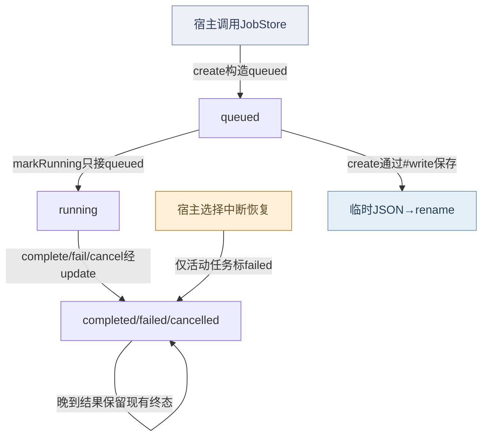
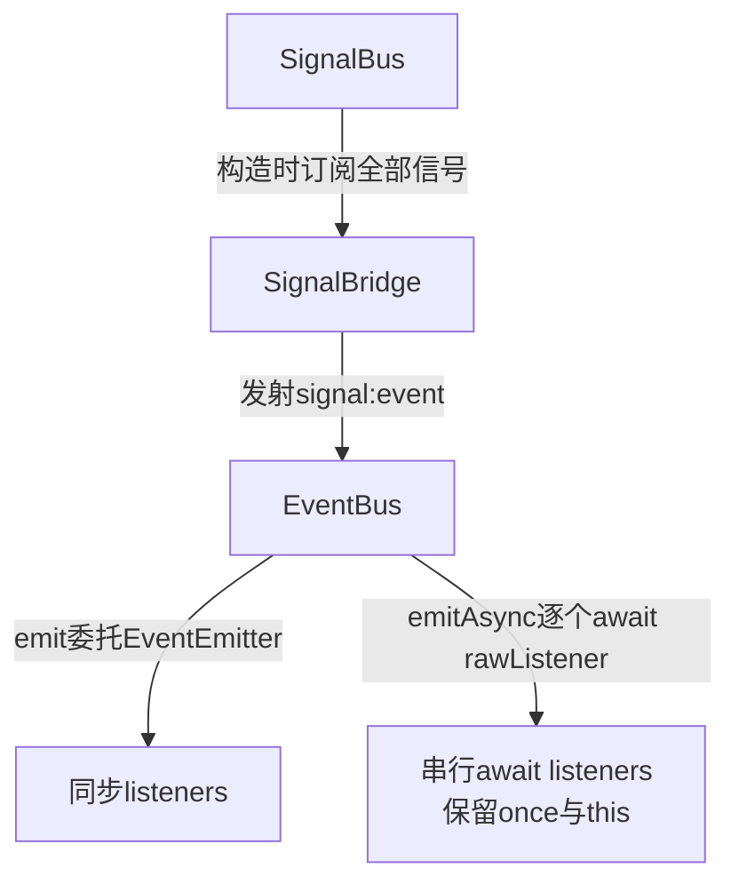
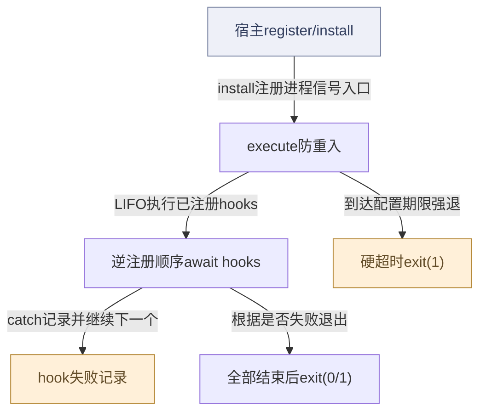
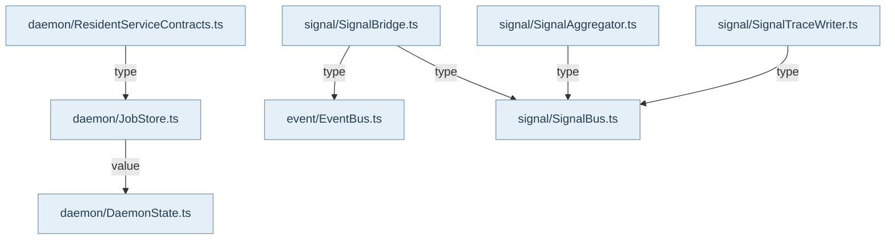

## Core保存合同与状态，宿主拥有进程

`@alembic/core/daemon`提供DaemonState、JobStore、resident/runtime capability、job process event/display snapshot等可复用结构。它不启动HTTP服务、MCP窗口或模型调用；Main/Plugin负责实际worker与路由。DaemonState解析workspace数据根及runtime路径，读取时核验state版本/必要字段；resident合同描述owner、capability、unavailable原因和恢复能力，不是一次真实服务健康探测的替代品。process event的developer view按sourceClass/display policy投射公开信息，原始provider、secret与hidden-reasoning分类不会自动进入开发者视图。

## JobStore的耐久状态

create生成queued记录并写JSON，markRunning仅接受queued，complete/fail/cancel通过update执行终态规则。终态记录不接受晚到worker覆盖；projectRoot/dataRoot/id/kind/createdAt由旧记录保留。markActiveInterrupted由宿主显式调用，把queued/running标failed并保留reason，已结束任务不改。写入采用同目录临时文件后rename，读取损坏JSON返回null；这里不能据rename推导与知识文件相同的fsync耐久承诺，也不能据单进程状态守卫推出多进程CAS。Main InfraModule真实消费JobStore，终态保护可由既有晚到worker测试定位。

## 同步事件、异步事件与可选留痕

SignalBus同步分发精确/通配订阅，隔离handler抛错；subscribe返回取消函数。SignalBridge订阅signal并投射到EventBus的signal:event和guard:updated。EventBus.emit沿Node EventEmitter同步语义返回是否有监听者，并记录有界内存历史；emitAsync使用rawListeners顺序await，保留once包装器及this绑定。两者的错误与等待语义不能混用，也都不是耐久队列。

SignalTraceWriter另将信号按类型追加JSONL，拒绝路径型type；写入失败不阻断信号。SignalAggregator按滑窗写ReportStore，dispose释放订阅；日志/trace是观测材料，不能取代业务提交结果。shutdown协调器只执行宿主已注册的hooks，LIFO、失败隔离与超时退出明确；它不凭自身存在保证所有资源都被注册或数据库已经checkpoint。Main SignalModule展示真实装配与shutdown注册，资源拥有者仍须选择stop/dispose的正确承诺。此页引用已有事件/Job测试源码，不新执行宿主进程或产品测试。

## 视图与术语

本页手工图描述已核对的关系与关键分叉；F1 也承担所列调用范围的业务纵切（V0）阅读，不能推出未画出的宿主自动调度。F0 文件依赖精选由同页选择集和 TypeScript 导入图生成，不是运行时轨迹。S0/R0 只描述正文指定的 owner、状态和恢复前提。公开 API、全部文件及变更影响见阅读器的对应入口。

`source` 为代码来源，`direct` 为直接绑定调用及断言，`indirect` 为经 helper/fixture 或间接行为的断言，`none` 为明确未覆盖。正文中的“宿主”指真实外层装配，不属于 Core 内部运行时。

## 模块协作与恢复边界深化

关闭应被理解为宿主建立的资源依赖顺序，而不是一个万能shutdown按钮。LIFO只对已register的hook生效；hook必须自行停止接收工作、等待队列、完成flush，再释放句柄，TimerRegistry.dispose放在最后且不代替排空。单hook失败不阻断后续清理，但最终exit(1)，硬超时则结束进程，未耐久工作只能交各组件自己的恢复协议。EventBus和SignalBus错误语义不同：emitAsync逐个await，首个失败终止后续；SignalBus隔离同步异常但不等待异步Promise。两种总线都不是耐久任务队列，history或JSONL也不能证明所有消费者成功。SignalAggregator.stop与dispose不同，后者解绑并丢弃窗口，若需要最后报告必须先flushNow。该专题未执行任何会退出进程的测试，也没有把内存事件fixture称为持久恢复证明。

<!-- atlas:generated:start -->

## 功能单元与调用接缝

各单元按真实入口拆分职责；门面暴露、内部调用和宿主装配是不同关系。关联图提供相邻阅读上下文，故障产生位置以条目源码为准。

<a id="m-M16-01" class="stable-anchor"></a>
<a id="宿主进程关闭协调器" class="stable-anchor"></a>

### 宿主进程关闭协调器

入口：`src/shared/shutdown.ts#ShutdownCoordinator`

| 检查项 | 功能与边界 |
| --- | --- |
| 输入 | 宿主register的hooks、install信号监听、timeout |
| 输出 | 进程退出码0/1及stderr日志 |
| 后续调用 / 绑定 | register；execute；await hook；process.exit |
| 状态与副作用 | 安装SIGTERM/SIGINT由宿主显式调用；执行LIFO并最终退出进程 |
| 能力边界 | import不自动install；无注册即无清理保证；必须先drain/flush再dispose，Core不凭空找到资源。 |

关联：[R3-HOOK · 某个已注册shutdown hook reject](README.md#f-R3-HOOK) · [R3-TIMEOUT · 关闭过程超过timeoutMs](README.md#f-R3-TIMEOUT)

<a id="m-M16-02" class="stable-anchor"></a>
<a id="timer与disposable最后清理" class="stable-anchor"></a>

### Timer与Disposable最后清理

入口：`src/shared/TimerRegistry.ts#TimerRegistryImpl`

| 检查项 | 功能与边界 |
| --- | --- |
| 输入 | 已登记timers/disposables |
| 输出 | dispose Promise与诊断计数 |
| 后续调用 / 绑定 | clearInterval/clearTimeout；Disposable.dispose |
| 状态与副作用 | 清timer、并行dispose、记录单项失败 |
| 能力边界 | 不会排空异步队列；dispose后仍允许登记但warn，后登记对象不会再被清理。 |

关联：[R3-POST-DISPOSE · TimerRegistry.dispose之后再注册timer或Disposable](README.md#f-R3-POST-DISPOSE)

<a id="m-M16-03" class="stable-anchor"></a>
<a id="同步事件与串行异步监听" class="stable-anchor"></a>

### 同步事件与串行异步监听

入口：`src/infrastructure/event/EventBus.ts#EventBus`

| 检查项 | 功能与边界 |
| --- | --- |
| 输入 | eventName与payload、listeners/once |
| 输出 | emit布尔值或emitAsync完成/拒绝 |
| 后续调用 / 绑定 | #recordEvent；super.emit；rawListeners |
| 状态与副作用 | 有界内存history；listener可有自己的副作用 |
| 能力边界 | emitAsync首个reject中止后续listener；history记录在派发前，不是所有消费者处理成功回执。 |

关联：[R3-EVENT-REJECT · emitAsync中某listener reject](README.md#f-R3-EVENT-REJECT) · 包入口 [@alembic/core](../../data/public-api.json)、[@alembic/core/events](../../data/public-api.json)

<a id="m-M16-04" class="stable-anchor"></a>
<a id="容错同步信号总线" class="stable-anchor"></a>

### 容错同步信号总线

入口：`src/infrastructure/signal/SignalBus.ts#SignalBus`

| 检查项 | 功能与边界 |
| --- | --- |
| 输入 | 结构化signal或send参数 |
| 输出 | 同步广播，无durable ack |
| 后续调用 / 绑定 | 精确订阅；通配订阅；unsubscribe函数 |
| 状态与副作用 | 内存计数、同步调用订阅者 |
| 能力边界 | 单handler异常隔离；不await async handler的Promise，不提供任务队列/重放。 |

关联：[R3-SIGNAL-HANDLER · SignalBus同步handler抛错](README.md#f-R3-SIGNAL-HANDLER) · 包入口 [@alembic/core](../../data/public-api.json)、[@alembic/core/events](../../data/public-api.json)

<a id="m-M16-05" class="stable-anchor"></a>
<a id="滑窗报告的flush与dispose" class="stable-anchor"></a>

### 滑窗报告的flush与dispose

入口：`src/infrastructure/signal/SignalAggregator.ts#SignalAggregator`

| 检查项 | 功能与边界 |
| --- | --- |
| 输入 | signal流、ReportStore、窗口/周期 |
| 输出 | 报告与异常signal、flushNow Promise |
| 后续调用 / 绑定 | timerRegistry.setInterval；ReportStore.write；#flush；dispose |
| 状态与副作用 | 内存窗口、周期写报告、取消订阅 |
| 能力边界 | stop只停timer；dispose额外解绑和清window；有待写报告应先显式flushNow。 |

关联：未声明跨项关联 · 包入口 [@alembic/core](../../data/public-api.json)、[@alembic/core/events](../../data/public-api.json)

<a id="m-M16-06" class="stable-anchor"></a>
<a id="可选jsonl信号留痕" class="stable-anchor"></a>

### 可选JSONL信号留痕

入口：`src/infrastructure/signal/SignalTraceWriter.ts#SignalTraceWriter`

| 检查项 | 功能与边界 |
| --- | --- |
| 输入 | SignalBus全量订阅、baseDir、可选WriteZone |
| 输出 | JSONL query/stats |
| 后续调用 / 绑定 | appendFileSync/WriteZone.appendFile；type单名校验 |
| 状态与副作用 | 按类型追加JSONL；查询读历史 |
| 能力边界 | 写失败静默容忍、不阻断总线；不是可靠审计提交，也未提供自动补写/订阅销毁。 |

关联：[R3-TRACE-WRITE · SignalTraceWriter追加JSONL失败](README.md#f-R3-TRACE-WRITE) · 包入口 [@alembic/core](../../data/public-api.json)、[@alembic/core/events](../../data/public-api.json)


## 生成的图与逐边依据

此区域由同页结构化图模型生成；请修改 frontmatter，再显式运行 `npm run inventory:write`，不要单独修改表格或 Mermaid。

<a id="graph-job-terminal-protection"></a>

### 作业状态与晚到结果保护

图 ID：`job-terminal-protection` · S0 · Core保存job状态和终态保护，宿主显式执行worker与重启恢复。



| 边 ID | 关系 | 源码定位 | 断言关系 | case / 缺口 | 相关旅程步骤 |
| --- | --- | --- | --- | --- | --- |
| <a id="e-job-terminal-protection--JB-01"></a>JB-01 | create构造queued | `src/daemon/JobStore.ts#JobStore` | direct | persists daemon jobs and lists newest first |  |
| <a id="e-job-terminal-protection--JB-02"></a>JB-02 | markRunning只接queued | `src/daemon/JobStore.ts#JobStore` | direct | persists daemon jobs and lists newest first |  |
| <a id="e-job-terminal-protection--JB-03"></a>JB-03 | complete/fail/cancel经update | `src/daemon/JobStore.ts#JobStore` | direct | persists daemon jobs and lists newest first |  |
| <a id="e-job-terminal-protection--JB-04"></a>JB-04 | 晚到结果保留现有终态 | `src/daemon/JobStore.ts#JobStore` | direct | does not allow terminal jobs to be overwritten by late workers |  |
| <a id="e-job-terminal-protection--JB-05"></a>JB-05 | 仅活动任务标failed | `src/daemon/JobStore.ts#JobStore` | direct | marks queued and running jobs interrupted without touching terminal jobs |  |
| <a id="e-job-terminal-protection--JB-06"></a>JB-06 | create通过#write保存 | `src/daemon/JobStore.ts#JobStore` | direct | persists daemon jobs and lists newest first |  |

<a id="graph-events-signals-waiting"></a>

### 信号桥接与事件等待语义

图 ID：`events-signals-waiting` · F1 · 订阅绑定与实际发射分别标注；同步emit与串行await的emitAsync是两种消费承诺。



| 边 ID | 关系 | 源码定位 | 断言关系 | case / 缺口 | 相关旅程步骤 |
| --- | --- | --- | --- | --- | --- |
| <a id="e-events-signals-waiting--EV-01"></a>EV-01 | 构造时订阅全部信号 | `src/infrastructure/signal/SignalBridge.ts#SignalBridge` | direct | SignalBridge forwards signal events into EventBus channels |  |
| <a id="e-events-signals-waiting--EV-02"></a>EV-02 | 发射signal:event | `src/infrastructure/signal/SignalBridge.ts#SignalBridge` | direct | SignalBridge forwards signal events into EventBus channels |  |
| <a id="e-events-signals-waiting--EV-03"></a>EV-03 | emit委托EventEmitter | `src/infrastructure/event/EventBus.ts#EventBus` | indirect | should deliver events to listeners |  |
| <a id="e-events-signals-waiting--EV-04"></a>EV-04 | emitAsync逐个await rawListener | `src/infrastructure/event/EventBus.ts#EventBus` | indirect | should await all async listeners |  |

<a id="graph-r3-shutdown-resource-ownership"></a>

### 关闭hook的顺序、失败隔离与强退

图 ID：`r3-shutdown-resource-ownership` · R0 · 这里只画shutdown真实执行；TimerRegistry/DB/vector必须由宿主注册合适hook，不虚构自动发现或调用。



| 边 ID | 关系 | 源码定位 | 断言关系 | case / 缺口 | 相关旅程步骤 |
| --- | --- | --- | --- | --- | --- |
| <a id="e-r3-shutdown-resource-ownership--R3-E1"></a>R3-E1 | install注册进程信号入口 | `src/shared/shutdown.ts#ShutdownCoordinator` | none | 未执行进程信号测试。 |  |
| <a id="e-r3-shutdown-resource-ownership--R3-E2"></a>R3-E2 | LIFO执行已注册hooks | `src/shared/shutdown.ts#ShutdownCoordinator` | none | 无隔离子进程LIFO实跑证据。 |  |
| <a id="e-r3-shutdown-resource-ownership--R3-E3"></a>R3-E3 | catch记录并继续下一个 | `src/shared/shutdown.ts#ShutdownCoordinator` | none | 无hook reject实际退出case。 |  |
| <a id="e-r3-shutdown-resource-ownership--R3-E4"></a>R3-E4 | 根据是否失败退出 | `src/shared/shutdown.ts#ShutdownCoordinator` | none | 源码执行语义，不主张本轮运行过。 |  |
| <a id="e-r3-shutdown-resource-ownership--R3-E5"></a>R3-E5 | 到达配置期限强退 | `src/shared/shutdown.ts#ShutdownCoordinator` | none | 未执行强退测试。 |  |

<a id="graph-dependencies-16"></a>

### 文件依赖精选 · 静态关系

图 ID：`dependencies-16` · F0 · 显式选择集内的实际导入；类型边不代表运行调用，动态未知保留在全量索引。



| 边 ID | 关系 | 源码定位 | 断言关系 | case / 缺口 | 相关旅程步骤 |
| --- | --- | --- | --- | --- | --- |
| <a id="e-dependencies-16--dep-16-0"></a>dep-16-0 | value | `src/daemon/JobStore.ts#<module>` | none | TypeScript AST 静态导入事实，不主张运行调用或断言覆盖。 |  |
| <a id="e-dependencies-16--dep-16-1"></a>dep-16-1 | type | `src/daemon/ResidentServiceContracts.ts#<module>` | none | TypeScript AST 静态导入事实，不主张运行调用或断言覆盖。 |  |
| <a id="e-dependencies-16--dep-16-2"></a>dep-16-2 | type | `src/infrastructure/signal/SignalAggregator.ts#<module>` | none | TypeScript AST 静态导入事实，不主张运行调用或断言覆盖。 |  |
| <a id="e-dependencies-16--dep-16-3"></a>dep-16-3 | type | `src/infrastructure/signal/SignalBridge.ts#<module>` | none | TypeScript AST 静态导入事实，不主张运行调用或断言覆盖。 |  |
| <a id="e-dependencies-16--dep-16-4"></a>dep-16-4 | type | `src/infrastructure/signal/SignalBridge.ts#<module>` | none | TypeScript AST 静态导入事实，不主张运行调用或断言覆盖。 |  |
| <a id="e-dependencies-16--dep-16-5"></a>dep-16-5 | type | `src/infrastructure/signal/SignalTraceWriter.ts#<module>` | none | TypeScript AST 静态导入事实，不主张运行调用或断言覆盖。 |  |

## 失败后的状态与恢复责任

先检查已落盘状态，再决定恢复。自动动作只描述代码已执行的分支；显式恢复不能据提示文字推断为自动调用。

<a id="f-R3-HOOK" class="stable-anchor"></a>
<a id="r3-hook--某个已注册shutdown-hook-reject" class="stable-anchor"></a>

### R3-HOOK · 某个已注册shutdown hook reject

| 检查项 | 当前代码语义 |
| --- | --- |
| 已留下什么 | 之前关闭的资源不会重开；失败资源可能未清 |
| Core自动做什么 | 记录失败，继续剩余LIFO hooks，最终exit(1) |
| 谁显式恢复 | 宿主下次启动检查业务持久化和失败资源，修正hook；当前进程无自动重试该hook |
| 必须停止的条件 | 所有hooks完成或硬超时后退出；不能报全部清理成功 |
| 源码定位 | `src/shared/shutdown.ts#ShutdownCoordinator` |

```ts
hasFailure = true;
```

关联：[宿主进程关闭协调器](README.md#m-M16-01)

断言关系：**none**。未见实际隔离子进程的shutdown失败case；不能用singleton存在测试替代执行。

<a id="f-R3-TIMEOUT" class="stable-anchor"></a>
<a id="r3-timeout--关闭过程超过timeoutms" class="stable-anchor"></a>

### R3-TIMEOUT · 关闭过程超过timeoutMs

| 检查项 | 当前代码语义 |
| --- | --- |
| 已留下什么 | 未完成hook/队列可能仍有未确认写入 |
| Core自动做什么 | 硬timer调用process.exit(1) |
| 谁显式恢复 | 下次启动按各组件持久恢复协议检查WAL/job等；不保证自动补全所有队列 |
| 必须停止的条件 | 进程强退不可在同进程恢复；只保留已耐久证据 |
| 源码定位 | `src/shared/shutdown.ts#ShutdownCoordinator` |

```ts
process.stderr.write('[shutdown] Timeout reached, forcing exit\n');
```

关联：[宿主进程关闭协调器](README.md#m-M16-01)

断言关系：**none**。未运行子进程超时退出测试，源码边界明确。

<a id="f-R3-EVENT-REJECT" class="stable-anchor"></a>
<a id="r3-event-reject--emitasync中某listener-reject" class="stable-anchor"></a>

### R3-EVENT-REJECT · emitAsync中某listener reject

| 检查项 | 当前代码语义 |
| --- | --- |
| 已留下什么 | history已记录该事件；前面listener可能完成，后面未运行 |
| Core自动做什么 | Promise reject传播给调用方；不catch并继续剩余listener |
| 谁显式恢复 | 宿主按幂等性判断是否重发/补偿，不能默认整个事件未消费 |
| 必须停止的条件 | 在首个reject停止串行派发；无自动重放 |
| 源码定位 | `src/infrastructure/event/EventBus.ts#EventBus` |

```ts
await listener.apply(this, args);
```

关联：[同步事件与串行异步监听](README.md#m-M16-03) · 包入口 [@alembic/core](../../data/public-api.json)、[@alembic/core/events](../../data/public-api.json)

断言关系：**none**。现有测试验证串行/once正例；未定位reject后续不执行的明确case。

<a id="f-R3-SIGNAL-HANDLER" class="stable-anchor"></a>
<a id="r3-signal-handler--signalbus同步handler抛错" class="stable-anchor"></a>

### R3-SIGNAL-HANDLER · SignalBus同步handler抛错

| 检查项 | 当前代码语义 |
| --- | --- |
| 已留下什么 | 其他订阅者仍可消费；失败者副作用未知 |
| Core自动做什么 | catch隔离并继续精确/通配handler |
| 谁显式恢复 | 消费者自己记录失败和决定重试；总线无耐久重放 |
| 必须停止的条件 | 异常不外抛不等于所有订阅者处理成功 |
| 源码定位 | `src/infrastructure/signal/SignalBus.ts#SignalBus` |

```ts
handler(signal);
```

关联：[容错同步信号总线](README.md#m-M16-04) · 包入口 [@alembic/core](../../data/public-api.json)、[@alembic/core/events](../../data/public-api.json)

断言关系：**indirect**。`test/SignalBus.test.ts` · `handler error does not block other handlers`

精确订阅者之一抛错，另一个仍被调用（fallback）。这里只定位断言；实际运行范围见独立运行证据。

```ts
expect(goodHandler).toHaveBeenCalledOnce();
```

<a id="f-R3-POST-DISPOSE" class="stable-anchor"></a>
<a id="r3-post-dispose--timerregistrydispose之后再注册timer或disposable" class="stable-anchor"></a>

### R3-POST-DISPOSE · TimerRegistry.dispose之后再注册timer或Disposable

| 检查项 | 当前代码语义 |
| --- | --- |
| 已留下什么 | 新资源被创建/登记，但registry已处disposed |
| Core自动做什么 | 输出稳定diagnostic，保持兼容创建行为 |
| 谁显式恢复 | 宿主修正关闭顺序，自己清理晚到资源；后续dispose会立即return |
| 必须停止的条件 | 不能指望再次dispose兜底回收 |
| 源码定位 | `src/shared/TimerRegistry.ts#TimerRegistryImpl` |

```ts
`${operation}("${label}") after dispose() — it will not be cleaned up\n`
```

关联：[Timer与Disposable最后清理](README.md#m-M16-02)

断言关系：**none**。本次未见后登记资源真实回收行为case；源码已明确只诊断。

<a id="f-R3-TRACE-WRITE" class="stable-anchor"></a>
<a id="r3-trace-write--signaltracewriter追加jsonl失败" class="stable-anchor"></a>

### R3-TRACE-WRITE · SignalTraceWriter追加JSONL失败

| 检查项 | 当前代码语义 |
| --- | --- |
| 已留下什么 | 总线已派发，缺失该次耐久trace |
| Core自动做什么 | catch吞错，不阻断signal；不排队补写 |
| 谁显式恢复 | 宿主诊断文件系统并明确记录日志缺口，不能从query空集推断无事件 |
| 必须停止的条件 | 没有自动恢复该丢失trace的保证 |
| 源码定位 | `src/infrastructure/signal/SignalTraceWriter.ts#SignalTraceWriter` |

```ts
fs.appendFileSync(fileName, line, 'utf8');
```

关联：[可选JSONL信号留痕](README.md#m-M16-06) · 包入口 [@alembic/core](../../data/public-api.json)、[@alembic/core/events](../../data/public-api.json)

断言关系：**none**。已有真实JSONL成功查询测试不覆盖写入失败；不把catch当可靠日志。


<!-- atlas:generated:end -->
