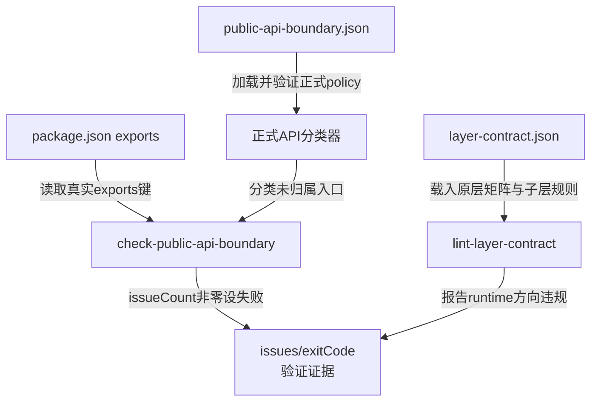
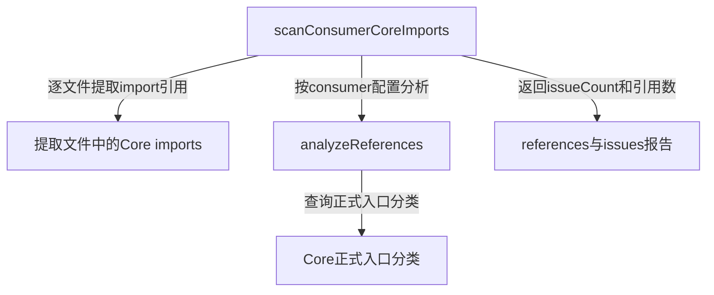
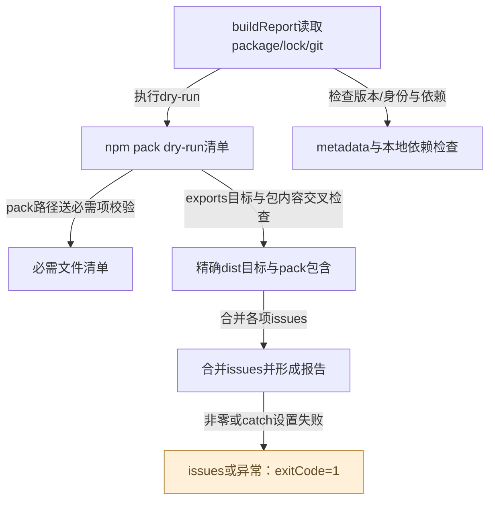
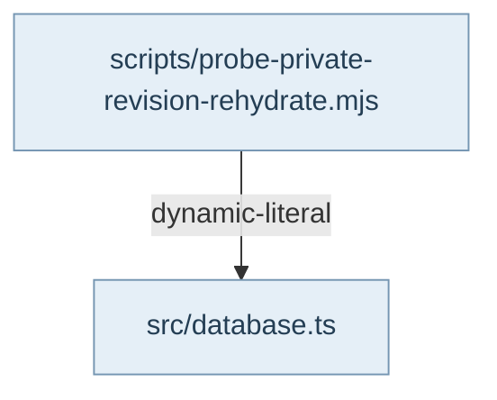

## 包入口与层规则是不同合同

package.json的exports定义外层可解析的长期入口；config/public-api-boundary.json给这些入口分类为stable-public、provisional-public或transitional-internal，并约束收缩、删除入口复活、归属、弃用与审阅日期。scripts/public-api-boundary-policy.mjs是正式分类器，check-public-api-boundary读取真实exports与policy生成issues，非零issueCount返回失败。默认运行只读；--record-trend是显式写policy历史的另外动作。Atlas可以展示入口与分类，却不能修改这些权威文件来让图谱通过。

config/layer-contract.json规定allowedRuntimeImports、typeOnly豁免、逐文件blessed例外及更细subAreaRules。lint-layer-contract扫描src的导入并按这些规则报告，类型桥通常豁免，但某些子层规则明确includeTypeOnly，不能用“type-only”一律逃避语法/事实/链接分层。其现有扫描器以语句pattern为主，和Atlas新增TypeScript Compiler API静态投影应各自标清能力；不同工具结果不自动成为新架构权威。

## 消费者、产物与发布证据

lint-consumer-core-imports-all依正式consumer表调用单仓扫描器，消费Alembic、AlembicAgent、AlembicPlugin各自配置。缺仓或缺配置会明确skipped，真实扫描失败或issues非零才使门失败；skip绝不代表下游已验证。Main和Agent的allowlist/referenceLimits是真实接入预算，不是Atlas自行合成的依赖方向。smoke-public-api检查构建声明与值入口，CorePackage和公共API测试验证稳定门面，四项Core边界测试阻止delivery/tool/agent/Codex/MCP等运行时职责混入源码或exports。

wire、故障taxonomy、结果预算、旧字段兼容和命名/退役符号也有各自脚本及测试。构建、类型检查、lint和Vitest分别验证不同性质；通过其中一个不能推导图文语义正确、外层完整接通或发布成功。dist是ignored产物，root npm files白名单决定发布内容；这个独立Atlas应在自己的package与.build中生成阅读产物。

## 维护时怎样解释证据

本专题是验证责任图，箭头代表配置输入、检查与报告，不表示产品运行时执行这些开发脚本。这里引用的是现有脚本实现与既有测试断言，产品测试结果保留原运行时间。Atlas的来源指纹、图渲染回执与浏览器检查只证明自己的来源/阅读面；没有重新运行的产品门必须明确写未运行，不能借静态“当前”标签刷新历史验证。更改API或层矩阵仍需遵守Core原有兼容与真实消费者规则，本次不改变产品合同。

## 视图与术语

本页手工图描述已核对的关系与关键分叉；F1 也承担所列调用范围的业务纵切（V0）阅读，不能推出未画出的宿主自动调度。F0 文件依赖精选由同页选择集和 TypeScript 导入图生成，不是运行时轨迹。S0/R0 只描述正文指定的 owner、状态和恢复前提。公开 API、全部文件及变更影响见阅读器的对应入口。

`source` 为代码来源，`direct` 为直接绑定调用及断言，`indirect` 为经 helper/fixture 或间接行为的断言，`none` 为明确未覆盖。正文中的“宿主”指真实外层装配，不属于 Core 内部运行时。

## 模块协作与恢复边界深化

验证链也有调用和失败恢复责任。smoke与预算门消费dist，release-readiness再消费npm pack dry-run清单；源码类型检查通过不代表构建声明存在，更不代表声明进入发布包。API政策门和层矩阵门回答允许什么，smoke回答可以导入什么，产品测试才回答所断言的行为。图谱本身的静态证据与阅读器验证是另外两轴。

release-readiness并不发布。它组合元数据、依赖、必需文件与精确export检查，issues非零时退出失败，异常同样失败。wildcard目标在逐文件段跳过，因此通过不能外推每一个通配实例都检查过；dirty工作区被报告而不单独形成issue。修复应回到相应构建/包合同owner，不能让文档脚本改源码或发布政策。

输出预算与归档helper刻意只提供可复用合同。一个artifact-ref字符串不会保存原payload，一个非空archiveRef也不会被此函数读盘验证。恢复能力应由实际生产和消费这些引用的宿主验证；本轮没有调用发布、重置或修改外层接线。

<!-- atlas:generated:start -->

## 功能单元与调用接缝

各单元按真实入口拆分职责；门面暴露、内部调用和宿主装配是不同关系。关联图提供相邻阅读上下文，故障产生位置以条目源码为准。

<a id="m-M17-01" class="stable-anchor"></a>
<a id="api政策门分组归属与收缩检查" class="stable-anchor"></a>

### API政策门：分组、归属与收缩检查

入口：`scripts/check-public-api-boundary.mjs#buildReport`

| 检查项 | 功能与边界 |
| --- | --- |
| 输入 | 真实exports、正式policy、构建后可导入门面 |
| 输出 | 分类、closeout和issues报告 |
| 后续调用 / 绑定 | classifier → resurrection/ownership/deprecation/reviewBy/narrowness/trend检查 |
| 状态与副作用 | 默认只读；仅--record-trend显式写政策趋势 |
| 能力边界 | 分类正常不证明值实现正确；narrowness需当前dist，缺产物应解决构建而非删门禁。 |

关联：未声明跨项关联

<a id="m-M17-02" class="stable-anchor"></a>
<a id="消费者import门引用与预算" class="stable-anchor"></a>

### 消费者import门：引用与预算

入口：`scripts/lint-consumer-core-imports.mjs#scanConsumerCoreImports`

| 检查项 | 功能与边界 |
| --- | --- |
| 输入 | consumer root/config与扫描文件 |
| 输出 | references及issues/issueCount |
| 后续调用 / 绑定 | extractCoreImports → analyzeReferences → classifyCoreImportSpecifier |
| 状态与副作用 | 读取外层源码与配置；不修改外层接线 |
| 能力边界 | 缺仓/缺配置的聚合skip不等于通过；不跨仓自动修复导入。 |

关联：[F17-consumer-reference · 扫描到consumer不允许的Core入口](README.md#f-F17-consumer-reference)

<a id="m-M17-03" class="stable-anchor"></a>
<a id="层矩阵门运行依赖方向" class="stable-anchor"></a>

### 层矩阵门：运行依赖方向

入口：`scripts/lint-layer-contract.mjs#main`

| 检查项 | 功能与边界 |
| --- | --- |
| 输入 | layer-contract与src import语句 |
| 输出 | runtime/type-only/子层违规列表 |
| 后续调用 / 绑定 | loadConfig → 文件扫描 → area/subArea判定 |
| 状态与副作用 | 只读检查，失败退出供调用者处理 |
| 能力边界 | blessed例外和includeTypeOnly是正式政策；Atlas AST图不能替代该政策。 |

关联：未声明跨项关联

<a id="m-M17-04" class="stable-anchor"></a>
<a id="公共smoke值与声明可导入" class="stable-anchor"></a>

### 公共smoke：值与声明可导入

入口：`scripts/smoke-public-api.mjs#<module>`

| 检查项 | 功能与边界 |
| --- | --- |
| 输入 | 当前dist、package exports、必需/禁止符号表 |
| 输出 | 精确入口导入与声明检查结果 |
| 后续调用 / 绑定 | dynamic import → 值键检查 → TypeScript declaration checker |
| 状态与副作用 | 实际加载dist；不启动完整业务流程 |
| 能力边界 | 只证明可导入和声明，不证明持久化/查询行为；缺构建不可用旧产物冒充本轮源码。 |

关联：未声明跨项关联

<a id="m-M17-05" class="stable-anchor"></a>
<a id="预算与归档共享投影合同" class="stable-anchor"></a>

### 预算与归档：共享投影合同

入口：`src/shared/OutputBudget.ts#applyOutputBudget`

| 检查项 | 功能与边界 |
| --- | --- |
| 输入 | 预算名/payload与reset报告 |
| 输出 | 截断信息或归档声明拒绝 |
| 后续调用 / 绑定 | applyOutputBudget / assertDestructiveResetHasArchive；check-output-budgets另作开发自检 |
| 状态与副作用 | 纯函数不存artifact也不删除/归档数据 |
| 能力边界 | archiveRef非空只通过结构门，不验证目标实际存在；不同字节/字符预算不可混用。 |

关联：[F17-overflow-route · 有预算的结果超限，或未知预算名导致未限制](README.md#f-F17-overflow-route) · 包入口 [@alembic/core](../../data/public-api.json)

<a id="m-M17-06" class="stable-anchor"></a>
<a id="release-readiness打包输入审阅" class="stable-anchor"></a>

### release-readiness：打包输入审阅

入口：`scripts/check-release-readiness.mjs#buildReport`

| 检查项 | 功能与边界 |
| --- | --- |
| 输入 | package/lock、git身份、当前dist和npm pack dry-run清单 |
| 输出 | issueCount、包名/大小/版本/源码commit |
| 后续调用 / 绑定 | metadata → dependency → required entries → export目标检查 |
| 状态与副作用 | 执行npm pack --dry-run与只读git探测；临时npm cache，不发布 |
| 能力边界 | 精确export逐文件检查；wildcard逐实例跳过；dirty记录本身不等于门失败。 |

关联：未声明跨项关联


## 生成的图与逐边依据

此区域由同页结构化图模型生成；请修改 frontmatter，再显式运行 `npm run inventory:write`，不要单独修改表格或 Mermaid。

<a id="graph-verification-authority-inputs"></a>

### 包边界与层规则的验证输入

图 ID：`verification-authority-inputs` · E0 · 图示开发检查的配置输入和结果；不表示这些脚本是Core产品运行链的一部分。



| 边 ID | 关系 | 源码定位 | 断言关系 | case / 缺口 | 相关旅程步骤 |
| --- | --- | --- | --- | --- | --- |
| <a id="e-verification-authority-inputs--CT-01"></a>CT-01 | 加载并验证正式policy | `scripts/public-api-boundary-policy.mjs#loadPublicApiBoundaryPolicy` | none | PublicApiInventory直接测试正式classifier，但未调用check-public-api-boundary.buildReport；相近投影断言不能冒充此脚本调用边的间接覆盖。 |  |
| <a id="e-verification-authority-inputs--CT-02"></a>CT-02 | 读取真实exports键 | `scripts/check-public-api-boundary.mjs#buildReport` | none | PublicApiInventory直接测试正式classifier，但未调用check-public-api-boundary.buildReport；相近投影断言不能冒充此脚本调用边的间接覆盖。 |  |
| <a id="e-verification-authority-inputs--CT-03"></a>CT-03 | 分类未归属入口 | `scripts/check-public-api-boundary.mjs#buildReport` | none | PublicApiInventory直接测试正式classifier，但未调用check-public-api-boundary.buildReport；相近投影断言不能冒充此脚本调用边的间接覆盖。 |  |
| <a id="e-verification-authority-inputs--CT-04"></a>CT-04 | issueCount非零设失败 | `scripts/check-public-api-boundary.mjs#main` | none | 源码确定检查退出逻辑；本页没有新执行CLI，也没有把inventory unit case冒充CLI失败路径测试。 |  |
| <a id="e-verification-authority-inputs--CT-05"></a>CT-05 | 载入原层矩阵与子层规则 | `scripts/lint-layer-contract.mjs#main` | none | 配置输入由源码锚定；本次不新增或执行产品layer门。 |  |
| <a id="e-verification-authority-inputs--CT-06"></a>CT-06 | 报告runtime方向违规 | `scripts/lint-layer-contract.mjs#main` | none | 源码明确产生违规；未在本次图谱实现中执行产品反例。 |  |

<a id="graph-consumer-import-verification"></a>

### 消费者import扫描与策略判定

图 ID：`consumer-import-verification` · E0 · 该开发工具读取消费者源码与配置，不执行消费者产品业务。



| 边 ID | 关系 | 源码定位 | 断言关系 | case / 缺口 | 相关旅程步骤 |
| --- | --- | --- | --- | --- | --- |
| <a id="e-consumer-import-verification--CI-01"></a>CI-01 | 逐文件提取import引用 | `scripts/lint-consumer-core-imports.mjs#scanConsumerCoreImports` | direct | multi-line named imports are counted (the previous blind spot) |  |
| <a id="e-consumer-import-verification--CI-02"></a>CI-02 | 按consumer配置分析 | `scripts/lint-consumer-core-imports.mjs#scanConsumerCoreImports` | direct | multi-line named imports are counted (the previous blind spot) |  |
| <a id="e-consumer-import-verification--CI-03"></a>CI-03 | 查询正式入口分类 | `scripts/lint-consumer-core-imports.mjs#analyzeReferences` | indirect | multi-line named imports are counted (the previous blind spot) |  |
| <a id="e-consumer-import-verification--CI-04"></a>CI-04 | 返回issueCount和引用数 | `scripts/lint-consumer-core-imports.mjs#scanConsumerCoreImports` | direct | multi-line named imports are counted (the previous blind spot) |  |

<a id="graph-r3-release-readiness-gates"></a>

### 从源码与打包清单到发布准备报告

图 ID：`r3-release-readiness-gates` · E0 · 开发检查流程：dry-run不是发布；精确export检查、必需资源和政策输入分别形成issues。



| 边 ID | 关系 | 源码定位 | 断言关系 | case / 缺口 | 相关旅程步骤 |
| --- | --- | --- | --- | --- | --- |
| <a id="e-r3-release-readiness-gates--r3-release-pack"></a>r3-release-pack | 执行dry-run | `scripts/check-release-readiness.mjs#buildReport` | none | 本边为发布检查脚本调用/数据关系；本轮只审阅实现，未执行发布门或注入CLI反例，不借相近单元测试推导覆盖。 |  |
| <a id="e-r3-release-readiness-gates--r3-release-metadata"></a>r3-release-metadata | 检查版本/身份与依赖 | `scripts/check-release-readiness.mjs#buildReport` | none | 本边为发布检查脚本调用/数据关系；本轮只审阅实现，未执行发布门或注入CLI反例，不借相近单元测试推导覆盖。 |  |
| <a id="e-r3-release-readiness-gates--r3-release-entries"></a>r3-release-entries | pack路径送必需项校验 | `scripts/check-release-readiness.mjs#buildReport` | none | 本边为发布检查脚本调用/数据关系；本轮只审阅实现，未执行发布门或注入CLI反例，不借相近单元测试推导覆盖。 |  |
| <a id="e-r3-release-readiness-gates--r3-release-exports"></a>r3-release-exports | exports目标与包内容交叉检查 | `scripts/check-release-readiness.mjs#buildReport` | none | 本边为发布检查脚本调用/数据关系；本轮只审阅实现，未执行发布门或注入CLI反例，不借相近单元测试推导覆盖。 |  |
| <a id="e-r3-release-readiness-gates--r3-release-merge"></a>r3-release-merge | 合并各项issues | `scripts/check-release-readiness.mjs#buildReport` | none | 本边为发布检查脚本调用/数据关系；本轮只审阅实现，未执行发布门或注入CLI反例，不借相近单元测试推导覆盖。 |  |
| <a id="e-r3-release-readiness-gates--r3-release-exit"></a>r3-release-exit | 非零或catch设置失败 | `scripts/check-release-readiness.mjs#<module>` | none | 本边为发布检查脚本调用/数据关系；本轮只审阅实现，未执行发布门或注入CLI反例，不借相近单元测试推导覆盖。 |  |

<a id="graph-dependencies-17"></a>

### 文件依赖精选 · 静态关系

图 ID：`dependencies-17` · F0 · 显式选择集内的实际导入；类型边不代表运行调用，动态未知保留在全量索引。



| 边 ID | 关系 | 源码定位 | 断言关系 | case / 缺口 | 相关旅程步骤 |
| --- | --- | --- | --- | --- | --- |
| <a id="e-dependencies-17--dep-17-0"></a>dep-17-0 | dynamic-literal | `scripts/probe-private-revision-rehydrate.mjs#<module>` | none | TypeScript AST 静态导入事实，不主张运行调用或断言覆盖。 |  |

## 失败后的状态与恢复责任

先检查已落盘状态，再决定恢复。自动动作只描述代码已执行的分支；显式恢复不能据提示文字推断为自动调用。

<a id="f-F17-dist-unavailable" class="stable-anchor"></a>
<a id="f17-dist-unavailable--预算门无法import当前dist模块" class="stable-anchor"></a>

### F17-dist-unavailable · 预算门无法import当前dist模块

| 检查项 | 当前代码语义 |
| --- | --- |
| 已留下什么 | 源码与旧构建保持原状；未执行预算自检 |
| Core自动做什么 | 记录先build提示并exit(1) |
| 谁显式恢复 | 维护者按当前源码build后重跑；需核对后续门确实消费新产物 |
| 必须停止的条件 | 构建未就绪不能把检查缺席报成通过 |
| 源码定位 | `scripts/check-output-budgets.mjs#<module>` |

```ts
await import('../dist/shared/OutputBudget.js').catch((err) => {
```

关联：未声明跨项关联

断言关系：**none**。本次未删除dist执行故障；只锚定脚本明确失败路径。

<a id="f-F17-api-issues" class="stable-anchor"></a>
<a id="f17-api-issues--未分类复活归属弃用预算等产生issue" class="stable-anchor"></a>

### F17-api-issues · 未分类/复活/归属/弃用/预算等产生issue

| 检查项 | 当前代码语义 |
| --- | --- |
| 已留下什么 | 政策与exports不会自动被脚本修正 |
| Core自动做什么 | main输出报告，issueCount>0设置失败exitCode |
| 谁显式恢复 | 维护者识别真实不兼容或政策变更并按授权解决，再跑同门 |
| 必须停止的条件 | 不得调大预算或删除规则只为清零 |
| 源码定位 | `scripts/check-public-api-boundary.mjs#main` |

```ts
if (report.issueCount > 0) {
```

关联：未声明跨项关联

断言关系：**none**。源码确定检查退出逻辑；本页没有新执行CLI，也没有把inventory unit case冒充CLI失败路径测试。

<a id="f-F17-consumer-reference" class="stable-anchor"></a>
<a id="f17-consumer-reference--扫描到consumer不允许的core入口" class="stable-anchor"></a>

### F17-consumer-reference · 扫描到consumer不允许的Core入口

| 检查项 | 当前代码语义 |
| --- | --- |
| 已留下什么 | 外层原代码保留，报告引用位置与违规 |
| Core自动做什么 | analyzeReferences收集issues；未执行代码改写 |
| 谁显式恢复 | 由对应外层owner选择合法稳定门面并验证接入；本窗口只记录Core边界 |
| 必须停止的条件 | consumer缺失或skip不可视为已完成下游验证 |
| 源码定位 | `scripts/lint-consumer-core-imports.mjs#scanConsumerCoreImports` |

```ts
const issues = analyzeReferences(references, config);
```

关联：[消费者import门：引用与预算](README.md#m-M17-02)

断言关系：**direct**。`test/ConsumerImportScannerMultiline.test.ts` · `multi-line named imports are counted (the previous blind spot)`

case直接扫描临时源码fixture，多行非stable import被提取并报告一个issue（positive）。这里只定位断言；实际运行范围见独立运行证据。

```ts
expect(result.issues).toHaveLength(1);
```

<a id="f-F17-missing-export-artifact" class="stable-anchor"></a>
<a id="f17-missing-export-artifact--精确export目标缺dist文件或未进入npm-pack清单" class="stable-anchor"></a>

### F17-missing-export-artifact · 精确export目标缺dist文件或未进入npm pack清单

| 检查项 | 当前代码语义 |
| --- | --- |
| 已留下什么 | 当前包清单不完整；原文件/声明保留 |
| Core自动做什么 | 收集missing-dist-export-file或missing-pack-export-file并使发布检查失败 |
| 谁显式恢复 | 维护者修复构建、files白名单或真实导出合同后重新dry-run；不靠Atlas补产物 |
| 必须停止的条件 | 精确入口不可用时停止发布准备 |
| 源码定位 | `scripts/check-release-readiness.mjs#collectExportIssues` |

```ts
kind: 'missing-pack-export-file',
```

关联：未声明跨项关联

断言关系：**none**。本边为发布检查脚本调用/数据关系；本轮只审阅实现，未执行发布门或注入CLI反例，不借相近单元测试推导覆盖。

<a id="f-F17-retention-without-ref" class="stable-anchor"></a>
<a id="f17-retention-without-ref--reset删除数量大于0且声称保留但archiveref为空" class="stable-anchor"></a>

### F17-retention-without-ref · reset删除数量大于0且声称保留但archiveRef为空

| 检查项 | 当前代码语义 |
| --- | --- |
| 已留下什么 | 该helper不知道删除是否已发生；不会恢复数据 |
| Core自动做什么 | 抛错误阻止该保留声明通过结构门 |
| 谁显式恢复 | 真正执行reset的owner先确保可读归档并传ref，或诚实说明未保留；此helper不能事后制造备份 |
| 必须停止的条件 | 结构检查通过仍需真实归档证据 |
| 源码定位 | `src/shared/OutputBudget.ts#assertDestructiveResetHasArchive` |

```ts
if (report.removedCount > 0 && report.claimsRetention && !report.archiveRef) {
```

关联：未声明跨项关联 · 包入口 [@alembic/core](../../data/public-api.json)

断言关系：**direct**。`test/OutputBudget.test.ts` · `NEGATIVE: a retention-claiming destructive reset with no archive throws`

明确删除且声称保留但无archiveRef会抛错；测试不验证备份文件实际存在。（negative）。这里只定位断言；实际运行范围见独立运行证据。

```ts
).toThrow(/no archiveRef/);
```

<a id="f-F17-overflow-route" class="stable-anchor"></a>
<a id="f17-overflow-route--有预算的结果超限或未知预算名导致未限制" class="stable-anchor"></a>

### F17-overflow-route · 有预算的结果超限，或未知预算名导致未限制

| 检查项 | 当前代码语义 |
| --- | --- |
| 已留下什么 | 返回可能为截断前缀；未知名则整段保留 |
| Core自动做什么 | 已知预算按UTF-8边界截断；未知名不自动套默认预算 |
| 谁显式恢复 | 调用者核对预算名并提供全量内容真实访问方式；是否完整需读truncated和overflow |
| 必须停止的条件 | 不能把truncated=false解释为任何名称都满足统一上限 |
| 源码定位 | `src/shared/OutputBudget.ts#applyOutputBudget` |

```ts
route: options.route ?? 'artifact-ref',
```

关联：[预算与归档：共享投影合同](README.md#m-M17-05) · 包入口 [@alembic/core](../../data/public-api.json)

断言关系：**direct**。`test/OutputBudget.test.ts` · `over-budget payloads are truncated with truncated:true and an overflow route`

超预算返回截断标记、实际省略字节和调用者提供的artifactRef；本例不证明引用文件被创建。（positive）。这里只定位断言；实际运行范围见独立运行证据。

```ts
expect(result.truncated).toBe(true);
```


<!-- atlas:generated:end -->
